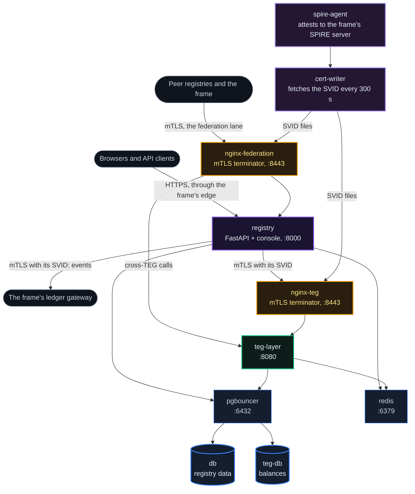
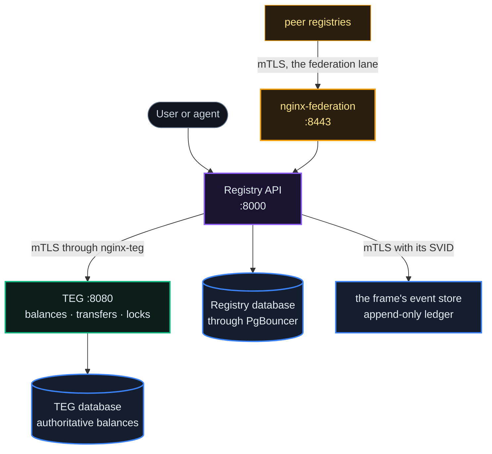
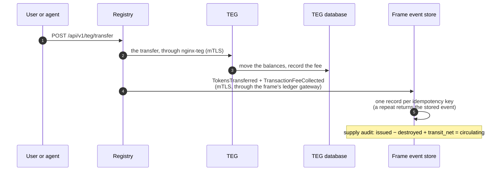

# Architecture: System Topology and Design

**Audience**: anyone who runs a registry: a cloud operator, a standalone registry or a frame
**Checked against the source**: 2026-10-16 (the frame kit 1.0.0-beta.20: the operator compose in
`scripts/distribution/nginx-templates/`, `scripts/distribution/docker-compose.standalone.yml` and the frame template in
`templates/frame-test/`; the registry, the TEG and the event store as released)

Every registry runs the same three applications: the **registry** (the API and the console), the **TEG** (the ledger
service: balances, transfers and locks) and the **event store** (the ledger every balance change is recorded
in). What differs between the three shapes of chapter 00 is who runs the event store and the identity fabric: a cloud
operator uses its frame's, a standalone registry runs its own ledger and no identity fabric, a frame runs both. This
chapter starts with the cloud operator's stack, the one the operator chapters mostly describe.

---

## Container Topology

A cloud operator's stack, as its frame's provisioner starts it on the frame's host: ten containers on one Docker
network.



The registry and the TEG read the same SVID files the cert-writer writes, and present them when they dial out: to the
frame's ledger, to the TEG through `nginx-teg`, and to peers. `nginx-federation` only takes calls in.

---

## Container Roles

| Container | Image | Port | What it does |
|-----------|-------|------|--------------|
| `registry` | `<images prefix>/registry:<version>` | 8000 | FastAPI backend and the console. Runs under gunicorn with 8 workers (the provisioner's `worker_count`); background tasks and reactors are leader-elected, one instance each across the workers. |
| `teg-layer` | `<images prefix>/teg-layer:<version>` | 8080 | The TEG: balances, transfers and lock positions. The registry calls it through `nginx-teg`; it accepts internal callers by SVID only (`TEG_MTLS_REQUIRED=true`). |
| `db` | `postgres:18.6-alpine` | 5432 | The registry's database: agents, developers, cards, governance, policies, federation state. |
| `teg-db` | `postgres:18.6-alpine` | 5432 | The TEG's database: balances, transactions, lock positions, fee records. |
| `pgbouncer` | `edoburu/pgbouncer:v1.25.2-p0` | 6432 | Transaction-mode pooling for both databases. Every client authenticates (`auth_type = scram-sha-256`, `userlist.txt`). |
| `redis` | `redis:8.10.2-alpine` | 6379 | Leader election, rate-limit counters and WebSocket fan-out across workers; 128 MB, least-recently-used eviction. One access-list user each for the registry and the TEG (`redis-users.acl`). |
| `spire-agent` | `ghcr.io/spiffe/spire-agent:1.15.3` | none | Attests to the frame's SPIRE server with an x509pop certificate from the operator's bundle. |
| `cert-writer` | `<images prefix>/cert-writer:<version>` | none | Fetches the operator's SVID from the agent's socket every 300 s and writes `svid.0.pem`, `svid.0.key` and `bundle.0.pem` to a shared volume. |
| `nginx-federation` | `nginx:1.30.5-alpine` | 8443 | The federation lane: TLS 1.3, a client certificate required. It serves `/api/v1/federation/`, the three registry-card files under `/.well-known/`, `/api/v1/cross-teg/` (to the TEG) and the transfer routes peers call (to the registry); anything else answers 404. It reloads the certificate every 300 s. |
| `nginx-teg` | `nginx:1.30.5-alpine` | 8443 | The mTLS terminator in front of the TEG (`TEG_API_BASE_URL=https://nginx-teg:8443`). |

`<images prefix>` is the frame's image host, or the local tags of a frame whose images are local
(`IMAGES_PREFIX`, `VERSION`). The provisioner adds up to three overrides when the frame's templates carry them:
**database TLS** (`data-cert-writer`, so the frame's auditor can read the operator's registry database over verified
TLS),
**OPA in shadow** (`opa` and its cert writer) and **push** (`ntfy`, the relay for Web Push and phone pairing).

---

## Startup Dependency Chain

Docker Compose starts each container once the ones it waits for are healthy (or started, where noted):

| Container | Waits for |
|-----------|-----------|
| `spire-agent`, `db`, `teg-db`, `redis` | nothing |
| `cert-writer` | `spire-agent` |
| `pgbouncer` | `db` |
| `teg-layer` | `teg-db`, `pgbouncer`, `redis` |
| `nginx-teg` | `cert-writer` (started), `teg-layer` |
| `registry` | `db`, `redis`, `pgbouncer`, `teg-layer`, `nginx-teg`, `spire-agent` |
| `nginx-federation` | `cert-writer` (started), `registry` (started) |

On its first start the registry runs its database migrations and creates the first admin; the TEG runs its own
migrations. `docker compose ps` shows each service healthy once it is ready.

---

## Network Architecture

### Internal Bridge Network

The containers share one Docker bridge network, `operator-net`, and find each other by service name (`registry`,
`teg-layer`, `pgbouncer`). `nginx-federation` also joins the frame's identity network, under the operator's public name,
so the frame and its peers reach the federation lane.

Three ports are published on the host: the registry's plain HTTP, the federation lane and the TEG's plain HTTP. The
frame's edge forwards browser traffic to the registry's port, and under a frame's own edge the provisioner binds the
registry and TEG ports to one internal host address rather than every interface. Neither port needs public reach:
Docker-published ports bypass a host firewall such as ufw, so filter them wherever they bind to a public interface.

### External Connectivity

| Direction | Peer | Protocol | Purpose |
|-----------|------|----------|---------|
| out | the frame's SPIRE server | x509pop attestation, then mTLS | the operator's identity and its renewals |
| out | the frame's ledger gateway (`EVENT_STORE_URL`) | HTTPS with mutual TLS | every event the registry records |
| out | peers' federation lanes | HTTPS with mutual TLS | agent-card and registry-card sync, cross-registry transfers |
| in | the frame and peers, on `nginx-federation` | TLS 1.3, client certificate required | the same calls in the other direction |
| in | browsers and API clients, through the frame's edge | HTTPS | the console and the API |

The frame's ledger gateway verifies the registry's certificate, clears any `X-Internal-Key` or `X-Federation-License`
header, and forwards the certificate with a marker only the frame's own terminators know. The event store takes the
certificate's SPIFFE ID as the caller: an ID under the frame's own trust domain with an `/operator/<name>/` path is
that operator, and any other ID must be registered as a federation operator or the write is refused (403). The SVID is
the whole authentication (chapter 08).

---

## Three Deployment Shapes

### Cloud Operator

The stack above. The frame provisions it on its own host, and the operator lives inside the frame's trust domain, unit
and ledger.

- **No issuance.** The compose sets `MINTING_AUTHORITY=disabled`, and the frame's event store refuses an issuance-class event
  (`TokensIssued`, `DisputeCompensationMinted`) from anyone but the frame's own services. The frame funds the
  operator's treasury when it provisions it, the operator pays its agents' genesis grants from there, and transfers
  bring the rest.
- **Federation.** Every `FEDERATION_SYNC_INTERVAL_SECONDS` (600 when unset; the kit writes 30) the registry pulls the
  agent cards that changed from each active peer, and the registry cards its frame knows, over mTLS; peers pull from it
  the same way.
- **Cross-registry transfers** carry a 0.5 % fee to the receiving registry; the registry card states the rate.
- **Cross-currency transfers** go through the frame's FX booth when the frame runs one: the provisioner then gives the
  operator a route to it (`FX_ROUTE_ENABLED` and the `FX_ROUTE_GATEWAY_*` settings, chapter 02).

### Standalone Registry

Twelve services from `docker-compose.standalone.yml`: the registry, the TEG and its own event store, three PostgreSQL
databases, `pgbouncer`, `redis`, the ledger's broker `redpanda` with its one-shot `redpanda-init`, `opa` in shadow and the
solo `auditor`. It issues its own units (`MINTING_AUTHORITY=teg-layer`) and records everything in its own ledger. It runs
no SPIRE agent, no cert-writer and no federation gateway, so it does not federate. Its registry publishes plain HTTP on
host port 8000 (`REGISTRY_HTTP_PORT`) on every interface: put your TLS proxy in front and filter the port.

### Frame

A frame is the sovereign stack, under its own DNS name, which is also its SPIFFE trust domain. Beside the registry and
the TEG it runs its own SPIRE server and agent, a cert writer per service, the event store with its database and a
private broker (Redpanda, which only the event store may use, over SASL and TLS, every record signed), mTLS terminators
in front of the TEG, the event store and the federation lane, and the kit: OPA in shadow, Prometheus, Alertmanager and
Grafana, the solo auditor, the federated directory and a push relay. `frame-up.py` adds the public edge (Caddy). From the
internet a frame takes the edge (80 and 443) and three machine lanes: the federation lane (8443) and the ledger
gateway (8445), both mutual TLS, and the SPIRE bundle endpoint (8444), which answers anyone because it publishes the
trust root a peer needs before it can verify the frame. Chapter 11 has what a frame runs that an operator does not.

---

## The Identity Fabric

Every service carries an X.509 SVID from SPIRE, and every call between stacks is mutual TLS.

- **A frame runs a SPIRE server.** Its trust domain is the frame's DNS name. Frames that federate exchange their trust
  bundles through the bundle endpoint and each keeps the other's root, so a peer's SVID verifies without a shared
  authority.
- **An operator runs only an agent.** It attests to its frame's SPIRE server with an x509pop certificate, signed by the
  frame's attestation authority when the operator activated. The frame registers three workload entries under its own
  trust domain: `spiffe://<frame>/operator/<name>/registry`, `.../svid-writer` and `.../teg`, each selected by a Docker
  label.
- **The cert-writer** refreshes the files every 300 s and the terminators reload them on the same cadence, so no
  certificate needs manual rotation.
- **Revoking an operator** at its frame bans its SPIRE node and deletes its entries: the frame's federation endpoints
  refuse it at once, and its SVIDs stop renewing.

---

## The Ledger and the Supply Audit

The event store is append-only. Every balance-moving event carries an idempotency key, and the store keeps each key
once: the same event sent again returns the stored record, and a different event under the same key is refused (409).
On a cloud operator the registry writes the typed events (`TokensTransferred`, `TransactionFeeCollected` and the
rest) to its frame's store; on a frame the TEG also journals every balance change and its balance outbox carries the
journal to the store.

The supply invariant is checked per frame: `tokens_issued - tokens_destroyed + transit_net = total_circulating`,
where `transit_net` is the signed sum of transfers, locks, fees and cross-frame legs. The difference must be 0. The
store answers it at `/api/v1/projections/supply-audit`; every registry publishes its own reading at
`GET /api/v1/public/supply-invariant` (refreshed at most every 30 seconds; `"status": "UNKNOWN"` when the store cannot
be read). The registry's supply auditor compares the ledger with its own balance records every 60 seconds, and the
kit's solo auditor verifies the ledger independently.

**The ledger gate.** A TEG with a balance outbox can refuse to start a value movement while the ledger cannot record
it (`TEG_LEDGER_GATE_MODE`: `off`, `shadow` or `enforce`; `off` by default and in a frame the kit stands up). In
`enforce` such a request answers 503 with `Retry-After` and the code `ledger_unavailable`: "The ledger cannot record this
right now. Nothing was moved. Try again shortly." Reads and the completion of movements already under way always pass.
`shadow` counts what it would refuse and refuses nothing; the production frames run it in shadow. An operator's TEG has
no outbox, so the gate has nothing to act on there.

**The partner rule.** A TEG takes part in a payment with another TEG only while it holds that TEG as a current partner
(`CROSS_TEG_PARTNER_RULE_MODE`: `enforce`, `shadow` or `off`; `enforce` by default, `shadow` in a frame the kit stands
up). A frame registers a partner when it federates with another frame (each side at the handshake), when it provisions
a cloud operator and when it trusts a peer again (a reactivation, a lifted quarantine, a reinstated licence); it removes
the partner when the federation is revoked, the peer is quarantined or deactivated, or its licence is suspended or
revoked. In `enforce` a leg with a TEG that is not a partner is refused before anything moves
(`cross_teg_partner_refused`); `shadow` logs it (`WOULD REFUSE`), counts it (`teg_cross_teg_partner_refused_total`) and
refuses nothing. The production frames run it in shadow. Once your frame's trust with its peers is set up and the
shadow log stays quiet, we recommend `enforce` (the chapter "Federating a frame, call by call", its section
TEG-to-TEG trust).

---

## Data Flow

### User Action Flow



### Event Flow on a Cloud Operator



### WebSocket Event Stream

The registry serves a public WebSocket at `/api/v1/ws/events` (no credential): it streams the registry's own events,
such as agents created and updated, with a developer's own account id shown as an opaque `account:` id and e-mail
addresses withheld, as on every public read; the workers share their broadcasts through Redis, so a client connected
to any worker receives them. The ledger's live stream belongs to the event store: a frame serves it at
`wss://<frame>/ws/events`, and an operator's console reads its frame's (the `ledger_ws` field of
`GET /api/v1/public/registry-config`).

---

## What Operators CAN Customize

| What | How | Default |
|------|-----|---------|
| Everything in the env file, on a standalone registry or a frame | `.env.operator`, or the frame's `.env.frame-test` (chapter 02) | the kit's generated values |
| A cloud operator's own switches | chosen in its application from the configuration catalog; the frame applies them when it provisions the operator (`GET /api/v1/public/env-catalog` lists every switch, marked `operator` or `frame`, with this registry's current option) | the frame's own option |
| Who may register | `BETA_INVITE_REQUIRED`, `REQUIRE_EMAIL_VERIFICATION` | open registration, verification on |
| Mail | a direct SMTP account, the parent's relay, or none (chapter 02) | placeholders that send nothing |
| Rate limit | `RATE_LIMIT_DEFAULT`, applied to every route per client address, plus the per-route limits in the code | 1200 requests a minute |
| The registry card | the admin card editor (`PUT /api/v1/admin/registry-card`): name, description, location, logo | what the provisioner wrote |

Frame-scope switches (money policy, the authority posture, governance and operations) follow the frame: an operator
application cannot choose them.

## What a Cloud Operator CANNOT Change

| Constraint | Reason |
|------------|--------|
| Issuance | Disabled on an operator; the frame's ledger refuses issuance-class events from anyone but the frame's own registry. |
| Supply invariant | `tokens_issued - tokens_destroyed + transit_net = total_circulating`, checked for the frame's whole ledger. |
| Transaction fee | 0.5 % base, scaled with velocity up to 5 % (`transaction_fees.*`). A federated registry's policy must carry these values; its registry card states them with `locked_by_network: true`. |
<!-- on: staking_rewards -->| Payout parameters on locked units | Bounded by the network (`staking_rewards.max_apy_percent`, read by the payout engine as `r_max`). The payout is a per-registry switch (`STAKING_REWARDS_ENABLED`), off on the production frames. |<!-- /on -->
| Ledger immutability | The event store is append-only: no event is changed or deleted after it is recorded. |
| SPIRE identity | Issued by the frame; revoking the operator removes it. |
| Cross-registry fee | 0.5 % to the receiving registry; the registry card states it. |

---

## Background Tasks (Auto-Started)

The registry runs its background tasks and the reactor framework under Redis leader election: whatever the number of
workers, one instance of each task runs at a time.

| Task | Cadence | Purpose |
|------|---------|---------|
| Federation sync | `FEDERATION_SYNC_INTERVAL_SECONDS` (600 when unset; the kit writes 30) | Pull changed agent and registry cards from each active peer |
| Supply auditor | 60 s | Compare the ledger's balances with the registry's own; record a breach event when they differ beyond its tolerance |
<!-- on: staking_rewards -->| Payout distributor | daily | Makes the payout on locked units only where the registry switches it on (`STAKING_REWARDS_ENABLED`); where it is off, as on the production frames, it pays nothing and records a skip |<!-- /on -->
| EigenTrust | hourly (`EIGENTRUST_EPOCH_HOURS`) | Compute agent reputation scores |
| Velocity snapshot | hourly (`VELOCITY_SNAPSHOT_INTERVAL_SECONDS`) | Measure transaction velocity, which scales the fee and feeds the per-day spend caps |
| Settlement reconciliation | 60 s | Finish, retry or expire dispute settlements waiting for a slash |
| Saga timeout | 5 min (cross-frame transfers: 60 s) | Compensate cross-registry settlements past their deadline; refund cross-frame transfers past their timeout |
| Peer revival | 120 s (`PEER_REVIVAL_INTERVAL_SEC`) | Probe deactivated peers and reactivate one that proves its identity twice |
| Agent health | 5 min | Probe registered agents' endpoints |
| A2A payment expiry | 60 s | Expire unused payment authorizations |
| Auto tally | 60 s (`AUTO_TALLY_INTERVAL_SECONDS`) | Tally proposals whose voting has ended |
| Collusion worker | daily (`COLLUSION_WORKER_INTERVAL_SECONDS`) | Detect collusion patterns in the transaction graph |
| Compliance poller | 6 h, where `IS_CENTRAL_REGISTRY` is true (a frame, a standalone registry) | Poll federated registries for policy compliance |
| Auditor worker | 10 min | Run the rule-based audit of economic behaviour |
| Webhook retry | 60 s | Retry failed webhook deliveries |

All of them start with the registry; none needs an operator's action.

### Stack Health (Operator Mode)

`GET /health` answers without a credential: `{"status": "ok"}` and an `event_store` object. `GET /api/v1/stack-health`
(also public) probes the stack's own services; on an operator those are the registry and the TEG. With an admin login,
`GET /api/v1/admin/system-health` reports the system's health and `GET /api/v1/admin/federation-sync/status` shows the
federation sync worker and its peers (chapter 03). Chapter 06 covers metrics and alerts.

```bash
curl -s http://localhost:<registry-port>/health
```
