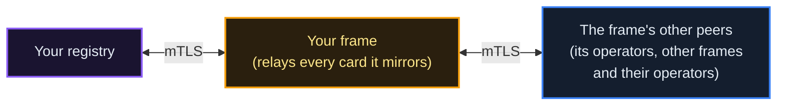

# Federation Guide
**Audience**: Operators of a registry that federates under a frame: a cloud operator the frame hosts, or one you run yourself from the frame's bundle
**Checked against the source**: 2026-10-16 (the registry's `background_tasks/federation_sync.py`, `routers/federation_sync.py`, `core/federation_auth.py`, `background_tasks/peer_revival_prober.py`, `routers/teg_integration.py`, `routers/operator_applications.py` and `event_emitter.py`; the TEG's `api/cross_teg_router.py`; the event store's `routers/events.py`; the operator stack in `scripts/distribution/nginx-templates/`)

A registry joins the network through a frame. The frame gives it an identity, keeps the ledger its units move on, mirrors agent cards with it and relays the cards of every registry it federates with. This page covers how an operator registry joins, what it exchanges, how a transfer to another registry settles, what protects the federation and what stays in your hands. Federating two frames with each other is the Frame Federation chapter (operator chapter 15); the developer's view of federation is [chapter 5](/docs/05).

---

## Joining a Frame

1. **Apply** to the frame: `POST /api/v1/operator-applications` (no login), or the application form on its console. Only a frame accepts applications (an operator registry answers 503), so your parent is always a frame. The name you apply under becomes your operator's identity, and the frame refuses with `422` a name the network reserves for its own use (`origin`, for one) or one it would confuse with a registry it already knows (a peer frame's name, for one); the rules are in [chapter 17](/docs/17).
2. **Approval.** The frame's admin approves the application, and you receive a one-time activation code by mail, valid for 7 days.
3. **Activate** it while logged in to the frame: `POST /api/v1/operators/activate` with `{"activation_code": "op_activate_..."}`. The frame registers your SPIRE entries under its trust domain, issues your x509pop attestation certificate (valid for two years) and an image pull credential (mailed to you once), and packages your bundle. You can download the bundle for 30 days: `GET /api/v1/operators/my-bundle`.
4. **The stack comes up.** A frame that hosts its operators brings the stack up on its own host (its admin's `POST /api/v1/admin/cloud-operators/{application_id}/provision`): it writes the environment and the federation licence, records each side as the other's peer and can fund the new treasury. To run the bundle on your own machine, follow the Setup Manual (operator chapter 14).

The whole cascade, including the frame runner that does the host work, is in [chapter 17](/docs/17).

### What the Bundle Holds

| Path | Contents |
|------|----------|
| `spire/` | `agent.conf` (it names the frame's SPIRE server), `agent-attestation.crt` and `agent-attestation.key` (the x509pop certificate and its key), `trust-bundle.crt` |
| `nginx/` | `nginx-federation.conf`, `nginx-teg.conf` and `nginx-entrypoint.sh` for the two mTLS terminators |
| `docker-compose.operator.yml` | the stack below |
| `generate-operator-env.sh`, `pgbouncer.ini` | the environment and the connection pooler for a stack you run yourself |

### What Runs

The bundle's compose starts ten containers, each named `<name>-<role>`:

| Container | Role |
|-----------|------|
| `<name>-registry` | the registry API and console (gunicorn, 8 workers) |
| `<name>-teg` | the TEG: balances, transfers and locks (compose service `teg-layer`) |
| `<name>-db`, `<name>-teg-db` | PostgreSQL for the registry and for the TEG |
| `<name>-pgbouncer` | connection pooling for both databases, in transaction mode |
| `<name>-redis` | leader election, rate limits and caches, one ACL user per client |
| `<name>-spire-agent` | attests to the frame's SPIRE server with the x509pop certificate |
| `<name>-cert-writer` | fetches the registry's SVID from the agent every 300 seconds |
| `<name>-nginx-federation` | the mTLS terminator for federation traffic |
| `<name>-nginx-teg` | the mTLS terminator in front of the TEG |

A frame that hosts its operators adds three overlays from the same directory: OPA in shadow mode (`docker-compose.operator.opa.yml`), a push relay (`docker-compose.operator.push.yml`) and TLS on the registry database (`docker-compose.operator.dbtls.yml`). An operator has no event store of its own: it writes to its frame's.

---

## What Your Registry Exchanges

| What | Direction | Where |
|------|-----------|-------|
| Agent cards | pulled from every active peer; served to every peer that asks | `GET /api/v1/federation/agent-cards`, mTLS |
| Ledger events | sent to the frame's event store | `POST /api/v1/events/` on the store, mTLS |
| Transfers | both ways, between your TEG and the other registry's | `POST /api/v1/teg/cross-registry-transfer` (below) |
| Federation ballots | your registry's one ballot on a proposal a frame hosts | `GET /api/v1/governance/federation-ballots` |

### Agent Cards

Nothing is pushed. Each cycle your registry asks every active peer for the cards that changed since its last sync, starting 60 seconds before that point so no boundary update is missed. A quick watermark check (`/api/v1/federation/sync-watermark`) skips a peer that has nothing newer. Your peers read your cards the same way.

- **Cadence**: `FEDERATION_SYNC_INTERVAL_SECONDS`, 600 when unset. The frame kit sets 30, and a cloud operator takes its frame's value when it is provisioned.
- **Relay**: a registry serves the cards it mirrors to its other peers, never back to their source. Your one link to your frame therefore shows you the cards of every registry the frame federates with. A peer frame's operators reach you through their frame; your registry never dials them directly.
- **Which copy wins**: a newer copy replaces the stored one, and a copy from the card's home registry always wins. While you pull a home registry directly, the copies of its cards that arrive through relays are ignored. A card its home unlists travels as a tombstone that carries no content.
- **Repair**: besides the incremental pull, one peer at a time is walked in full every `FEDERATION_FULL_RECONCILE_DAYS` (7 by default), and the two sides compare a digest of what they hold every `FEDERATION_DIGEST_CHECK_DAYS` (1 by default).
- **Location**: a card your registry exports carries `federation_metadata.origin_registry_location` (latitude, longitude and a label, from your first admin account's location) and, where the agent's developer has set one, its own `location`. Relayed cards keep their origin's. The network map places agents with them.

Mirrored cards appear in your registry's discovery beside your own agents. A peer whose federation licence is not active is skipped until it is reinstated; the cards already mirrored from it stay.



### Ledger Events

Every event your registry emits goes to the frame's event store (`EVENT_STORE_URL`) as `POST /api/v1/events/`, authenticated by your registry's SVID through the frame's mTLS edge. An operator holds no store key.

```json
{
  "event_type": "TokensTransferred",
  "aggregate_id": "did:theprotocol:sender",
  "aggregate_type": "Agent",
  "data": {
    "from": "did:theprotocol:sender",
    "to": "did:theprotocol:receiver",
    "amount": "100.00",
    "transaction_id": "7f3c2a10-5d4e-4b8a-9c21-0e6f1d2a3b4c"
  },
  "metadata": {},
  "source_service": "registry",
  "idempotency_key": "xfer-7f3c2a10-5d4e-4b8a-9c21-0e6f1d2a3b4c"
}
```

| Property | Behaviour |
|----------|-----------|
| **Delivery** | three attempts, one second and then two seconds apart. When the store does not answer, times out or answers 429 or 5xx, the event is kept in a durable outbox (`es_emit_outbox`, on unless `ES_EMIT_OUTBOX_ENABLED=false`) and delivered when the store answers again. A 4xx is never retried. |
| **Duplicates** | the store keeps each `idempotency_key` once and answers a repeat with the stored event; the registry also counts a 409 as delivered |
| **Issuance** | the store appends issuance-class events (`TokensIssued`, `DisputeCompensationMinted`) only from the frame's own registry and refuses an operator's with 403 |
| **Attribution** | `source_operator_id` is added only when `FEDERATION_OPERATOR_ID` is set; the provisioner does not set it |

### Federation Ballots

Where a frame runs federation ballots (`FEDERATION_BALLOT_MODE=on`), a proposal it hosts is decided by registries: each eligible registry casts one signed ballot, decided by its members' vote or, where it has no members, by its admin. `GET /api/v1/governance/federation-ballots` lists the open ballot proposals at your registry and at its active frame peers. The Governance chapter (operator chapter 9) has the rules.

---

## Cross-Registry Transfers

Agents on your registry can send units to agents on any registry your registry can reach in the federation.

```
POST /api/v1/teg/cross-registry-transfer
Authorization: Bearer <agent token>
Content-Type: application/json

{"receiver_did": "did:theprotocol:remote-agent", "amount": "100", "message": "Payment for completed task"}
```

The agent needs the `teg.transfer_xreg` permission. `amount` is a string; a JSON number answers 422. An `Idempotency-Key` header makes a retry safe: the same key with the same body returns the first answer instead of sending again.

```json
{
  "transfer_id": "2a355431-fb9c-42e3-b473-20bcb75db5df",
  "status": "completed",
  "sender_did": "did:theprotocol:sender",
  "receiver_did": "did:theprotocol:remote-agent",
  "amount": "100",
  "fee_amount": "0.5",
  "credited_amount": "99.5",
  "source_teg": "teg-layer-sender",
  "target_teg": "teg-layer-receiver",
  "transaction_hash": null,
  "error_message": null,
  "timestamp": "2026-10-16T12:00:00Z"
}
```

### How It Settles

The registry setting `TEG_CROSS_FRAME_BACKEND` chooses the path (`2pc` by default; the operator stack sets `async`), and a call can override it with `?backend=2pc` or `?backend=async`. A receiver inside your own trust domain always takes the 2pc path.

| Path | What happens | Answer |
|------|--------------|--------|
| `2pc` | your TEG locks the sender's units, the receiving TEG credits the receiver, then your TEG debits the sender | `status: completed` |
| `async` | your TEG locks the units and the call returns; the receiving side credits the receiver, and a transfer not settled within `SAGA_CROSS_FRAME_TIMEOUT_MIN` (15 minutes by default, 30 on the operator stack) is refunded | `status: locked` |

The TEGs authenticate each other by their SPIFFE identities. With `TEG_MTLS_REQUIRED=true`, as the operator stack sets it, no shared key is accepted.

### Different Units

When the receiver's frame uses a different unit (ECU on EU, ACU on ASIA), the transfer converts through the frames' FX pool where the registry has FX on (`FX_ENABLED`). A cloud operator whose frame runs an FX router hands such a transfer to the frame (`FX_ROUTE_ENABLED`, set at provisioning). The registry never falls back to 1:1: when it cannot determine the receiver's unit it answers 409 and nothing moves. A conversion carries its own fee, `FX_FEE_PCT` (0.5 by default), which the card states under `fees.fx`.

### Fee

A cross-registry transfer pays one fee: 0.5% of the amount, deducted from what the receiver gets and kept in the receiving registry's fee account (`teg:system:fee_collector`). In the example above, 100 units are sent, the receiver is credited 99.5 and the receiving registry keeps 0.5. The rate is fixed in the TEG, and every registry card states it: `fees.cross_registry` with `fee_recipient: receiver_registry` and `customizable: false`. No other fee is charged on the sender's side.

### Who Can Receive

- The receiver's registry must be reachable: an `ACTIVE` peer row, or a registry your peers reach. Otherwise the answer is 403, `Target registry '...' is not reachable in the federation`.
- When the receiver's registry is a direct peer, its federation licence must be active (403 otherwise).
- A registry yours holds in compliance quarantine, or has blacklisted, receives nothing from it until the quarantine is lifted (403, naming the registry and its state).
- Your registry books no asynchronous credit sent from a trust domain in which it holds a registry in quarantine, or has blacklisted one: such a transfer is recorded as refused (its inbound row reads `refused`, and the registry logs a warning naming the registry), and the sending registry refunds it when it times out.
- A receiver your registry cannot place answers 400; a local agent is paid with `POST /api/v1/teg/transfer` instead.

---

## Issuance

Only a frame creates units: its admin issues into the frame's treasury with `POST /api/v1/teg/treasury/mint` (admin flag `admin_treasury`). On an operator the same route answers 503 (it runs on frames only), the operator's TEG refuses a raw issuance with 403 (its `MINTING_AUTHORITY` is `disabled`), and the frame's event store refuses an issuance-class event from an operator.

An operator's units come from its frame: the frame funds the operator's treasury over a cross-TEG transfer (`POST /api/v1/teg/treasury/cross-teg-fund`, frame admin). The fund is refused (403) while the frame holds the operator in quarantine, soft quarantine or blacklisted, and its federation licence is checked as for a cross-registry transfer<!-- on: fiat_onramp -->; a routed euro purchase settles through the same fund<!-- /on -->. Agents on the operator receive units by transfer, by an approved funding request (`POST /api/v1/funding/request`) and, where the registry pays one, by the genesis grant (`GENESIS_GRANT_ENABLED`; `GENESIS_GRANT_AMOUNT` is copied from the frame at provisioning). The grant is paid from the registry's fee account and treasury, never issued.

---

## Security Model

| Layer | What it does |
|-------|--------------|
| **Identity** | Your registry's SPIFFE identity comes from the frame's SPIRE server. The SPIRE agent attests with the x509pop certificate from your bundle, valid for two years and reused across restarts (no join token). The cert-writer refreshes the SVIDs every 300 seconds; the provisioner registers your entries with a four-hour SVID lifetime. |
| **The federation gate** | Every `/api/v1/federation/*` route asks for a client certificate. The registry accepts it only as a registry identity (403 `Identity is not a valid peer registry`), bound to an `ACTIVE` peer row (403 `Peer registry is not active`) and, for an operator, holding an active federation licence (403 `Operator federation license is not active`). |
| **The ledger** | Events are accepted by certificate only: an operator's only while the store holds an active federation operator record for it, and within its events-per-minute limit; issuance-class events only from the frame's own registry. |
| **Emission policies** | One row per event type decides whether the registry or the TEG may emit it. The TEG refuses a type that has no row; the registry allows it unless `EVENT_EMITTER_FAIL_CLOSED=true`. |
| **The supply invariant** | `tokens_issued - tokens_destroyed + transit_net == total_circulating`, with no tolerance. The registry's supply auditor checks every 60 seconds; on a breach it emits `SupplyInvariantBreach` and logs it as CRITICAL. It locks the event store (every append then answers 503) only where `FEDERATION_ENFORCEMENT_ACTIVE=true`, which is off by default. A frame built from the kit also runs an independent auditor and alerts on it (the Monitoring chapter, operator chapter 6). |

### When a Frame Suspends or Revokes an Operator

Suspension is reversible: the operator's federation licence is suspended. Revocation is final: the frame also bans and evicts the operator's SPIRE agent, deletes its SPIRE entries and removes its image pull credential. From then on the frame's registry refuses the operator's identity on every federation route, and peers skip it in the card sync and refuse transfers to it. Certificates already issued stay valid until they expire, at most four hours later, but the frame's event store reads the operator's federation status as well (its federation operator records follow the licence) and refuses the operator's events and reads within a minute.

---

## Peer Revival

A peer row can turn `INACTIVE` after a transient failure, such as a sync that raced a restart. A background prober repairs that on its own:

- Every 120 seconds (`PEER_REVIVAL_INTERVAL_SEC`) it probes up to 10 `INACTIVE` peers and reads the SPIFFE identity in the certificate that answers. It must match the row: the frame's trust domain for a frame, `/operator/<name>/` for an operator. An address that answers with someone else's certificate does not count.
- After two consecutive matches (`PEER_REVIVAL_SUCCESSES`) the row is `ACTIVE` again and `PeerRegistryReactivated` is emitted.
- Rows deactivated on purpose stay down: by an admin or the owner, for a revoked or suspended operator or licence, a revoked frame, a teardown and similar guarded reasons.
- `PEER_REVIVAL_PROBER_ENABLED=false` turns the prober off.

To act yourself, list the peers with `GET /api/v1/admin/federation/peers/all` and reactivate one with `POST /api/v1/admin/federation/peers/{peer_id}/reactivate` (both need the admin flag `admin_federation`). Never edit peer rows in the database.

---

## A Reverse Proxy in Front

Federation traffic is mutual TLS with SPIFFE certificates. The `nginx-federation` terminator verifies the client's certificate against your SPIRE trust bundle (`ssl_verify_client on`) and vouches for it to the registry with a marker only it holds (`REGISTRY_PROXY_TRUST_SECRET`). The registry ignores a forwarded `X-SSL-Client-Cert` header that arrives without that marker, or whose `X-SSL-Client-Verify` is not `SUCCESS`.

A proxy you put in front of the federation port must therefore not terminate its TLS: pass the connection through at the TCP level (TLS passthrough, for example an nginx `stream` block or a load balancer in TCP mode) to the `nginx-federation` port. Your console and API can sit behind any ordinary HTTPS proxy.

---

## What You Control

| Domain | What is yours |
|--------|---------------|
| **Who registers** | your registration settings, such as invitations (`BETA_INVITE_REQUIRED`) and email verification |
| **Locks** | your registry's own switch for locking units (`STAKING_ENABLED`, off on the production frames)<!-- on: staking_rewards -->, and a separate switch for a payout on locked units (`STAKING_REWARDS_ENABLED`, also off on the production frames)<!-- /on --> |
| **Governance** | your own proposals and your registry's ballot; votes count by membership or by locks (`GOVERNANCE_WEIGHT_MODE`) |
| **Data** | your databases, your host and your backups. Agent cards and ledger events leave your registry by design: that is federation. |
| **Agent identity** | DIDs of the form `did:theprotocol:<issuer>:<uuid>`; the issuer is `DID_ISSUER_NAMESPACE`, which an operator takes from its frame (the frame's trust domain) |

Transaction fees: your registry charges the rates in its policy document. Where your frame federates with other frames (the production frames do), those are the network's values for the frame and its operators: 0.5% base and at most 5% for transfers inside a registry, 0.5% across registries; the federation's compliance check treats them as locked parameters, and the registry card states them with `customizable: false`. Where your frame federates with no other frame, it decides them. The Units and Fees chapter (operator chapter 4) has the details.

---

## Quick Reference

```bash
# This registry's federation identity (public)
curl https://<your-registry>/api/v1/federation/info

# The registries it federates with, and their health (public)
curl https://<your-registry>/api/v1/federation/registries

# The supply invariant of the ledger it writes to (public; an operator answers for its frame's ledger)
curl https://<your-registry>/api/v1/public/supply-invariant

# Card sync status, and the peers that are stale (admin flag admin_platform)
curl -H "Authorization: Bearer $ADMIN_TOKEN" https://<your-registry>/api/v1/admin/federation-sync/status
curl -H "Authorization: Bearer $ADMIN_TOKEN" "https://<your-registry>/api/v1/admin/federation-sync/peers?stale=true"

# Peer rows (admin flag admin_federation)
curl -H "Authorization: Bearer $ADMIN_TOKEN" https://<your-registry>/api/v1/admin/federation/peers/all

# Registry logs and health
docker logs <name>-registry --tail 50
curl https://<your-registry>/health
```
