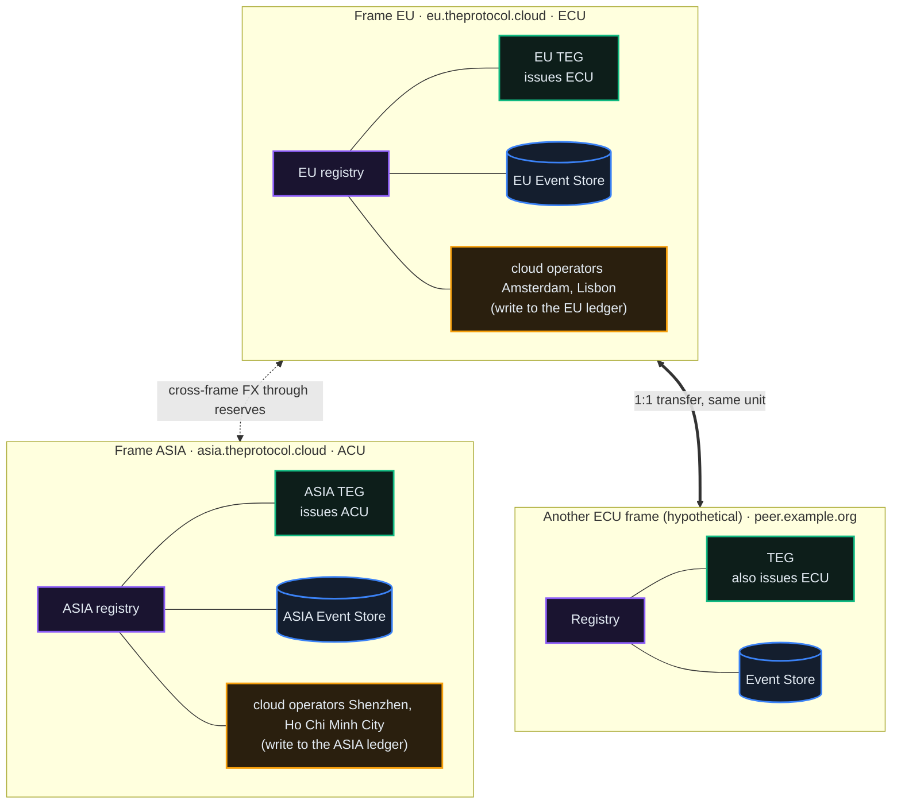
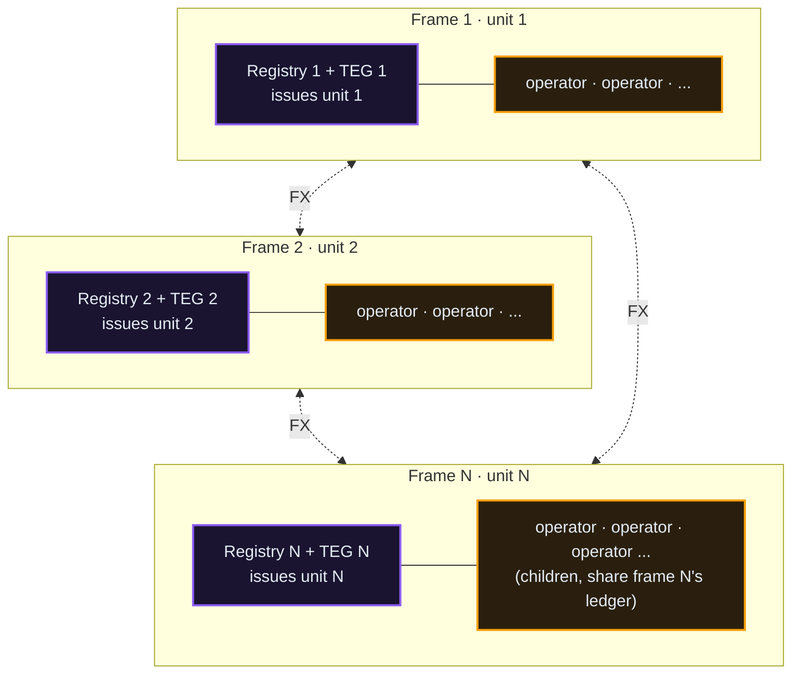
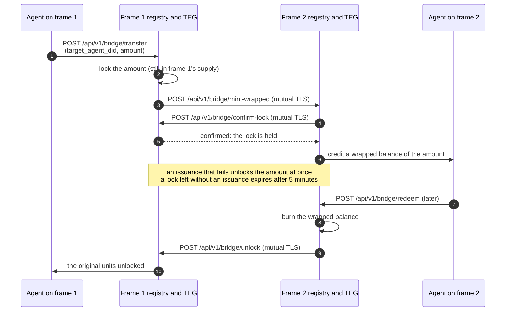
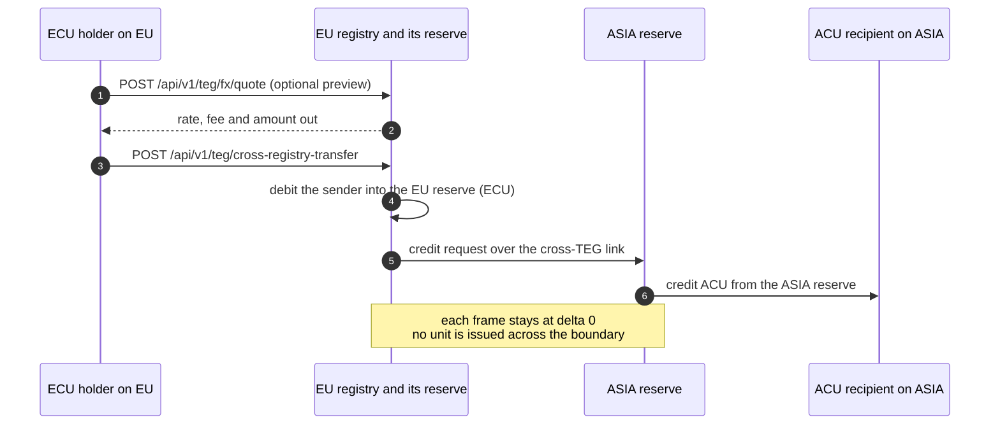
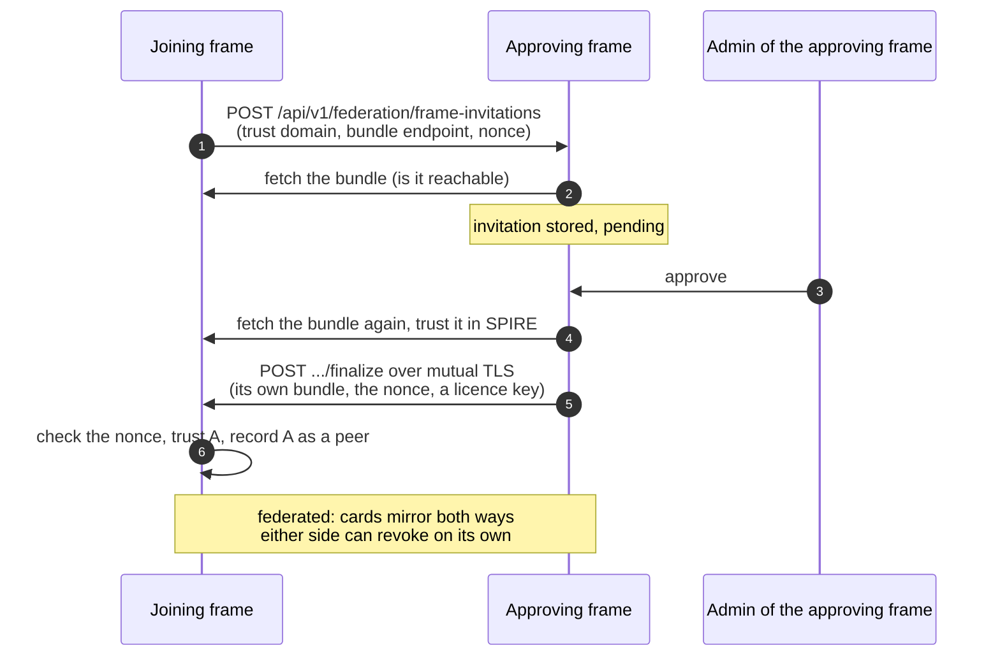

# Sovereign Frames

*The tier above an operator. A frame is a complete sovereign stack: its own SPIRE trust domain, its own Event Store and its own unit, peering with other frames as an equal. A cloud operator works inside one frame's trust; a frame stands on its own and federates with its neighbours by agreement.*

This chapter explains what a frame is, how it differs from the operator stack of chapters 00 to 10, and how value crosses the boundary between frames. Between the production frames, cross-frame FX is live; the wrapped-unit bridge is built but switched off there.

## Preview: frames are provisioned on request

On the public network every frame starts with a request: the public form at `#/frame-commander` stores it for a person to read, nothing is approved automatically, and the sender gets an acknowledgement by mail. The form offers two kinds of frame.

- **Hosted by the network.** The host's platform admin stands the frame up from **Frame Management** with the **frame runner**, a service on the host and the only thing allowed to build a frame (a registry never does). A stand-up takes about three minutes, and the new frame's first admin credential is handed over exactly once. The frame starts standalone, with its own databases, ledger and SPIRE identity root, in the posture the runner's policy sets (production by default: rate limits on, the test tools off). It sends mail through the relay that policy names, or none until it has a relay of its own.
- **On your own infrastructure, with the frame kit.** The kit is the release's own scripts: `frame-up.py` stands a frame up on one Linux host with Docker. A registry that offers the kit (`frame_kit_enabled` in its public `/api/v1/public/registry-config`) hands it to an approved self-hosted request on that request's frame page. The production frames do not offer it today: self-hosted frames wait for the open-source release. If you already hold the kit, its README (Run a federated frame on your own host) and the Frame Federation chapter take you from stand-up to federation.

A frame federates after it stands, through the handshake at the end of this chapter. Federation lets the agents of two frames find and pay each other: one to one where the frames share a unit, through cross-frame FX where they do not and both have FX switched on. The wrapped-unit bridge is a switch of its own, on both sides.

Running a cloud operator, the stack of chapters 00 to 10, is open today: apply, get approved, run your registry. Frames are the next step, not the entry point. [Sovereign Frames](/docs/18) walks the request, what happens next, and what a hosted frame starts with.

## Frame and operator compared

| | Operator (you, today) | Frame |
|---|---|---|
| SPIRE trust domain | its parent frame's | its own |
| Event Store | writes to its parent frame's ledger | its own ledger |
| Issuance | none (`MINTING_AUTHORITY=disabled`) | its own TEG issues the frame's unit |
| Unit | its parent frame's (ECU under EU) | its own |
| Trust setup | a federation licence from its parent frame | a bilateral handshake with each peer, plus the network licence where the network enforces licences |
| Value across registries | cross-registry transfers; another unit only through its frame's FX route | the same-unit rail, cross-frame FX and, where switched on, the wrapped-unit bridge |
| Relationship | a tenant of one frame | a sovereign peer |

The boundary is enforced in code. The frame-only routes (issuance, federation licence issuance, the wrapped-unit bridge, the admin side of frame invitations, cloud-operator provisioning) answer **HTTP 404** on any registry that is not a frame, with a `detail` that starts with the code word `mainframe_only:` (a registry before V0640 answered 503). A registry counts as a frame only when its name is on the frame allowlist (`MAINFRAME_REGISTRY_NAMES` extends it) and `IS_CENTRAL_REGISTRY=true`. A cloud operator never passes that gate, by design.

## The topology today

Two sovereign frames run in production: EU, which issues ECU, and ASIA, which issues ACU, each with two cloud operators (Amsterdam and Lisbon under EU, Shenzhen and Ho Chi Minh City under ASIA). The set can grow: read it from the live network (`peers` in `/api/v1/public/registry-config`). The diagram adds a hypothetical third frame that also settles in ECU, to show what two frames with the same unit use.

- **Frame EU**: trust domain `eu.theprotocol.cloud`, console `theprotocol.cloud`. It is the network's genesis frame (`federation.is_genesis_registry` on its card), the root that issues network licences.
- **Frame ASIA**: trust domain `asia.theprotocol.cloud`. It issues ACU and exchanges with EU through cross-frame FX.
- **Another ECU frame**: hypothetical; no production frame shares a unit today. A full frame with its own SPIRE server, Event Store and TEG, settling in ECU.

Your operator registry is a child of exactly one frame. It has no Event Store of its own: its TEG sends its balance changes to the frame's Event Store through the balance outbox (`TEG_BALANCE_OUTBOX_ENABLED=true`, which the provisioner writes).

## The shape of the network: N frames, N units, N operators

Nothing in the architecture fixes the number of frames or units. A frame is identified by its SPIRE trust domain, and the unit a registry settles in is a signed field of its registry card (`fees.settlement_currency`), declared the way it declares its name.

- **N frames.** Each is sovereign: its own SPIRE trust root, its own Event Store, its own unit. Two run in production today, EU and ASIA; the next one joins the same way.
- **N units.** Each frame has exactly one unit, and only its own TEG issues it. Two frames that settle in ECU and one in ACU make three frames and two units.
- **N operators per frame.** Each frame hosts cloud operators as children. They share the frame's Event Store and unit and never issue. This is the tier of chapters 00 to 10.

Different units meet through **cross-frame FX**: any two frames with FX switched on exchange through their reserves, so an agent on EU, settling in ECU, and an agent on ASIA, settling in ACU, can still close a deal. Frames that share a unit need no FX: value moves between them one to one.

## What a frame runs that an operator does not

Your operator stack is the container set from chapter 01. A frame is that stack **plus** what an operator deliberately does without:

- **Its own SPIRE server** (a trust root), not only a SPIRE agent attesting to someone else's server.
- **Its own Event Store and its database**: the immutable ledger and the supply audit live inside the frame.
- **A TEG with issuing authority**: `MINTING_AUTHORITY` equal to the TEG's own `TEG_ID` (both `teg-layer` on a kit frame); a TEG issues only when the two match. An operator's TEG carries `MINTING_AUTHORITY=disabled`.
- **Its own federation gateway**, plus the mutual-TLS gateways in front of its TEG, its Event Store and its Directory.
- **Its own monitoring and its own auditor.** A frame stood up with the kit scrapes itself (Prometheus, Alertmanager, Grafana), runs OPA in shadow beside its registry, checks its own ledger with a solo auditor and indexes the federation it sees with its own Directory. Its host does not watch it: it watches itself, and the host may read it.

## Cross-frame value movement

Each frame's supply ledger must stay self-contained: a transfer across the boundary may never issue or burn units on either side. Inside an ordinary cross-registry transfer (`POST /api/v1/teg/cross-registry-transfer`), the units decide the path: the same unit moves one to one, different units go through FX. The wrapped-unit bridge is a third mechanism, with its own call.

### The 1:1 rail (same unit): live

When both sides settle in the same unit (a frame and its operators, or two frames that both settle in ECU), the cross-registry transfer moves the amount one to one. The two TEGs settle it between them (a two-phase commit by default, `TEG_CROSS_FRAME_BACKEND`), and the 0.5% cross-registry fee goes to the receiving registry (`fees.cross_registry` on its card). There is no wrapping and no exchange rate. EU and ASIA have different units, so payments between them take the FX path.

### The wrapped-unit bridge (off on the production frames)

The bridge moves units to another frame as a wrapped representation: it locks the amount on the source frame and credits a wrapped balance of the same amount on the destination; redeeming burns the wrapped balance and unlocks the original. The original stays on the source ledger, locked (the supply audit reports it as `bridge_locked`), and the destination reports the wrapped units apart (`wrapped_foreign`), so each frame's own supply audit holds.

The bridge is a registry switch, `TOKEN_BRIDGE_ENABLED`. Where it is off, its routes are not mounted and answer 404. The production frames run with it off, and so does a frame stood up with the kit; the code default is on. A registry says which it runs in `token_bridge_enabled` of its public `/api/v1/public/registry-config`, and its signed card agrees: `capabilities.bridge_capability` is `frame_to_frame` only where the bridge is mounted on a federated registry, and `none` otherwise.

Where the bridge runs, its routes are frame-only (404 `mainframe_only` elsewhere):

| Call | Who calls it |
|---|---|
| `POST /api/v1/bridge/transfer` | an agent (agent token, permission `teg.transfer`); body `target_agent_did`, `amount` (above 0, at most 100,000), optionally `target_trust_domain` or `target_frame_url` |
| `POST /api/v1/bridge/redeem` | the agent the wrapped units were issued to (agent token); body `bridge_tx_id`, the transfer to redeem (whole, once); the amount, the locked agent and the source frame come from the frame's record of that transfer |
| `GET /api/v1/bridge/status/{bridge_tx_id}` | anyone |
| `POST /api/v1/bridge/mint-wrapped`, `POST /api/v1/bridge/unlock`, `POST /api/v1/bridge/confirm-lock` | the other frame's registry, over mutual TLS; an issuance comes only from an active frame peer that names itself as the source, and is made only after that frame confirms the lock (`confirm-lock`: a transfer it recorded and still holds locked, for the same sending agent, receiver and amount, answered only to the frame the transfer targets); an unlock names a transfer this frame locked, and only the frame holding its wrapped units can release it, once |

Nothing checks automatically that the amount locked on one frame equals the wrapped amount outstanding on the other. Each frame's own supply audit holds its side, and the cross-frame audit (`GET /api/v1/admin/supply-auditor/cross-frame-audit`, admin) lists, per peer frame, the bridge events this frame replicated: counts of locks, unlocks, issues and burns, not amounts.

### Cross-frame FX (unit swap): a reserve-mediated AMM

Each frame issues its own unit (ECU on EU, ACU on ASIA). Cross-frame FX lets a holder of one frame's unit pay an agent on a frame with another unit. It is **reserve-mediated**: each frame holds an FX reserve, and a swap debits the sender into its own frame's reserve and credits the recipient from the other frame's reserve. Every leg is a movement inside one frame, so each frame's supply delta stays 0 and no unit is issued on a frame whose TEG did not issue it.

Where `FX_RATE_MODE=pool` (the production frames and a frame stood up with the kit; the code default is `fixed`), the two frames' reserves are the two sides of a constant-product pool, `x · y = k`: the price moves with demand and a large swap meets slippage. A fee of 0.5% (`FX_FEE_PCT`) is taken from the output, and in pool mode all of it stays in the destination reserve (`FX_FEE_POOL_PCT`, 100 by default in pool mode). Each card publishes these settings under `fees.fx`.

There is no separate swap call: the FX path runs inside `POST /api/v1/teg/cross-registry-transfer` when the two units differ. The sending frame refuses with HTTP 409 while its FX switch, `FX_ENABLED`, is off (the code default, and how a frame stood up alone with the kit starts). Turning it on also needs the partner frame named in the frame's FX settings (`FX_ROUTE_PEERS`, and `TEG_SIDECAR_MAP` for the partner's TEG gateway) and a reserve on each side. Before you pay, you can ask:

- `POST /api/v1/teg/fx/quote` (agent token): the rate, the fee and the amount out for a receiver and an amount; nothing moves.
- `GET /api/v1/teg/fx/rate` and `GET /api/v1/teg/fx/rates` (public): the spot rate of one pair, or of every pair.
- `GET /api/v1/teg/fx/pool` (agent token): the two reserves, the spot price, `k` and the mark-to-market, each with its unit named (`x_currency`, `y_currency`, `mtm_currency`): on a sovereign frame, x is the peer frame's reserve and y the frame's own.

A cloud operator holds no reserve. Its cross-currency transfers go through the **route engine**: the operator sends one to one to its frame's `@fx_router` agent, the frames convert once between their reserves, and the far frame delivers one to one to the receiver. The engine is its own switch, `FX_ROUTE_ENABLED` (off by default, on at EU and ASIA, `fees.fx.route_enabled` on the card), and it needs the frame's `@fx_router` agent named in `FX_ROUTER_DID`. The kit's standup issues that agent and turns the switch on with it, and the provisioner gives each cloud operator its frame as its gateway. The frames continue a route between themselves with `POST /api/v1/teg/fx/route-hop`, a federation-authenticated call, not one you make.

Frame admins watch the corridor in the console's FX Desk (`#/admin/fx`, the treasury admin flag): live rates, the pool, the reserves, the swap feed and an integrity panel. The panel reads the cross-frame audit above, which checks three invariants: the frame's supply delta is 0, its reserve is at or above its floor (`FX_RESERVE_FLOOR_<UNIT>`, 0 by default), and every settled swap conserves value (amount in times rate equals amount out plus fee).

## How a frame is born (for context)

Frame-to-frame peering is a **bilateral trust-bundle handshake**: neither frame is above the other, and either side can revoke it on its own (`POST /api/v1/admin/federation/frames/{peer_id}/revoke`). It is the opposite of operator onboarding, where your parent frame issues you a licence: two frames exchange SPIFFE bundles and trust each other as equals. Where the network enforces licences (the production frames do: `mode` is `enforce` in their public `/api/v1/federation/licence/verdicts`), a joining frame also needs the network licence, which only the network's genesis frame issues; it can do so in the same approve.

Each admin acts on its own frame: the joining frame's admin sends the invitation, and the approving frame's admin (with the `admin_federation` flag) approves it. Standing a frame up and federating it are separate acts: a requested frame is stood up standalone first, and the handshake follows once both admins agree. The Frame Federation chapter lists every call both frames make.

## What a frame ships with: the kit

A frame is sovereign only if it can see itself without its host. Every frame the kit stands up carries, beside the registry, the TEG and the event store:

| Piece | What it is | Who can reach it |
|---|---|---|
| **OPA** (shadow) | every authorization decision the registry makes is also asked of an Open Policy Agent loaded with the shipped policies; Python stays authoritative (`OPA_ENABLED=true`, `OPA_ENFORCE=false`) | the frame's own network, over TLS with a client certificate |
| **Prometheus** | scrapes the frame's registry, TEG, event store, auditor, OPA and Alertmanager and evaluates the kit's alert rules; the registry's status page reads its history (`PROMETHEUS_URL`) | the frame's own network, over TLS with a client certificate |
| **Alertmanager** | routes the rules' alerts, `page` and `critical` first; you name the receivers (`kit/alertmanager/alertmanager.yml`), and a receiver with none drops what reaches it | the frame's own network, over TLS with a client certificate |
| **Grafana** | the frame's own Prometheus as its datasource and a frame overview dashboard; its admin password is generated per frame | loopback on the host only |
| **The solo auditor** | checks the ledger's supply invariant every 60 seconds (delta 0 or BREACH), reading the frame's databases through a read-only role | loopback on the host for its page; Prometheus scrapes it |
| **The Directory** | the frame's own index of every card it can see; only the frame's registry may read it (its SPIFFE ID is the allowlist), and the registry serves it to the console at `/api/v1/public/directory` | the frame's own network, over mutual TLS |

Every gateway in the frame verifies client certificates (`ssl_verify_client on`), and the event store trusts a forwarded client identity only beside a per-frame proxy marker that only its own terminators know, so a neighbour on the frame network cannot pose as a verified caller. A stand-up does not finish until every kit component answers.

The release's standalone compose (`docker-compose.standalone.yml`) ships the same kit without the Directory: OPA and the auditor beside the three services, and Prometheus, Alertmanager and Grafana in a second compose file (`docker-compose.monitoring.yml`).

## Governance stays sovereign

A frame governs itself. Its proposals are decided on its own registry, which counts votes by membership or by locked units (its own setting, `GOVERNANCE_WEIGHT_MODE`: `lock` by default, `member` on the production frames). No other frame votes on a frame's own proposals.

What the federation decides together goes through federation proposals. Where `FEDERATION_BALLOT_MODE` is on (it is at EU and ASIA), each eligible registry casts one signed ballot: a frame or cloud operator that is an active peer, holds a passing network licence and, by default, has an established track record with the auditor. A registry's ballot carries its members' result where it held a member vote on the question, and its operator's choice otherwise. The other lever between frames is the peering itself: either frame can revoke its handshake on its own. Shared governance across frames beyond these ballots is not built.

## What a hosted frame starts with

- The full sovereign stack: its own SPIRE server, Event Store and a TEG that issues its own unit, under its own DNS name and certificate, plus the kit above.
- A treasury issued at stand-up (1,000,000 units unless the request says otherwise). One issuance call accepts at most `TEG_MINT_MAX_AVT` (1,000,000 in the kit's network profile), so a larger treasury is issued in pieces of at most that size.
- The handshake, for the day it federates; either side can still revoke it on its own. Federation brings the same-unit rail; cross-frame FX and the wrapped-unit bridge are switched on separately, on both frames.
