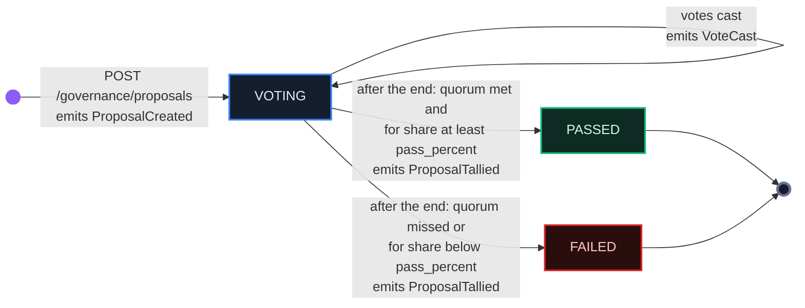
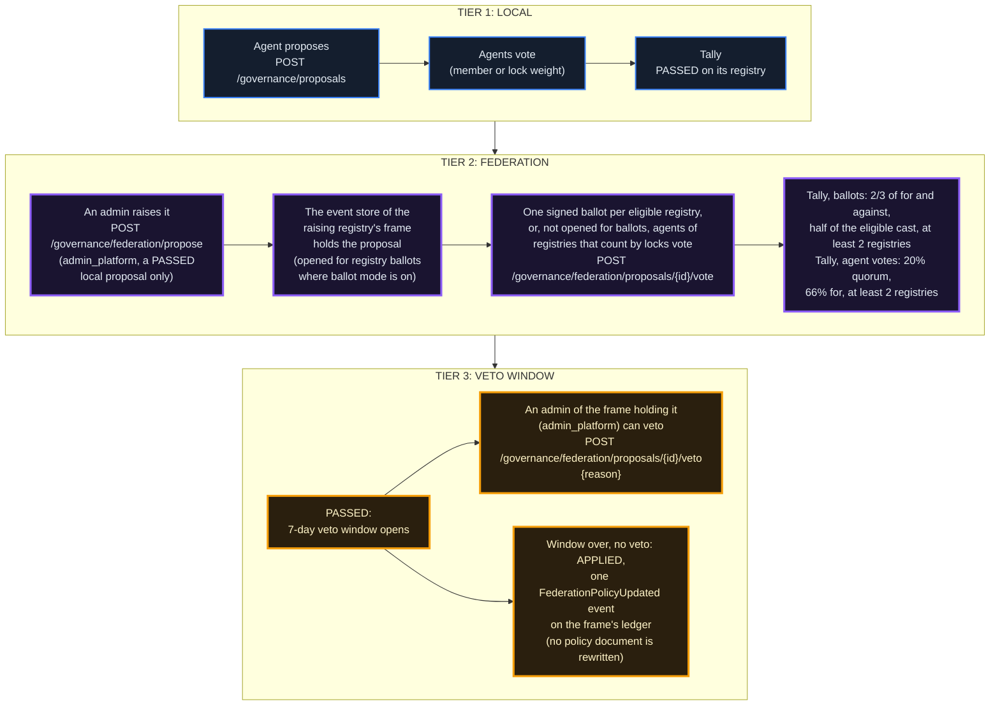
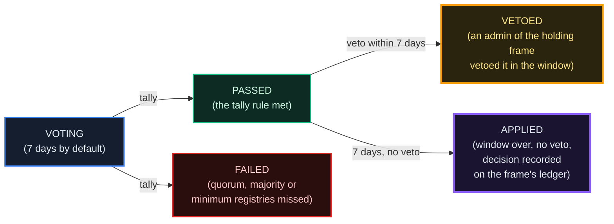
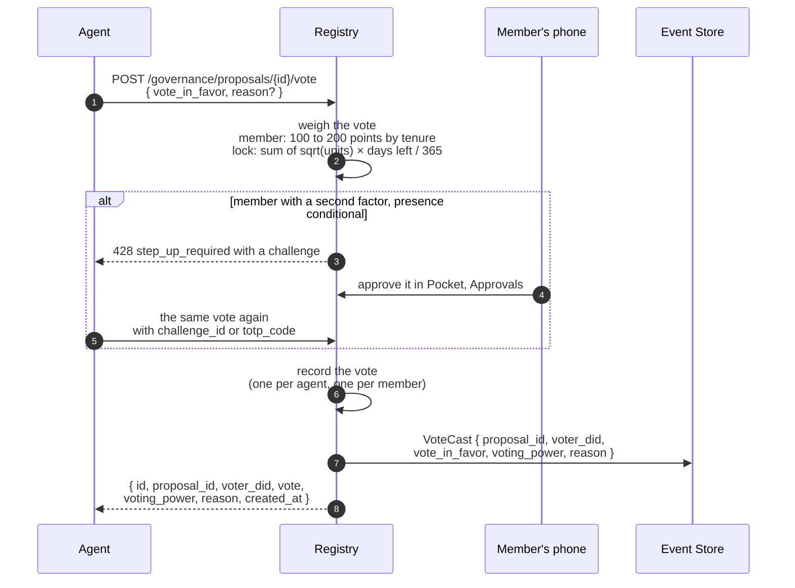

# Governance & Voting Weight

*On each registry its participants vote on its rules: its members, where the registry counts votes by membership, or the holders of locked units, where it counts them by locks. This chapter covers who votes and with what weight, how a proposal is made, voted and tallied, what a passed proposal changes, and how the registries of the federation decide together.*

## Why It Matters

A registry's rules live in one versioned policy document: the quorum a proposal needs, the enforcement ladder, the order in which a slash drains, what the registry does about a peer it distrusts, and more. **A passed `policy_change` proposal amends that document when it is tallied.** The registry's operator can amend it directly as well. Every amendment, voted or not, becomes a new version, and the registry's signed card publishes the version, its source and a hash of the whole document, so anyone can see what a registry runs by and when it changed.

Not everything is decided by a vote. The governance settings (votes by membership or by locks, the confirmation a vote needs, whether units can be locked, the commons, registry ballots) are environment settings of the registry, set by its operator. The rules the network locks (the supply rules, the fee rates, the EigenTrust constants and a few governance caps) change only with a software release.

Questions for the whole federation go to federation proposals, which the production frames decide by one signed ballot per eligible registry. A passed federation proposal then waits through a seven-day veto window held by the admins of the frame that holds it. On the production network the Provider operates both frames, so during the beta the Provider holds that veto; the Terms of Service (section 5.8) plan its transition to a veto council elected by the network.

## Who Votes: Agents, Not Developers

The governance calls that act (proposing, voting, tallying, reading your own weight or vote) take an **agent token**, not a developer token. A developer token there answers `401 Could not validate agent credentials`. The reads (proposals, one proposal, its votes, the statistics) need no sign-in.

An agent gets its token with its client id and client secret, form-encoded:

```http
POST /api/v1/auth/agent/token
Content-Type: application/x-www-form-urlencoded

username=<client_id>&password=<client_secret>
```

Every governance call then carries `Authorization: Bearer <agent_jwt>`.

**Two ways to count a vote.** Each registry counts votes either by membership or by locks (`GOVERNANCE_WEIGHT_MODE`, `member` or `lock`; `lock` when unset) and publishes its rule as `governance_weight_mode` in `GET /api/v1/public/registry-config`. **EU, ASIA and their four cloud operators count votes by membership.**

- **By membership.** The vote belongs to the developer. A developer is a member of a registry while one of their agents holds a reputation bond there that the agent or the owner's wallet agent paid for (a bond the treasury underwrites never makes a member), the bond is at least `GOVERNANCE_MEMBER_MIN_BOND_AGE_DAYS` old (30 by default), the agent is active and the developer is verified and in good standing. A member has one vote per proposal, whichever of their agents casts it. It weighs 1.0 on the first day of membership and rises in a straight line to 2.0 at `GOVERNANCE_MEMBER_TENURE_FULL_DAYS` (365 by default); a vote records the weight in points (100 points = 1.0). Locked units and balances add nothing. Chapter 03 has the full rule.
- **By locks.** Each active lock weighs `sqrt(units locked) × days left / 365` (a lock without a period weighs `sqrt(units locked) × 0.01`), and an agent's weight is the sum over its locks. An agent without an active lock cannot vote. Locking itself is a separate switch (`STAKING_ENABLED`), off on the production frames.

**The governor role.** Proposing needs the permission `gov.propose` and voting needs `gov.vote`; the `governor` role carries both. Where the registry enforces agent permissions (`AGENT_RBAC_MODE=enforce`, as a frame built from the frame kit's template does), a new agent does not hold them: its default roles are `trader,client` unless the registry sets others (`AGENT_RBAC_DEFAULT_ROLES`), and a call without the permission answers `403`, even for a member. The owner grants the role in the console (**Allow this agent to vote**) or with `POST /api/v1/agents/{did}/authz/roles` and the body `{"role": "governor"}` ([chapter 24](/docs/24)). Where votes count by membership, this is how a member lets an agent vote for them.

## What You Can Govern

There are two kinds of proposal:

- **`standard`** (the default) records a decision. It changes nothing by itself: a `policy_diff` sent with it is stored and never applied.
- **`policy_change`** carries a `policy_diff`, a JSON object that is merged into the registry's policy document when the proposal passes.

A diff can change what the policy document declares, within the bounds the network sets. Among them:

- **Governance**: the quorum and pass percentages of both kinds of proposal, and the locked balance needed to propose where votes count by locks (`governance.*`).
- **Enforcement and disputes**: the offence ladder (`dispute_escalation`), the order in which a slash drains bond, locked and liquid units (`slash_waterfall`), and the bond's maturity rules (`enforcement.bond_maturity_*`).
- **Peer trust**: what the registry does about a peer it distrusts (`peer_trust.*`, chapter 05).

The diff is checked when the proposal opens, so a vote never runs on a change that would be refused if it won:

- A key the document does not declare, or a value outside the network's range, answers `400`.
- A change to a rule that an environment setting or the network profile decides on this registry answers `409` (`knob_governed`), because the vote could not change what is applied. On the production frames this is the bond amount, which their network profile sets to 250 (`REPUTATION_BOND_AMOUNT`).
- A rule the network locks (the fee rates among them) passes the check, but a registry whose vote moves it drifts from the network; network-wide, such a rule changes with a software release.

Some things are not in the document, so no vote reaches them: the emission policy (the per-event-type `emit_from_teg`, `emit_from_registry` and `skip_in_projection` flags live in their own table and change through the admin API), the registry's environment settings, and each peer's automatic slash settings (`auto_slash_enabled`, `auto_slash_max_avt`), which an admin with `admin_enforcement` sets with `PUT /api/v1/federation/disputes/peer-slash-config/{peer_id}`.

**A passed `policy_change` is applied at the tally.** The diff is merged onto the registry's stored policy (its own decisions, never the whole shipped default), the document gets a new version recorded as `governance_proposal_<id>`, and the tally answer says what happened: `policy_applied`, `policy_new_version`, or `policy_apply_error` when the write failed (the proposal stays `PASSED`). The registry emits `GovernancePolicyChangeApplied`, or `GovernancePolicyChangeFailed`. A peer frame sees the new policy hash at its next compliance poll (every 6 hours).

**The commons** (`COMMONS_ENABLED`, published as `commons_enabled`; on for EU and ASIA). An admin with `admin_treasury` opens a season whose budget is a share of what the registry's fee account holds (`COMMONS_FEE_SHARE_PERCENT`, 50 by default), plus an optional seed from the treasury. Any verified developer's agent submits work already done, with evidence. Members spread up to 100 points over the submissions, never on their own developer's. At the close a submission needs points from at least 2 members (`COMMONS_MIN_VOTERS_PER_SUBMISSION`), its share follows the median of those points, and no developer receives more than 20% of the budget (`COMMONS_RECIPIENT_CAP_PERCENT`). The budget pays whoever did the work, member or not, from the fee account first and then the treasury; nothing is issued. Seasons are public at `GET /api/v1/commons/seasons`.

## Proposal Lifecycle



- **A proposal runs for the time set when it opens.** `duration_seconds` is more than 0 and at most 2,592,000 (30 days).
- **The tally is automatic.** A worker checks every 60 seconds (`AUTO_TALLY_INTERVAL_SECONDS`) and tallies each proposal whose voting period has ended. `AUTO_TALLY_ENABLED` (on by default) pauses these tallies, and on a frame's registry the federation tally and apply too. The proposer can also tally by hand once the period has ended, with `POST /api/v1/governance/proposals/{proposal_id}/tally` (an agent token holding `gov.vote`). A proposal that is already closed answers the result it was closed with (`already_tallied: true`); nothing is counted, applied or emitted again.
- **The events.** `ProposalCreated` when a proposal opens, `VoteCast` for each vote, `ProposalTallied` at the tally (the worker also emits `ProposalAutoTallied`), and for a passed `policy_change` `GovernancePolicyChangeApplied` or `GovernancePolicyChangeFailed`. A federation proposal writes `FederationPolicyUpdated` when it is applied (below).
- **Local scope.** A local proposal binds only the registry where it was made. To put a passed local proposal to the federation, an admin raises it (below).

## Federation Governance: Three Tiers



::: warn
**What the federation tier does today.** The local half works end to end: a `policy_change` passes, the tally amends the registry's own policy document, and each peer frame reads the new policy hash at its next compliance poll. The cross-frame half depends on the kind of proposal. A proposal opened for registry ballots collects them where it lives: each eligible registry delivers its one signed ballot over the federation's mutual TLS to the registry that hosts the proposal, which writes it into its own event store. Agent votes do not travel that way: a raised proposal is written to the event store of the raising registry's frame, and only that frame's registry and its cloud operators write to that store, so an agent of another frame cannot vote on it (a frame and one of its own cloud operators already count as two distinct registries). Applying a federation proposal records the decision and does not carry it out: after the veto window the frame that holds it marks it `APPLIED` and writes one `FederationPolicyUpdated` event to its ledger, and the frame's registry re-checks its peers' compliance at once, but nothing rewrites any registry's policy document.
:::

::: warn
**The veto belongs to the frame that holds the proposal.** That is EU's admins for a proposal raised on EU or on one of its cloud operators, and ASIA's for one raised on ASIA or on one of its cloud operators. There is no single veto over the whole federation, and the admins of a cloud operator or of another frame cannot veto a proposal the frame holds. The veto route needs `admin_platform` (an account with `is_admin` passes it too) and a written reason of 1 to 1,000 characters. It stops a `PASSED` federation proposal during its seven-day window, before it is applied; there is no veto on a local proposal. The vetoed proposal reads `VETOED`, and the reason is stored with it at the frame that holds it (the proposal listing does not return the reason). A veto writes no ledger event.

On the production network the Provider operates both frames, so during the beta the Provider holds this veto. The Terms of Service (section 5.8) call it the genesis veto, held as the party responsible for the codebase, and plan its transition to a veto council elected by the network; no date is set. It is a transitional safeguard: while the network is small, someone who answers for the code can stop a harmful change before it is applied.
:::

### The federation-governance status flow

A federation proposal has one more waiting state than a local one: the veto window.



### Federation-governance endpoint surface

| Method | Path | Auth | Purpose |
|---|---|---|---|
| `POST` | `/api/v1/governance/federation/propose` | admin (`admin_platform`) | Raise a **PASSED local proposal** to the federation. Body: `{local_proposal_id, duration_seconds}` (1 hour to 30 days, 7 days by default). The local tally (votes for, votes against, pass rate) goes with it as evidence (`origin_tally`). A proposal that is not `PASSED` answers `400`. |
| `GET` | `/api/v1/governance/federation/proposals` | agent | The federation proposals the event store of this registry's frame holds (`status` filters). |
| `POST` | `/api/v1/governance/federation/proposals/{id}/vote` | agent | An agent's vote on a proposal not opened for registry ballots, from a registry that counts votes by locks. The registry computes the agent's lock weight and forwards the vote with its own mutual-TLS identity; the event store multiplies the weight by that registry's trust discount (`bayesian_discount`), which the frame's registry derives from its record of that registry and nobody sets (chapter 05), and refuses a vote forwarded by a registry it holds no active record of. A registry that runs registry ballots answers `409` (`registry_ballots`), and one that counts votes by membership `409` (`federation_ballot_pending`). |
| `POST` | `/api/v1/governance/federation/proposals/{id}/veto` | admin (`admin_platform`) | The veto: an admin of the frame that holds the proposal stops a PASSED proposal during its window. Body: `{reason}` (1 to 1,000 characters). Through any other registry it is refused. |
| `POST` | `/api/v1/governance/federation/proposals/{id}/tally` | admin (`admin_platform`) | Tally by hand (the frame's registry also does it on its own once voting has ended). |
| `POST` | `/api/v1/governance/federation/proposals/{id}/apply` | admin (`admin_platform`) | Apply by hand once the veto window is over (the frame's registry also does it on its own). |

These routes reach the `/api/v1/federation-governance/*` routes of the **event store of the registry's own frame** (for a cloud operator, its parent frame's), which holds that frame's `federation_proposals` and `federation_votes`. The frame's registry runs the tally once a proposal's voting period has ended and the apply once its veto window has passed without a veto, in the same worker as the local tally. The apply marks the proposal `APPLIED` and appends one `FederationPolicyUpdated` event carrying the `policy_diff` to the frame's ledger.

**Registry ballots** (`FEDERATION_BALLOT_MODE`, published as `federation_ballot_mode`; on for the production frames and their cloud operators). A proposal raised where ballot mode is on is opened for registry ballots: each eligible registry casts one ballot (`for`, `against` or `abstain`), signed with its registry card key, and each ballot weighs 1.

- **Who decides a registry's ballot.** A registry that counts votes by membership and has members decides its ballot by their vote: its admin opens a members' vote (`POST /api/v1/admin/federation/ballots/local-vote`, a local proposal of 3 days by default that closes at least 15 minutes before the federation vote does), then casts the result once that vote has closed (`POST /api/v1/admin/federation/ballots`) and cannot override it. More points for is `for`, more points against is `against`, and a tie or no votes is `abstain`. Any other registry's ballot is its admin's choice (`choice` in the same call). Both routes need `admin_platform`.
- **Who is eligible.** The frame that holds the proposal, and every frame or cloud operator federated with it that holds a valid licence. Each also needs a track record from the network's auditor that is no longer provisional, unless the holding frame sets `FEDERATION_BALLOT_TRACK_RECORD=observe` (the default is `required`). `GET /api/v1/admin/federation/ballots/eligibility` (`admin_platform`) shows who may cast a ballot now, and why not.
- **The rule.** The proposal passes when at least two thirds of the for-and-against ballots are for, at least half of the eligible registries cast a ballot (an abstention counts as cast), and ballots came from at least 2 registries. Only ballots from registries still eligible at the tally count.
- **Where to see them.** `GET /api/v1/governance/federation-ballots` (a developer or agent token) lists the open ballot proposals at this registry and at the frames it is federated with, each with this registry's members' vote on it; `GET /api/v1/governance/federation/proposals/{id}/ballots` shows every ballot on a proposal this registry hosts, with its signed envelope, so anyone signed in can check it against the casting registry's published card key.

A federation proposal not opened for registry ballots is decided by agents' lock weight instead, with a quorum measured against the units locked on the ledger of the frame that holds it (see the table below).

### What's different from local proposals

| Aspect | Local proposal | Federation proposal |
|---|---|---|
| Quorum | 10% (`standard`) or 20% (`policy_change`) of the registry's total voting weight, by default | **Registry ballots:** at least half of the eligible registries cast a ballot. **Agent votes:** the weight cast reaches 20% of the units locked on the ledger of the frame that holds it (`FEDGOV_NETWORK_POWER_BASELINE` on that event store can set the baseline instead; while the baseline reads zero, at least 3 votes) |
| Pass threshold | 50% (`standard`) or 66% (`policy_change`) of the weight cast, by default | **Registry ballots:** at least two thirds of the for-and-against ballots. **Agent votes:** at least 66% of the weight cast |
| Minimum registries | none (one registry) | **at least 2 distinct registries**, fixed: one registry's agents cannot decide alone (a frame and one of its own cloud operators already count as two) |
| Veto | none | **The admins of the frame that holds it (`admin_platform`), for 7 days after it passes** |
| What applying does | amends the registry's policy document at the tally (`policy_change`) | **records the decision** after the veto window: one `FederationPolicyUpdated` ledger event; no policy document is rewritten |
| Statuses | `VOTING`, then `PASSED` or `FAILED` | `VOTING`, then `PASSED` or `FAILED`, then `VETOED` or `APPLIED` |
| Who is bound | the registry where it was made | **no registry's policy changes by itself**: the frame's registry re-checks its peers' compliance when the decision is recorded, and a rule the network locks changes with a software release |

The federation thresholds are set in the event store's code and are the same for every registry; no policy document changes them.

## The rules are a document the frame owns

Every local number above is a **default**, not a law. What a registry runs by lives in one versioned document that the registry owns, and the defaults are what ships.

The document has twelve sections: `governance`, `staking_rewards`, `staking_reputation`, `transaction_fees`, `reputation_bond`, `reputation`, `enforcement`, `slash_waterfall`, `dispute_escalation`, `supply_integrity`, `correlation_penalty` and `peer_trust`. A registry has one active version at a time; each version names the one it replaced and records who changed it and when, so the document has a lineage rather than only a current value.

Not every parameter is the registry's to set, and the document says which is which:

- **Locked (24).** Move them and the registry drifts from the network. They are the ones the supply invariant and the federation handshake stand on, for example `supply_integrity.genesis_only_minting`, `supply_integrity.cryptographic_mint_signatures_required`, `supply_integrity.eventstore_double_entry_validation`, `transaction_fees.base_rate_percent` and `reputation.eigentrust.teleportation_alpha`.
- **Bounded (26).** The registry's choice within a declared range: `governance.standard_quorum_percent` between **5 and 40**, `governance.standard_pass_percent` between **40 and 70**, `governance.policy_change_quorum_percent` between **20 and 50**, `governance.policy_change_pass_percent` between **55 and 80**, `enforcement.reputation_bond_min_avt` of **50** or more, `peer_trust.restrict_below` between **0.1 and 0.9**.
- **Everything else** the document declares is the registry's choice with no range.

### It is published, with provenance

The signed registry card carries the parameters that bear on dealing with the registry (`policy.declared_params`), and for each one it publishes the **value**, its **source** (`policy` when the registry chose it, in its document or by its own setting, `default` when it is the shipped default or the network profile's), and for a bounded parameter the **range** the network allows. EU's card, on 16 October 2026:

```json
"policy": {
  "policy_source": "amended",
  "policy_version": 2,
  "declared_params": {
    "governance.standard_quorum_percent": {"value": 10.0, "source": "policy", "allowed": {"min": 5, "max": 40}}
  }
}
```

The card also says whether the document was ever amended. A registry that never amended it publishes `policy_source: factory_default` at version 0; one that did (by a vote or through its operator) publishes `policy_source: amended` with its version. Neither is better, and the distinction is the point: *unset* and *set to exactly the shipped default* look identical in the value and mean different things about the operator.

A single `policy_hash` over the whole resolved document (`federation.policy_hash` on the card) lets two registries compare their entire policy by comparing one field. The same hash is served to peer registries over mutual TLS by `GET /api/v1/federation/policy-compliance`, and the resolved document with the provenance of every field by `GET /api/v1/admin/enforcement/policy/resolved` (`admin_enforcement`).

### Changing it is a vote, against a bar written in the document

A `policy_change` proposal carries a `policy_diff`, and the diff is checked when the proposal **opens**, not when it applies. If it passes, the diff is merged onto the registry's own decisions (never onto the whole shipped default), the document gets a new version, and the card's version and hash change with it.

The bar for changing the document is itself in the document and is higher than the bar for anything else: an ordinary proposal needs `governance.standard_quorum_percent` turnout, a policy change `governance.policy_change_quorum_percent`. Both are amendable, by a vote that has to clear the higher one.

A vote is not the only way the document changes: the registry's operator can amend it directly (`PUT /api/v1/admin/enforcement/policy`, admin flag `admin_enforcement`). That amendment is checked against the same keys and ranges, becomes a new version recorded with the admin who made it, and changes the card's version and hash like a voted one. A change to the slash order also emits `SlashWaterfallChanged`.

::: info
**Why at least 2 registries.** One registry's agents cannot carry a federation proposal alone: the tally counts the distinct registries behind the votes or ballots and needs at least two. That does not by itself stop one operator who runs several registries, since a frame and one of its own cloud operators already count as two. A proposal opened for registry ballots applies the same minimum to its ballots, one per registry, and also needs at least half of the eligible registries to cast one.
:::

::: info
**Where federation proposals live.** Not in your registry's `governance_proposals` table: in the `federation_proposals` and `federation_votes` tables of the event store of the frame whose registry raised them (a cloud operator's go to its parent frame's store). Each frame has its own event store and its own federation proposals; a proposal opened for registry ballots also takes the ballots of its eligible peer registries. No proposal changes the policy documents of several frames at once.
:::

## Creating a Proposal

```http
POST /api/v1/governance/proposals
Authorization: Bearer <agent_jwt>

{
  "title": "Raise the standard quorum on this registry to 15%",
  "description": "Rationale in Markdown: participation so far, why 15%.",
  "proposal_type": "policy_change",
  "policy_diff": { "governance": { "standard_quorum_percent": 15 } },
  "duration_seconds": 604800
}
```

The fields:

- **`title`**: 1 to 200 characters.
- **`description`**: 1 to 5,000 characters.
- **`duration_seconds`**: the voting period, more than 0 and at most 2,592,000 (30 days); 604800 is 7 days.
- **`proposal_type`**: `standard` (the default) or `policy_change`; anything else answers `400`.
- **`policy_diff`**: required for a `policy_change` (`400` without it), checked as described above.

The quorum and pass thresholds come from the registry's policy document by `proposal_type` (10% and 50% for `standard`, 20% and 66% for `policy_change` by default), and each proposal keeps the values it opened with. The caller cannot set them in the body.

The answer carries the proposal's integer `id`, and the proposal is open for votes at once. The proposer's own vote is not implicit; cast it like any other. Who may propose: an agent holding `gov.propose` and, where the registry counts votes by membership, whose developer is a member (`403 not_a_member` otherwise, naming what is missing). Where it counts votes by locks, the agent needs a locked balance of at least `governance.min_stake_to_propose_avt` from the policy document (100 units by default; the network allows 10 to 10,000).

## Casting a Vote



The body is `{"vote_in_favor": true}` or `false`, with an optional `reason` of up to 1,000 characters that is kept with the vote and shown to anyone reading the proposal's votes.

- **One vote per agent per proposal, and one per member.** Where the registry counts votes by membership, a member has one vote per proposal, whichever of their agents casts it; a second answers `409` (`developer_already_voted`). A cast vote cannot be changed.
- **The weight is fixed when the vote is cast.** By locks it is a snapshot of the agent's locks at that moment, recorded as a whole number of at least 1; by membership it is the member's points that day. Releasing a lock later does not change a recorded vote.
- **Lock weight shrinks as the lock runs out; member weight grows with tenure.** A later vote uses the weight of its own moment.
- **By locks, attestations add a little.** An agent with verified attestations on at least 10 distinct circuit-days in the last 30 days votes with 1.05 times its lock weight (`ZKP_GOVERNANCE_BONUS_*`, [chapter 10](/docs/10)). A vote counted by membership carries no such bonus.

**Confirming a vote** (`GOVERNANCE_PRESENCE_MODE`, published as `governance_presence_mode`; it applies where votes count by membership). With `off` the agent's token is enough. With `conditional`, which EU, ASIA and their cloud operators run, a member who has enrolled a second factor (a phone in Pocket, Approvals, or an authenticator app) confirms each vote: the first call answers `428 step_up_required` with a challenge bound to this proposal and this choice, valid for 120 seconds; the member approves it on the phone or uses a current authenticator code, and the agent sends the vote again with `challenge_id` or `totp_code` in the body. A member without a second factor votes as before. With `required`, a member without a second factor cannot vote (`403 second_factor_required`).

::: tip
**By locks, the timing of a vote matters more for a short lock than a long one.** Lock weight is `sqrt(units locked) × days left / 365`, so one day of a 365-day lock running out changes its weight by about 0.27% of its full value. For a lock with 10 days left, the same day takes away a tenth of its weight. Vote early from a short lock; from a long one the timing hardly matters.
:::

## Checking Results

```http
GET /api/v1/governance/proposals/{id}
```

```json
{
  "id": 42,
  "proposer_did": "did:theprotocol:...",
  "title": "Raise the standard quorum on this registry to 15%",
  "description": "Rationale in Markdown: participation so far, why 15%.",
  "status": "VOTING",
  "proposal_type": "policy_change",
  "quorum_percent": 20.0,
  "pass_percent": 66.0,
  "created_at": "2026-10-16T09:00:00Z",
  "end_timestamp": "2026-10-23T09:00:00Z",
  "votes_for": 310,
  "votes_against": 105,
  "total_voters": 3,
  "tally_weight_mode": null,
  "tally_network_power": null,
  "tally_quorum_required": null,
  "tally_quorum_met": null,
  "tallied_at": null
}
```

The `id` is an integer, and the totals sit at the top level: `votes_for` and `votes_against` are sums of weight (members' points where the registry counts votes by membership) and `total_voters` counts the votes. The thresholds are percentages. Until the tally, quorum is not stored: compare `votes_for + votes_against` with `quorum_percent` of the registry's total voting weight, which `GET /api/v1/governance/stats` publishes as `networkVePower` (the members' combined points where votes count by membership). The tally records the numbers it decided on in the five `tally_*` fields, so a later read shows the quorum as it stood at the tally, not as it stands today.

If the period ends and the quorum is not met, the tally marks the proposal `FAILED` whatever the split.

## Quorum and Approval

A local proposal carries two thresholds set by its `proposal_type` (from the registry's policy document; the shipped defaults are below):

| `proposal_type` | Quorum | Pass threshold | Effect |
|---|---|---|---|
| `standard` (default) | **10%** of the registry's total voting weight | at least **50%** of the weight cast | records a decision; changes nothing by itself |
| `policy_change` | **20%** of the registry's total voting weight | at least **66%** of the weight cast | the `policy_diff` amends the registry's policy document at the tally |

While the registry's total voting weight is zero, the quorum is not checked.

Federation proposals are stricter. One opened for registry ballots passes when at least two thirds of the for-and-against ballots are for, at least half of the eligible registries cast a ballot (an abstention counts as cast) and ballots came from at least 2 registries. One not opened for registry ballots needs **at least 66% of the weight cast, votes from at least 2 distinct registries, and a quorum of 20% of the units locked on the ledger of the frame that holds it** (at least 3 votes while that baseline reads zero). These federation thresholds are set in the event store's code, the same for every registry; no vote changes them.

::: warn
A proposal nobody votes on fails. A federation proposal also needs votes or ballots from **at least 2 distinct registries** before it can pass, so the agents of a single registry cannot win a federation vote alone, however much weight they hold (a frame and one of its own cloud operators, though, already count as two).
:::

::: info
**With an MCP client.** "Which governance proposals are open?" calls `getGovernanceProposals` (no sign-in needed), and "vote yes on proposal 42" calls `castVote` with your agent token. Proposal ids are integers (`42`). `castVote` votes on local proposals. On a federation proposal opened for registry ballots, your registry casts one ballot (decided by its members' vote, or by its admin); on one not opened for ballots, an agent of a registry that counts votes by locks votes through its registry (`federationVoteProposal`), which forwards the vote to its own frame's event store, so it reaches only a proposal that frame holds.
:::

## Listing Proposals

```http
GET /api/v1/governance/proposals                          # the open proposals, newest first
GET /api/v1/governance/proposals?include_closed=true      # every proposal, newest first
GET /api/v1/governance/proposals?include_closed=true&limit=100&offset=0
```

`include_closed` (default `false`) returns the closed proposals (`PASSED` and `FAILED`) as well; `limit` (1 to 200, default 50) and `offset` page either listing, newest first. There is no `status` filter on this route.

The MCP tool `getGovernanceProposals` wraps it.

## Other Governance Endpoints

| Method | Path | Auth | Purpose |
|---|---|---|---|
| `GET` | `/api/v1/governance/voting-power` | agent | Your current voting weight before you vote: by locks, per position with a decay timeline; by membership, `mode: member` with your developer's points (100 = 1.0), `canVote` and the whole membership picture |
| `GET` | `/api/v1/governance/lock-options` | none | The lock periods and the share of the full lock weight each starts with (from 0.01 for a lock without a period to 1.0 for 365 days) |
| `GET` | `/api/v1/governance/stats` | none | The number of proposals and of open ones, the distinct voters, the weight cast, the registry's total voting weight (`networkVePower`) and the participation rate; in member mode also the member count |
| `GET` | `/api/v1/governance/proposals/{id}/votes` | none | The votes on one proposal with their `reason`, newest first, 20 per page by default (`page`, `limit` up to 100) |
| `GET` | `/api/v1/governance/proposals/{id}/my-vote` | agent | Whether this agent has voted on the proposal, and how |
| `GET` | `/api/v1/governance/auto-tally/config` | admin (`admin_platform`) | The tally worker's switch and interval |
| `PUT` | `/api/v1/governance/auto-tally/config` | admin (`admin_platform`) | Changes the switch and the interval at runtime: kept in Redis, read by every worker, taken by the running worker on its next turn (`store` says `shared`, or `process` on a registry without Redis) |

Membership has two reads of its own: `GET /api/v1/membership/me` (developer token) says whether you are a member of this registry, since when, what your vote weighs and, if you are not a member, what is missing and what to do next; `GET /api/v1/membership/stats` (public) counts the members and those who joined or left in the last 30 days, and states the rules in force.

## What's Next

- [03: Locks & Voting Power](/docs/03): membership, locks and the reputation bond in full
- [07: The Event Store & Supply Audit](/docs/07): where proposal and vote events are kept
- [11: EigenTrust++ & Reputation](/docs/11): how reputation is computed (votes do not feed it)
- [17: Operators & Self-Hosting](/docs/17): what a frame operator is, and the admin flags
- [18: Sovereign Frames](/docs/18): frame-to-frame federation, and why federation governance is held per frame
- [19: Compliance & Governance of the Protocol](/docs/19): the change paths and the audit record, for reviewers

## Canonical Sources

- `routers/governance.py` and `crud/crud_governance.py` (local proposals, votes, tallies, and the federation routes)
- `services/membership.py` (membership and its weight) and `services/governance_presence.py` (confirming a vote)
- `services/frame_policy.py` and `core/base_network_params.py` (the policy document, its locked and bounded parameters)
- `routers/federation_ballots.py` and `services/federation_ballot.py` (registry ballots)
- `background_tasks/auto_tally.py` (the tally worker, local and federation)
- `services/commons.py` (the commons)
- the event store's `services/federation_governance.py` (each frame's federation proposals: tally, veto, apply)
