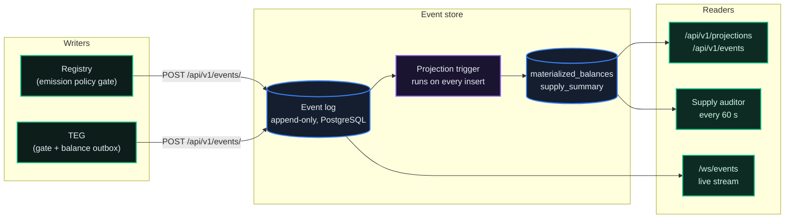
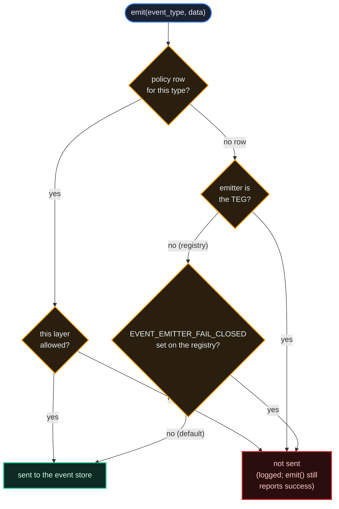
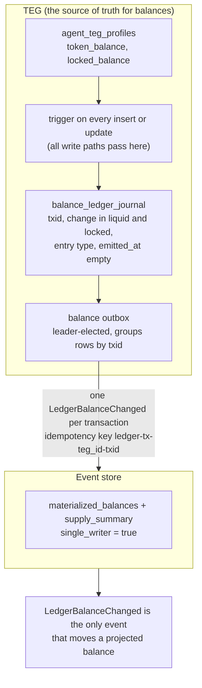
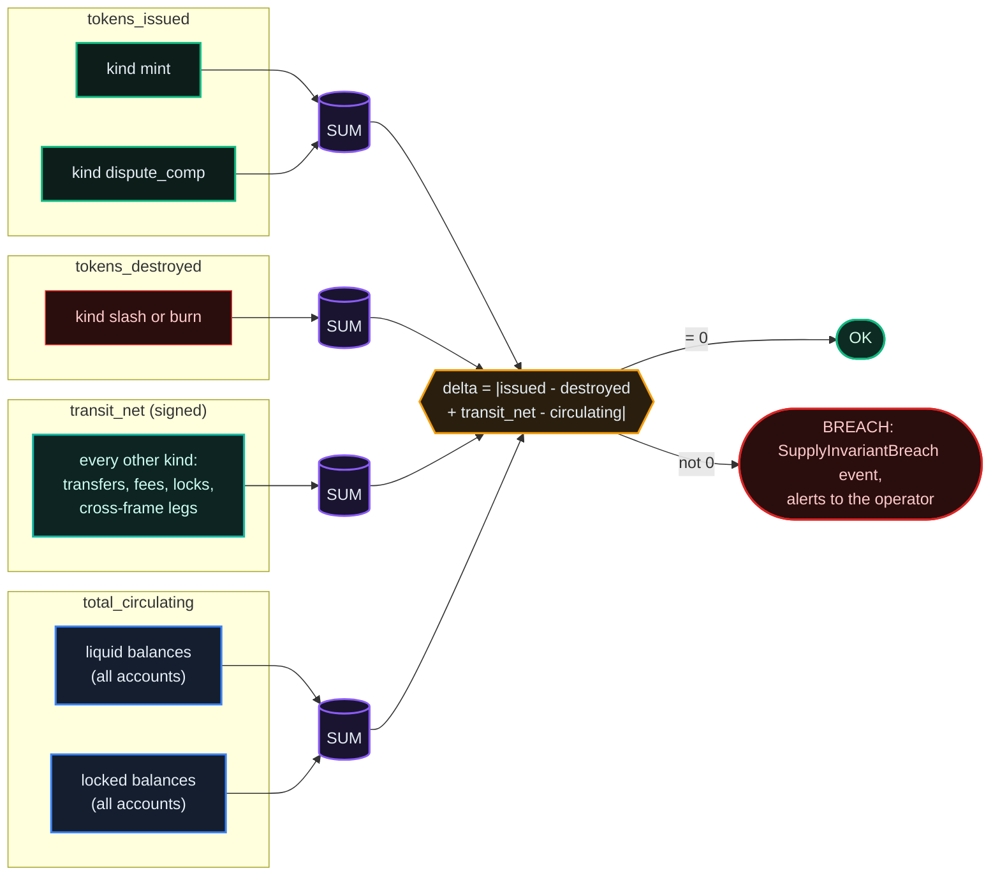
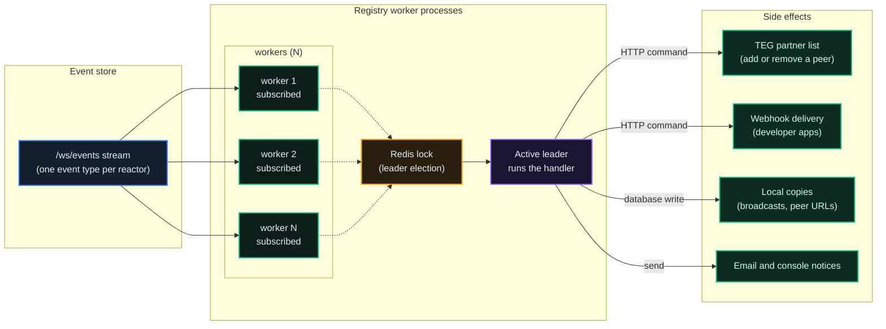
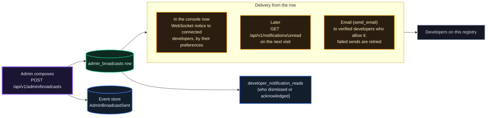
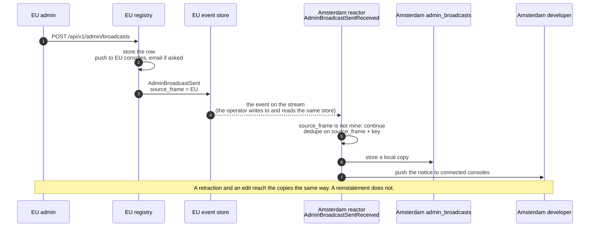
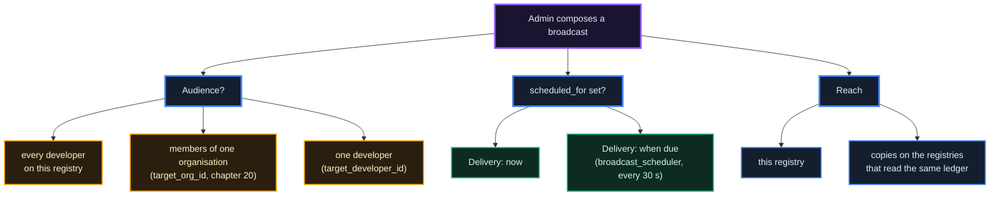

# The Event Store & Supply Audit

*The append-only ledger behind every frame. Every balance change is recorded as an event, balances are a projection of those events, and the frame checks every 60 seconds that the books balance.*

## Why It Matters

Anyone who holds units on a frame can ask: how do I know the operator is not quietly creating units? The event store is the answer the protocol gives. Every change to a balance on the frame's TEG is recorded as an event in an append-only log. The balances the platform reports are computed from that log. A supply audit compares what was created and destroyed with what is held, and the difference must be exactly zero.

This chapter covers how that works: the write and read sides, who may write which events, how balances are projected, the supply invariant, the live event stream, the reactors that act on events, and the admin broadcast channel that rides on the same ledger.

## CQRS at the Heart

The platform separates writes from reads (CQRS: Command Query Responsibility Segregation). Writers append events to a log. Readers read projections: tables that a database trigger updates from each new event. Nothing edits or deletes a stored event.



What this shape gives you:

1. **The audit trail is the storage model.** Auditability is not added on top; the log is the record.
2. **History in order.** Every event carries a timestamp and a sequence number (`seq`) that the database assigns as it stores the event, so the log answers what happened and in which order.
3. **Independent checks.** Anyone who can read the ledger database can recompute the supply terms from it, which is exactly what the independent auditor does.

## Event Types

Not every event changes a balance. On a frame built from the template, one event type moves the projected balances, and the typed events are recorded for the audit trail.

| Event | Emitter | Effect on the projection |
|---|---|---|
| `LedgerBalanceChanged` | The TEG's balance outbox | Moves balances: one event per TEG database transaction, with each account's change in liquid and locked units and the transaction's `kind` (see below) |
| `TokensIssued` | Registry (issuance proxy; the TEG performs the issuance and does not emit) | Recorded; moves balances only on a projection that is not in single-writer mode |
| `DisputeCompensationMinted` | Registry | Recorded; as above |
| `TokensTransferred` | Registry | Recorded; as above |
| `TransactionFeeCollected` | Registry | Recorded; as above |
| `TokensStaked` / `TokensUnstaked` | Registry | Recorded; as above. Locking units is switched off on the production frames (`STAKING_ENABLED`) |
| `BalanceCorrected` | Registry | Recorded; as above |
| `RewardsDistributed` | Registry | Audit only (`skip_in_projection`) |
| `CrossRegistryTransferCompleted` | Registry | Audit only (`skip_in_projection`); the transfer itself is counted elsewhere |
| `ProjectionSnapshot` | Registry (admin action) | A baseline for the store's fallback replay; the trigger does not apply it |
| `AgentOnboarded`, `AgentStatusChanged` | Registry | None |

Each event carries `id` (a UUID), `event_type`, `aggregate_id` (usually an agent DID or a system account), `aggregate_type`, `data` (the payload), `metadata`, `timestamp`, `version`, `source_service` (for example `registry` or `teg`) and `idempotency_key`. The store adds `seq`, and `source_operator_id` when the writer is an operator registered in the store's federation operator table.

Writers do not sign individual events. A writer reaches the store through a TLS terminator that verifies its SPIRE certificate (the frame's own services through the frame's mTLS terminator, a cloud operator through its frame's public ledger address), and the store identifies the writer from that certificate (chapter 08). On a frame built from the template the store publishes each event it accepts to its own broker and answers `202`; its consumer then writes the event to the log. The store applies its own rules on every write:

- An event that adds supply (`TokensIssued`, `DisputeCompensationMinted`, or a `LedgerBalanceChanged` of kind `mint` or `dispute_comp`) is refused with `403` unless one of this frame's own services wrote it. A cloud operator cannot add supply to its frame's books.
- A typed balance event (`TokensIssued`, `TokensTransferred`, `TokensStaked`, `TokensUnstaked`, `BalanceCorrected`, `DisputeSlash`, `DisputeCompensationMinted`, `TransactionFeeCollected`, `RewardsAutoCompounded` or `ProjectionSnapshot`) without an `idempotency_key` is refused with `400`. `LedgerBalanceChanged` is not on that list; the TEG's outbox always sets a key.
- A second event with an `idempotency_key` that is already stored is not stored again. The store answers with the stored event (or, when it ingests through its broker, accepts and drops the duplicate), without comparing the two payloads.
- Two further checks read the store's own copy of the policy table: a typed balance event whose type the table marks `skip_in_projection` is refused with `400`, and with `EVENTSTORE_STRICT_EVENT_TYPES=true` a type with no policy row is refused with `422` (otherwise it is written with a warning). In the released software the store loads that copy from its registry (`REGISTRY_URL`) only when it replays the log for a read, and neither the frame template nor the standalone release gives the store that address, so on those installs the two checks do not fire. The registry refuses the dangerous policy change at its source (below).

## Emission Policy

Which layer may emit which event? If the registry and the TEG both emitted `TokensTransferred` for one transfer, a projection built on typed events would count it twice. The emission policy prevents that.

Each event type can have a row in the registry's `event_emission_policies` table:

```
event_type                       emit_from_teg  emit_from_registry  skip_in_projection
-------------------------------------------------------------------------------------
TokensIssued                     false          true                false
TokensTransferred                false          true                false
TokensStaked                     false          true                false
TransactionFeeCollected          false          true                false
CrossRegistryTransferCompleted   false          true                true    (audit only)
RewardsDistributed               false          true                true    (audit only)
```

The table grows as event types are added (180 rows on EU on 16 October 2026); read it live rather than trusting a count. The registry's emitter reads it from its own database; the TEG reads it from `GET /api/v1/agents/locations/emission-policies`, which every registry answers without authentication. `GET /api/v1/admin/event-emission-policies` (admin with `admin_treasury`) adds each row's description and last change. `LedgerBalanceChanged` has no row: the TEG always allows it, because it is the TEG's own event.

Every `emit()` call checks the policy before it sends anything:



- **A blocked event is not sent.** The emitter logs it (`[EmissionPolicy] BLOCKED`, on the TEG `[EmissionPolicy] TEG BLOCKED`) and returns success to its caller, so the action that produced the event carries on. Every decision is counted in `event_emitter_gate_decision_total`.
- **The two layers default in opposite directions.** The TEG is fail-closed: an event type with no row is not sent. Until its first read of the table it works from the blocklist in `TEG_BLOCKED_EVENT_TYPES`, and when a read fails it keeps the last copy it had. The registry is fail-open: an event type with no row is sent, unless `EVENT_EMITTER_FAIL_CLOSED=true`.
- **Skip-in-projection events are written.** They exist for the audit trail and for stream subscribers; the projection does not move balances for them.
- **Changing a row** is an admin action: `PUT /api/v1/admin/event-emission-policies/{event_type}` with any of `emit_from_teg`, `emit_from_registry`, `skip_in_projection` and `description`. It needs the `is_admin` account flag, updates an existing row only (`404` otherwise), refuses `skip_in_projection: true` on a typed balance event (`422`) and emits `EventEmissionPolicyUpdated`. The registry's workers pick up the change at once (a Redis message tells each to reload). The reactor for that event asks the TEG to reload, which reaches one of the TEG's workers; the others reload on their next emit once their copy is more than 120 seconds old.

::: info Do not give two layers the same event
A frame whose projection still runs on typed events counts a movement twice if the registry and the TEG both emit it. On a single-writer frame the typed events no longer move balances, but one emitter per event type still keeps the log free of duplicates.
:::

## Projections: How Balances Are Calculated

The store keeps two projection tables, updated by a trigger on every insert into the log:

- `materialized_balances`: one row per account, with its liquid and locked balance. System accounts such as the treasury and the fee collector get one row per TEG that writes to the store (a frame and its cloud operators share their frame's store).
- `supply_summary`: one row with the supply terms the audit reads (`tokens_issued`, `tokens_destroyed` and `transit_net`). Its `tokens_fees_collected` column is reported by the audit but not updated by the trigger; fees are part of `transit_net`.

Reading one balance (`GET /api/v1/projections/balance/{agent_did}`) takes the store's in-process cache (30 seconds; `?refresh=true` skips it), then the projection row, and replays that account's events only when it has no projection row or the table cannot be read. This read, an account's history (`GET /api/v1/projections/transactions/{agent_did}`) and its balance at a past moment (`GET /api/v1/projections/balance/{agent_did}/at/{timestamp}`) answer only the callers the store authenticates, like the raw log (see Querying the Log Directly). The agent's owner reads an agent's history through its registry (`GET /api/v1/teg/transactions/history/{agent_id}`); a treasury administrator reads any account's, and anyone else is refused (403). The registry's export of transaction events and its transaction detail hold a developer to its own agents in the same way.

### Projection snapshots

`POST /api/v1/admin/projection-snapshot` (admin with `admin_treasury`) writes a `ProjectionSnapshot` event with the balances the registry holds for its active agents. It is refused with `403` unless the registry sets `ENABLE_PROJECTION_SNAPSHOTS=true`; the cloud-operator template sets it, the frame template does not. The trigger-maintained projection does not apply a snapshot. Only the store's fallback replay of all balances, used when the projection tables cannot be read, starts from the latest snapshot instead of the beginning of the log; it takes the latest one in the store, whichever registry wrote it.

## Single-Writer Balance Integrity

A balance on the TEG can change in many code paths: transfers, fees, issuances, locks, escrow, cross-frame legs. If each path had to remember to emit the right typed event, one forgotten emit would leave the projection silently wrong. The TEG therefore records balance changes where every path must pass: the database row.



1. A trigger on the TEG's balance table writes every change into `balance_ledger_journal`, in the same database transaction as the change, with the transaction id and the kind of operation.
2. The balance outbox (`TEG_BALANCE_OUTBOX_ENABLED`; off in code, on in the frame template) runs on one TEG worker at a time, every 5 seconds by default (`TEG_BALANCE_OUTBOX_INTERVAL_SEC`), and turns each transaction's journal rows into one `LedgerBalanceChanged` event.
3. The event's idempotency key is `ledger-tx-{teg_id}-{txid}` (with a suffix when the database reuses a transaction id), so a retry after a crash is stored once. The outbox marks the rows as emitted only after the store has accepted the event.
4. The store's `projection_config.single_writer` switch makes `LedgerBalanceChanged` the only event that moves balances; typed balance events are still recorded but no longer projected. A new store starts with the switch off, and the frame standup turns it on.

**Why this conserves supply.** Each `LedgerBalanceChanged` lists every account the transaction touched, including the treasury and the fee collector. The store classifies the transaction by its `kind`: `mint` and `dispute_comp` add the net change to `tokens_issued`; `slash` and `burn` add it to `tokens_destroyed`; every other kind (transfers, fees, locks, cross-frame legs) adds its net change, positive or negative, to `transit_net`. The same deltas update the account rows, so the invariant below holds after every event.

## The Supply Invariant

The audit compares the store with itself, in one database statement, so two separate reads cannot disagree:

```
tokens_issued - tokens_destroyed + transit_net  ==  total_circulating
```

Where, on a single-writer frame:

```
tokens_issued      = net change of every LedgerBalanceChanged of kind mint or dispute_comp
tokens_destroyed   = net change of every LedgerBalanceChanged of kind slash or burn
transit_net        = signed net change of every other transaction
                     (transfers, fees, locks, and cross-frame legs that settle on another frame)
total_circulating  = sum of liquid + locked over every row of materialized_balances
                     (treasury, fee collector and every agent account included)
```

Fees move units from the payer to the fee collector, which is itself counted in circulation, so a fee changes no supply term. Only an issuance adds to supply and only a slash or a burn removes from it.



The status is `OK` only when the delta is exactly zero. A store whose projection still runs on typed events (the standalone release, which turns on neither the balance outbox nor single-writer mode) takes the same terms from `TokensIssued` (issued), `DisputeSlash` (destroyed) and `BalanceCorrected` (issued when positive, destroyed when negative). In that mode a `DisputeCompensationMinted` raises a balance without raising `tokens_issued`, so the audit reads it as a breach (a known defect).

**What happens on a breach.** Each registry runs a supply auditor worker that reads the store's audit every 60 seconds. On a `BREACH` it emits `SupplyInvariantBreach`. A reactor turns that event into alerts: a critical log line, the `supply.invariant_breach` webhook, an email to the addresses in `SUPPLY_ALERT_RECIPIENTS` when set, and a critical notice to connected consoles. It alerts again when the delta changes, and otherwise at most every 5 minutes (`SUPPLY_ALERT_THROTTLE_SECONDS`). With `FEDERATION_ENFORCEMENT_ACTIVE=true` the registry also asks the store to lock down (`POST /api/v1/system/lockdown`); the frame template leaves that switch off. In the released software the lock is held in the memory of the one store worker that receives the call, so on a store that runs several workers it stops only part of the writes (a known defect).

::: info What Δ = 0 does not prove
The invariant proves that the ledger's books balance. It does not prove that every projected balance equals the TEG's: an account whose opening balance predates the frame's balance outbox can show a negative projected balance while the totals still balance. The store's audit counts such rows in `negative_accounts`, and the independent auditor checks them separately.
:::

### Query the Audit Directly

Every registry publishes its frame's verdict without authentication:

```http
GET /api/v1/public/supply-invariant
```

```json
{
  "delta": 0.0,
  "status": "OK",
  "net_supply": 1000001.0,
  "total_circulating": 1000001.0,
  "checked_at": "2026-10-16T10:20:30.809945+00:00",
  "source": "eventstore"
}
```

(The EU frame's answer on 16 October 2026.) The registry keeps the answer for 30 seconds. When it cannot read its store, the answer says `status: "UNKNOWN"` with a null delta rather than a reassuring zero.

The full audit is the store's own `GET /api/v1/projections/supply-audit`, which the frame's registry reads every 60 seconds. It returns `tokens_issued`, `tokens_destroyed`, `tokens_fees_collected` (not updated, see above), `transit_net`, `net_supply`, `total_circulating`, `delta`, `status` (`OK` or `BREACH`), `agent_count`, `negative_accounts` and `negative_balance_sum`.

The network's independent auditor at [auditor.theprotocol.cloud](https://auditor.theprotocol.cloud) reads each frame's ledger database directly every 60 seconds, publishes the verdicts (`GET /api/auditor/latest`) and signs them as hash-chained attestations under the supply attestation standard TPSA-1 (published at [docs.theprotocol.cloud](https://docs.theprotocol.cloud/reference/supply-audit-standard)).

::: info A breach is an alarm, not a number to fix
When a `BREACH` fires, do not correct balances by hand. Read the auditor's breach record (`GET /api/auditor/breaches`), find the event that moved the books, and correct the cause. The invariant is the alarm.
:::

## WebSocket Fan-Out

Every stored event is pushed to subscribed WebSocket clients. This is how consoles, dashboards and agent programs see events as they happen.

```
WebSocket /ws/events            (on the production frames: wss://<frame host>/ws/events)
  Query parameter ?token=<the store's internal key, or a JWT-SVID>
  required only when the store sets EVENTSTORE_WS_AUTH_REQUIRED=true

After connecting, send:
  { "action": "subscribe", "channel": "events:TokensTransferred" }
  Channels: events:all · events:{type} · agent:{did}
  Other actions: unsubscribe · ping · stats
```

The frame template leaves the stream open, and the production frames publish it at their ledger address (`wss://eu.theprotocol.cloud/ws/events` for EU; a registry's `GET /api/v1/public/registry-config` names it in `self.ledger_ws`). The server greets with `{"type": "connected", ...}`, confirms each subscription with `{"type": "subscription_confirmed", "channel": ...}` and delivers events as `{"type": "event", "event": {...}}` with the event's `id`, `event_type`, `aggregate_id`, `data`, `timestamp` and `version`. A `TokensTransferred` event is also delivered on the receiver's `agent:{did}` channel.

A connection that presents no credential (as every console does) receives each event, live and in the catch-up below, with a developer's own account, whose id is built from its e-mail address, shown as `account:` and 16 hex characters (the same on every read of this store, and the same id this frame's registry shows on its public reads), and an e-mail address shown as `[address withheld]`; it cannot subscribe to the `agent:{did}` channel of such an account, and its `stats` name no such channel. A connection that presents the store's internal key or a JWT-SVID the store verifies (the registry's reactors) receives the events as stored.

On every subscribe the store also sends the channel's 15 most recent events alongside the live ones, so a client that reconnects catches up across a short gap: of that type for an `events:{type}` channel, of that agent's own events for an `agent:{did}` channel, and of any type for `events:all`. A transfer an agent receives reaches its channel live but is not part of that catch-up. The `balance:updates` channel is advertised in the greeting, but nothing is published on it, and a subscribe to it sends no catch-up.

A slow client cannot stall the others: each connection has its own queue of up to 10,000 messages (`WS_PER_CLIENT_QUEUE_MAX`). When the queue is full the oldest message is dropped, and a client that overflows 500 times in a row (`WS_PER_CLIENT_OVERFLOW_LIMIT`) is disconnected.

### The delivery contract: at-least-once, dedupe by `id`

**The stream is at-least-once, and every client must be written for that.** An event can reach your socket more than once: in the backlog sent on a new subscription, and when it is replayed by a reconnect. The event is *stored* once and carries a stable `id`; only the notification can repeat.

Two rules follow, and the second is the one people get wrong:

1. **Deduplicate by `id`** before you act on an event. A ring of recently seen ids is enough; the reactor framework keeps 256.
2. **Count acceptances, never arrivals.** A counter incremented once per received message measures your socket, not the ledger. Increment only after the id passes your dedupe check, or your totals drift above the truth.

Exactly-once delivery to a remote consumer is not something a network can promise, so the ledger promises exactly-once *storage* and gives you a stable identifier to reconcile against.

### Seeding a feed without a socket

A page that has just loaded has no history: a live socket only carries what happens next, so a fresh dashboard looks like a dead network until the first event arrives.

```http
GET /api/v1/public/eventstore-recent?limit=60      # public, no auth; limit caps at 500
```

This is served by the **registry**, not by the store. It reads a bounded ring of this frame's recent events, each appearing once, and states what it is: the response carries `events`, `count`, `requested`, `ring` (the ring's size), `scope` (`local-frame-eventstore`), `is_seed: true` and a `note`. Each event is shown as the store holds it, except that a developer's own account, whose id is built from its e-mail address, appears as `account:` and 16 hex characters (the same id this frame's store shows in its public stream: the registry keys it with the store's key, which it holds to write its events; a registry without that key keys it with its own secret, and its ids then differ from the store's), and an e-mail address appears as `[address withheld]`. Operators size the ring with `RECENT_EVENTS_RING` (default 400, between 15 and 2000).

Use it to **prime a view**, not to measure. A seed tells you what recently happened, not what you observed; mixing the two is how a dashboard ends up claiming traffic that predates the page load.

## Querying the Log Directly

The raw log is read on the store, by the callers it authenticates: this frame's own services (through the frame's mTLS terminator with a service certificate, or with the store's internal key, which authenticates reads only while `EVENTSTORE_MTLS_REQUIRED` is on, its default), and, with their certificates through the frame's ledger address, its cloud operators and the services of a federated peer frame, which read it to replicate. A developer or admin JWT does not open these routes; an admin reads a developer's events through the registry (chapter 08).

```http
GET /api/v1/events/?limit=100&offset=0&sort_order=asc
GET /api/v1/events/?event_type=<type>&limit=100&offset=0
GET /api/v1/events/aggregate/<aggregate_id>
GET /api/v1/events/by-transaction/<transaction_id>
```

- `GET /api/v1/events/`: `limit` 1 to 10,000 (default 100) and `offset`. Without `event_type` the events come oldest first (`sort_order=desc` reverses it); with `event_type` they come newest first.
- `GET /api/v1/events/aggregate/{aggregate_id}`: an aggregate's whole history, oldest first; pass `limit` (1 to 1000) and `sort_order=desc` for the newest events only, and `event_types` (comma-separated) to filter.
- `GET /api/v1/events/by-transaction/{transaction_id}`: every event carrying that `data.transaction_id`, newest first.

There is no route that deletes or edits an event. A mistake is corrected by a new movement, recorded like any other.

## Reactors: Cross-Service Reactions to Events

Some events have consequences in other services. When a peer registry is deactivated, the TEG must drop it from its partner list; when a proposal is tallied, subscribed webhooks must hear about it. The endpoint that caused the event does its own part inside its database transaction; the follow-on work happens out of band, in reactors.

A reactor is a background task in the registry that subscribes to one event type on the frame's event stream. One worker process holds the reactor's Redis lock at a time and runs its handler.



### The CQRS line

A reactor reacts to an event; its side effects are HTTP commands, database writes and notifications. A reactor never emits the event type it consumes. A few emit one follow-up event of a different type: the receive side of an asynchronous cross-frame transfer emits `CrossFrameTransferSettled` after crediting the receiver, and the drift and self-healing reactors record what they found.

### The source of truth stays inline

The synchronous endpoint that produced the event (for example `POST /api/v1/admin/agents/bulk/suspend`, which runs the coordinated suspension) is the source of truth. A reactor propagates its effect; if the reactor fails, the local state is still correct. Setting `REACTOR_FRAMEWORK_ENABLED=false` pauses that propagation without touching the endpoints.

### What the reactors do

| Domain | Events consumed | What happens |
|---|---|---|
| **Agents and developers** | `AgentSuspended`, `AgentReinstated`, `DeveloperSuspended`, `DeveloperReinstated`, `DisputeSlash` | Webhooks to the owning developer's apps; a suspended agent goes on the cross-TEG blocklist of this frame's TEG and of the peer frames (and comes off on reinstatement), with a notice to the connected enforcement admins; an email to the owning developer when an agent is slashed |
| **Agent cards** | `AgentCardPulled`, `AgentCardJWSVerifyFailed` | Flags an agent whose card keeps drifting or whose signature keeps failing to verify |
| **Federation and peers** | `RegistryFederated`, `RegistryQuarantined`, `FederationLicenseSuspended`, `FederationLicenseReinstated`, `PeerRegistryDeactivated`, `OperatorApplicationRevoked`, `FrameFederationRevoked`, `FederationStateDriftDetected`, `ComplianceDryRunDrift`, `FederationPolicyUpdated`, `OperatorRenamed` | Adds or removes the peer on the TEG's partner list, repairs a peer's stored URL, re-polls compliance, propagates renames, and fires the matching webhooks |
| **Money and treasury** | `SupplyInvariantBreach`, `BalanceCorrected`, `LedgerBalanceChanged`, `BridgeTransferExpired`, `FundingRequestCreated`, `EventEmissionPolicyUpdated` | Breach alerts, an audit alert on every balance correction, the `payment.received` webhook, a notice to the originator of an expired bridge transfer and to treasury admins on a funding request, and a refresh of the emission policy cache |
| **Cross-frame settlement** | `CrossFrameTransferInitiated`, `CrossFrameTransferSettled`, `CrossFrameTransferRefunded`, `FxSwapSettled`, `CrossRegistryTransferCompleted` | Credits the receiver and clears the sender's pending state for asynchronous cross-frame transfers, reverses on a refund, and feeds the peer-trust model |
| **Governance and disputes** | `ProposalTallied`, `DisputeFiled` | Webhooks and a console notice for a tallied proposal, a notice to enforcement admins on a filed dispute |
| **Organisations** | `OrganizationMemberInvited`, `OrganizationMemberJoined`, `OrganizationMemberRemoved` | Notices to the invitee, the removed member and the organisation's admins (chapter 20) |
| **CI/CD** | `DeploymentTriggered`, `DeploymentStatusUpdated`, `DeploymentWebhookExhausted` | Notices to the owner or the organisation's admins |
| **Admin broadcasts** | `AdminBroadcastSent`, `AdminBroadcastEdited`, `AdminBroadcastRetracted` | Local copies of broadcasts sent on another registry (below) |
| **Webhooks** | `WebhookRetryExhausted` | An email to the developer when a webhook endpoint has stopped accepting deliveries (chapter 21) |
| **Attestations** | `AttestationDueReminder`, `AttestationExpired`, `AttestationRevoked` | Webhooks to the owner, and an email on a revocation; each runs while its phase switch is on (`ZKP_PHASE_2_ENABLED` for expiry and revocation, `ZKP_PHASE_5_ENABLED` for reminders, both on unless a registry turns them off) |
| **Canary validators** | `TokensTransferred`, `TransactionFeeCollected`, `CrossFrameTransferInitiated`, `CrossFrameTransferSettled`, `CrossFrameTransferRefunded` | Stamp synthetic test transfers for the canary judge (chapter 16) |

Some reactors start only with their feature: device push notices (`PUSH_NOTIFY_ENABLED`, off in code and on in the frame template) and cross-frame contract mirrors (`CONTRACTS_XFRAME_MODE` at `shadow` or `enforce`; the frame template sets `enforce`). The canary validators (`CANARY_VALIDATOR_ENABLED`, on in code and off in the frame template) and the two routed settlement reactors of the fiat on-ramp run outside the master switch; the on-ramp they serve is switched off on the public network (`fiat_onramp_enabled` false). The live set, with dispatch counts and errors, is at `GET /api/v1/admin/reactor/status` (admin with `admin_platform`).

### Operational properties

- **Leader-elected.** One worker holds each reactor's Redis lock (a 30-second lease, renewed every 10 seconds); another takes over when the lease runs out. Reactors start 15 seconds after the registry boots.
- **Deduplicated.** Each reactor keeps a ring of the last 256 event ids it handled, stored in Redis as well so a restart does not handle the backlog again.
- **Backstopped.** Besides the stream, the leader polls the store every 30 seconds (10 seconds for the cross-frame settlement reactors) for events of its type it may have missed (`REACTOR_POLLING_BACKSTOP_ENABLED`, on by default). The poll cursor is kept in Redis.
- **Retried, then dropped.** A handler that fails is retried when the event is delivered again, up to 3 attempts (`REACTOR_HANDLER_RETRY_CAP`); after that the event is dropped for that reactor and the failure is logged.
- **Throttled where it matters.** The supply breach reactor alerts at most every 5 minutes per delta, and skips replayed breach events older than an hour.
- **Switchable.** `REACTOR_FRAMEWORK_ENABLED=false` stops the framework; a per-reactor switch (for example `REACTOR_AGENT_SUSPENDED_ENABLED=false`) stops one reactor. Both default to on.
- **Observable.** `GET /api/v1/admin/reactor/status` returns each reactor's leader, connection state, dispatch and error counts and its last event; the console's admin view `#/admin/reactors` refreshes it every 10 seconds. Prometheus series: `reactor_dispatches_total`, `reactor_dispatch_duration_seconds`, `reactor_is_leader`, `reactor_ws_connected`.

## Admin Broadcasts

An admin sometimes needs to tell every developer something at once: maintenance starts in ten minutes, an advisory was published, a peer frame is going offline. Admin broadcasts do that, and the broadcast event lets other registries that read the same ledger show it to their developers too.

### Composing and delivering

`POST /api/v1/admin/broadcasts` (admin with `admin_support`) takes:

| Field | Meaning |
|---|---|
| `title` (up to 200 characters), `body` | The message |
| `broadcast_type` | `info` (default), `warning`, `maintenance` or `critical` |
| `send_email` | Also email verified developers (default false) |
| `cta_url`, `cta_label` | A call-to-action button |
| `requires_ack` | The notice stays until the developer acknowledges it |
| `scheduled_for` | Send later instead of now. When it is due, the scheduler sends it as an immediate broadcast is sent: the console notice and, with `send_email`, the email, once. A time already past sends it now |
| `target_org_id` | Only the active members of one organisation: the console notice, the unread list, the community page and, with `send_email`, the email |
| `target_developer_id` | One developer only (a direct notice: in the console only, sent now, and not combined with `send_email`, `scheduled_for` or `target_org_id`) |
| `idempotency_key` | A key of your own for the broadcast |
| `skip_self` | Do not push the notice to the sending admin |



The type sets the colour in the console and the email's theme: `warning` and `critical` use the red security theme, `info` and `maintenance` the neutral one. `GET /api/v1/notifications/unread` returns up to 50 active broadcasts the developer has not dismissed, newest first: those addressed to everyone, to an organisation the developer is an active member of, or to the developer alone, from the later of the account's creation and 90 days ago. Broadcasts still scheduled for later stay hidden.

After the row is stored, the registry emits `AdminBroadcastSent` (or `AdminDirectNoticeSent` for a direct notice) to its event store, with the idempotency key `admin-broadcast-sent:{source_frame}:{id}`.

### Reach beyond this registry

Every registry runs the `AdminBroadcastSentReceived` reactor. When it sees an `AdminBroadcastSent` from another registry, it stores a local copy so that registry's developers see the broadcast too, and pushes it to their consoles.



What to know about the copies:

- **Who receives one.** Every registry that reads the same event store: a frame and its cloud operators. A peer frame's registries receive one when the two frames replicate their ledgers (the event store's `CROSS_FRAME_REPLICATION_ENABLED`, which the frame template leaves off and the tooling that federates two frames switches on).
- **What a copy carries.** The title, type, body, call to action and acknowledgement flag. A broadcast scheduled for later is copied as scheduled: the receiving registry shows and pushes it at the time the original goes out, and a time already past when the event arrives is sent at once. A copy is never emailed again. A body longer than 16,000 characters stays on the sending registry, as does every body in an event from a registry older than this release: such a copy reads `[Federated from <registry>]`.
- **No local-only option.** Every broadcast addressed to everyone is offered to the other registries that read the event; there is no field that keeps one local. Direct notices (`target_developer_id`) and organisation broadcasts (`target_org_id`) are not copied: their audience is on the sending registry.
- **Retraction and edits propagate; reinstatements do not.** Retracting the original retracts the copies, and editing its title, type or body changes them. Reinstating it leaves them retracted.

### Targeting



### Call to action and acknowledgement

- **Call to action.** Set `cta_url` and `cta_label`; the console's notice shows a labelled button.
- **Acknowledgement required.** Set `requires_ack: true`. The console's notice stays on screen with an Acknowledge button instead of closing after a few seconds (a `critical` notice also stays). Acknowledging, or dismissing an ordinary notice, calls `POST /api/v1/notifications/{broadcast_id}/read`, which writes a `developer_notification_reads` row; the broadcast then no longer appears on the next visit.

### Per-developer notification preferences

Developers set their own filters with `GET` and `PATCH /api/v1/developers/me/notification-prefs`: `mute_info`, `mute_warning`, `mute_maintenance` (critical notices cannot be muted), `delivery_in_app`, `delivery_email`, and `quiet_hours_start` / `quiet_hours_end` (hours 0 to 23, UTC; during quiet hours the live push is skipped and the notice waits in the unread list). Email and in-console delivery are independent.

### Two dedicated workers

| Worker | Cadence | Job |
|---|---|---|
| `broadcast_scheduler` | every 30 s | Sends up to 50 broadcasts per cycle whose `scheduled_for` has passed, that are active and not yet sent: the console notice to the broadcast's audience and, with `send_email`, its email to that same audience. Each broadcast goes out once. |
| `broadcast_email_retry_worker` | every 60 s | Retries failed email batches after 60 s, 5 min, 30 min, 2 h and 12 h, then moves the batch to the dead-letter list (`GET /api/v1/admin/broadcast-email-retry/dead-letter`). |

Both are leader-elected. Their state is at `GET /api/v1/admin/broadcast-scheduler/status` and `GET /api/v1/admin/broadcast-email-retry/status` (admin with `admin_platform`).

### The broadcast endpoints

All paths are under `/api/v1`.

| Method | Path | Auth | Purpose |
|---|---|---|---|
| `POST` | `/admin/broadcasts` | admin (`admin_support`) | Compose and send, or schedule, a broadcast |
| `GET` | `/admin/broadcasts` | admin (`admin_support`) | List broadcasts (`skip`, `limit` up to 200, `include_inactive`) |
| `PUT` | `/admin/broadcasts/{id}` | admin (`admin_support`) | Edit the title, body or type; emits `AdminBroadcastEdited` |
| `DELETE` | `/admin/broadcasts/{id}` | admin (`admin_support`) | Retract (sets `is_active` false); emits `AdminBroadcastRetracted` |
| `POST` | `/admin/broadcasts/{id}/reinstate` | admin (`admin_support`) | Undo a retraction (on this registry only) |
| `GET` | `/admin/broadcasts/overview` | admin (`admin_support`) | Totals by type, last 24 hours and 7 days, emails sent, live connections, verified developers |
| `GET` | `/admin/broadcasts/{id}/stats` | admin (`admin_support`) | Read count, recent readers and email state for one broadcast |
| `GET` | `/notifications/unread` | developer | Active broadcasts the caller has not dismissed |
| `GET` | `/notifications/{broadcast_id}` | developer | One active broadcast and whether the caller has read it. A broadcast the caller may not see (another developer's direct notice, another organisation's broadcast, one scheduled for later) answers `404`, as a missing one does |
| `POST` | `/notifications/{broadcast_id}/read` | developer | Mark as read or acknowledged |
| `GET` | `/admin/broadcast-templates` | admin (`admin_support`) | List the calling admin's saved compose templates |
| `POST` | `/admin/broadcast-templates` | admin (`admin_support`) | Save a template (`label`, `title_template`, `body_template`, and optional type, email, acknowledgement and call to action) |
| `DELETE` | `/admin/broadcast-templates/{id}` | admin (`admin_support`) | Delete one of your templates |
| `GET` | `/developers/me/notification-prefs` | developer | Read the caller's preferences |
| `PATCH` | `/developers/me/notification-prefs` | developer | Change the caller's preferences |
| `GET` | `/admin/broadcast-scheduler/status` | admin (`admin_platform`) | Scheduler state and pending count |
| `GET` | `/admin/broadcast-email-retry/status` | admin (`admin_platform`) | Email retry state and queue depth |
| `GET` | `/admin/broadcast-email-retry/dead-letter` | admin (`admin_platform`) | Email batches that failed for good |
| `GET` | `/community/announcements` | developer | The active broadcasts the caller may see (the unread list's audience, read or not), newest first, for the community page (`skip`, `limit` up to 50). |

::: tip Test a broadcast safely
Compose with `broadcast_type: "info"` and `send_email: false`. The notice reaches the consoles connected now, on this registry and on the registries that copy it, and no email goes out. Retract it with `DELETE /api/v1/admin/broadcasts/{id}`; the copies are retracted with it. `GET /api/v1/admin/broadcasts/{id}/stats` shows who read it.
:::

::: info The console view
`#/admin/broadcasts` (admin with `admin_support`) lists broadcasts with their read statistics and composes new ones (title, body, type, email, an organisation and skip-self) with a live preview and three quick-fill templates. A broadcast's drawer edits, retracts or reinstates it, or copies it into a new draft. Scheduling, the call to action, acknowledgement, saved templates and the dead-letter list are available through the API.
:::

## What's Next

- [02: Units and Fees](/docs/02): the balances this ledger records
- [04: Contracts, A2A Payments & Disputes](/docs/04): where `DisputeCompensationMinted` comes from
- [08: Security & Identity Fabric](/docs/08): how writers authenticate to the event store
- [16: Monitoring & Observability](/docs/16): the metrics and alerts on the ledger's health
- [19: Compliance & Governance of the Protocol](/docs/19): the auditor's role in compliance
- [21: Webhooks & Integrations](/docs/21): subscribing a backend to the events the reactors fan out
