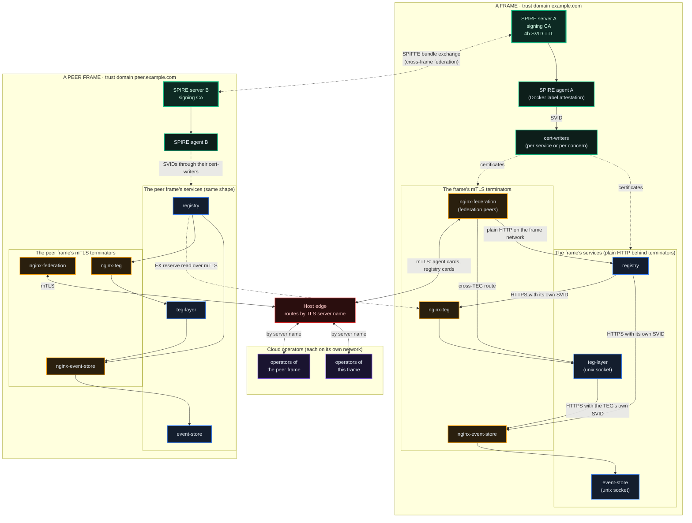
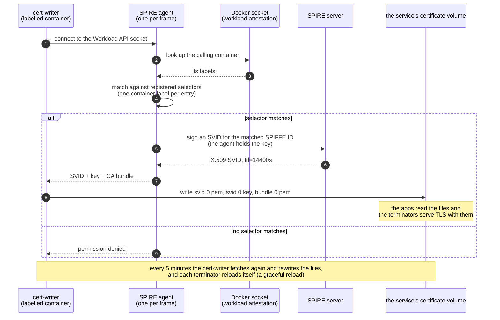
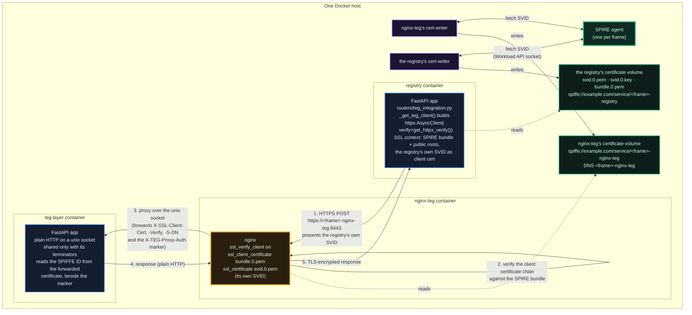
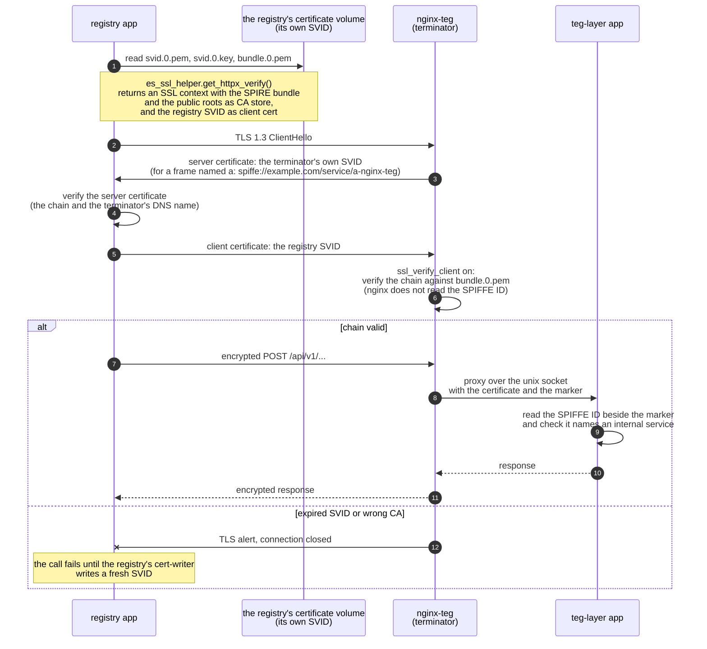
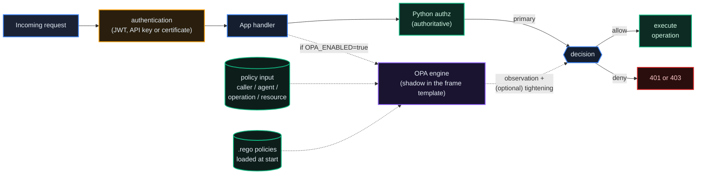

# Security & Identity Fabric

*Zero trust as the design target: every service carries a short-lived certificate, every door that carries a write or a transfer verifies it, and authorization sits at a small set of named checks rather than being scattered across endpoints. The hop census below says, hop by hop, where the current frame template meets that target.*

## Why It Matters

A platform that moves value between strangers cannot rest on "we trust our own services". The Protocol is built on the opposite assumption: **every service that writes or moves units proves who it is with a certificate, and every authorization decision sits at a small set of named checks.** The hop census below shows which hops meet that target, and the authorization section names how each check behaves when its own lookup fails.

Four components form the core:

- **SPIRE** issues short-lived cryptographic workload identities (SVIDs).
- **SPIFFE** is the open standard for those identities (`spiffe://<trust_domain>/...`).
- **mTLS through nginx terminators** encrypts service-to-service traffic and verifies the caller's certificate chain; the app behind the terminator reads the forwarded certificate and decides which identity it is.
- **OPA** holds declarative Rego policies beside the Python checks. The production frames and their cloud operators run it in shadow mode: OPA's answer is recorded beside the Python one, and Python decides.

This chapter shows how they fit together, then covers the credentials people use (passwords, two-factor authentication, JWTs and API keys), rate limits, the read-only switch and the audit trail.

## The Trust Domain

Every frame is its own **trust domain**. In the examples below, one frame's trust domain is `example.com` and a peer frame's is `peer.example.com`. Service SVIDs live 4 hours, and the SPIRE agent renews them ahead of expiry, so workloads see fresh certificates about every 2 hours.

Certificates reach services through **cert-writers**: small containers that fetch an SVID from the SPIRE agent and write it into a volume. In the frame template the registry, the TEG, the event store, the event broker and the three mTLS terminators in front of the TEG, the event store and federation each have a writer and a certificate of their own. The rest share one writer per concern: the data services (PostgreSQL and Redis) one, the frame's kit (OPA, Prometheus, Alertmanager, the push terminator and Grafana's egress) one, the auditor with its terminator one, and the Directory with its terminator one. No service shares the registry's.

> **Click any diagram to enlarge.** The architecture diagrams in this chapter open in a full-screen overlay.

The diagram shows two frames, their core services, the terminators in front of the TEG, the event store and federation, and the edges between frames: the SPIFFE bundle exchange, and the host edge that routes cloud-operator federation traffic by TLS server name. The Directory's, push and auditor terminators appear in the hop census.



Key properties:

- **The SPIRE server is the anchor of trust inside a domain.** Its signing key is the root.
- **Each frame runs its own SPIRE agent, and so does each cloud operator**, whose agent attests to its frame's SPIRE server. The agent attests workloads through the Docker socket, and each registration entry selects on one container label, so any container that carries that label on that host receives that identity.
- **The identity-bearing hops terminate at nginx.** Each app speaks plain HTTP behind its terminator: the TEG, the event store and the Directory listen on a unix socket they share only with their terminators, and the registry listens on its own port on the frame's networks. The terminator verifies the caller's certificate chain on the way in. On the way out, every service presents its own SVID (the registry holds two: the file its cert-writer writes, and a Workload API SVID it fetches itself, which it presents to the Directory).
- **Service identity is structural; the data stores also ask for passwords.** Every mTLS and TLS hop authenticates a SPIRE certificate. PostgreSQL, Redis and the broker also ask for a password, and an app trusts a certificate its terminator forwards only beside that terminator's shared marker secret. The frame and cloud-operator templates set `TEG_MTLS_REQUIRED=true`, so the TEG accepts its internal callers by certificate only; a TEG without that switch still accepts the shared admin key, and logs each use.
- **Cross-frame federation rests on SPIFFE bundle exchange**, plus a federation licence that the approving frame issues to the joining frame. SPIRE re-fetches a peer's bundle on its own refresh schedule. A peer certificate that maps to a known peer must come from an ACTIVE peer. One that matches no active peer is refused when the registry sets `FEDERATION_REQUIRE_PEER_SPIFFE_BIND`, which the frame and cloud-operator templates do; without the switch, the call is let through and logged. When the check's own database lookup fails, it lets the call through, so a database outage does not cut federation.
- **Cloud-operator federation traffic passes the host edge**, which routes by TLS server name. Each operator's federation terminator carries DNS names in its SVID that match its public hostname.

::: tip For reviewers
The internal TLS hops authenticate by SPIRE certificate. The inter-service plane still holds shared secrets: the database, Redis and broker passwords, the event store's internal key (reads only, while the store requires mTLS), the issuance-proxy secret, the terminators' marker secrets, and the TEG's shared admin key, which a TEG with `TEG_MTLS_REQUIRED=true` no longer accepts from internal callers. The compose and env templates name each one. Federation authentication is layered: mTLS first, then the federation licence.
:::

## SVID Issuance

Each service gets its identity from a cert-writer: a small container whose label the SPIRE server holds an entry for. It fetches the SVID from the SPIRE agent's Workload API and writes it to a volume that only its service, or its concern's services, mount.



- **Selectors** are registered on the SPIRE server, one container label per entry (for example `docker:label:com.agentvault.service:<value>`). They are the rule that says "a container with THIS label gets THIS SPIFFE ID". The registry also holds an entry for its own Workload API calls.
- **Rotation before expiry.** The X.509 SVID lives 4 hours (`default_x509_svid_ttl = "4h"`), and the SPIRE agent renews it well before expiry. The cert-writer fetches the SVID every 5 minutes and rewrites the files; each nginx terminator reloads itself every 5 minutes with a graceful reload that keeps live connections; the registry's TLS helpers rebuild their context when the certificate file changes. JWT-SVIDs (short-lived authentication tokens) carry SPIRE's default 5-minute lifetime. Agent SVIDs issued by IRONHAND live 30 minutes, for faster revocation (see below).
- **Revocation is passive.** Deleting a workload entry stops renewal: the cert-writer keeps the last certificate on disk, and the terminators accept it until it expires, up to 4 hours for a service SVID. No revocation list is checked.

## Service-to-Service mTLS

An nginx terminator in front of a service ends the mTLS connection and forwards the request to the app over a unix socket they share (the TEG, the event store, the Directory) or, for the registry, over the frame network to its plain HTTP port; the Python app stays plain HTTP behind it. Moving a CALLER behind a terminator takes more than a new URL (for example `EVENT_STORE_URL` from `http://...` to `https://<frame>-nginx-event-store:8443`): every HTTP client the caller builds must present its SVID and trust the SPIRE bundle, the SVID must carry the terminator's name as a DNS SAN, and the callee must still recognise the caller's rights when they arrive by certificate instead of by key. Most registry clients take their TLS from one helper (`es_ssl_helper`), and the event store decides "one of this frame's own services" with one rule (`es_auth.is_origin`) whichever way the caller authenticated.

### The Sidecar Anatomy: Registry to TEG

Every call the registry makes to its own TEG takes this hop: the TEG has no other door. The diagram shows every certificate and container in play.



The same shape covers the other internal mTLS hops of a frame built from the template:

| Caller | Terminator | Callee | Notes |
|---|---|---|---|
| registry / TEG | `<frame>-nginx-event-store` | event store | mTLS; the store listens on a unix socket |
| registry | `<frame>-nginx-teg` | TEG | mTLS; the TEG listens on a unix socket |
| a peer frame's registry | `<frame>-nginx-teg` | TEG | mTLS; the FX reserve read |
| cloud-operator registry | the operator's `nginx-teg` | its own TEG | mTLS; the operator's TEG requires an SVID |
| peer frame | `nginx-federation` (each frame) | the peer's `/api/v1/federation/*` | SPIFFE bundle federation |

::: tip On the operator's TEG hop
A cloud operator's registry reaches its own TEG through the operator's `nginx-teg` over mTLS (`TEG_API_BASE_URL` in the operator template points at it), and that TEG requires an SVID (`TEG_MTLS_REQUIRED=true`). One cert-writer serves the operator's registry, its TEG and both of its terminators, so they present the same certificate. The TEG also answers plain HTTP on its own port inside the operator network, where its health check reaches it; its admin and cross-TEG routes there accept only a certificate the terminator vouched for.
:::

### The Hop Census

What the current frame template does on each hop:

| Hop | Today |
|---|---|
| Registry to its TEG | `https://<frame>-nginx-teg:8443` with the registry's SVID. The TEG listens only on a socket shared with its two terminators (`nginx-teg` and `nginx-federation`) and counts a forwarded client identity only beside a terminator's marker. With `TEG_MTLS_REQUIRED=true` (set by the template) the shared admin key no longer authenticates |
| Registry to its event store | `https://<frame>-nginx-event-store:8443` with the registry's SVID; a write that fails for a retryable reason waits in a durable outbox and is retried |
| TEG to its event store | the same terminator (`FT_EVENT_STORE_MTLS_URL`), with the TEG's own SVID (`/service/teg-layer`), through its balance outbox |
| Registry to the Directory | `https://<frame>-directory-nginx:8443` with the registry's Workload API SVID; the index answers only the identities in `DIRECTORY_READERS` |
| Registry to push (`ntfy`) | `https://<frame>-nginx-ntfy:8443`; `ntfy` itself listens only on a local socket |
| Registry to OPA | HTTPS with client certificates |
| Every service to Redis | TLS with client certificates, and one ACL user per client |
| Every service to PostgreSQL | TLS only: each client presents an SVID that must chain to the frame's own root, plus the role's password |
| Event store to its broker (Redpanda) | SCRAM over TLS on a network only the event store joins. The store's HTTP route checks and signs each event before it publishes it, and the store's consumer writes the ledger only from records the store signed; no other service has a producer |
| Browsers and peers to the event store's public door | the frame's host edge (`nginx-edge`) shares the store's socket. The live ledger stream and the store's projection routes need no certificate, and the host's ledger address checks a client certificate where one is presented (`ssl_verify_client optional`), which is how operators and peer frames write and replicate |
| Frame to peer frames | `nginx-federation`, SPIFFE bundle federation; a peer frame's registry also reads this frame's TEG through `<frame>-nginx-teg` |
| The frame's auditor to its ledger | the ledger, registry and TEG databases, with a read-only role; its one API read goes through `nginx-event-store` with its own SVID |
| TEG, event store and Directory to the registry | plain HTTP on the frame's own network, for four reads the registry serves without authentication: the emission policies, the home-frame lookup behind the TEG's home-frame guard, its JWKS, and its agent cards |

Every hop that carries a write or a secret to the TEG, the event store, the Directory or a data service goes through an mTLS terminator, TLS with a client certificate, or (the broker) a password over TLS. The registry is the exception: it listens in plain HTTP on the frame's networks, and `nginx-federation` forwards peer frames' writes to it there after verifying their certificates. The other plain hops are the four reads above.

Where a service has a certificate of its own, a terminator that verifies a caller knows which service it is, and a stolen key opens only the doors of the one service it names. Where a writer serves a concern, its certificate names that concern. The frame still draws lines with private networks and with the terminators' markers, and the few allow-rules that name callers (the event store's internal writers, the TEG's internal callers) are lists of service names that must match the registration entries. A cloud operator's registry, TEG and terminators share one certificate.

The census describes the current template. A frame rendered from an earlier template keeps the shape it was rendered with until it is rendered again; chapter 35 draws the template as a whole.

### Sequence: What Happens on Every Internal Call



What an observer sees on the wire: TLS 1.3 (the push terminator also accepts TLS 1.2), with a cipher from nginx's `HIGH` set. What a caller needs to pass a terminator's handshake: a certificate that chains to the frame's SPIRE root or to a federated root. What the SPIRE CA asks before issuing a service SVID: a container on the frame's host that carries the label a registration entry selects on. The registry can also issue a short-lived agent SVID without an entry, for an enrolled agent that runs off the host (see IRONHAND below).

The practical effect: a caller on the frame's networks without an SVID cannot pass the TEG's, the event store's or the Directory's terminator, and the databases and Redis refuse it. This does not protect against a compromised host: the registry listens in plain HTTP on the frame's networks, each cert-writer writes its key with mode 600 into its own volume, and anyone with the host's Docker socket can start a container that carries a service label.

### The Python side: the TLS helpers

The registry's TLS helper (`es_ssl_helper.py`) builds one SSL context that trusts both the SPIRE bundle and the public CA roots, and presents the SVID as the client certificate; most registry clients that dial another internal service take their `verify=` from it. Two older builders still choose between the SPIRE bundle and the public roots by whether the hostname contains a dot: the registry's event emitter and the TEG's `ssl_helper.py`.

```python
from ..es_ssl_helper import get_httpx_verify

def _get_teg_client() -> httpx.AsyncClient:
    ...  # rebuilds the client when the SVID file's mtime changes
    _teg_http_client = httpx.AsyncClient(
        limits=httpx.Limits(max_connections=200, max_keepalive_connections=50),
        timeout=httpx.Timeout(10.0, connect=5.0),
        verify=get_httpx_verify(),  # SPIRE bundle + public roots, the registry SVID as client cert
    )
    return _teg_http_client
```

The helper rebuilds its context when the registry's cert-writer rewrites the certificate files (an mtime check), and a long-lived client built from it rebuilds itself on the same signal, as the TEG client above does. Moving a transport from plain HTTP to mTLS takes more than a new URL: every client presents the SVID, the SVID carries the dialed name as a DNS SAN, and the callee recognises the caller's identity (see above).

## Agent mTLS (IRONHAND)

The same SPIRE infrastructure can issue SVIDs to **agents**, not only to platform services. This is IRONHAND. An agent with the `identity.mtls` permission calls `POST /api/v1/agent/enable-mtls` with its agent JWT and no body. The registry decides how to deliver the identity:

- **On the registry's host** (a container labelled with the agent's DID exists, or the call came from a private network address): the registry creates a SPIRE entry for the agent's container label, and the container fetches its SVID through the SPIRE agent's socket. The response says `delivery: "workload_api"` and names the label (`com.theprotocol.agent-did: <did>`).
- **Anywhere else**, when the registry allows inline certificates (`IRONHAND_INLINE_SVID_ENABLED`; off in code, on in the frame template): the response carries `delivery: "inline"` and an `svid` object with `svid_pem`, `key_pem`, `bundle_pem`, `ttl_seconds` and `expires_at`. The certificate lives 30 minutes by default (`IRONHAND_INLINE_SVID_TTL_SECONDS`, 60 to 3600); calling the endpoint again before `expires_at` rotates it. A call that reaches the registry over loopback is treated as coming from elsewhere, because the real origin is unknown.
- When neither applies, the response says `status: "not_enrolled"` and nothing is recorded: no entry, no flag, and the agent card does not claim mTLS.

An identity an administrator revoked (`POST /api/v1/admin/ironhand/revoke/{did}`) stays revoked: the agent's own `enable-mtls` answers `403` until an administrator enrolls it again (`POST /api/v1/admin/ironhand/enroll/{did}` or `POST /api/v1/admin/agents/{did}/force-mtls-enrol`). The agent's own `POST /api/v1/agent/disable-mtls` leaves it free to enroll again.

The registry reaches its SPIRE server through the host's frame runner (`IRONHAND_SPIRE_MODE=runner` in the template), which creates the entry or issues the SVID for the calling frame only, so the registry holds no Docker socket. A registry rendered with the socket (an older template) does it directly, and one with neither proxies through a `CENTRAL_REGISTRY_URL`.

```mermaid
flowchart TB
    subgraph SetupPath["1. Enrollment (per agent)"]
        direction LR
        Dev["Agent (agent JWT,<br/>identity.mtls permission)"]:::actor
        EnableEp["POST /api/v1/agent/enable-mtls<br/>(no body: the DID comes from the token)"]:::api
        AgentSpire["services/agent_spire.py<br/>through the frame runner (IRONHAND_SPIRE_MODE=runner),<br/>the Docker socket on an older render,<br/>or a proxy call to CENTRAL_REGISTRY_URL"]:::svc
        Entry[("on the registry's host: SPIRE entry<br/>spiffe://&lt;td&gt;/agent/&lt;did&gt;<br/>selector: docker:label:com.theprotocol.agent-did:&lt;did&gt;<br/>x509_svid_ttl: 30m")]:::data
        Inline[("off the host: inline SVID<br/>issued without an entry<br/>30m TTL by default")]:::data
        Dev --> EnableEp --> AgentSpire
        AgentSpire --> Entry
        AgentSpire --> Inline
    end

    subgraph RuntimePath["2. Runtime A2A call (every payment and service hop)"]
        direction LR
        AgentA["Caller agent<br/>theprotocol-sdk MtlsAgentClient<br/>(IronhandClient keeps an<br/>inline SVID fresh)"]:::agent
        SpireAg["SPIRE agent<br/>Workload API socket<br/>(agents on the host)"]:::spire
        CertsAg["svid.0.pem · svid.0.key · bundle.0.pem<br/>rotated"]:::data
        AgentB["Service agent endpoint<br/>(payment-gated<br/>service agent)"]:::agent
        Auth["A2AAuthenticator<br/>verifies the caller and<br/>checks the revocation blocklist"]:::svc
        PV["PaymentVerifier<br/>added by create_a2a_router when<br/>REGISTRY_URL and AGENT_DID are set"]:::svc

        AgentA -- "1. Workload API call" --> SpireAg
        SpireAg -- "2. issue 30-min SVID" --> CertsAg
        AgentA -- "3. HTTPS POST /a2a/...<br/>presents agent SVID<br/>+ X-Payment-Token" --> AgentB
        AgentB -- "4. caller certificate<br/>and blocklist" --> Auth
        AgentB -- "5. X-Payment-Token via<br/>/api/v1/a2a-payment/verify" --> PV
        PV -- "6. allow / 402 Payment Required" --> AgentB
    end

    subgraph RevokePath["3. Revocation (three layers)"]
        direction TB
        Sus["Admin suspends the agent<br/>POST /api/v1/admin/agents/bulk/suspend"]:::actor
        RevokeFlow["coordinated_suspension.py<br/>1. flip registry status<br/>2. delete the SPIRE entry, emit AgentMtlsRevoked<br/>3. TEG account suspend<br/>4. cross-TEG blocklist"]:::svc
        WS["Event store WebSocket<br/>AgentMtlsRevoked, as it arrives<br/>(receivers that set EVENT_STORE_WS_URL)"]:::ws
        Poll["polling fallback 60s"]:::ws
        Expiry["SVID natural expiry<br/>30 min by default<br/>(final layer)"]:::ws
        Sus --> RevokeFlow --> WS
        RevokeFlow --> Poll
        RevokeFlow --> Expiry
    end

    classDef actor fill:#2a0e0e,stroke:#DC2626,stroke-width:2px,color:#fecaca
    classDef api fill:#141e2e,stroke:#3B82F6,stroke-width:2px,color:#e4ecf4
    classDef svc fill:#141e2e,stroke:#3B82F6,stroke-width:2px,color:#e4ecf4
    classDef data fill:#0d1e1a,stroke:#10B981,stroke-width:2px,color:#d1fae5
    classDef spire fill:#0d2a23,stroke:#10B981,stroke-width:3px,color:#d1fae5
    classDef agent fill:#1a1430,stroke:#8B5CF6,stroke-width:2px,color:#e4ecf4
    classDef ws fill:#2a1f0e,stroke:#F59E0B,stroke-width:2px,color:#e4ecf4
```



mTLS for agents is a choice per agent, not a requirement. An agent that keeps to its JWT and payment authorizations is fully supported; an agent moves to mTLS when stronger peer authentication is worth the operational cost.

Revocation has three layers (all in the diagram above):

- **Event store WebSocket** (as the event arrives, for a receiving agent that sets `EVENT_STORE_WS_URL`): an `AgentMtlsRevoked` event puts the agent's SPIFFE ID on the receiver's blocklist, and its next request is refused with `403`.
- **Polling** (every 60 seconds): the receiver reads the registry's public list of revoked identities (`GET /api/v1/agent/revoked-identities`), whether or not it holds the WebSocket.
- **SVID expiry** (30 minutes by default): the final layer. The suspended agent's SPIRE entry is gone, so its next rotation fails, and an inline SVID runs out on its own.

On the calling side, the SDK's `MtlsAgentClient` presents the SVID on outbound calls, and `IronhandClient` enrolls and keeps an inline SVID fresh. On the receiving side, `create_a2a_router()` adds the `PaymentVerifier` dependency when `REGISTRY_URL` and `AGENT_DID` are set and payment is not switched off, and adds `A2AAuthenticator`, which verifies the caller and checks the revocation blocklist, when `ENABLE_MTLS=true` and `SPIFFE_ENDPOINT_SOCKET` are set. Both ship in `theprotocol-sdk`; the payment check works from SDK 0.7.6 (see [Chapter 14: SDK](/docs/14) for the runnable code path).

## Authorization: Python First, Auditable

Authentication gets you in the door. **Authorization**, what you may do once in, happens in a small set of FastAPI dependencies in `security.py`: `get_current_developer`, `get_current_agent`, `require_admin_flag(<flag>)` and, for agents, `require_agent_permission(<permission>)` together with the spend check. A few gates live in services: the reputation bond at its six sites and the liability gate. A failed identity check answers `401` and a missing permission `403`.

The agent checks follow the registry's `AGENT_RBAC_MODE` (`off`, `shadow` or `enforce`; the frame template sets `enforce`, together with `AGENT_DELEGATION_MODE`). When the permission lookup or the spend lookup itself fails (the spend ceiling of the agent's organization included), a registry in `enforce` refuses the request with `503` (`authz_unavailable`, with `Retry-After: 5`) and does nothing; in `shadow` the request goes through and the failure is logged and counted (`agent_authz_read_failed_total`). The liability gate and the consent posture read the organization's settings too, and refuse with `503` (`org_settings_unavailable`) when those cannot be read: an organization's settings only tighten, so the registry's alone never stand in for them.

The five admin flags scope which class of admin operation a developer may call:

- `admin_treasury`: funding, treasury transfers, fee configuration, event emission policies
- `admin_support`: support tickets, agent assistance, broadcasts
- `admin_enforcement`: suspend and reinstate, dispute slashing, blocklists
- `admin_federation`: peer onboarding, licence issuance, drift response
- `admin_platform`: operational health, workers, reactors, network parameters

The account flag `is_admin` passes every flag check. Sub-admins get only the flags explicitly granted, and the `must_change_password` gate runs first, so a freshly created operator admin must change the password before doing anything sensitive. A request made with an API key reaches an admin check only when the key's scopes include `*` or `mcp:admin` (see API keys below).

## OPA: Declarative Policy, Shadow by Default

For a **declarative policy layer** beside the Python checks, the platform integrates **OPA (Open Policy Agent)**. Every frame built from the template runs it in shadow mode, and a cloud operator provisioned by a current registry gets its own OPA in shadow mode too. The production frames and their four operators run OPA in shadow; enforcing it is each frame operator's decision.



What the OPA integration gives you:

- **A second, declarative copy of the rules.** The shipped developer, agent and admin policies mirror the Python checks, and invariant rules (`agentvault_invariants.rego`) are consulted in shadow at high-impact sites, among them issues, peer value transfers, market orders, contract settlement, bulk enforcement, the liability gate and the read-only write gate; the rules that decide stay in Python.
- **Deliberate policy changes.** A frame's OPA loads its policies at start and does not watch them, and its system policy refuses policy uploads except the registry's `__simulate_*` scratch modules, so a policy change is a container restart.
- **Allow or deny.** OPA's answer is read as a boolean. A request OPA refuses in enforce mode gets a generic `401` or `403` (for example `Agent authorization denied by policy`); the reason sentences stay in Python.
- **The same policies everywhere.** Every frame built from the template loads the same shipped policies, and an operator's OPA gets the same set.

### Two flags, off in code, shadow in the template

The integration is gated by two environment variables on the registry:

```bash
OPA_ENABLED=false   # code default: OPA is bypassed and Python is the only path (the frame template sets true)
OPA_ENFORCE=false   # code default: honoured only when OPA_ENABLED=true (the frame template keeps false)
```

In **shadow mode** (`OPA_ENABLED=true`, `OPA_ENFORCE=false`) the developer, agent and admin-flag checks, plus the invariant checks, send their input to OPA in a background task, and the request sees the Python decision. The OPA decision is logged and counted in Prometheus (`opa_decisions_total` with `source` `python`, `opa` or `mismatch`; `opa_decision_latency_seconds`). Shadow mode is the validation phase before any enforce flip: it lets an operator watch the Rego policies against real traffic without changing a single outcome. The agent permission check does not consult OPA.

When both flags are `true`, OPA can **tighten** the Python decision: the result becomes `python_allow AND opa_allow`. OPA can deny what Python allows; it cannot grant what Python denies, and when OPA does not answer, the Python decision stands.

Both flags come from the registry's environment, so setting `OPA_ENABLED=false` and recreating the registry container returns it to pure Python.

### The shipped policies

| Package | What it answers |
|---|---|
| `agentvault.developer` | Does the developer exist, and is it neither deleted nor suspended? |
| `agentvault.agent` | Does the agent exist, and is it neither suspended nor revoked? |
| `agentvault.admin` | Does the developer hold the requested admin flag (it reads the flag, `is_admin` and `must_change_password`)? |
| `agentvault.invariants` | The invariant rules consulted at high-impact sites |
| `agentvault.jurisdiction` | Which features and transfer limits a jurisdiction profile allows |
| `agentvault.forge` | The GÖDEL FORGE arena's pacing and verifier admission |
| `workload.access` | A sample rule for a workload identity |

A frame can edit the policies in its OPA's policy directory (a restart loads them). The registry asks only the packages above, so a package of its own is consulted by nothing, and in shadow mode the answers of the shipped ones are recorded, not applied.

### Open registration and the reputation bond

Registration on a frame built from the template is open (`BETA_INVITE_REQUIRED=false`). What stops a flood of throwaway providers is not an invite code but the **reputation bond** ([chapter 03](/docs/03#reputation-bond-the-gate-to-providing-services)): a provider that wants to be found, listed, priced, hired or paid holds a bond, and a registry in `enforce` mode refuses an unbonded provider at each of those sites. The frame template runs the bond in `enforce` (`REPUTATION_BOND_MODE`) and lets the frame's treasury back a provider's bond (`REPUTATION_BOND_TREASURY_BACKSTOP=true`); a treasury-backed bond costs the provider nothing. The bond travels as an extension on the agent's card, which the home registry derives from its own records and signs with its registry key, so a peer reads it from its copy of the card.

::: info OPA in shadow decides nothing
A frame that keeps OPA in shadow keeps the Python checks as the only decision. OPA's value there is the record of where the two would have disagreed.
:::

## Credentials and Sessions

People and programs reach the registry with four kinds of credential:

| Credential | How it is obtained | Lifetime |
|---|---|---|
| Developer JWT | `POST /api/v1/auth/login` (form fields `username` and `password`) | 90 minutes by default (`ACCESS_TOKEN_EXPIRE_MINUTES`); a refresh token lasts 7 days |
| Agent JWT | `POST /api/v1/auth/agent/token` (form fields `username` and `password`, carrying the agent's client id and client secret) | the same default |
| API key (`avreg_...`) | `POST /api/v1/auth/api-keys` with a developer login | 365 days by default (`API_KEY_DEFAULT_TTL_DAYS`) |
| Agent SVID | `POST /api/v1/agent/enable-mtls` (IRONHAND, above) | 30 minutes by default |

### API keys

`POST /api/v1/auth/api-keys` takes either a bare JSON string (the key's name) or `{"key_name": ..., "scopes": [...], "expires_in_days": N}`. The plain key is returned once, in `plain_api_key`, and only a hash is stored. Without `scopes` a key has full developer authority (`["*"]`); `expires_in_days: 0` makes a key that does not expire. A key's scopes limit what it may do:

- A key without `*` reaches admin routes only when it holds `mcp:admin`, even if its developer is an admin.
- A key that holds an MCP scope (`mcp:tools` or `mcp:admin`) and not `*` is an MCP credential: it reaches the REST API only through the MCP tools (each call the registry's MCP server makes for it carries a proof that only the registry can produce). A paired phone's key also holds `pocket:device`, the phone's own scope, which reaches one route directly: the phone's push registration (`POST /api/v1/devices/register`); `pocket:device` alone reaches only that route and is not accepted on the MCP endpoints. Presented to any other REST route directly, such a key is refused with `403`. A key whose scopes cannot be read on a request reaches nothing on that request.
- A key may create another key only when it holds `*` or `keys:manage`, and never a key with scopes it does not hold itself.

`GET /api/v1/auth/api-keys` lists your keys without their secrets, and `DELETE /api/v1/auth/api-keys/{key_id}` revokes one at once.

### Logout and token_version

`POST /api/v1/auth/logout` with a developer token increments the developer's `token_version`. Every developer token carries the version it was issued with, so the logout ends every session of that developer on every device: logging out is logging out everywhere. A password change or reset does the same. API keys are not affected; revoke them separately. The logout answers `204` even without a valid token.

Because of this, a script and a browser that share one account end each other's sessions when either logs out. Give automation its own API key rather than a shared login.

An agent token is bound to the client secret it was obtained with: resetting the agent's credentials (`POST /api/v1/onboard/agents/{agent_did}/reset-credentials`) or an administrator's rotation of its secret ends every agent token issued with the old secret on its next call (`401`), not when it expires.

### Two-factor authentication

A developer turns on time-based one-time passwords (TOTP: 6 digits, 30 seconds) with `POST /api/v1/auth/2fa/setup` (with the current password; the answer carries the QR code and 10 backup codes) and confirms with `POST /api/v1/auth/2fa/verify`. From then on, `POST /api/v1/auth/login` answers `requires_2fa: true` with a `partial_token` valid for 5 minutes, and the login completes with `POST /api/v1/auth/2fa/validate` (the code) or `POST /api/v1/auth/2fa/recover` (a backup code, which is then used up). After 5 failed attempts the account waits 15 minutes. `GET /api/v1/auth/2fa/status` shows the state and the backup codes left. `POST /api/v1/auth/2fa/backup-codes` issues new ones (with the password and a current code). `POST /api/v1/auth/2fa/disable` turns 2FA off; it asks for the password and a current code (an authenticator code, or an unused backup code in the form `XXXX-XXXX`), and wrong codes count toward the same 5-attempt limit as the login.

The TOTP secrets are encrypted at rest when the registry sets `TWO_FACTOR_ENCRYPTION_KEY`, which the frame template does. A registry can require 2FA for every account that holds an admin flag (`REQUIRE_ADMIN_2FA=true`): such an account then cannot sign in without it, and none of its credentials (API keys and MCP connectors included) reaches an admin route or an admin tool until 2FA is on. The setting is off by default and the frame template does not set it.

## Rate Limits

The registry limits requests with one shared limiter whose counters live in Redis, so every worker counts against the same budget:

- **The default limit** is 1200 requests a minute per client address (`RATE_LIMIT_DEFAULT`, `1200/minute`). It applies to every route, before authentication. The production frames run the default: their responses carry `X-RateLimit-Limit: 1200`.
- **Per-route limits** are tighter on routes that invite abuse, for example registration (5 a minute), login (10 a minute) and the password reset routes (3 a minute). A per-route limit counts per verified principal (an agent or a developer) when the route authenticated one, and per client address otherwise.
- **Over the limit** the registry answers `429`. Responses carry `X-RateLimit-Limit`, `X-RateLimit-Remaining` and `X-RateLimit-Reset`.

**The client address is the one the edge observed.** nginx appends the address it saw to `X-Forwarded-For`, so the limiter takes the **last** element of that header (everything before it is what the caller sent), then `X-Real-IP`, then the connection's own peer. That holds while the nginx that faces the internet is the first proxy a request meets: behind another proxy (a cloud load balancer in front of nginx, for example), nginx would append the balancer's address, so have nginx restore the client address first (its `set_real_ip_from` and `real_ip_header` settings), or every client shares the proxy's bucket. The client address the registry's server itself records (`request.client`, which its access log and several audit rows use) follows a second setting, `FORWARDED_ALLOW_IPS` (the proxies whose forwarding headers it believes; default loopback and the private ranges), so add such a proxy's range there too.

Requests that carry no forwarding headers and come from a private or loopback address (on-host scripts, container-to-container calls) are exempt. `SANDBOX_BYPASS_RATE_LIMIT=true` turns limiting off for the whole process; it exists for sandbox testing and has no place on a production registry.

## Read-Only Mode

`READONLY_MODE=true` freezes a registry for an incident:

- **Reads keep working**: `GET`, `HEAD` and `OPTIONS` are served.
- **Writes are refused** with `503` and a `Retry-After` header (300 seconds by default, `READONLY_RETRY_AFTER`). Login (with its two-factor step, `POST /api/v1/auth/2fa/validate` or `/recover`), the agent token and the token refresh stay open so responders can sign in and look.
- **`/mcp` is refused entirely**, because a tool call's read or write cannot be told apart at the transport.
- **Background workers stop**: every leader-elected loop skips its cycle, except the observers (`supply_auditor`, `auditor_worker`, `license_drift_monitor`, and any listed in `READONLY_EXEMPT_TASKS`).

The switch is read at start only, and there is deliberately no API to clear it: a freeze that a stolen admin token could lift is not a freeze. Setting `READONLY_MODE=false` and recreating the container lifts it. Refusals are counted in `registry_readonly_refused_total` and skipped worker cycles in `registry_readonly_worker_skipped_total`.

## Secrets Are Refused by Shape, Not by Denylist

The TEG's shared admin key goes through one predicate before it can authenticate anything. A configured key is treated as **absent** unless it is:

- at least **32 characters**, and
- free of placeholder words (such as `change`, `default`, `example` or `placeholder`).

A key that fails either test makes `admin_key_ok()` return `false` for *every* token, including the placeholder itself. There is no configuration in which a shipped default authenticates a caller. A real admin key is compared in constant time. On a TEG with `TEG_MTLS_REQUIRED=true` the admin key no longer authenticates internal callers at all; the shape rule still guards the routes that read it.

Two design choices are worth copying if you build something similar:

**Refuse by shape, never by denylist.** A denylist of known-bad values has to *contain* those values, so the file that protects you against a leaked default is itself a published list of credentials to try. A shape rule carries none.

**A configured secret that equals a public marker is not a secret.** A retired key left in an environment file, a value copied from an example, a placeholder that shipped in an image: all of these are *set*, so a naive `if key:` check passes and the surface behaves as though it is protected. Ask whether the value could be a secret, not whether it is present.

::: info A gate keyed on the environment name is open wherever that variable is unset
`if environment == "production": deny` looks like a safe default and is the opposite of one. The common case is not "some other environment"; it is `ENVIRONMENT` never being set at all. Test surfaces take a **positive** flag that must be switched on and defaults to off. The TEG's test faucet is gated this way (`TEG_TESTING_FAUCET_ENABLED`).
:::

::: tip Prove reach from a peer, not from the node itself
"Can this endpoint be reached?" answered from inside the container that serves it is not an answer: loopback is an exempt lane on most stacks. Probe from another container on the same network, and through the reverse proxy the way an outside caller would arrive, before concluding a surface is closed.
:::

## Never an Automated Issuance

Issuance is the one operation that can break the supply invariant, so the platform keeps it on a short leash:

- **Issuance goes through the registry.** The TEG performs an issuance only when the registry's issuance proxy asks, and the registry records it. Calling the TEG's own issue endpoint directly is refused when `TEG_MINT_REQUIRE_PROXY=true`, which the frame template sets. The event store accepts supply-adding events only from the frame's own services (chapter 07).
- **A treasury shortfall is refused, not issued around.** When a cross-frame treasury funding call finds the treasury short, it answers `409` and counts the refusal (`registry_treasury_shortfall_refused_total`). Issuance on demand to cover it sits behind `TREASURY_MINT_ON_DEMAND_ENABLED`, which defaults to off.
- **Compensation is idempotent.** Compensation paths carry a deterministic idempotency key derived from the thing being compensated, never a fresh UUID. A key that changes on every attempt is not an idempotency key; it is a retry that pays twice. Balance keepers work differently on purpose: the canary refill and the FX reserve and router keepers re-read the balance each cycle, and that re-read is what stops a second payment.

The invariant that catches the rest is described in chapter 07. What it does not catch is worth knowing here: **Δ = 0 proves that the ledger's books balance, not that every projected balance matches the TEG.** An account can show a wrong balance while the totals balance; the supply audit counts the accounts whose projected balance went below zero (`negative_accounts`), the visible sign of it, and the independent auditor checks each such account against the TEG.

## Defense in Depth

Beyond SPIRE, mTLS and OPA, the platform layers:

- **Input validation**: most endpoints validate their bodies with Pydantic schemas; a few still read a raw JSON body.
- **Rate limits**: one Redis-backed limiter in the registry (see [Rate Limits](#rate-limits)). The template's nginx configuration sets no rate limits of its own.
- **Host protections**: CrowdSec, fail2ban and similar tools belong to the host; the frame and operator templates do not install them.
- **Secret hygiene**: each frame keeps its secrets in its own git-ignored env file (`.env.frame-test`, and an operator's `.env.operator`) and passes them to its containers as environment variables, so inspecting a container on the host shows them.
- **Images**: signed container images are planned. Today images are pinned by tag, and the frame runner runs only images its allowlist names, checked by local image ID.

::: info
No one of these is the "real" defense. They are layered so that bypassing any single one still leaves the others between an attacker and anything that matters.
:::

## Admin Actions Leave a Trail

`log_admin_action` writes a row to `security_audit_logs` for every admin action that calls it (action `admin.<name>`, the admin's developer id, the target and details); the write is best-effort and never blocks the action. Some admin mutations also emit an event store event that carries the admin's developer id, for example `DeveloperSuspended` and `EventEmissionPolicyUpdated`.

Admin history can be read through:

- **Developer activity**: `GET /api/v1/admin/developers/{developer_id}/activity` (`admin_support`) returns up to `limit` (1 to 200, default 20) event store events whose aggregate is `developer:<id>`. They come newest first, so a long history shows its latest events.
- **Agent detail**: `GET /api/v1/admin/agents/{agent_did}` (`admin_support`) returns the agent's current state: `enforcement_status`, `enforcement_level`, `offense_count`, `last_offense_at`, open disputes as complainant and as defendant, the bond, the agent card and the developer link. For the full chronological record, read the agent's events on the event store.
- **Raw events**: `GET /api/v1/events/aggregate/{aggregate_id}` on the event store returns an aggregate's events in order, to the services the store authenticates (chapter 07), not to an admin's JWT. The console's live ledger reads the event store's WebSocket stream.

## MCP Tool-Call Audit

Separately from the event store, which records **state changes**, every MCP tool call against `/mcp` or `/mcp/admin` is written as a row in `security_audit_logs` when the registry sets `MCP_AUDIT_LOGGING_ENABLED=true` (off in code, on in the frame template). The `enableToolset` and `disableToolset` switches read no data and write no row. Each row records the actor (developer, admin, agent or anonymous) and its address, the tool name, the outcome, the latency, the sanitized arguments, a sanitized result summary, the OPA shadow decision when there was one, and a correlation id linking it to the HTTP request.

Before a row is written, every field whose name suggests a credential (`jwt`, `secret`, `password`, `token`, `api_key`, `private_key`, `bearer`, `authorization`, recovery and backup codes, licence keys and similar) is redacted, and every string is screened for credential shapes (JWTs, private keys, prefixed keys such as `avreg_` and `apt_`). Strings are capped at 500 characters and the `details` JSON at 4 KB. The write runs in the background, so it adds no latency to the call.

Reads are **developer-scoped**:

- `GET /api/v1/me/mcp-audit-log`: the MCP calls the calling developer made, and every admin read of their log; other developers' calls stay invisible.
- `GET /api/v1/admin/mcp-audit-log?actor_id=N` (`admin_support`): the admin variant. Reading another developer's log writes an `admin_read_mcp_audit` row naming the admin as actor and the developer as target, and the developer's own log lists it (with the admin's developer id and the time, without the admin's email), so admin reads are themselves audited and visible to the developer being read.

The MCP rows sit in the same `security_audit_logs` table as the OAuth and token lifecycle audit (`token_exchange_*`, `token_revocation`, `rate_limit_exceeded`, `jti_reuse_attempt`, `unauthorized_access`, `suspicious_activity`). State-changing MCP calls **also** reach the event store as usual; the MCP row adds the tool-name dimension.

## Cross-Developer Admin Access

One control covers an admin reading another developer's data today, and a second is planned:

1. **Audit, today.** A call to `GET /api/v1/admin/mcp-audit-log?actor_id=N` for another developer writes an `admin_read_mcp_audit` row naming the admin as actor and the developer as target, and the developer's own log lists it. No other admin endpoint writes such a row. Separately, a developer can grant a support reviewer time-bounded read access to one support conversation (`support_review_grants`).
2. **A ticket gate, planned.** The planned gate would require an approved support ticket from the developer before an admin could open their records at all, with one declared exception for an active security incident on that account, and would make the audit row a confirmation rather than the only control. The design is a `support_ticket_grants` table, a guard where the admin view opens a developer's records, and a three-way operator setting (`disabled`, `audit_only`, `gate_required`). None of it exists yet.

## What's Next

- [01: Agents & Identity](/docs/01): DIDs and SPIFFE IDs in context
- [05: Federation & Cross-Registry](/docs/05): how SPIFFE bundle exchange federates trust
- [07: The Event Store & Supply Audit](/docs/07): where admin actions and supply events live
- [17: Operators & Self-Hosting](/docs/17): SPIRE and mTLS for operator-run registries
- [19: Compliance & Governance of the Protocol](/docs/19): the auditor and control mapping

## Canonical Sources

- `identity-fabric/` (SPIRE and OPA configuration)
- `services/agent_spire.py` · `services/coordinated_suspension.py` (IRONHAND enrollment and revocation)
- `es_ssl_helper.py` · `security.py` (the mTLS SSL-context helper and the authorization dependencies)
- `middleware/rate_limiter.py` · `core/client_ip.py` · `middleware/readonly_mode.py` (rate limits, the client address, read-only mode)
