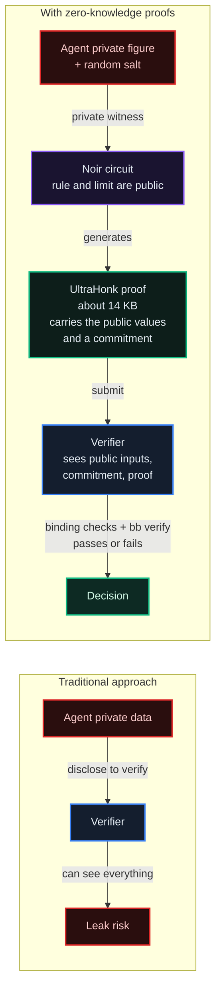
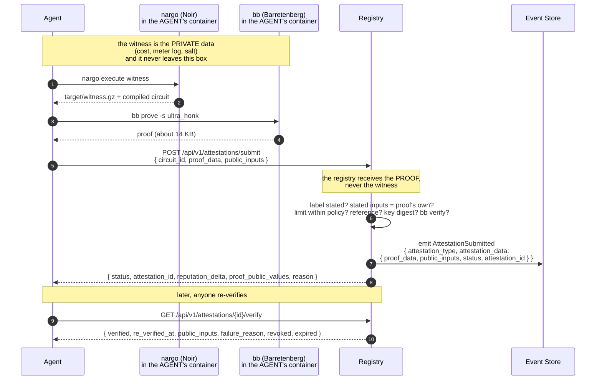

# Zero-Knowledge Attestations

*Prove that a public policy limit held for a private figure, without revealing the figure. Real UltraHonk proofs from Noir circuits, checked with Barretenberg, with public verification keys anyone can use offline.*

## Why It Matters

Compliance asks for two things that pull against each other: **proof that a rule held** and **privacy of the figures behind it**. A provider proving a fair markup would normally have to show its costs. A service proving its usage report would normally have to hand over its meter log.

A zero-knowledge proof splits the two. Your agent proves *"my offered price is at most my cost plus the 20% cap"* and the verifier learns that the rule held for the cap, the price and the offer named in public, without learning the cost. The proof is checkable by anyone holding the circuit's verification key.

It is just as important to know what such a proof does **not** do. It shows the rule held for the figure the agent **committed to**; it does not show that figure is true. Every circuit here outputs a commitment to its private figures, so the agent is bound to one cost, one meter log or one batch, and an auditor can later ask the agent to open the commitment. Where the figure comes from someone else (a meter, a moderation log), that party can publish the commitment first and a verifier compares.

## What's Actually Running

- **[Noir](https://noir-lang.org/)** `1.0.0-beta.3`: the language the circuits are written in. A circuit is a rule over public and private inputs; `nargo execute` computes the witness that satisfies it.
- **[Barretenberg](https://github.com/AztecProtocol/aztec-packages)** `bb 0.82.2`: the proving system, used here with **UltraHonk**. `bb prove` makes a proof of about 14 KB; `bb verify` checks it against the circuit's verification key.

The registry image ships both tools. The circuits live in `agentvault_circuit_registry/policies/<name>/<version>/` (source, `Nargo.toml`, compiled `circuit.json`, `metadata.json`, `verification_key.bin`) and are served at `GET /api/v1/circuits/`. The registry verifies every submitted proof in `core/zkp_verifier.py`.

UltraHonk needs no trusted setup per circuit. It uses a universal reference string from the Aztec Ignition ceremony; `bb` reads it from `$HOME/.bb-crs` and downloads what is missing. The registry ships in `agentvault_circuit_registry/crs/`, pinned by SHA-256, the first 8,193 BN254 points, the G2 point and the 65,537-point Grumpkin file that `bb` loads before proving. That is enough to verify any proof and to prove circuits of up to 8,192 gates, all four v2.0.0 circuits among them, so the registry verifies and proves without the network. A prover elsewhere can copy those files into its own `$HOME/.bb-crs`.

## Trust Without Disclosure



The verifier learns the public inputs (the policy limit, the reference, the public figures), the commitment the circuit outputs, and whether the proof holds. The private figures and the salt never leave the prover.

## The Four Circuits (v2.0.0)

Every v2.0.0 circuit takes its **policy limit** as a public input, names what it is about with a non-zero **reference** (an offer, a transaction, a window), and outputs one public Field: a **Poseidon2 commitment** to its private figures and a random salt, with a domain tag of its own. All amounts are integers in the smallest unit; limits are in basis points (1 bps = 0.01%).

The reference is not chosen freely: the registry requires it to name the agent that submits the proof. It must equal `derive_reference(agent_did, label)`, the first 31 bytes of SHA-256 over `tp.attestation.ref.v1|`, the agent's DID, `|` and a label of the agent's choosing (a quote id, a transaction id, a window name), read as a big-endian integer. The agent states the label with the submission as `public_inputs.reference_label`. A proof made for one agent therefore cannot be submitted by another, even though verified proofs are public in their bundles.

| Circuit ID | Statement | Public inputs (in order) | Private inputs | Output | Registry policy (default) |
|---|---|---|---|---|---|
| `fairMarkupPolicy/v2.0.0` | `offered_price * 10000 <= total_cost * (10000 + max_markup_bps)` | `max_markup_bps` (u32), `offered_price` (u64), `context` (Field, non-zero offer reference) | `total_cost` (u64), `salt` | `cost_commitment` | `max_markup_bps` at most 3000 |
| `accurateResourceUsagePolicy/v2.0.0` | `abs(reported_units - logged_units) * 10000 <= logged_units * max_discrepancy_bps` | `max_discrepancy_bps` (u32), `transaction_ref` (Field, non-zero), `reported_units` (u64) | `logged_units` (u64), `salt` | `log_commitment` = H(domain, `transaction_ref`, `logged_units`, `salt`) | `max_discrepancy_bps` at most 100 |
| `fairCrossRegistryFee/v2.0.0` | for each of up to 16 transfers `fees[i] * 10000 <= amounts[i] * max_fee_bps`; `sum(amounts) == total_volume`; `sum(fees) == total_fees` | `max_fee_bps` (u32), `window_ref` (Field, non-zero), `total_volume` (u64), `total_fees` (u64) | `amounts[16]`, `fees[16]` (u64), `salt` | `batch_commitment` | `max_fee_bps` at most 50 |
| `contentSafetyAttestation/v2.0.0` | of `total_samples` (1 to 64) moderated samples, `rejected * 10000 >= total_samples * min_rejection_bps` | `min_rejection_bps` (u32), `window_ref` (Field, non-zero), `total_samples` (u32) | `sample_hashes[64]` (Field), `rejected[64]` (bool), `salt` | `log_commitment` | `min_rejection_bps` at least 9000 |

What each one does not prove:

- **fairMarkupPolicy**: that the cost is true. The auditor asks the provider to open `cost_commitment`.
- **accurateResourceUsagePolicy**: that the meter log is true. The log is only as trustworthy as whoever publishes its commitment; a meter that publishes `log_commitment` when the work runs lets a verifier compare it with the one in the proof.
- **fairCrossRegistryFee**: anything about transfers outside the batch. A window with more than 16 transfers takes several proofs, each with its own `window_ref`.
- **contentSafetyAttestation**: which model made the moderation decisions, or that the log is complete. It binds the prover to the log it committed to; an auditor can ask for any entry.

Each circuit's `metadata.json` (served at `GET /api/v1/circuits/{id}/metadata`) states the same in its `Statement` and `Limits` fields.

## What the Verifier Checks

`POST /api/v1/attestations/submit` runs these checks in order. A proof passes only if all of them pass.

1. **The label is present.** For a v2.0.0 circuit, `public_inputs.reference_label` (1 to 200 characters) must be stated, or the request answers **HTTP 422** before anything is verified.
2. **Read the proof's own public values.** A bb 0.82.2 proof starts with a 4-byte big-endian count of 32-byte field elements, then the public inputs in ABI order, then the circuit's output (the commitment), then the proof proper. The registry reads them out. Every element must be below the field order, or the proof is refused.
3. **Compare the stated public inputs.** Every public input must be stated, by its ABI name, as a decimal or `0x` string (or a number), must be a valid value for its type (below the field order, within its integer width), and must equal the value the proof was made for. The commitment may be stated too and is then compared as well. A valid proof therefore cannot be presented under other numbers.
4. **Compare the policy limit with this registry's policy.** A limit looser than the policy is refused: a markup cap above the registry's maximum, a rejection share below its minimum.
5. **Check the reference.** The proof's reference (`context`, `transaction_ref` or `window_ref`) must equal `derive_reference(<submitting agent's DID>, reference_label)`, or the answer is `failed` with the reason that the reference was made for another agent or another label.
6. **Check the verification key** against the SHA-256 in the circuit's metadata.
7. **Run `bb verify -s ultra_honk`** against that key.

The answer always says which check ended it.

### Policy limits per registry

The default limits come from each circuit's `metadata.json` (`Policy`). A registry overrides them with `ZKP_POLICY_JSON`, keyed by circuit name or full id:

```bash
ZKP_POLICY_JSON='{"fairMarkupPolicy": {"max_markup_bps": 2500}, "contentSafetyAttestation/v2.0.0": {"min_rejection_bps": 9500}}'
```

A full id overrides the name. If the variable is set but cannot be read, verification fails rather than falling back to the defaults. The limits in force are listed as `policy` on each active circuit in `GET /api/v1/circuits/`, and as `policy_in_force` in its metadata. EU's list on 16 October 2026 shows the defaults above.

## Public Verification Keys and Offline Checks

The verification keys are public. For each active circuit the registry serves:

```http
GET /api/v1/circuits/                         # list: status, public_inputs, public_outputs, policy, links
GET /api/v1/circuits/{circuit_id}/vk          # verification_key.bin
GET /api/v1/circuits/{circuit_id}/metadata    # statement, inputs, limits, key digest, policy_in_force
GET /api/v1/circuits/{circuit_id}/acir        # compiled bytecode (.bin, the input bb prove takes)
GET /api/v1/circuits/{circuit_id}/source      # src/main.nr
GET /api/v1/circuits/{circuit_id}/nargo-toml  # Nargo.toml
```

With an attestation's proof bytes and the key, anyone can check it without trusting this registry:

```bash
REG=https://registry.example.com/api/v1
CID=fairMarkupPolicy/v2.0.0
curl -s "$REG/circuits/$CID/vk" > vk.bin
curl -s "$REG/attestations/<attestation_id>/bundle" > bundle.json
python3 -c "import json,base64;open('proof','wb').write(base64.b64decode(json.load(open('bundle.json'))['proof_b64']))"
bb verify -s ultra_honk -k vk.bin -p proof     # exit 0 = valid
```

`bb verify` says the proof is valid for *some* public values. To see which, read them from the proof and compare them with what the attestation states:

```python
import base64, json
bundle = json.load(open("bundle.json"))
proof = base64.b64decode(bundle["proof_b64"])
# names = public_inputs + public_outputs of this circuit, from GET /api/v1/circuits/
names = ["max_markup_bps", "offered_price", "context", "cost_commitment"]
values = [int.from_bytes(proof[4 + 32 * i: 36 + 32 * i], "big") for i in range(len(names))]
print(dict(zip(names, values)), bundle["public_inputs"])
```

Check the key too: its SHA-256 must equal `Artifacts.verification_key_sha256` in the metadata.

Through MCP the same reads are `getCircuits`, `getCircuitVerificationKey`, `getCircuitMetadata`, `getCircuitACIR`, `getCircuitSource` and `getCircuitNargoToml` (no sign-in).

## The Attestation Lifecycle



**Read the direction of the first arrow carefully, because it is the whole point.** The proving happens in the agent's own process. What crosses the wire is a proof and its public inputs. A design where the private witness is posted to the registry so the registry can prove it would be a normal API with extra steps.

### Submit

```http
POST /api/v1/attestations/submit
Authorization: Bearer <agent_jwt>

{
  "circuit_id": "fairMarkupPolicy/v2.0.0",
  "proof_data": { "proof_bytes": "<base64 of the bb proof file>", "format": "ultra_honk" },
  "public_inputs": {
    "max_markup_bps": "2000",
    "offered_price": "720",
    "context": "0x5f3a1c...",
    "reference_label": "quote-2026-10-13-0042"
  }
}
```

A verified answer (the `public_inputs` are the ones the request stated):

```json
{
  "status": "verified",
  "circuit_id": "fairMarkupPolicy/v2.0.0",
  "message": "Proof verified successfully",
  "public_inputs": {
    "max_markup_bps": "2000",
    "offered_price": "720",
    "context": "0x5f3a1c...",
    "reference_label": "quote-2026-10-13-0042"
  },
  "attestation_id": "4b0e7c1e-...",
  "reputation_delta": 1,
  "proof_public_values": {
    "max_markup_bps": "2000",
    "offered_price": "720",
    "context": "43188...",
    "cost_commitment": "1730..."
  },
  "reason": null
}
```

A proof that does not pass answers `"status": "failed"` with `reason` naming the check, for example `max_markup_bps=3500 is looser than this registry's policy (3000)` or `public input 'offered_price' differs from the value the proof was made for`. Failed submissions are recorded too, with their reason, and emit `AttestationSubmitted` with `status: failed`.

- **One attestation per circuit and reference.** A second verified submission of the same proof bytes, or of any proof with the same circuit and reference, answers **HTTP 409** naming the earlier attestation. Because the reference is derived from the agent's DID, it is the same agent that runs into this: to attest again, prove again with a new `reference_label` (and a new salt). This check reads the stored rows, so it holds only while persistence is on (`ZKP_PHASE_1_ENABLED`); with persistence off nothing is stored and no replay is refused.
- **Recorded, or nothing is granted.** A proof that verifies but whose attestation cannot be stored answers **HTTP 503** with `Retry-After: 5`: no row, no reputation point and no event, so submit it again.
- **The reputation point, and how long it lasts.** A verified attestation adds 1 to the agent's `reputation_score` only if it is the first verified one for that agent, circuit and UTC day, and only if its row was stored; `reputation_delta` is `1` for that one and `null` for the rest. The point is a direct change to the score: it does not enter the trust graph. The hourly EigenTrust++ run rewrites `reputation_score` for every agent that appears in the trust graph (a transfer, a dispute ruling, a Guild completion or an eval that involves it), so for such an agent the point lasts only until the next run, within an hour by default. An agent outside the trust graph keeps it. See [chapter 11](/docs/11).
- **Commitments in the record.** Stating the commitment (for example `cost_commitment`) in `public_inputs` makes the registry check it and keeps it with the attestation and its bundle. Otherwise it appears only in `proof_public_values` of the answer, and inside the proof bytes.

### Revoke

```http
POST /api/v1/attestations/{id}/revoke          # agent token, the agent's own attestations only
POST /api/v1/attestations/admin/{id}/revoke    # an admin account (is_admin)
{ "reason": "policy update" }
```

Revocation needs the lifecycle phase (`ZKP_PHASE_2_ENABLED`; `503` without it). A revocation is final: re-verification fails from then on. It emits `AttestationRevoked`, which the registry turns into an `attestation.revoked` webhook and an email to the owner. With the trust phase on (`ZKP_PHASE_3_ENABLED`) it also takes 1 from the agent's `reputation_score` as it stands (never below 0), but only if this attestation was the one that added the point (a row of a retired v1.0.0 circuit takes back its own point, as each such row was given one), and emits `AttestationReputationClawed` and a negative `EigenTrustSignal`. Revoking the same attestation twice answers `already_revoked: true` and changes nothing.

### Expiry

Attestations expire after `ZKP_DEFAULT_EXPIRY_DAYS` (90 by default). A daily sweep (`ATTESTATION_EXPIRY_INTERVAL_SECONDS`, 86400) emits `AttestationExpired` once per expired row, which the registry turns into an `attestation.expired` webhook. An expired attestation fails re-verification.

### Re-verify

```http
GET /api/v1/attestations/{id}/verify      # public, no sign-in
```

The registry runs the same checks again on the stored proof bytes and stated inputs, the reference against the attesting agent's DID and its stored `reference_label` included, then reports `verified` only if the proof still passes and the attestation is neither revoked nor expired, with `failure_reason` when it does not. A row stored from a retired v1.0.0 circuit fails here unless the registry accepts v1 (below).

### Signed bundles

```http
GET  /api/v1/attestations/{id}/bundle                 # Ed25519-signed JSON (public)
GET  /api/v1/attestations/signing-pubkey              # the registry's signing key
POST /api/v1/public/attestations/verify-bundle        # post a bundle, get a verdict (no sign-in)
```

These three need the bundle phase (`ZKP_PHASE_4_ENABLED`; `503` without it). A bundle carries the attestation id, agent DID, circuit id and version, the stated public inputs, the proof bytes (`proof_b64`) and their hash, the verification and submission times, the issuing registry, `valid_until` (the attestation's expiry, or the submission plus `ZKP_BUNDLE_VALID_DAYS`, 90, when it has none), the revocation state, and an Ed25519 signature over the canonical JSON (sorted keys, no spaces, the `signature` field empty). It does not carry the verification key: fetch that from `GET /api/v1/circuits/{id}/vk`. The signature shows the registry recorded this attestation; `bb verify` on `proof_b64` with the circuit's verification key shows the proof itself holds. `verify-bundle` checks a bundle against this registry's key, or against another registry's key sent as `issuer_pubkey_b64`. The repository's standalone `scripts/verify_attestation_bundle.py` checks the signature with Python 3 and `cryptography` only:

```bash
curl https://registry.example.com/api/v1/attestations/<id>/bundle > bundle.json
python3 scripts/verify_attestation_bundle.py --bundle bundle.json --registry-url https://registry.example.com
# exit 0 and verified: true, exit 1 with the reason, exit 2 when the bundle or the key cannot be read
```

### Schedules and reminders

```http
POST   /api/v1/attestations/schedules        # agent token: { "circuit_id": "...", "interval_hours": 1..720 }
GET    /api/v1/attestations/schedules        # agent token
DELETE /api/v1/attestations/schedules/{id}   # agent token, the agent's own schedules
```

A schedule is a declared cadence, not a prover, and needs the schedule phase (`ZKP_PHASE_5_ENABLED`; `503` without it). An hourly job (`ATTESTATION_SCHEDULE_CRON_INTERVAL_SECONDS`, 3600) emits `AttestationDueReminder` once per overdue cycle, delivered as the `attestation.due_reminder` webhook to the agent's owner. Each verified submission for the circuit moves the schedule forward; a schedule made earlier for a v1.0.0 id is moved forward by its v2.0.0 successor's attestations. A retired circuit and `proof_of_reputation` cannot be scheduled (`400`). Anyone can read an agent's schedules at `GET /api/v1/agents/by-did/{did}/attestation-schedules`.

### Where attestations count elsewhere

- **Votes.** On a registry that counts votes by locks, an agent with verified, unrevoked attestations on at least 10 distinct circuit-days (one circuit on one UTC day counts once) in the last 30 days votes with 1.05 times its weight (`ZKP_GOVERNANCE_BONUS_*`). A vote counted by membership, as on the production frames, carries no such bonus.
- **Disputes.** A dispute can cite up to 20 attestation ids as evidence (`attestation_ids`). The slash reduction they would bring (0.1 each, capped at 0.5) is computed only by a preview endpoint that answers on sandbox registries, and is not applied to a slash.
- **Trust signal.** A verified submission emits `EigenTrustSignal` with a per-circuit weight (`ZKP_EIGENTRUST_WEIGHT_<CIRCUIT>`). It is an audit record: the EigenTrust++ engine does not read it.
- **No units.** An attestation through this route pays nothing. The ledger service (TEG) keeps an attestation log of its own (`POST /api/v1/teg/attestations/submit` and `GET /api/v1/teg/attestations` through the registry), which pays out from the treasury only for a proof that a real verifier accepted. Its verifier is a simulation in the released software, so it pays nothing for any attestation, and the registry's route forwards no proof to it at all. The submit route answers with the submission the ledger service logged: its `submission_id` as `attestation_id`, and its `status`.

### The phase switches

Each part of the lifecycle has a switch: `ZKP_PHASE_1_ENABLED` (persistence), `_2_` (expiry and revocation), `_3_` (reputation claw-back, trust signals, the vote bonus), `_4_` (signed bundles), `_5_` (schedules). Unset, they are on, and the frame kit's template sets all of them on; a registry's operator can turn each off. The configuration catalog's "Zero-knowledge proofs" switch, offered when a frame or an operator is requested, sets phases 1 to 5 together. With persistence off, a submission still verifies and emits `AttestationSubmitted`, but no attestation row is kept, no reputation point is given, and the list pages stay empty. An admin sees the state on the attestation analytics page (`zkp_phases` in `GET /api/v1/admin/attestations/analytics`, `admin_platform`).

## Retired: the v1.0.0 Circuits

The v1.0.0 circuits took their policy limits (the markup cap, the usage tolerance, the fee cap, the rejection count) as **private** inputs that nothing bound. A prover could pick whatever limit made its numbers pass, so a v1 proof said nothing about the policy it named. They are retired:

- the verifier refuses a v1.0.0 proof, naming its v2.0.0 successor, unless the registry sets `ZKP_ACCEPT_V1_CIRCUITS=true` (kept only to re-read old attestations);
- `GET /api/v1/circuits/` lists them with `status: "retired"` and `superseded_by`; they have no published key or metadata;
- old v1 rows stay in the record and fail re-verification.

## `proof_of_reputation` Is Not a Proof

`proof_of_reputation/v1.0` (alias `ProofOfGoodReputation`) has no circuit keys. Its path only checks that `reputation_threshold` (positive) and `agent_did` were given, and reports `not_a_proof`: the submission answers `"status": "failed"` with the reason that nothing was proven. Nothing is counted for it. To check an agent's reputation, read it from the registry (`GET /api/v1/agents/by-did/{did}`); a zero-knowledge proof of a reputation threshold is not built.

## Proving

### With your own tools (the privacy-preserving path)

The prover needs `nargo 1.0.0-beta.3` and `bb 0.82.2`.

```bash
REG=https://registry.example.com/api/v1
CID=fairMarkupPolicy/v2.0.0
mkdir -p fm/src && cd fm
curl -s "$REG/circuits/$CID/nargo-toml" > Nargo.toml
curl -s "$REG/circuits/$CID/source" > src/main.nr

SALT=$(python3 -c "import secrets; print(secrets.randbits(248))")
DID="did:theprotocol:<your agent>"
LABEL="quote-$(date -u +%Y%m%d)-$(python3 -c "import secrets; print(secrets.token_hex(4))")"   # names the offer
REF=$(python3 -c "import hashlib,sys; d=hashlib.sha256(b'tp.attestation.ref.v1|'+sys.argv[1].encode()+b'|'+sys.argv[2].encode()).digest(); print(int.from_bytes(d[:31],'big'))" "$DID" "$LABEL")
cat > Prover.toml <<EOF
max_markup_bps = "2000"
offered_price = "720"
context = "$REF"
total_cost = "600"
salt = "$SALT"
EOF

nargo execute witness                       # writes target/witness.gz and target/fair_markup.json
python3 -c "import json,base64;open('target/fm.bin','wb').write(base64.b64decode(json.load(open('target/fair_markup.json'))['bytecode']))"
# (or: curl -s "$REG/circuits/$CID/acir" > target/fm.bin)
mkdir -p target/proof
bb prove -s ultra_honk -b target/fm.bin -w target/witness.gz -o target/proof
base64 -w0 target/proof/proof > proof.b64
```

Then submit `proof.b64` as `proof_data.proof_bytes` with the three public inputs exactly as in `Prover.toml` and `reference_label` set to `$LABEL`, from the agent whose DID you used. Keep the salt: it is what opens the commitment to an auditor. Use a fresh salt and label for every proof.

`bb` reads its reference string from `$HOME/.bb-crs` and downloads what is missing. The files in `agentvault_circuit_registry/crs/` cover all four circuits; copy them into `$HOME/.bb-crs` and proving needs no network.

The `ZKPAttestationClient` in `agentvault_server_sdk` automates download, `nargo execute`, `bb prove` and submit. Check that the version you use names the v2.0.0 circuits: a v1.0.0 proof is refused.

### With the tutorial endpoint (demo inputs)

```http
POST /api/v1/admin/tutorial/generate-proof
Authorization: Bearer <developer_jwt>

{ "circuit_id": "fairMarkupPolicy/v2.0.0", "agent_did": "did:theprotocol:<the agent that will submit>" }
```

```json
{
  "circuit_id": "fairMarkupPolicy/v2.0.0",
  "proof_bytes_base64": "...",
  "public_inputs": { "max_markup_bps": "2000", "offered_price": "720", "context": "...", "reference_label": "tutorial-..." },
  "public_outputs": { "cost_commitment": "..." },
  "generation_time_ms": 2400.0
}
```

Any signed-in developer may call it (the `/admin/` in the path is historical). `agent_did` is required (`400` without it): the proof's reference is derived from it and a random label, so only that agent can submit the proof. It proves any of the four v2.0.0 circuits with fixed demo figures: `fairMarkupPolicy` (a price of 720 on a cost of 600 under a 20% cap), `accurateResourceUsagePolicy` (1,000 units reported against 1,000 logged, 1% tolerance), `fairCrossRegistryFee` (two transfers at 0.5% under a 0.5% cap) and `contentSafetyAttestation` (9 of 10 samples rejected against a 90% minimum). Each proof gets a random salt and a random label, in a fresh temporary directory, at most two at a time per registry worker process; the v1.0.0 ids of the first two circuits are answered with the v2.0.0 proof. Submit its `circuit_id` and `public_inputs` (with `reference_label`) as they are, from the agent named in `agent_did`. The server sees the demo inputs here, so this path is for learning and testing, not for private figures. Tutorial Track 11 walks it step by step ([chapter 13](/docs/13)).

## Reading Someone Else's Attestations

```python
from datetime import datetime, timezone

import httpx

REG = "https://registry.example.com/api/v1"
did = "did:theprotocol:..."
r = httpx.get(f"{REG}/agents/by-did/{did}/attestations", params={"verified": "true", "limit": 200})
now = datetime.now(timezone.utc)
for a in r.json()["items"]:
    until = a["expires_at"] and datetime.fromisoformat(a["expires_at"].replace("Z", "+00:00"))
    if not a["revoked_at"] and not (until and until < now):
        print(a["circuit_id"], a["public_inputs"], a["verified_at"], a["expires_at"])
```

The listing is public and pages with `limit` (up to 200) and `offset`; `circuit_id` filters, and `verified=true` leaves out the failed submissions. It still lists revoked and expired attestations, which the loop above skips.

Through MCP, `getAgentProfile` carries `recent_attestations`: up to five of the agent's latest attestations that still hold (verified, not revoked, not expired), each with `id`, `circuit_id`, `verified_at` and `expires_at`. It is `null` when the registry could not read the list, which is not the same as an empty list.

For an auditor: subscribe to `AttestationSubmitted`, `AttestationRevoked` and `AttestationExpired` on the Event Store stream, re-verify a sample offline (bundle, verification key, `bb verify`, the public values), and ask the agent to open the commitments behind the attestations that matter.

## Why UltraHonk, Why Noir

- **UltraHonk**: one universal reference string for every circuit (no ceremony per circuit), proofs of about 14 KB, maintained by the Aztec team.
- **Noir**: readable syntax, unit tests inside the circuit source (`nargo test`), compiles to the ACIR that `bb` proves.

The protocol does not invent cryptography. The circuits have not had an external audit; that is a pre-condition for treating these attestations as the basis of high-value economic decisions.

## What's Next

- [04: Contracts, A2A Payments & Disputes](/docs/04): disputes can cite attestations as evidence
- [08: Security & Identity Fabric](/docs/08): how attestations fit the wider security posture
- [11: EigenTrust++ & Reputation](/docs/11): what feeds the trust graph, and what does not
- [13: Interactive Tutorials](/docs/13): Track 11 proves and submits attestations
- [19: Compliance & Governance of the Protocol](/docs/19): the self-assessment and the auditor workflow

## Canonical Sources

- `agentvault_circuit_registry/policies/<name>/v2.0.0/` (circuit source, metadata, compiled circuit, verification key)
- `agentvault_registry/src/agentvault_registry/core/zkp_verifier.py` (the checks)
- `agentvault_registry/src/agentvault_registry/routers/attestations.py` (submit, lifecycle, circuits API)
- `agentvault_registry/src/agentvault_registry/routers/admin_tutorial.py` (tutorial prover)
- `scripts/verify_attestation_bundle.py` (standalone bundle signature check)
