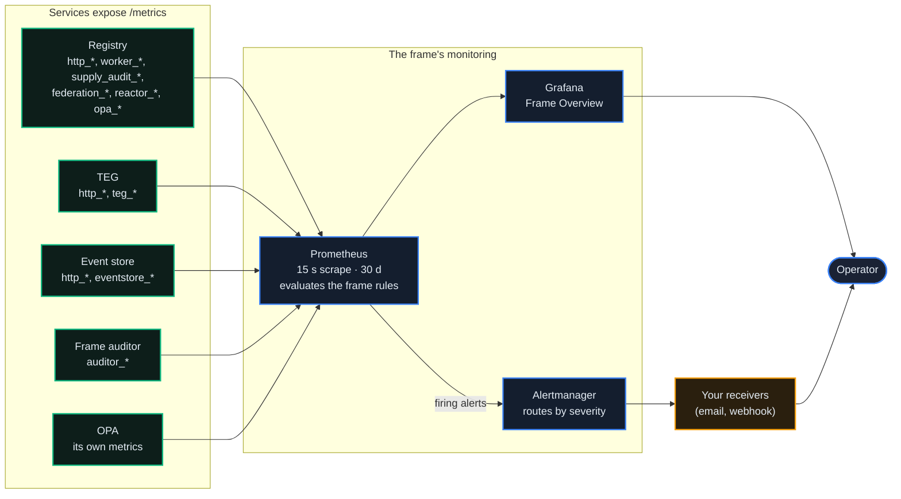
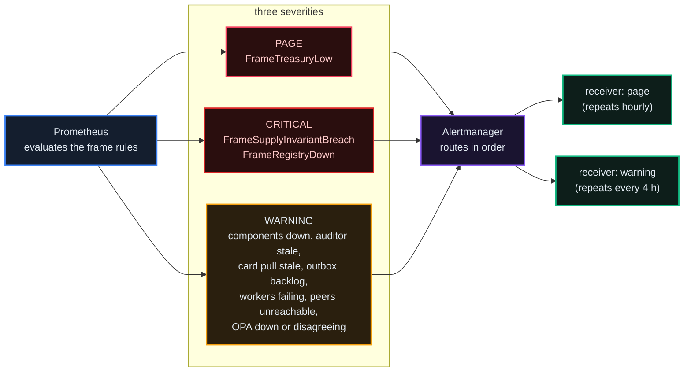

# Monitoring & Observability

*What a frame measures about itself: metrics, dashboards, alerts, the public status page and the independent auditor. Where to look when something is wrong, and which alerts exist so you know a problem has been noticed.*

## Why It Matters

A frame that cannot see itself cannot be trusted with other people's units. Monitoring answers three questions an operator should be able to answer at any time:

1. **Is the supply invariant still zero?** If not, nothing else matters.
2. **Are the services up and answering**, at an error rate and latency you can live with?
3. **What is about to fail?** Backlogs, stale workers, unreachable peers, a low treasury.

This chapter covers what each service exports, what a frame built from the template ships for its own monitoring, which alerts fire and where they go, the public status page, worker vitals, and the independent auditor.

## The Stack

A frame built from the template carries its own monitoring, inside the frame:

- **Prometheus** scrapes the frame's registry, TEG, event store, Alertmanager and itself every 15 seconds and the auditor and OPA every 30, keeps 30 days (`FT_PROM_RETENTION`), and **evaluates the frame's alert rules itself**, every 30 seconds.
- **Alertmanager** routes firing alerts by severity to the receivers you name.
- **Grafana** shows the provisioned *Frame Overview* dashboard.
- **The frame's auditor** re-checks the ledger's supply invariant every 60 seconds and exports its verdict for Prometheus.



Because the frame's Prometheus evaluates its own rules, alert state is in Prometheus: its `ALERTS` series and its `/api/v1/alerts`. A host that runs several frames can also scrape them from outside, with a separate rule evaluator: the repository's `sidecars/` project pairs Prometheus with vmalert. There the scraper holds no alert state, so ask vmalert (its `/api/v1/alerts`), not Prometheus. The registry's admin alert view (`GET /api/v1/admin/alerts/active`, `admin_platform`) reads the `ALERTS` series that vmalert writes into a VictoriaMetrics store when the registry sets `VICTORIA_METRICS_URL`; without it, it reads the frame's own Prometheus (`PROMETHEUS_URL`) when that Prometheus holds alert rules, as on a frame built from the template, and reports itself as not configured otherwise. Its `source` says which store answered.

## What's Measured

Every service exposes `/metrics` in the Prometheus format; a registry stops serving it when its `METRICS_ENABLED` is `false` (operator chapter 02). Names below are the ones the code defines. The registry runs several worker processes, so a counter with labels appears only after it has been counted once.

### Registry

- **HTTP**: `http_requests_total` (labels `handler`, `method`, `status` grouped as `2xx`, `4xx`, `5xx`), `http_request_duration_seconds`, `http_request_size_bytes`, `http_response_size_bytes`.
- **Background workers**: `worker_cycles_total{worker, outcome}`, `worker_last_turn_unixtime`, `worker_last_cycle_unixtime`, `worker_last_success_unixtime`, `worker_last_cycle_duration_ms`, `worker_vitals_write_failures_total` (see Worker Vitals).
- **Supply**: `supply_audit_last_delta`, `supply_audit_net_supply`, `supply_audit_circulating`, `supply_audit_cycle_total`, `supply_audit_breaches_total`, `supply_audit_errors_total`: the registry's own read of the store's audit, every 60 seconds.
- **Treasury**: `registry_treasury_low_threshold` and `registry_treasury_low_active` (1 while the treasury is below that threshold). The balance itself is not exported.
- **Ledger writes**: `registry_es_emit_outbox_pending`, `registry_es_emit_outbox_drained_total`, `registry_es_emit_outbox_dead_total` (events waiting for the store), and `event_emitter_gate_decision_total` (the emission policy's decisions, chapter 07).
- **Federation**: `federation_peer_state`, `federation_peers_total`, `federation_peers_reachable_ratio`, `federation_peer_last_sync_age_seconds`, `federation_peers_never_synced`, `agent_card_pullsync_last_cycle_unixtime` and the other `agent_card_pullsync_*` series.
- **Reactors**: `reactor_dispatches_total`, `reactor_dispatch_duration_seconds`, `reactor_is_leader`, `reactor_ws_connected`.
- **Identity and policy**: `ironhand_enrolled_agents`, `ironhand_revoked_agents`, `ironhand_spire_agent_entries`, `ironhand_orphan_entries`, `ironhand_missing_entries`; `opa_decisions_total{policy, decision, source}`, `opa_decision_latency_seconds`; `registry_svid_bundle_roots`; `registry_xreg_revokes_owed_open` and `registry_xreg_revokes_owed_total{outcome}` (cross-registry delegation revokes not yet delivered to the delegate's registry, and their sends by outcome: `delivered`, `retried`, `dead`; chapter 24).
- **Other**: `mcp_audit_log_writes_total`, `jurisdiction_decisions_total`, `notification_sent_total{type, channel, outcome}`, `governance_proposals_active`, and, while read-only mode is on, `registry_readonly_refused_total`.

### TEG

- **HTTP**: the same `http_*` series.
- **Movements**: `teg_transfers_total{kind, result}`, `teg_transfer_amount_avt` (a histogram of amounts), `teg_fees_collected_avt_total`, `teg_issued_avt_total`.
- **The balance outbox to the ledger**: `teg_balance_outbox_backlog`, `teg_balance_outbox_cycle_total`, `teg_balance_outbox_errors_total`, `teg_balance_outbox_groups_total`, `teg_balance_outbox_rows_total`.
- **The ledger gate**: `teg_ledger_health_state`, `teg_ledger_oldest_waiting_seconds`, `teg_ledger_rejected_rows`, `teg_ledger_gate_decisions_total`.
- **Escrow and cross-TEG**: the `teg_escrow_reconcile_*` and `cross_teg_*` series.

### Event store

- **HTTP**: the same `http_*` series.
- **The ledger**: `eventstore_events_total`, `eventstore_events_by_type{event_type}`, `eventstore_unique_agents`, `eventstore_ledger_age_seconds`, `eventstore_ledger_freshness_seconds` (seconds since the newest event), `eventstore_projection_negative_agents`, `eventstore_projection_negative_oldest_seconds`, `eventstore_info`. These are refreshed every 15 minutes by default (`ES_METRICS_REFRESH_INTERVAL_S`), because counting the log is expensive.
- **Ingestion**: `eventstore_events_ingested_total{source, event_type}`, `eventstore_kafka_consumer_batches_total`, `eventstore_kafka_batch_size`, `eventstore_kafka_records_unverified_total`.

### The frame's auditor

`auditor_status{frame}` (1 = OK, 0 = breach or error), `auditor_atomic_delta`, `auditor_delta`, `auditor_last_cycle_age_seconds`, `auditor_consecutive_ok`, and the per-account checks `auditor_per_user_status`, `auditor_per_user_negative_agents` and `auditor_per_user_behind_agents`.

### Not in the kit

The template ships no host, container or database exporters (node-exporter, cAdvisor, a PostgreSQL or Redis exporter). Add them on your host if you want those layers; the rules and the dashboard do not depend on them.

### Business invariants

**Exported as series**: the supply audit (`supply_audit_*` and `auditor_*`), treasury level, worker liveness, federation reachability, the card pull-sync, reactor dispatch, IRONHAND enrollment, OPA decisions, jurisdiction decisions, notifications, active proposals, the ledger's write path, and A2A payments as they move (`a2a_payment_authorized_total`, `a2a_payment_verified_total`, `a2a_payment_settled_total`, `a2a_payment_released_total`).

**Not exported as series**: how many payment authorizations are in each state right now, dispute phases, and the outcomes of closed proposals. Read them through their APIs: an agent's payment authorizations at `GET /api/v1/a2a-payment/my-tokens` (agent JWT, filter with `status`), disputes at `GET /api/v1/disputes/` (developer JWT, filter with `status`; the caller's agents' disputes, or every dispute for an administrator with `admin_enforcement`), and proposals at `GET /api/v1/governance/proposals?include_closed=true` (public).

## The Canary Reactor

Most synthetic monitors hit a health endpoint. The canary reactor instead moves real units between funded canary agents, on the same code paths as user traffic, and watches the resulting events arrive, so it can tell which step of a transfer broke.

The frame template ships with the canary off (`CANARY_ENABLED`, `CANARY_RUNNER_ENABLED`, `CANARY_JUDGE_ENABLED` and the validator, refill and rebalancer switches all false); turning it on is the operator's decision. When on:

- The **runner** (leader-elected, checking every 5 seconds) fires each active path in `canary_paths` on that path's own interval and writes a `canary_test_results` row.
- Five **validator reactors** subscribe to the events below and stamp the time they saw each one into a Redis hash per test (`canary:<test_id>`).
- The **judge** (every 5 seconds) reads the hash, decides the outcome and records it.
- The admin view is `#/admin/canaries` in the console (`admin_platform`).

| Backend | Endpoint | Required to pass |
|---|---|---|
| `intra` | `POST /api/v1/teg/transfer` | `TokensTransferred` seen |
| `2pc` | `POST /api/v1/teg/cross-registry-transfer?backend=2pc` | `TokensTransferred` or a `CrossFrameTransferSettled` seen |
| `async` | `POST /api/v1/teg/cross-registry-transfer?backend=async` | `CrossFrameTransferInitiated` and a `CrossFrameTransferSettled` seen |
| `smartsend` | `POST /api/v1/teg/send` (the registry picks the route) | as for `async` |

A path marked as a conversion (its notes start with `fx`) passes on the runner's own record that the conversion settled, read from the synchronous answer, because the conversion's event stays on the sending frame's store. A `CrossFrameTransferRefunded`, or a refused conversion, marks the test failed at once. `TransactionFeeCollected` is stamped when seen, as a latency signal, and never required.

Latency is measured from the fire to the last event a validator stamped, not to the moment the judge looked: a monitor that measures its own polling interval reports a number that does not mean what it says.

### What the canary is not

The canary is not the supply auditor. The auditor verifies `tokens_issued - tokens_destroyed + transit_net == total_circulating` on the ledger every 60 seconds with zero tolerance; the network's independent auditor publishes its verdicts at [auditor.theprotocol.cloud](https://auditor.theprotocol.cloud). The canary watches whether transfers complete; the auditor watches whether they conserve units. Different invariants, different failure modes, different runbooks.

::: tip After a registry restart
Reactors start 15 seconds after the registry boots, then subscribe to the stream again; their polling backstop (every 30 seconds, every 10 for cross-frame settlement) picks up anything missed meanwhile. Expect a few minutes of canary noise after a restart before reading a failure as real.
:::

## A Frame Watches Itself

Every frame the frame runner builds carries its own monitoring inside the frame: a Prometheus that scrapes the frame's registry, TEG, event store, auditor and OPA (each target labelled with its `component` and `frame`), the shipped frame rules evaluated there, an Alertmanager beside it, and a Grafana with the Prometheus datasource and the *Frame Overview* dashboard provisioned. Grafana's admin password is generated for each frame. The frame's registry reads its history from that Prometheus (`PROMETHEUS_URL`), so its status page shows its own past without any other host.

The frame's auditor re-verifies the ledger's supply invariant every 60 seconds (`AUDIT_INTERVAL`) and answers `/health` and `/metrics` for the scrape, so a dead auditor reads as one, never as a quiet one.

The standalone release ships the same monitoring as a second compose file: `docker compose -f docker-compose.standalone.yml -f docker-compose.monitoring.yml` brings up Prometheus (`monitoring/prometheus.yml`, the frame rules under `monitoring/rules/`), Alertmanager (`monitoring/alertmanager.yml`) and Grafana (`monitoring/grafana/provisioning/`) on the host's loopback, scraping the standalone services by name; OPA and the auditor are part of the standalone compose itself.

The *Frame Overview* dashboard has rows for availability (registry, TEG, event store, operators up; request rate, p95 latency and 5xx ratio), money (the auditor's delta, verdict and cycle age, the treasury, transfers, the outbox backlog and the registry's own read of the delta), the ledger (events ingested, freshness, agents), federation (peers known and reachable, card pull age, trust bundle roots), workers (failing persistently, cycles by outcome) and OPA (up, mismatches, query errors, latency, decisions by source).

## Where Things Live

| What | Where |
|---|---|
| Grafana | the frame's edge, on the host's loopback (the port is chosen at standup); reach it over an SSH tunnel or put your own access-controlled proxy in front |
| Prometheus and Alertmanager | on the frame's network, over mTLS: only the frame's kit identity and its registry may query them |
| The registry's view of Prometheus | `PROMETHEUS_URL` (the frame template points it at the frame's Prometheus) |
| Long-term metrics and external alert state | optional: `VICTORIA_METRICS_URL`, when the host keeps a VictoriaMetrics store |
| Worker liveness | `GET /api/v1/admin/workers/vitals` on the registry, without any Prometheus |

::: tip
Start at the *Frame Overview* dashboard. If every panel is green, close the tab. If one is not, its row tells you which part of the frame to look at.
:::

## Alerts

The frame's Prometheus evaluates the rules the template ships (`kit/prometheus/rules/frames.yml` in the frame template, `monitoring/rules/frames.yml` in the standalone release); Alertmanager routes what fires. Every metric a rule names is exported by a live frame. There is deliberately no ledger-freshness rule: a quiet network is not a defect.



| Alert | Severity | Fires when |
|---|---|---|
| `FrameTreasuryLow` | page | `registry_treasury_low_active == 1` for 10 minutes: the treasury is below its notify floor |
| `FrameSupplyInvariantBreach` | critical | `auditor_status == 0` for 5 minutes: the auditor's latest verdict is not OK (its delta is not zero, or its audit failed) |
| `FrameRegistryDown` | critical | the registry has not been scraped for 10 minutes |
| `FrameComponentDown` | warning | the registry, TEG or event store has not been scraped for 3 minutes |
| `FrameAuditorStale` | warning | `auditor_last_cycle_age_seconds` above 4 hours for 10 minutes: the delta is unmeasured, not OK |
| `FrameCardPullSyncStale` | warning | no completed agent-card pull cycle in 8 hours |
| `FrameBalanceOutboxBacklog` | warning | `teg_balance_outbox_backlog` above 50 for 15 minutes: the TEG cannot deliver balance events to the ledger |
| `FrameWorkerFailingPersistently` | warning | a worker has not succeeded in 3 hours and is still erroring |
| `FrameFederationPeersUnreachable` | warning | `federation_peers_reachable_ratio` below 0.9 for 30 minutes |
| `FrameOpaDown` | warning | OPA has not been scraped for 5 minutes |
| `FrameOpaShadowMismatch` | warning | OPA disagreed with the registry on a policy in the last 30 minutes |
| `FrameOpaQueryErrors` | warning | more than 5 % of the registry's OPA queries got no answer over 15 minutes |

The supply breach and the treasury floor are the alerts that mean "look now". Everything else means "look within the hour".

### A severity with no route is a promise nothing keeps

Alertmanager routes are evaluated **in order**, and the first match wins. The shipped routes send `page` and `critical` to the `page` receiver first (repeating hourly), `warning` to the `warning` receiver, and anything else to the default `everything-else` receiver; alerts are grouped by alert name, frame and severity, so one frame's incident is one notification. A rule that emits a severity no route matches does not error and is not dropped: it falls to the default receiver, which looks exactly like an alert that never fired.

**The shipped receivers have no integration.** Until you add one (an `email_configs` or `webhook_configs` block), alerts reach nobody. Two habits keep routing honest:

- **The highest-priority route goes first**, because routing stops at the first match.
- **Compare the emitted severities with the routed ones** whenever you add a rule:

```bash
# every severity the rules can emit
grep -o 'severity: *[a-z]*' monitoring/rules/frames.yml | sort | uniq -c
# where each severity goes
amtool config routes test --config.file=monitoring/alertmanager.yml severity=page
```

::: tip Set `--web.external-url`
Without it, every "view in Alertmanager" link in a notification points at the container's hostname, which is unreachable from the phone you read it on.
:::

::: info A failure counter without its denominator is not a finding
`notification_sent_total{channel="email", outcome="failed"}` reading 33 means little until you read the channel's total beside it: 33 out of 4,515 is 0.7 %, which is normal for email. Before declaring a transport dead, fetch the paired total **and** one live log line.
:::

## The Public Status Page

Every console has a status page at `#/status`, and every registry serves the data behind it at **`GET /api/v1/public/status`**, without authentication, because a status page must work for someone who cannot sign in.

It answers three questions, each from a different source:

| Panel | Source | What it means |
|---|---|---|
| **Components** | the registry's own `/api/v1/stack-health` probes, plus the peer frames and operators it is configured to list, whose state is the latest `up` sample of their Prometheus job | live reachability now |
| **Availability history** | `avg_over_time(up{job="..."}[1d])` per UTC day | what happened, day by day |
| **Incidents** | a curated list, written only through the admin route | what a person says happened |

```bash
curl -s https://eu.theprotocol.cloud/api/v1/public/status | jq '{overall, components: [.components[] | {name, group, status, availability, days_known}]}'
```

**Availability history needs a scrape job, and honesty when there is none.** A component that no Prometheus job scrapes shows **no history at all** rather than a green bar it has not measured. If a bar is missing, that is a monitoring gap, and the fix is a scrape job whose `job` label the page keys on; confirm `up` is 1 for the new job before believing the page.

Prometheus keeps 30 days, but the page is not capped at a month: completed days are appended to a rollup file on the registry's data volume, and the page shows up to 90 days. The snapshot is cached for 30 seconds and the history for 5 minutes, so a popular status page costs the probes nothing.

### Groups, and what "overall" means

Every component belongs to one of three groups, and the page draws each as its own section:

| Group | What it holds |
|---|---|
| `core` | this registry's own stack: its registry, TEG, event store and the services beside them |
| `frame` | a peer frame's registry, TEG and event store |
| `operator` | operator registries, this frame's own and a peer frame's |

The group comes from the peer's **type** in this registry's federation table, never from its name: a peer frame is a `frame` whatever it is called, and every other peer is an `operator`. Each registry appears **once**: two entries that point at the same public host are one registry, and a typed entry wins over an untyped copy of it.

`overall` reads `outage` when a `core` component is down, `degraded` when any other component is down, `operational` otherwise, and `unknown` when the page has no components. A peer's trouble can degrade your page; only your own stack can put it in outage.

### Incidents

Incidents are deliberately not derived from metrics. Metrics produce **measured dips** (any UTC day a component averaged below 99.9 %), which are listed separately, carry no narrative and say that they are machine-derived. A real incident is written by a person:

```
GET  /api/v1/admin/status/incidents      # admin_platform: read the curated list
PUT  /api/v1/admin/status/incidents      # admin_platform: replace the whole list, validated
```

The `PUT` body is `{"incidents": [...]}`, and the shape is validated on write: each incident has an `id` (a lowercase slug), `title`, `impact` (`minor`, `major`, `critical` or `maintenance`), a `status` (`investigating`, `identified`, `monitoring`, `resolved`, `scheduled` or `completed`), the affected `components`, `started_at`, an optional `resolved_at` that may not precede the start, and a list of timestamped `updates`. Duplicate ids are refused.

::: info A 99.9 % threshold flags every deploy
A rolling restart takes a component below 99.9 % for that day, so in a busy release week the dip list is mostly your own deploys. Read a dip as "something interrupted service", not "something broke", and write an incident when the interruption deserved a sentence.
:::

## Worker Vitals

A registry runs dozens of leader-elected background loops: federation sync, the supply auditor, health checks, expiry sweeps. The dangerous failure is not a loop that crashes; it is a loop that **catches its own error, logs something reassuring, and returns**. Such a worker is invisible to every exception-based instrument, possibly for the life of a deployment.

**`GET /api/v1/admin/workers/vitals`** (admin with `admin_platform`) exists so that cannot happen. Each worker reports against two independent clocks:

- **turn**: the loop went round. Proves the process is alive and holds leadership.
- **success**: the cycle's work completed. Proves it is doing its job.

A worker can turn faithfully while every cycle fails, which is exactly the case one clock cannot express. Both stamps live in Redis for 30 days, so a worker that dies reads **stale** rather than **never ran**.

### The verdict vocabulary

| Verdict | Meaning |
|---|---|
| `ALIVE` | turning, and its last cycle succeeded |
| `ERRORING` | its most recent cycle failed |
| `STALE` | no sign of life for more than 3 times its declared interval (at least 5 minutes) |
| `NEVER_RAN` | declared, past its first interval, no cycle and no turn |
| `WARMING` | declared less than one interval ago and not due yet; **not** a fault |
| `UNKNOWN_INTERVAL` | turning, but nothing declared how often it should |
| `DISABLED` | declared, switched off by its setting; **not** a fault |

The last three states make the view usable. Without `WARMING`, every daily worker reads red after each boot; without `DISABLED`, every switched-off feature looks like a fault; without `UNKNOWN_INTERVAL`, a worker with no declared cadence is judged against a floor it never agreed to. A view that cries wolf after every restart gets ignored, and then it is worse than nothing.

The metrics behind it:

```
worker_cycles_total{worker, outcome}      # outcome = ok | error | skipped
worker_last_turn_unixtime{worker}
worker_last_cycle_unixtime{worker}
worker_last_success_unixtime{worker}      # what alerts should read
worker_vitals_write_failures_total        # the instrument reporting on itself
```

Alert on the **age of the last success**, never on a rate. `increase()` cannot see a counter that restarts at the value it died at, so a release week reads zero increase beside a fleet of fresh starts.

::: tip The roster is derived, not written by hand
Workers register themselves when they start, and the roster is whatever registered. A list of workers that a person maintains goes stale silently and still sounds confident.
:::

## PromQL Cheatsheet

The frame's Prometheus labels each target with `component` (`registry`, `teg`, `event-store`, `auditor`, `opa`, ...) and `frame`:

```
# The supply invariant: the auditor's verdict (1 = OK) and the registry's own read of the delta
auditor_status
max by (frame) (supply_audit_last_delta{component="registry"})

# Seconds since the ledger's newest event (refreshed every 15 minutes)
eventstore_ledger_freshness_seconds{component="event-store"}

# p95 latency per service
histogram_quantile(0.95, sum by (component, le) (rate(http_request_duration_seconds_bucket[5m])))

# 5xx ratio per service
sum by (component) (rate(http_requests_total{status=~"5.."}[5m]))
  / sum by (component) (rate(http_requests_total[5m]))

# Service liveness
up{component=~"registry|teg|event-store"}

# Balance events the TEG has not yet delivered to the ledger
max by (frame) (teg_balance_outbox_backlog{component="teg"})

# IRONHAND mTLS enrollment count
ironhand_enrolled_agents

# OPA decisions by source (python, opa, mismatch)
sum by (policy, decision, source) (rate(opa_decisions_total[5m]))

# Background workers that have not completed a cycle in 8 hours
time() - max by (worker) (worker_last_success_unixtime) > 28800

# Agent-card pull-sync liveness: the age of the last completed cycle, not a rate
time() - max(agent_card_pullsync_last_cycle_unixtime) > 28800
```

Metric prefixes at a glance: `http_*` (every service), `worker_*`, `supply_audit_*`, `registry_*`, `federation_*`, `agent_card_pullsync_*`, `reactor_*`, `ironhand_*`, `opa_*` (the registry), `teg_*` and `cross_teg_*` (the TEG), `eventstore_*` (the event store), `auditor_*` (the auditor), and `up` (Prometheus).

## Admin API for Queries

To ask questions from code (a CI health check, a script, an assistant):

- **Worker liveness**: `GET /api/v1/admin/workers/vitals` answers without Prometheus, which is useful exactly when the metrics path is what you suspect.
- **Supply**: `GET /api/v1/public/supply-invariant` (public), or the auditor's `GET /api/auditor/latest`.
- **Alert state**: `GET /api/v1/admin/alerts/active`, from VictoriaMetrics where the registry sets `VICTORIA_METRICS_URL`, otherwise from the frame's own Prometheus; or Prometheus's own `/api/v1/alerts` on a frame built from the template.
- **Metrics**: through Grafana, or a PromQL query to the frame's Prometheus with a client certificate it accepts.

The admin MCP tools `theprotocol_adminPromQuery(query, start, end, step)` and `theprotocol_adminGrafanaQuery(path, method)` query the Prometheus the registry names in `PROMETHEUS_URL` (the setting the routes above read) and the Grafana it names in `GRAFANA_URL` (default `http://grafana:3000`). The Grafana tool signs in as `GRAFANA_ADMIN_USER` (default `admin`) with the password in `GRAFANA_ADMIN_PASS`, both from the registry's environment; while no password is set it refuses ("Grafana credentials not configured") and sends nothing. The frame template gives the registry none of these three Grafana settings, so add them before you use that tool (chapter 12 covers the MCP tools).

## Host Security Monitoring

Host-level protection is the host's own business: tools such as CrowdSec, fail2ban or Lynis are not part of the frame or operator templates. If you run them, route their alerts yourself; nothing in the kit forwards them to Alertmanager.

## What's Next

- [17: Operators & Self-Hosting](/docs/17): the operator's view of the same surfaces
- [07: The Event Store & Supply Audit](/docs/07): where the supply invariant comes from
- [08: Security & Identity Fabric](/docs/08): the identities and terminators the scrapes pass through
- [19: Compliance & Governance of the Protocol](/docs/19): monitoring as evidence for auditors
