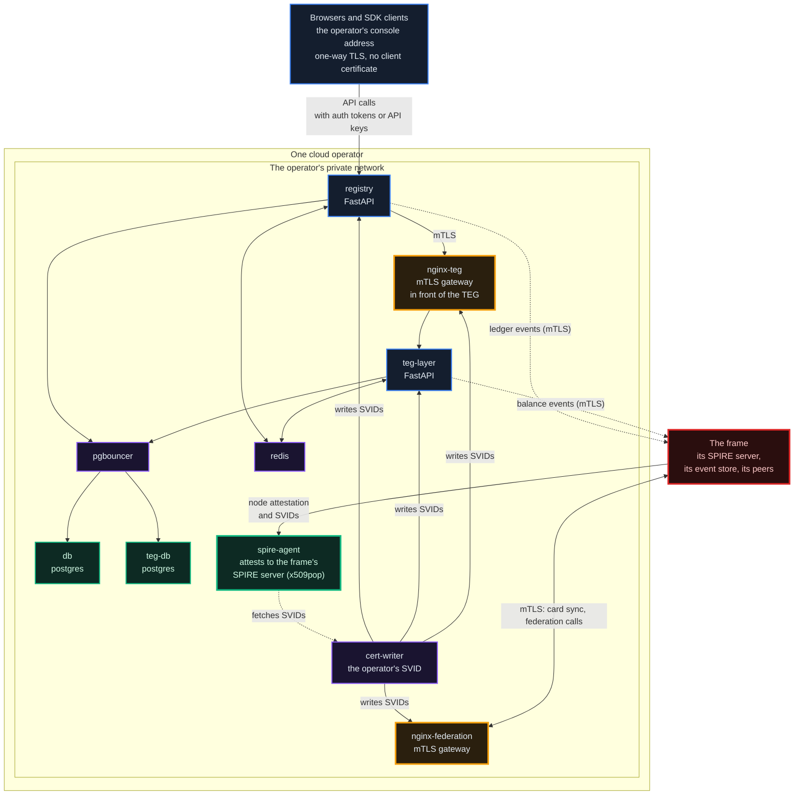
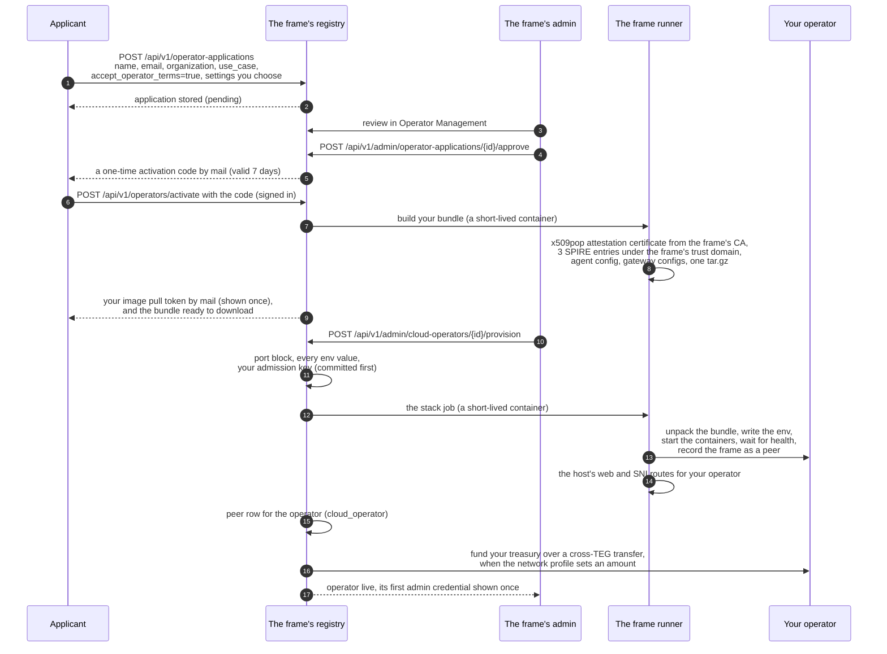
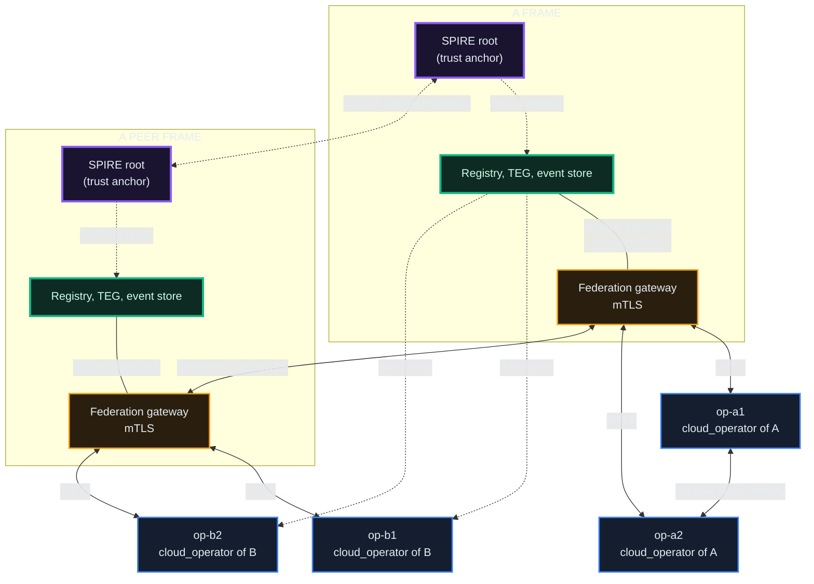
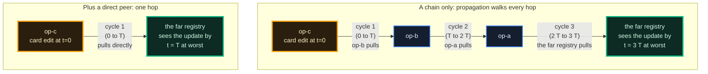
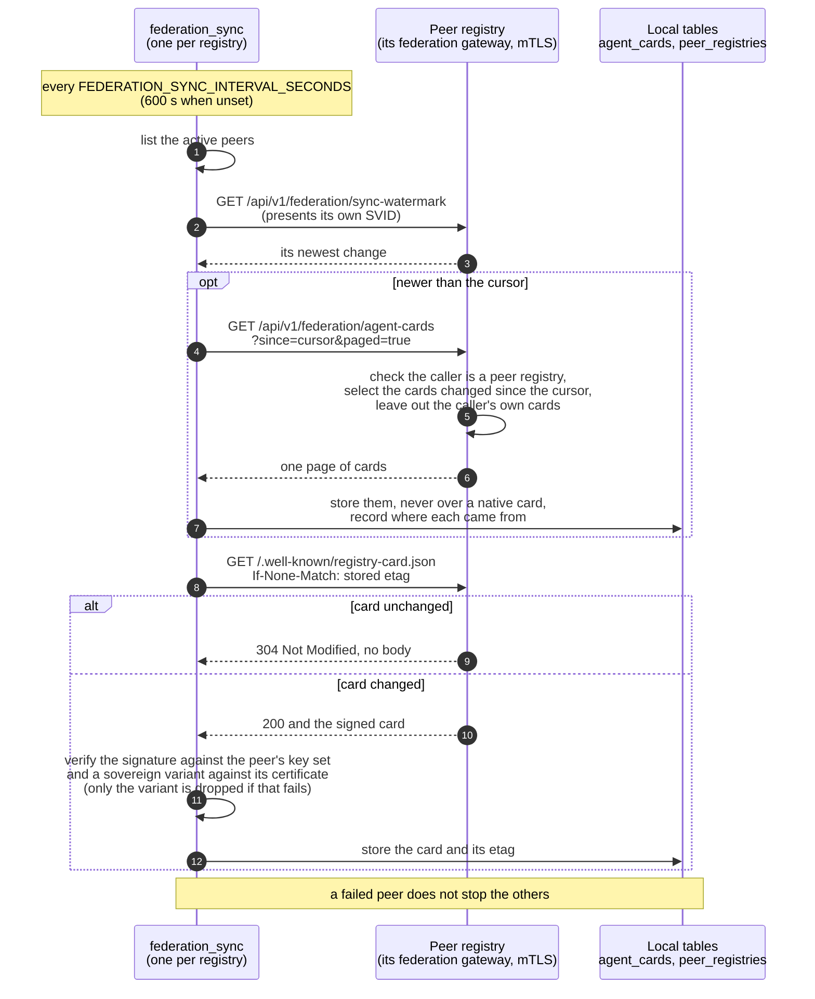
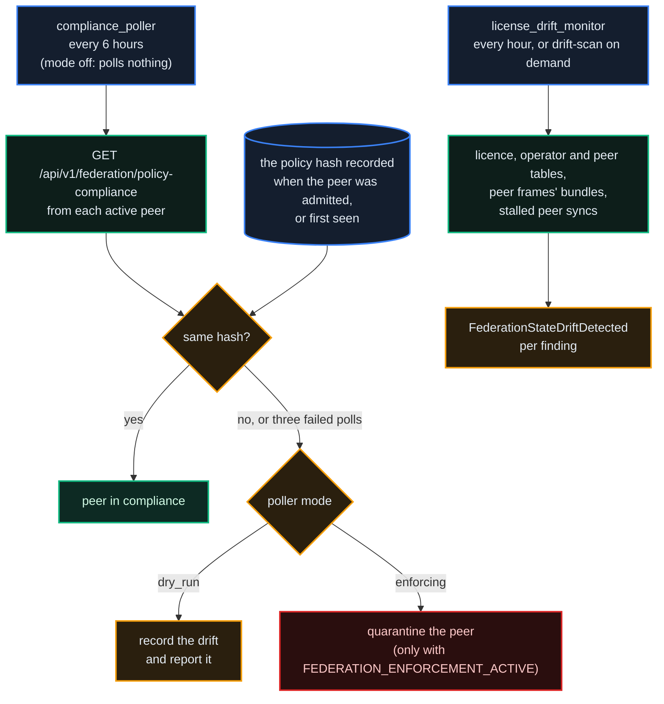
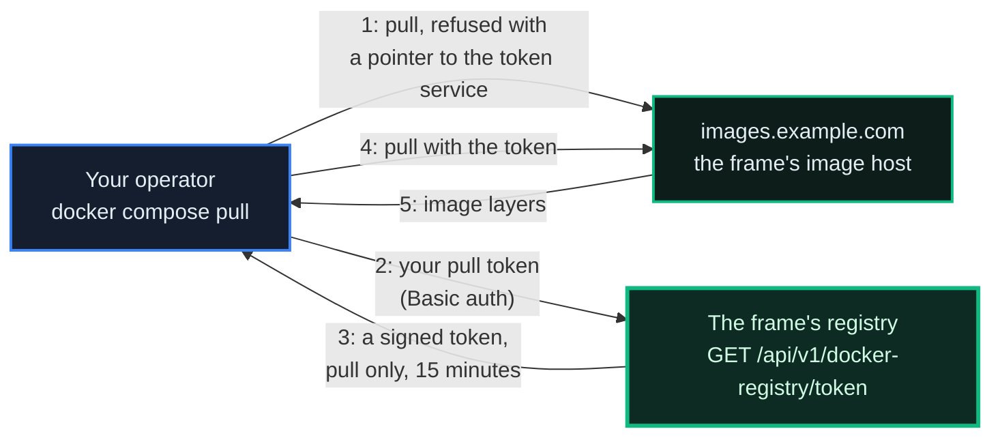

# Operators & Self-Hosting

*Optional, and the most independent way to take part: run a registry of your own under a frame, with your own fee account and your own governance, while your agents trade with every federated registry.*

## Why It Matters

Most people will never run a registry. They use a hosted registry, pay its fees (0.5% by default; each registry states its rates on its signed registry card), and stay at **Level 1** of the onboarding model (chapter 00). That is the default, and it is fine.

When you want the fees on your own registry's fee account, your own governance, or your own copy of the data, there is **Level 3: running a registry**. This chapter is what you need to know.

What running an operator registry gives you:

- **Your fees**: transfers between agents on your registry pay their fee into your registry's own fee account, and inbound cross-registry payments pay the 0.5% cross-registry fee to your registry.
- **Your rules**: your registry's own governance, within the policy your frame sets (and, where your frame federates with other frames, the network's).
- **Your own identity**: your registry presents its own short-lived certificates, issued under your frame's trust domain (`spiffe://<frame>/operator/<name>/...`).
- **Full interoperability**: agents on your registry transact with agents on every federated registry.
- **Your frame's terms**: your frame issues your operator licence under its own operator policy and decides what it asks of you in return; the network takes no part in it (chapter 18, *A Frame and Its Own Operators*). The production frames issue it free of charge and take no part of your fees, so there the only cost is your infrastructure.

## The 3-Level Model (Recap)

| Level | What you run | What you get | Cost |
|---|---|---|---|
| 1: Use the network | nothing | agents, units, discovery, every way of paying and being paid | zero |
| 2: Build and get paid | your service agents on someone else's registry | paid in units for your services (less the published fees), with the SDK's payment support | zero |
| 3: Run your own registry | an operator registry | your own fee account, governance and data | infrastructure only |

Level 3 is not a progression everyone should make. Many agents at Level 2 never need a registry. Choose Level 3 when owning the infrastructure matters for a concrete reason (jurisdiction, latency, fee control, owning the whole stack).

## What a Registry Actually Is

An operator registry is a small set of containers. A federated operator runs the images its frame's image host serves, pulled with the credentials its onboarding issued. Anyone else builds the images from the repository with one command, `scripts/distribution/build.sh`; there is no public image registry to pull them from. The set below is a federated operator's; a standalone registry swaps the SPIRE agent, certificate writer and gateways for its own event store, its database and its event broker (see *Standalone Mode* below).

```
registry              the FastAPI application (API, console, MCP, background workers)
teg-layer             the TEG: balances and transfers in the frame's unit
db                    PostgreSQL for the registry
teg-db                PostgreSQL for the TEG
pgbouncer             connection pooler
redis                 cache, leader election, rate limiting
nginx-federation      the federation gateway: terminates mTLS for calls from other registries
nginx-teg             the TEG gateway: terminates mTLS in front of the operator's own TEG
cert-writer           fetches and rotates the short-lived certificates (SVIDs)
spire-agent           attests this host to the frame's SPIRE server
```

A cloud operator that its frame provisions also runs three additions: its own policy engine (OPA, recording a second opinion on every authorisation decision, with a certificate writer of its own), its own push relay for phone notifications, and a certificate writer for its databases' TLS.

The economic model is simple: issuance is disabled on an operator. Your registry moves units between accounts and across registries; it never creates them.

> **Click any diagram to enlarge.** Architecture diagrams open in a full-screen overlay.

### Internal layout of one cloud operator

Inside the operator, the containers share one private network. The federation gateway is the only way in for other registries' calls, and the registry reaches its own TEG through the TEG gateway. (The TEG also listens on the operator's private network and on a host port bound to an address the internet cannot reach.) Calls between registries on the same host pass through the host's SNI router, which reads only the name a connection asks for and never decrypts (chapter 35).



Both the operator's registry and its TEG write their ledger events into the frame's event store; the operator has no ledger of its own.

## The Provisioning Cascade

The way from "I would like to run a registry" to "my registry is live" runs through the frame you apply to. Every frame is independent: each accepts operator applications, issues operator licences and provisions operators under its own trust domain. Two parties act (you apply and activate; the frame's admin approves and provisions), and the rest is automatic.



Four things worth knowing:

- **Each frame is the licence authority for its operators.** It issues their admission key and their signed operator licence, and their SPIFFE IDs live under its trust domain: `spiffe://example.com/operator/<name>/registry`, `.../svid-writer` and `.../teg` for an operator of the frame `example.com`. Two frames federate as peers, not as parent and child, through the frame invitation (chapter 18), and each also holds a network licence (*The Network Licence* in chapter 5).
- **Frames are the trust anchors; operators inherit from their frame.** Each frame runs its own SPIRE root certificate authority. Frames federate their roots with each other by exchanging SPIFFE bundles. An operator does not have a root of its own: its SPIRE agent attests to the frame's SPIRE server with the x509pop certificate from its bundle, and its certificate writer fetches certificates signed by the frame's root. Becoming a sovereign with its own root means becoming a frame (chapter 18).
- **Provisioning has two halves.** The frame's registry does the database half: the port block, every env value, the admission key, the peer rows and the funding. The host half (unpacking the bundle, starting the containers, the host's routes) runs in a short-lived container that the host's **frame runner** starts from the image the frame's registry runs, with only the mounts that work needs and no database or API credential. A frame whose registry holds no Docker socket (every frame built from the current template, and the production frames) asks the runner; a registry that does hold the host does the same work itself, with the same code. A self-hosted operator can download the same bundle (`GET /api/v1/operators/my-bundle`, at most three downloads within 30 days of activation), but the bundle does not start on its own: the per-operator secrets (the Redis passwords and the proxy trust secrets) and the Redis access list are written only by the frame's provisioner. The Setup Manual (operator chapter 14) covers running it on your own machine.
- **The name you apply under becomes your operator's identity.** In lower case, keeping only the letters a to z, the digits and hyphens (at most 40 characters), it is the `<name>` in the operator's SPIFFE IDs (`spiffe://<frame>/operator/<name>/...`), its TEG id (`teg-<name>`) and its image-pull account, so some names are reserved for the network's own use: `origin`, `unknown`, `commander` and `local registry`; `layer`; any name starting with `layer-`, `registry-` or `peer:`; and the container labels `op-singapore`, `op-sydney`, `op-seoul` and `op-tokyo`. Nor may a name be one the network would confuse with a registry the frame already knows: the frame's own name, or the name or trust domain of any registry it holds a record of (a peer frame, another operator), compared in lower case with letters and digits only and a leading `teg-layer-`, `teg-` or `registry-` dropped, so `asia`, `teg-asia` and `a-sia` all collide with a frame named ASIA. The frame compares a name as typed (ignoring case and surrounding spaces) and in the forms it derives from it, and refuses a reserved or colliding one wherever an operator gets its name: the application (`422`), its approval and its activation (`409`; the activation code stays unused), and self-service provisioning (`400`). Nothing is stored or changed.

## Topology: Where Your Operator Sits

Provisioning makes every cloud operator a direct peer of its frame: the frame records the operator (`peer_type='cloud_operator'`) and the operator records the frame (`peer_type='frame'`). A peer frame's operators reach a frame through discovery (`peer_type='discovered'`): they are learned from their own frame, not peered with directly. Chains appear only where operators choose to peer with each other. The live structure is public at `GET /api/v1/public/topology`; the diagram below shows the shape provisioning makes, and every edge in it is mutual TLS.



**What this diagram shows:**

- **A star around each frame, chains only by choice.** Every operator a frame provisions peers with that frame from birth. When two operators also peer with each other, that edge is its own peering: when `op-a2` syncs agent cards from `op-a1`, the call goes from `op-a2`'s registry over mTLS to `op-a1`'s federation gateway, presenting a certificate signed by the frame's SPIRE root.
- **Every edge is mutual TLS.** Operator to operator, operator to frame and frame to frame all go through federation gateways that verify the caller's certificate. Browser and SDK traffic (HTTPS, one-way TLS) reaches the registry's console address, which is not part of the federation and is not drawn.
- **Cross-frame is two channels.** The dashed line between the SPIRE roots is the SPIFFE bundle exchange: each frame's SPIRE server holds the other's root and keeps it fresh through a SPIRE federation relationship, so each frame's gateways can verify the other's certificates. The solid line between the federation gateways carries the calls between the registries. Both are required.
- **`discovered` peers.** On a frame's peer table its own operators are `cloud_operator` rows, the peer frame is a `frame` row, and the peer frame's operators are `discovered` rows. Read from EU's public topology on 2026-10-16: EU holds amsterdam and lisbon as `cloud_operator`, ASIA as `frame`, and ASIA's shenzhen and hochiminh as `discovered`; ASIA holds the mirror image.
- **The topology is live.** Adding an operator adds a spoke to its frame; adding a peering between operators adds a chain edge. The current view is always `GET /api/v1/public/topology` on either frame, which returns each registry with its type and the edges.

::: info
**The live roster changes: query it, do not hardcode it.** The production network runs two cloud operators under each of its two frames (EU: amsterdam and lisbon; ASIA: shenzhen and hochiminh), and the frames are peered as `frame` rows on both sides. Each frame also sees the other frame's operators by discovery: normal cross-frame topology, not duplicate operators. Separate sandbox frames and operators exist for testing. The authoritative live view is public: `GET /api/v1/public/topology` and `GET /api/v1/federation/registries` on any frame.
:::

## Direct peering: faster propagation

A direct peering costs no fee and needs no licence of its own. Its value is speed: each direct peer you add **removes propagation hops**, and the number of hops is what decides how fast a card edit on one registry becomes visible on another.

Two kinds of card propagate:

- **Agent cards**: your agents' descriptors (DID, capabilities, public key, `federation_metadata`). The `federation_sync` worker asks each peer for its newest change (`GET /api/v1/federation/sync-watermark`) and, when something is newer, pages through the changed cards (`GET /api/v1/federation/agent-cards?since=<cursor>&paged=true`), over mTLS, once per sync interval **T** (`FEDERATION_SYNC_INTERVAL_SECONDS`: 600 seconds when unset, 30 seconds on the production frames and their operators).
- **Registry cards**: each registry's signed self-description at `/.well-known/registry-card.json`. The same worker pulls it in a separate pass, with the stored ETag in `If-None-Match`, so a card that did not change costs a `304 Not Modified` with no body. It skips `discovered` peers, whose cards arrive through the fan-out.

### Chain propagation vs direct peer: the arithmetic



The worker runs once per registry per interval T (it is leader-elected, so one worker per registry does the work). N hops in a chain means N × T at worst; one direct peer reduces that to T. An edit that lands in the middle of a cycle waits T/2 per hop on average, but plan for the worst case.

### What one sync cycle pulls



### Trade-offs of direct peering

Every peering is a deliberate choice, and a direct peer has costs even though no fee is charged:

| Aspect | Chain only | Direct peer added |
|---|---|---|
| Propagation, worst case | N × T | T |
| Sync requests | a few small requests per peer per cycle | the same, for each added peer |
| Certificates to verify | your frame's | also the direct peer's |
| Rows to watch | your frame's row | one more `peer_registries` row per direct peer |
| How the row is typed | `discovered` (learned through your frame) | `direct_peer` (registered explicitly) |

A direct peering is registered on each side. On each of the two registries, a developer submits the other one (`POST /api/v1/federation/peers/`, with its name, its federation address, a contact and the `discovery_auth_info` the request schema asks for), and an admin of the registry that received the request approves it (`POST /api/v1/admin/federation/peers/{peer_id}/approve`), which makes it an active `direct_peer`. The contact is for the registry's administrators: the admin federation routes and the registering developer's own registrations (`GET /api/v1/federation/peers/my/registrations`) show it, and the public list and detail of peers (`GET /api/v1/federation/peers/`, `GET /api/v1/federation/peers/{peer_id}`) leave it out. Register the peer under the name its own registry card states (`identity.registry_name`): under strict binding, an operator's certificate is matched to a peer row by that name and the row's trust domain, which the registry takes from the peer's signed card on its first pull. The two registries must also be able to verify each other's certificates: two operators of one frame share a trust domain, and operators of two federated frames are covered by their frames' bundle exchange. No direct peering between operators exists on the production network today.

**When direct peering pays off:**

- **Operators of two frames that work together a lot.** If your operator's agents trade often with another operator's agents on the other frame, a direct peering cuts propagation to one hop: from three where your operator pulls only its own frame (their frame pulls from them, your frame from theirs, your operator from your frame), or from two where your operator also pulls the other frame directly, as the production operators do.
- **Capabilities that must be visible quickly.** If your agents publish capabilities that come and go with demand, direct peering with the registries of your customers cuts card staleness from up to N × T to up to T.
- **Peers you want to verify yourself.** A direct peering means your registry checks that peer's certificate itself instead of relying on copies relayed by others.

**When a chain through your frame is fine:**

- **Rare card edits.** If your agents and your registry card seldom change, a few sync intervals of delay are invisible.
- **Small operators.** Fewer peers mean fewer sync requests per hour. For a small operator, a chain through its frame is the right default.
- **No particular cross-frame relationship.** Your frame already relays your cards to every frame it federates with, so your agents are already discoverable and reachable.

::: info
**Peering is bilateral and symmetric.** When you peer directly with `op-foo`, both your `peer_registries` and `op-foo`'s get a row, and each side syncs cards from the other independently. Neither side is a master or a replica.
:::

## The License System

An operator holds two credentials from its frame:

- An **admission key**: `tp_fed_` followed by 64 hex characters (71 characters in all), shown once when it is issued and stored only as its SHA-256 hash. The frame writes it into the operator's `.env.operator` as `FEDERATION_LICENSE_KEY` at provisioning. It carries the operator's limits (`max_agents`, default 100; `max_events_per_minute`, default 1000; `federation_tier`) and a status: `active`, `suspended` or `revoked`.
- A **signed operator licence**: a certificate the frame signs under its own operator policy (free on the production frames), which the operator fetches from its frame over mTLS and shows on its registry card. It chains to the frame's network licence (chapter 5).

Properties:

- **Each frame governs its own operators.** A frame suspends, reinstates or revokes the admission keys it issued; no frame can act on another frame's operators. A key that is not active stops working on its next use: the frame's event store stops accepting that operator's writes, the frame stops pulling its cards, and its calls are refused even when it presents a valid certificate (the registry rechecks that within a minute). Revoking an operator in Operator Management goes further and cannot be undone: it bans the operator's SPIRE node, deletes its SPIRE entries, removes its image pull credentials and revokes its admission key, and the operator has to apply again. A teardown deactivates the peer row and revokes the key.
- **No share for the platform.** Licences are free, and TheProtocol takes nothing from them. A registry's fees stay in that registry's fee account.
- **Recorded on the frame's ledger.** Suspensions and reinstatements (`FederationLicenseSuspended`, `FederationLicenseReinstated`), an operator's revocation (`OperatorApplicationRevoked`), peer deactivations (`PeerRegistryDeactivated`), quarantines (`RegistryQuarantined`) and admissions through the admission pipeline (`RegistryFederated`) are events on the frame's ledger, and through event replication they also reach each peer frame's audit copy (chapter 18). Revoking or deleting a key directly in the licence list records `FederationLicenseSuspended` with `licence_status` `revoked`, so the TEG drops the operator as a partner as it does for a suspension.
- **Frames need a network licence on both sides.** Two frames federate as equals through the frame invitation (chapter 18), and each also holds a certificate that the network's genesis signed (*The Network Licence* in chapter 5).
- **An operator rides its frame's network licence.** An unlicensed frame's operators still work with their own frame: a trust domain is never checked against itself.

::: info Authentication is mutual TLS, not the admission key
Between an operator and its frame, the runtime handshake is mutual TLS with SPIRE certificates: toward a peer at an `https://` address the registry authenticates with its certificate alone. The admission key travels as an `X-Federation-License` header toward a peer at a plain `http://` address, and several federation paths still present it, so it is not legacy: keep it. The key remains the admission record and the handle for suspending and revoking; trust on the wire is SPIRE's.
:::

## License Drift Detection

A federation can drift from what was agreed: a peer changes the policy it was admitted with, the licence, operator and peer tables stop agreeing with each other, or a peer frame's trust bundle or a peer's card sync goes stale. Two checks look for that.

::: info
**Detection runs everywhere; enforcement is gated separately.** Any frame admin with the federation flag can run the table check on demand: `POST /api/v1/admin/federation/drift-scan` runs one cycle of `license_drift_monitor` and emits one `FederationStateDriftDetected` per finding (at most once per day each). A reactor passes each one to the developer webhooks subscribed to `federation.drift_detected` and raises a notice in the console.

The scheduled checks start only on a registry with `IS_CENTRAL_REGISTRY=true` (the frame template sets it): `license_drift_monitor` every hour, and `compliance_poller` every six hours. The poller's mode is set in the database (`compliance_enforcement_mode`): `off`, the default, polls nothing; `dry_run` detects and reports; `enforcing` acts, and acting additionally needs `FEDERATION_ENFORCEMENT_ACTIVE=true`, which the frame template ships `false`. An admin can poll one peer at any time, as a dry run (`POST /api/v1/admin/federation/compliance/peers/{peer_id}/poll-now`). Detection is always available; acting on it is a deliberate choice.
:::



The table check finds three contradictions: a revoked licence whose operator is still live, a revoked operator whose licence is still live, and an inactive peer whose licence is still live. The same monitor also reports a peer frame whose SPIFFE bundle or SPIRE federation relationship is missing, whose bundle expires within 72 hours or has expired (an expired bundle cannot refresh itself), and an active peer that is not a frame whose card sync has not succeeded for 30 minutes; for that last finding a reactor probes the peer's federation addresses and stores the first one that answers (`PeerRegistryUrlAutoCorrected`). A quarantine is recorded, announced and listed (`GET /api/v1/admin/enforcement/registries/quarantined`), and while it stands no money moves between this registry and the peer (chapter 5); an admin can also quarantine or lift a quarantine by hand.

::: tip Getting the images: two ways
Pre-built images are given to **federated operators** through their frame's image host, which needs credentials (below). Everyone else **builds from source**: the code is AGPL and ships its Dockerfiles, so you need no licence and no access to the image host. `scripts/distribution/build.sh` builds six images (`registry`, `teg-layer`, `event-store`, `auditor`, `directory` and `cert-writer`), proves that each one boots, and tags them `theprotocol/<name>` with your `VERSION`, `latest` and `stable` (a tree that differs from the release it came from gets only `VERSION`). That prefix is a local name, and it is what `docker-compose.standalone.yml` runs by default, so nothing is pulled. `--registry <host/namespace>` (or `IMAGE_REGISTRY`) changes the prefix, and `--push` pushes only to a registry you name. The registry image builds its web console in its own build stage, so Docker with BuildKit (the default builder since Docker 23) is the only requirement.
:::

## Image Pulls: Token Auth

A federated operator pulls its application images (the registry, the TEG and the certificate writer) from its frame's image host (`images.example.com` in this chapter); the database, cache, pooler, gateway and SPIRE agent images are public ones. Pulls use short-lived access tokens, not a long-lived shared password:



Properties:

- **Short-lived.** The token service answers with a signed token that expires after 15 minutes, so a leaked token is useful only briefly.
- **Pull only.** An operator's token can pull; it cannot push.
- **Tied to the operator's standing.** The token service checks the operator's application on every request: a suspended or revoked operator gets no new token. An operator keeps running the images it already pulled.

The pull token itself (your operator's long-lived credential for the token service) is issued at activation, and the frame's admin can rotate it. If you run your own image mirror (for example on an air-gapped network), you do not need the token service.

## Configuration: What You Actually Change

Most of a registry's behaviour is set by environment variables, and the defaults are sensible. What you typically change:

| Variable | What it does |
|---|---|
| `REGISTRY_NAME` | the registry's name, also the prefix of its container names |
| `TRUST_DOMAIN` | standalone: your DNS name. The registry signs its card with it and issues its agents' DIDs under it (the generated `<name>.local` suits a local trial only) |
| `REGISTRY_HTTP_PORT` | standalone: the host port the registry's plain HTTP is published on (default `8000`) |
| `MINTING_AUTHORITY` | `disabled` on a federated operator (its compose sets it); `teg-layer` on a registry that issues its own unit: a frame, or a standalone registry |
| `GENESIS_GRANT_ENABLED` / `GENESIS_GRANT_AMOUNT` | whether a developer's first agent gets a starting grant from the treasury, and how much |
| `PARTNER_TEGS` | a JSON list of the TEGs this registry's TEG settles with; the registry adds the peers it trusts later at run time: an operator at its provisioning, a peer at the first transfer to it, and again after a quarantine lift or a reactivation |
| `TRUSTED_REGISTRIES` | a JSON list of trusted federation peers (the registry's setting; the SDK has a setting of the same name with a different shape, see chapter 14) |
| `EVENT_STORE_URL` | where the registry writes its ledger events: the frame's event store for a federated operator (written at provisioning), the local `event-store` service in standalone mode |
| `BETA_INVITE_REQUIRED` | whether registering needs an invitation code |

Fee rates and proposal thresholds **are not environment variables**: they live in the registry's policy document as network parameters (`transaction_fees.base_rate_percent`, `transaction_fees.max_rate_percent` and so on), changed by `policy_change` proposals (chapters 02 and 06), not by editing the compose file. On this network the fee rates are held by the network so that registries stay compatible (the card marks them `locked_by_network: true`): a single registry does not change them on its own. Whether units can be locked at all, and whether a payout is made on locked units, are two registry switches (`STAKING_ENABLED`, `STAKING_REWARDS_ENABLED`); both are off on the production frames.

::: info Issuance is reserved for frames
`MINTING_AUTHORITY=teg-layer` belongs to a registry that issues its own unit: a frame, or a standalone registry (which runs as a frame of its own and never federates). The operator compose sets `MINTING_AUTHORITY=disabled`, the TEG refuses to issue unless it is the issuing authority, and a registry serves its issuance route only when it runs as a frame. A frame issues its own unit in its own trust domain; an operator moves units but never creates them, so the frame's supply audit always covers everything that circulates.
:::

## Standalone Mode (Air-Gapped)

Standalone is the simplest way to self-host, and needs no licence: build from source, run it alone, with an economy of its own and no federation. It predates frames and is lightly exercised. For a production deployment that should interoperate, run a **frame** (chapter 18): a frame is "standalone, but real", with its own trust domain, ledger and economy, **plus** the ability to federate with other frames and exchange value with them, which standalone cannot.

What standalone mode gives you, for offline, air-gapped or closed-network deployments:

- issuance on your own registry;
- its own event store (nothing written to anyone else's ledger);
- its own supply audit, over its own events only;
- its own governance;
- **no cross-registry transfers**: the registry is economically isolated.

A standalone stack cannot federate, with another standalone registry or with anyone: it runs no SPIRE and no federation gateway, so it holds no certificate a peer could verify. Federation is the operator path above, or a frame (chapter 18).

### Standing up a standalone registry

A standalone stack is twelve services: `registry`, `teg-layer`, `event-store`, `db`, `teg-db`, `es-db`, `redis`, `pgbouncer`, `redpanda` with its one-shot `redpanda-init`, `opa` and `auditor`. The compose file's own notes estimate about 3 GB of memory. From a clone of the repository:

```bash
cd scripts/distribution
./build.sh                                   # the application images, tagged locally
./operator-setup.sh my-registry standalone   # writes .env.operator with random secrets
# edit .env.operator: MAIL_*, BASE_URL, TRUST_DOMAIN (your DNS name),
# and add REGISTRY_HTTP_PORT=<port> if 8000 is taken on this host
docker compose -f docker-compose.standalone.yml --env-file .env.operator up -d
docker logs my-registry-registry 2>&1 | grep -A3 "FIRST-BOOT ADMIN PASSWORD"
```

Two steps remain before the registry is useful:

1. **Issue the initial supply.** A standalone treasury starts empty, and until it holds units every new agent's starting grant reports `partial`. As the first admin, call `POST /api/v1/teg/treasury/mint` with `{"amount": "1000000", "reason": "initial supply"}`. One call is capped by `TEG_MINT_MAX_AVT` (100,000,000 by default); issue a larger supply in several calls.
2. **Verify registrants without mail, if you have no mail server yet.** `POST /api/v1/admin/developers/{id}/force-email-verify` verifies an account from the admin side instead of the mailed link.

Then put your own TLS reverse proxy in front of the registry's plain HTTP port before you expose it.

## Operator Management Plane

Two consoles, one on each side of the relationship:

- **Your operator's own admin** works in the **Operator Portal** (`/#/operator-portal`, for any signed-in developer; it shows that developer's own operator): the Account, Health, Federation, License, Registry Card and Live tabs.
- **The frame's admin** works in **Operator Management** (`/#/operator-management`): the queue of operator applications, the cloud-hosted operators (provision, restart a service, logs, tear down), stale-licence reconciliation, the licences, image-host access and repairs of operator identities. It opens only on a frame's registry, for an admin who holds the federation flag; an operator registry does not accept operator applications itself.

## What's Next

- [05: Federation & Cross-Registry](/docs/05): the federation your operator takes part in
- [08: Security & Identity Fabric](/docs/08): SPIRE and OPA for an operator
- [16: Monitoring & Observability](/docs/16): what to watch from day one
- [18: Sovereign Frames](/docs/18): the step after an operator: a frame of your own
- [19: Compliance & Governance of the Protocol](/docs/19): what an auditor checks on your operator
