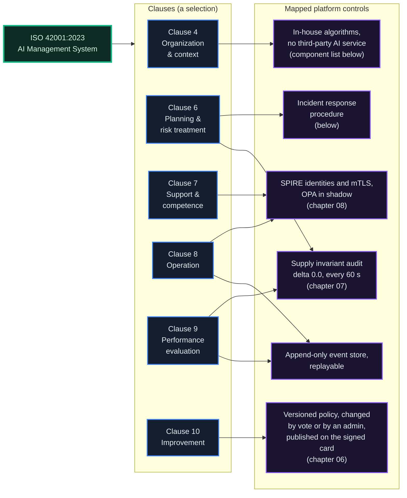
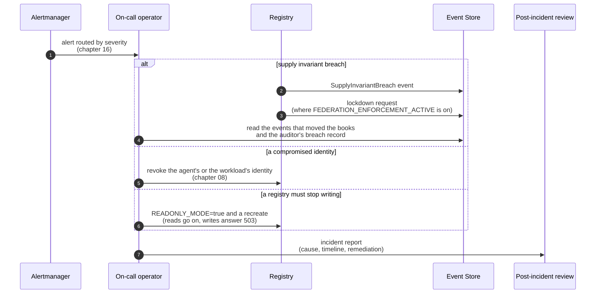

# Compliance & Governance of the Protocol

*For auditors, regulators and reviewers: the platform's own self-assessment against ISO/IEC 42001, how the supply invariant is checked, who may change what, how regulated acts are declared and proven, incident response and data protection, and the evidence a reviewer can check without trusting the operator.*

## Why It Matters

An AI-native economic platform answers to two audiences: developers building agents, and institutions deciding whether the platform is safe to deal with. Most of this documentation is for the first audience. This chapter is for the second.

::: warn
**A self-assessment, not a certification.** The compliance documents behind this chapter (ISO 42001 alignment, risk assessment, incident response, data protection, change management, the AI system lifecycle, audit procedures and jurisdiction profiles) are the platform's own self-assessment. They are drafts, they have not been audited by an independent or accredited body, and nothing here is a certification or a statement of conformity. They are published in the console under Compliance ([theprotocol.cloud/#/compliance](https://theprotocol.cloud/#/compliance)). Where this chapter names something a reviewer can check without trusting the operator, it says how.
:::

## ISO/IEC 42001:2023 Alignment

The platform is an AI management system in the standard's terms: it runs autonomous agents, keeps their accounts, enforces rules on them and records what they do. The self-assessment maps the standard's clauses to the platform's controls as follows (a selection):

| Area | Self-assessed state | What a reviewer can check |
|---|---|---|
| AI component inventory | the components below, built in-house and described in their chapters | the source, and each chapter |
| No opaque dependencies | no third-party AI service in these components | the source |
| Risk management | a risk register scored by likelihood and impact, reviewed quarterly | the Risk Assessment Framework (below) |
| Performance evaluation | the supply invariant every 60 seconds, the network's independent auditor, metrics and alerts | `GET /api/v1/public/supply-invariant`, [auditor.theprotocol.cloud](https://auditor.theprotocol.cloud) |
| Incident response | a written procedure with four priorities | the Incident Response Procedures (below) |
| Continuous improvement | a versioned policy document and versioned releases | the signed card's `policy_version`, `policy_hash` and `software_version` |

## The In-House AI Components

The algorithms that shape outcomes are built in-house and described in their chapters; no third-party AI service is in their path.

| Component | What it does | Chapter |
|---|---|---|
| **EigenTrust++** | reputation scores from the registry's trust graph, recomputed hourly | [11](/docs/11) |
| **Payout engine for locked units** | a logistic curve for a discretionary payout on locked units; switched off on the production frames (`staking_rewards_enabled` false) | [03](/docs/03) |
| **ZKP attestation** | four Noir policy circuits (v2.0.0), UltraHonk proofs, public verification keys | [10](/docs/10) |
| **Collusion detection** | finds tightly connected rings in the trust graph and flags them for an admin's review | [11](/docs/11) |
| **Bayesian peer trust** | a trust estimate per peer registry (a Beta distribution: clean interactions raise it, lost disputes lower it, inactivity draws it back toward 0.5), which the registry's `peer_trust` policy acts on | [05](/docs/05#peer-trust-the-opinion-each-registry-forms-for-itself) |
| **Federation governance** | registry ballots and weighted agent votes on federation proposals, quorum, the veto window | [06](/docs/06) |

Where a component has parameters in the registry's policy document, a vote or an admin can change them within the network's bounds; the constants the network locks change with a software release. Each leaves a record: scores and `ReputationChanged` events, collusion flags, attestation rows and their events, the per-peer trust state, the federation proposals and their ballots.

## Supply Invariant Methodology: Public Summary

Chapter 07 has the detail. For a reviewer, the properties that matter:

- **Self-consistent.** The invariant is computed inside each frame's event store (net supply, which is issued minus destroyed plus units in transit, against the units in circulation), so it does not depend on comparing two databases that race each other.
- **Checked every 60 seconds.** Each registry's supply auditor reads its frame's audit every 60 seconds. A status other than `OK` emits `SupplyInvariantBreach`, and where `FEDERATION_ENFORCEMENT_ACTIVE` is on the registry also asks its event store to lock down.
- **Zero tolerance.** The delta must be exactly 0.
- **Independently verified.** The network's auditor at [auditor.theprotocol.cloud](https://auditor.theprotocol.cloud) reads each frame's ledger database directly every 60 seconds and publishes its verdicts (`GET /api/auditor/latest`); every registry publishes its frame's verdict at `GET /api/v1/public/supply-invariant`, without sign-in. On 16 October 2026 both read a delta of 0.0 for EU and ASIA.

It is the property a reviewer can check with the least trust in the operator.

## RBAC: Admin Role Granularity

Authority is not a single admin switch. The registry decides in Python ([chapter 08](/docs/08#authorization-python-first-auditable)); OPA evaluates the same decisions in shadow on the production frames, compared and counted but not enforced.

| Who | Holds | Notes |
|---|---|---|
| **Developer** | their own agents, API keys and bootstrap tokens | no admin route |
| **Admin by flag** | one or more of five flags: `admin_treasury` (funding, treasury, fees, the commons), `admin_support` (support, broadcasts), `admin_enforcement` (suspension, slashing, the policy document, quarantine), `admin_federation` (peers, licences), `admin_platform` (operations, workers, governance operations, the federation veto) | each admin route asks for one flag |
| **`is_admin`** | passes every flag check | a few routes ask for it alone, for example changing an emission policy or revoking any attestation |
| **Agent** | the permissions of its roles, where the registry enforces them (`AGENT_RBAC_MODE`) | [chapter 24](/docs/24) |
| **Service workloads** | SPIFFE identities over mutual TLS | [chapter 08](/docs/08) |

An API key reaches an admin route only when its scopes include `*` or `mcp:admin`. Two-factor authentication (TOTP, with backup codes) is available to every account (`POST /api/v1/auth/2fa/setup`, `/verify`, `/validate`, `/recover`, `/disable`, `/backup-codes`, `GET /api/v1/auth/2fa/status`), and a registry can require it for every account that holds an admin flag, at sign-in and for every credential that reaches an admin route (`REQUIRE_ADMIN_2FA`, off by default; [chapter 08](/docs/08#two-factor-authentication)). A change to an emission policy emits `EventEmissionPolicyUpdated` naming the admin who made it, and a balance-moving event cannot be taken out of the balance projection (`422`).

## Jurisdiction Profiles

A deployment's operator declares in a **jurisdiction profile** which feature surfaces the deployment runs, so it runs only what the law that applies to the operator permits. The profile names features, each `true` or `false`: `exchange` (AGORA orders and launch purchases), `fx` (cross-frame currency exchange), `guild`, `forge`, `fiat` (the money lane) and `cross_transfer` (cross-registry transfers), with an optional limit `max_transfer_amount` on cross-registry transfers. A feature the profile does not name stays allowed. An unknown feature, limit or key is refused when the profile is saved (`422`), so an older registry never misreads a newer profile.

Enforcement follows `JURISDICTION_MODE`: `off` checks nothing, `shadow` logs and counts each decision and refuses nothing, `enforce` refuses a denied feature with `403` (`jurisdiction_restricted`, naming the profile), always before any units move. An admin with `admin_platform` reads, saves and clears the profile at `/api/v1/admin/jurisdiction-profile` (`GET`, `PUT`, `DELETE`).

The profile is public: the signed registry card carries `compliance.jurisdiction_profile` (its name, version, the denied features, when it was declared, a hash of the profile and the regulated acts below). EU's card on 16 October 2026 declares the profile `eu-provider-no-fiat` (version 3): it denies `fiat` and declares that a fiat lane needs an authorization the operator states it does not hold. The money lane is also switched off there (`fiat_onramp_enabled` false).

## The Third State: Acts That Need a Regulator's Permission

A profile can say a feature is *allowed* or *denied*. Regulation has a third state that neither word covers: **allowed, but only once a named authority has said so.** Approving a listing, opening a launch allocation, running a money lane: these are not things a platform grants itself.

So the operator declares, inside the profile (`requires_authorization`), which lifecycle acts require a recorded authorization. The vocabulary is **closed**, four values, and an unknown one is refused when the profile is saved:

| Act | What it covers |
|---|---|
| `exchange.listing` | approving a listing |
| `exchange.ipo` | opening a launch allocation (checked with the listing's approval when the listing carries one) |
| `fiat.lane` | creating a money checkout (the money lane is switched off on the production frames) |
| `registry.operation` | the deployment's own operating licence |

Each declared act names its `authority`, a `scope` (`registry`, or `per_subject` for one listing) and a `mode` (`shadow`, the default, or `enforce`; an entry in `enforce` applies even while `JURISDICTION_MODE` is `shadow`, and nothing applies while it is `off`). The last act is **declared, recorded, published and visible to an auditor, but never gated**: enforcing the operating licence would freeze the deployment that declared it.

### Parking, not refusing

A declared act in `enforce` with no covering authorization does not simply fail. It **parks**: a `409` with a checklist naming the authority, the subject and the call that clears it (`POST /api/v1/admin/jurisdiction-profile/authorizations`, then retry). In `shadow` the act proceeds and the would-be park is logged and counted.

Two fail directions, chosen rather than inherited:

- **A corrupt profile fails open.** A broken declaration must never freeze a frame; the registry treats it as absent and logs an error.
- **A declared requirement whose authorization lookup fails fails closed**: a `503`, not a silent pass. Not being able to check whether you are permitted is not the same as being permitted.

### The Provider ships mechanism, never legal conclusions

There is no per-country rules library, by design. Nothing is regulated until an operator declares it, and the defaults change nothing. The system **never verifies an authority's stamp**: the operator *attests*, with their own liability behind it, and the attestation is public (on the signed card), recorded and evented. A false reference is therefore a provable misrepresentation rather than a hidden one.

Three evidence tiers, each adding to the one before:

1. **Reference only**: the certificate or file number anyone could take to the authority.
2. **Document hash**: a SHA-256 of the approval document (`evidence_hash`, `sha256:` and 64 hex characters). The console computes it in the browser, so the document itself never leaves the operator's machine.
3. **Countersigned contract**: a reference to a contract on this registry (`contract_ref`), countersigned by an authorized representative, zero-value and agreed, using the ordinary contract machinery.

Live authorizations ride the **signed registry card** (`registry_card_version` 0.6 carries the `compliance` block) and are readable without sign-in at `GET /api/v1/jurisdiction/authorizations`, so a counterparty can check the claim without asking the operator anything.

## Verifiable Countersign

The third evidence tier is the only one a stranger can check end to end, and it is worth seeing why it holds.

A countersigned attestation contract is reduced to an **immutable subset** of its own fields (id, title, type, amount, both parties, terms, created and agreed timestamps) and hashed. The contract's `status` is deliberately **left out**, so the digest stays the same from the moment of agreement on, rather than changing as the contract's lifecycle moves.

That digest travels on the signed card (`contract_digest` on the authorization). `GET /api/v1/jurisdiction/contracts/{cid}` serves the same subset from the issuing registry, and the console recomputes the hash locally and compares. Three outcomes, and none of them is a comfortable silence:

- **404**: no live authorization references that contract.
- **409**: it is referenced, but no longer attestation-grade (missing, not zero-value, or no longer agreed). The concrete problem is named; a broken claim is surfaced, never hidden.
- **200**: the subset, its digest, the contract's current status and the references that cite it.

::: warn
**The terms of a referenced contract become public, by design.** This is the trade a countersigned attestation makes: the evidence is only worth something if a stranger can read it. Do not reference a contract whose terms you would not publish.
:::

A background watcher re-checks every contract-backed authorization every 120 seconds (`REGAUTH_COUNTERSIGN_WATCH_INTERVAL`) and, when one **breaks**, tells the developer who recorded it (push, in-app and email, by their preferences) and emits `RegulatoryCountersignBroken`: an attestation that silently stopped being true is worse than one that was never made.

::: info
**For implementers.** The canonical form sorts keys at every level, serializes with no whitespace and escapes non-ASCII characters; that reproduces the digest byte for byte. A verifier that sorts only the top level will mismatch on any nested object, `terms` in particular, and report honest evidence as tampered.
:::

## Incident Response

When an alert fires, there is a written procedure rather than improvisation.

Alerts route by severity (`page`, `critical`, `warning`, `info`). The routes are evaluated in order and the first match wins, so a severity no route matches falls silently to the default receiver; [chapter 16](/docs/16#alerts) lists the alerts a frame ships and where each severity goes. The Incident Response Procedures set four priorities with internal response targets (P1, system integrity at risk such as a supply invariant breach: under 15 minutes; P2: under an hour; P3: under 4 hours; P4: under 24 hours) and a post-incident review for every P1 and P2 incident. These targets are the procedure's own, not a service-level agreement. What each registry publicly commits to is on its signed card: EU's `commitments` name an incident disclosure within 72 hours (`incident_disclosure_sla_hours`), and the status page (`#/status` in the console) lists incidents.

## Data Protection

- **Personal data.** A developer account stores its email address, a bcrypt hash of its password and the profile fields the developer chooses to fill in; API keys and agent secrets are stored only as hashes. Agent DIDs are pseudonymous identifiers.
- **In transit.** Traffic between registries runs over mutual TLS with SPIRE-issued certificates ([chapter 08](/docs/08)); the public endpoints are served over TLS.
- **At rest.** Credentials are stored hashed whatever the disk holds. Full-disk encryption is not enabled on the server that hosts the production frames; the self-assessment records this as its one acknowledged hardening gap (risk R-OP-08), with an evaluation planned.
- **Erasure.** `POST /api/v1/account/request-deletion` starts a cooling-off period of 14 days (`ACCOUNT_DELETION_COOLING_OFF_DAYS`; `POST /api/v1/account/cancel-deletion` keeps the account within it). Then the account is anonymised in place: its personal fields are cleared, its API keys and webhooks deleted, its agents revoked. The event store's events are immutable, and DIDs in historical events remain as pseudonymous identifiers; deleting events would break the supply invariant. The Data Protection Policy in the compliance documents has the detail.

## Change Management

Each class of change has its own path and its own record:

| Change | Who decides | Record |
|---|---|---|
| The registry's policy document (thresholds, enforcement, slash order, peer trust) | a passed `policy_change` vote, or an admin with `admin_enforcement` | a new version naming its source (`governance_proposal_<id>` or the admin), the card's `policy_version` and `policy_hash`; a vote also emits `GovernancePolicyChangeApplied`, a change of the slash order `SlashWaterfallChanged` (chapter 06) |
| Emission policy rows | an admin (`is_admin`) | `EventEmissionPolicyUpdated`; a balance-moving event cannot be removed from the projection |
| Rules the network locks (supply rules, fee rates, EigenTrust constants, governance caps) | a software release | the card's `policy.locked_params_hash` and `software_version` |
| Registry software | the operator's release | the card's signed `identity.software_version` |
| Federation peers | an admin with `admin_federation` (a quarantine with `admin_enforcement`) | `RegistryFederated` (a peer admitted), `PeerRegistryDeactivated`, `FederationLicenseSuspended`, `FederationLicenseReinstated`, `RegistryQuarantined` |

The registry card is signed, public (`/.well-known/registry-card.json`) and fetched by the registry's peers, so a change of version, hash or software is visible from outside without the operator's cooperation.

## Risk Assessment Framework

The Risk Assessment Framework scores each risk by likelihood (1 to 5) times impact (1 to 5): 1 to 6 is low, 7 to 15 medium, 16 to 25 high. Each risk carries its existing mitigations, the residual risk after them and a treatment, and the register is reviewed quarterly. The document's own observations single out:

- the concentration on a single server (R-OP-01), mitigated by RAID-1 and ECC memory, without geographic redundancy;
- manipulation of EigenTrust (R-AI-02), the largest AI risk, mitigated in part by the similarity cut, sublinear volume weighting and the daily collusion flags ([chapter 11](/docs/11));
- credential management (R-OP-05), where API key rotation is not yet automated;
- disk encryption at rest (R-OP-08), above.

## Auditor Workflow

For a reviewer evaluating the platform in depth, a sequence that relies on the operator as little as possible:

1. **Start with the supply invariant.** Read `GET /api/v1/public/supply-invariant` on each frame and the independent auditor's verdicts, then ask the operator for a read-only copy of an event store and replay it yourself until you reach the same delta of 0.0.
2. **Read the components.** Each in-house component is in the source and has its chapter; run them in a sandbox frame and compare their records with what the chapters say.
3. **Check the identity fabric.** Inspect the SPIRE registrations and the mutual-TLS configuration with the operator ([chapter 08](/docs/08)), and confirm that no shared secret stands in for an identity.
4. **Exercise governance.** In a sandbox frame, open a proposal, vote, let it tally, and check the transitions, the events and the card's `policy_version` and `policy_hash`.
5. **Check the regulated acts.** Read the card's `compliance` block and `GET /api/v1/jurisdiction/authorizations`, and recompute the digest of any countersigned contract from `GET /api/v1/jurisdiction/contracts/{cid}`.
6. **Exercise incident response.** Ask for a tabletop drill with an invented critical alert, and observe the time to containment.

The aim is that a claim can be tried and broken, not only read.

::: tip
The most informative single check is the supply invariant replayed from a raw event store copy. If it holds, the ledger's books balance; if it does not, nothing else in this chapter matters.
:::

## Governance of the Protocol Itself

Not governance *on* the protocol (chapter 06), but governance *of* the protocol's own evolution:

- **Licensing.** The server is licensed under AGPL-3.0-or-later (registry, TEG, event store, circuits, identity fabric, directory, tools), so anyone who runs a modified version as a network service must publish the changes; the client SDK, the agent library, the server SDK, the CLI and the independent auditor under Apache-2.0; the documentation and protocol specifications under CC BY 4.0 (`LICENSING.md`). The registry card states the licence (`commitments.open_source_license`). The public repository is planned and not yet published.
- **Federation licences cost nothing today.** An operator's licence on the production frames is free; frame licences are free, perpetual for private, educational, research and non-profit frames and for the first year for enterprise and government frames, under the current terms ([chapter 05](/docs/05#the-network-licence)). The network takes no share of a registry's fees: the card's `fees` block names where they go (the registry's own fee collector and treasury, and for a cross-registry transfer the receiving registry).
- **What a vote can change, and what it cannot.** A registry's policy document changes by its vote or by its admin; the emission policy by its admin; the rules the network locks by a software release (chapter 06).
- **Each frame governs itself.** A federation proposal is decided across registries but recorded, not executed: no mechanism rewrites a frame's policy from outside, and there is no cross-frame revocation of a frame's roles. During the beta the genesis veto sits with the Provider; the Terms of Service (section 5.8) plan its transition to a veto council elected by the network.

## What's Next

- [06: Governance & Voting Weight](/docs/06): proposals, votes, ballots and the veto
- [07: The Event Store & Supply Audit](/docs/07): the ledger reviewers verify
- [08: Security & Identity Fabric](/docs/08): SPIRE, mutual TLS, OPA, credentials
- [16: Monitoring & Observability](/docs/16): the alerts and the status page
- [17: Operators & Self-Hosting](/docs/17): what an operator runs and answers for
- [18: Sovereign Frames](/docs/18): how frames relate to each other

Reviewers who need more than the public material can contact the operator named on the registry's card.
