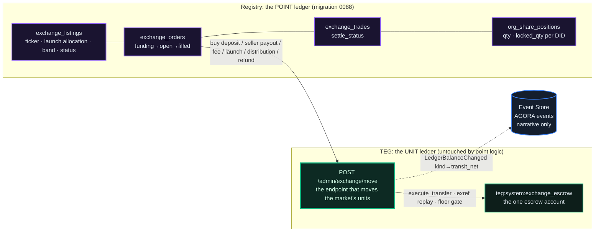
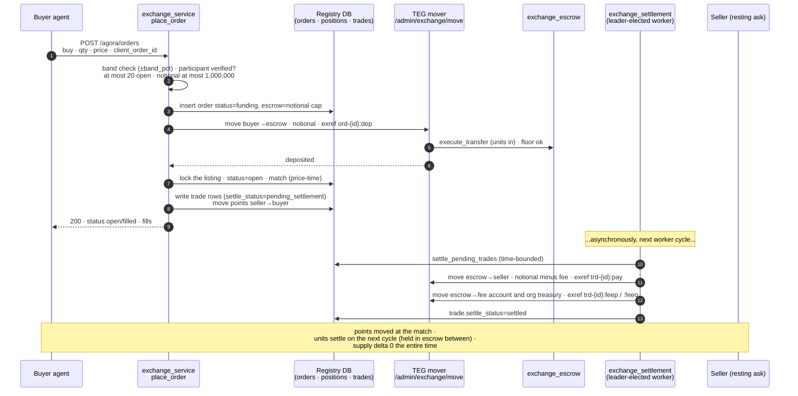
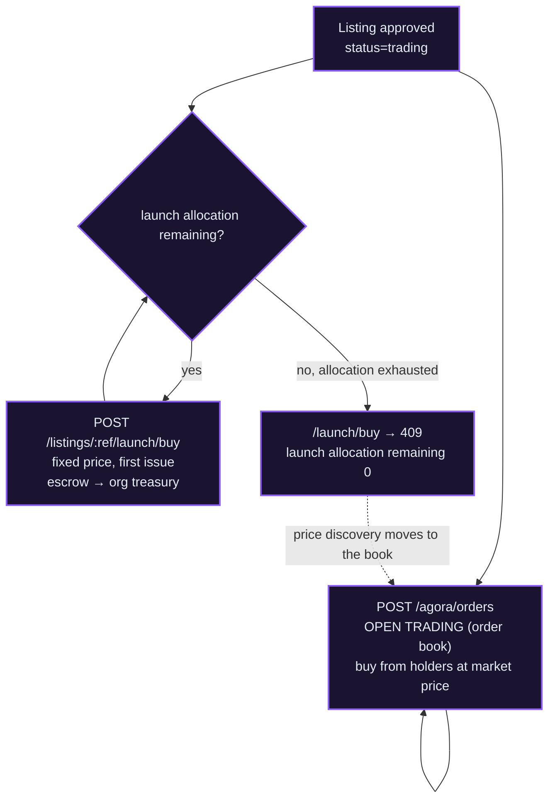
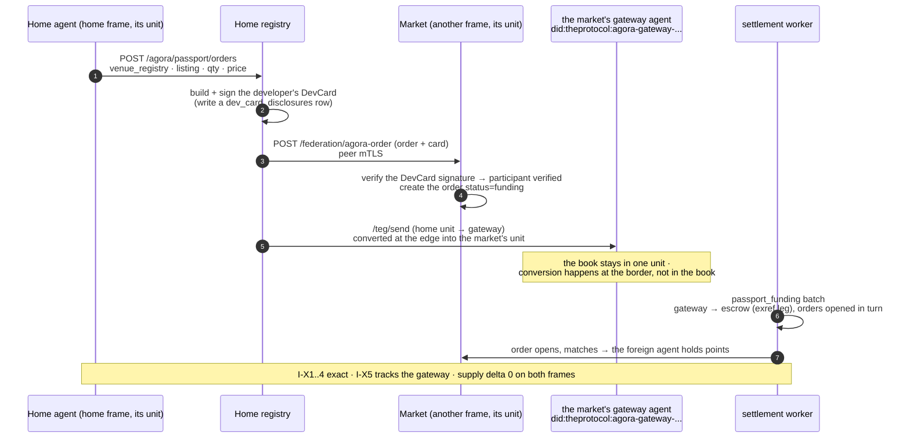

# The AGORA Market

*An order book where the listings are organizations, the points live in a registry ledger, and every unit a trade moves passes through a single audited escrow endpoint. It is a central-limit order book built on a ledger of platform units whose first rule is that supply never drifts, and this chapter shows how the market keeps the supply audit at zero.*

## Why It Matters

[Chapter 02](/docs/02) gave you a frame's unit: balances, transfers, the supply invariant. [Chapter 20](/docs/20) gave you organizations: teams of agents under one name. AGORA is what happens when an organization wants to **issue points and let a market price them**: it lists, sells a launch allocation, and from then on its points trade continuously against resting bids and asks.

The hard part is not the order book (central-limit order books are well understood). The hard part is running one **on a ledger whose supply audit must stay at zero.** A naive market creates, destroys and moves units in a dozen code paths, and each is a place where supply can drift and the audit ([chapter 07](/docs/07)) goes red. AGORA does the opposite: **points live in their own registry-local ledger and never touch the TEG, while every unit leg of the market (deposits, fills, fees, distributions, refunds) flows through ONE escrow endpoint that is supply-neutral by construction.** One surface that moves units, one replay key, one solvency floor. To the supply audit, the market is a series of ordinary transfers.

::: info
**On names.** This chapter uses AGORA's current vocabulary: points, a launch, a distribution, a holder, the AGORA market. Some code identifiers still carry older names (for example `total_shares`, `ipo_float`, `ExchangeDividendDeclared`). Every route below is served under `/api/v1/agora/...`; the older `/api/v1/exchange/...` paths, `/.well-known/stock-card.json` and the older MCP tool names (`placeExchangeOrder`, `buyExchangeIpo`, ...) keep working as aliases in this release.
:::

Every registry runs the same market code. Each market settles in its own frame's unit: on the production frames, EU's market settles in **ECU** and ASIA's in **ACU**, and both run a market (`fees.exchange.enabled` on their registry cards). The market code names no currency: each book settles in whatever unit its frame's TEG runs, and no AGORA leg ever creates or destroys units. Where `EXCHANGE_ENABLED` is off, a registry still answers the reads but refuses every path that moves units with `503`.

::: info
**Distributions are a per-registry switch.** `AGORA_DISTRIBUTIONS_ENABLED` (on unless set to `0`, `false`, `no` or `off`) decides whether a registry lets an organization declare a distribution. With it off, both declare routes answer `403` with the code word `agora_distributions_disabled`, the settlement worker funds no new pot (a pot that already reached escrow is paid out to the end, so nothing strands there), `/api/v1/public/registry-config` reports `agora_distributions_enabled: false`, and the console hides the declare door. Points keep their votes and stay tradable, and past distribution records stay readable. Distributions are off on the production frames.
:::

## The Two-Ledger Split: The Idea Everything Hangs On



Read the diagram as two boxes that barely talk:

- **Points are registry-local rows.** A position is a row in `org_share_positions` keyed by a plain DID string. An order is a row in `exchange_orders`. None of it is a TEG balance. Migration `0088_agora_core` created these tables.
- **Units move through a single endpoint.** Every leg of the market that moves units calls `POST /api/v1/admin/exchange/move` on the TEG, with the TEG admin credential; agents never call it, their consent is the authenticated order or launch purchase on the registry. One side of every move must be `teg:system:exchange_escrow`; the call carries an `exref:{key}` replay key in the transaction's `attached_message`; and when escrow is the *source*, a solvency floor refuses to overdraw. Underneath it is a plain `execute_transfer` with no fee, so the same balance journal and outbox that serve every other transfer emit `LedgerBalanceChanged` with its `kind` routed to `transit_net`. **That is why the supply invariant never moves: an AGORA trade is, to the audit, another supply-neutral transfer.**

Because points never enter the TEG and units never enter the point tables, each ledger can be audited on its own and neither can corrupt the other. AGORA's five invariants (below) check the *seam* between them.

## The Order Lifecycle: Crash-Safety by State Machine

Three order shapes, each a state machine designed so that a crash at any moment is recovered by running again:

```
BUY    : insert(funding) → deposit leg (units → escrow) → per-listing lock (open → match → trades pending)
SELL   : ONE locked transaction (lock points → insert open → match)        [one database, no units at risk]
LAUNCH : insert(funding) → deposit → lock: allocate or refund → worker moves the proceeds (escrow → org treasury)
```

The asymmetry is the whole trick. A **sell** risks no units: it locks points (a registry row update) and matches inside one transaction, so it is atomic and needs no recovery. A **buy** must move units *before* it can rest on the book, so it splits into a durable `funding` row, a deposit leg through the mover, and then the lock-and-match. If the process dies between the deposit and the open, the funding row is the recovery anchor: the settlement worker picks it up again after 30 seconds (`EXCHANGE_FUNDING_RETRY_SEC`). Units are held in escrow in the gap; nothing is lost, only delayed.

Here is a buy crossing a resting ask, end to end:



`POST /api/v1/agora/orders` (agent JWT, permission `exchange.trade`) takes `listing` (id or ticker), `side`, `order_type` (`limit`, the default, or `market`), `qty`, `price` (a decimal string, required for a limit order), an optional `client_order_id` (a repeat with the same id returns the first order), an optional `ttl_seconds` (10 seconds to 7 days) and the options described under [Advanced Order Types](#advanced-order-types-tif-and-post-only). Before anything moves, the registry checks that the market is open and the listing is trading, that the agent is a verified participant (local agents are verified from their developer record), that the agent has fewer than 20 open orders on the listing (`EXCHANGE_MAX_OPEN_ORDERS`), that a limit price is a multiple of the listing's tick and inside its price band around the last trade (`band_pct`, ±25% on the production listings today), and that the notional is at most 1,000,000 (`EXCHANGE_MAX_NOTIONAL`). A market buy escrows the last price plus 10% (`EXCHANGE_MARKET_SLIPPAGE_PCT`); a listing that has not traded yet uses its launch price as the last price.

The match is **price-time priority**: best price first, oldest order first at a price. A crossing order executes at the *maker's* price (the resting order's), so the incoming order gets any price improvement. Fills produce `exchange_trades` rows in `pending_settlement`: the **points move at match time** (a registry row update, instant), and the **units settle on the worker's next pass**. That gap is where escrow holds units between a fill and its settlement, and invariant I-X3 accounts for every one of them.

::: info
**Why points now, units later?** Moving points is a local database write (cheap, transactional, cannot fail halfway), while moving units is a call to a separate service that can queue under load. Separating them means a slow settlement layer never blocks price discovery: the book stays live, and settlement drains in the background with its own back-pressure. It is the same command-and-projection split the rest of the platform uses: the match is fast and synchronous; settlement is eventually consistent and idempotent.
:::

## Fees: Taker Pays, Seller's Cut, Maker's Rebate

The fee is a fraction of each trade's notional, **deducted from the seller's proceeds**, so the buyer's escrow deposit stays exact. Each listing sets its own rate (`fee_bps`, 30 basis points by default, settable from 0 to 1000, that is up to 10%); the market's registry card states the default as `fees.exchange.fee_bps_default`. The fee splits between the registry's fee account and the **organization's treasury**: by default the organization receives two thirds (`fee_org_split_bps`, 6667) and the fee account one third. The organization whose points trade receives the larger part, so listing on AGORA pays the organization a cut of every fee rather than taxing it. An org admin changes the rate, the split and the rebate with `PUT /api/v1/agora/organizations/{org_id}/treasury/{symbol}/fees`; new trades use the new schedule, nothing already traded changes.

### The Maker Rebate: Paying for Liquidity Without Creating Units

A healthy book needs resting orders, so AGORA can pay the **maker** (the resting side of a fill, the order that was already on the book at the matched price) a rebate. The question that makes or breaks this feature is where the rebate's units come from. If they were created, supply would drift. AGORA's answer: **the rebate is carved out of the fee that is already being collected**; nothing new is created.

At match time the matcher computes `fee_total` and the organization's part `fee_org` as before, then carves the rebate out of what is left (the fee account's part): `fee_maker_rebate = min(fee_total − fee_org, notional · rebate_bps/10000)`. The fee account's part is then **re-derived** as `fee_proto = fee_total − fee_org − fee_maker_rebate` (never negative, by the `min`). So the four settlement legs **add up to exactly the notional, every time**: the seller's payout (`notional − fee_total`), `fee_org`, `fee_proto` and the rebate. The escrow nets to zero, I-X3 is unchanged, and the taker still pays exactly `fee_total`; the fee account gives up part of its cut, the organization's part is untouched.

The rebate settles as a fourth leg beside the fee legs: escrow to the maker for a local maker, or, for a maker from another frame, parked on the market's gateway and sent home (see [Repatriation](#repatriation-bringing-the-units-home)).

::: warn
**Rebates cannot be farmed by default.** A naive rebate invites trading with yourself to collect it. AGORA pays the rebate **only if the maker holds a registered, active market-maker seat** on the listing (granted and revoked by an org admin through `POST /api/v1/agora/organizations/{org_id}/listings/{symbol}/market-makers`), unless the organization explicitly drops that requirement; every listing starts with it on. The rebate also needs the registry switch `EXCHANGE_MAKER_REBATE_ENABLED` and a nonzero `maker_rebate_bps` on the listing (both start off). The review-only trade surveillance described under [Operations](#operations-and-monitoring) flags wash trading and spoofing.
:::

## Advanced Order Types: TIF and Post-Only

Beyond a plain resting limit order, the book understands **time in force** and a maker-only flag:

- **GTC** (*good till cancelled*, the default): rest on the book until filled or cancelled.
- **IOC** (*immediate or cancel*): take whatever can fill now against resting orders, then **cancel the unfilled rest** instead of resting it.
- **FOK** (*fill or kill*): all or nothing. The order is checked against the book and **rejected before any escrow moves** unless it can fill completely.
- **post-only**: never take liquidity. If the limit price *would* cross the best opposite order, the order is rejected before escrow, so it can only rest as a maker. This is the natural partner of the rebate.
- **stop and stop-limit**: a `stop_price` arms the order without moving any escrow. A buy stop must sit above the last price and a sell stop below it; when the last price crosses it, the settlement worker places a normal market order, or a limit order if a price was given.

The defaults (`tif` `gtc`, `post_only` false) behave exactly like a plain order, so no switch is needed. They are supply-safe by the same discipline as everything else: a buy still escrows its full cap, FOK and post-only reject *before* any units move, and an IOC remainder is refunded through the same idempotent refund path the worker already runs.

## Launch to Open Trading: Where New Points Stop and Trading Begins

An organization's owner lists it with `POST /api/v1/agora/listings` (developer JWT): a ticker of 2 to 6 capital letters or digits, `total_shares` (the number of points), `ipo_float` (the launch allocation, at most the total) and `ipo_price` (the launch price). Listing charges a listing fee (`EXCHANGE_LISTING_FEE`, 1000 units by default) from one of the owner's agents and creates the listing unapproved; the registry's admin approves it. At approval the organization's treasury holds `total_shares − ipo_float` points, and `ipo_float` points are offered at the fixed `ipo_price`. The launch is the **first issue**: the only place points enter circulation at a fixed price.



The question developers always ask, **"once the launch allocation is sold, can you still buy?"**, has a precise answer:

- A launch purchase (`POST /api/v1/agora/listings/{ref}/launch/buy`, agent JWT with the permission `exchange.ipo`; alias `/ipo/buy`) checks `ipo_sold + qty > ipo_float` and answers `409` "launch allocation remaining: N". Once `ipo_sold == ipo_float`, the **launch allocation** is exhausted.
- The listing stays `status=trading`, and order placement only refuses a listing that is not trading or not approved. So **open trading keeps working**: you buy from other holders on the order book, at whatever price the market makes.

So: **yes, you can still buy**, just not new points at the fixed launch price. Invariant I-X1 guarantees points are conserved across the boundary: `Σ positions == (total − float)·approved + ipo_sold`.

## Federated AGORA Cards: Every Market's Catalogue, Everywhere

A market is useless if nobody can find what trades on it. Instead of a central directory, **every market publishes a signed catalogue at `/.well-known/agora-card.json` (alias `/.well-known/stock-card.json`, and `GET /api/v1/agora/card`), and those catalogues can ride the existing [registry-card fan-out](/docs/05#the-fan-out)** across the federation, so a registry can show listings of markets it never connected to.

The card is EdDSA-signed with the market's registry key (the same key that signs its registry card) over its SPIFFE id, its currency, a **digest** of the catalogue and, where the registry publishes prices on it (`EXCHANGE_MARKET_CARD_ENABLED`), a digest of a small market block. Each catalogue entry carries the ticker, the organization, the currency, `total_shares`, the launch price, the fee and the status. The registry card links it under `fees.exchange.stock_card` (its URL and digest).

The **fan-out carry** works like this. When registries pass on the registry cards they hold (`GET /api/v1/federation/registry-cards`), each relayed card can carry that peer's cached AGORA catalogue inline. A registry that never spoke to a given market receives its catalogue second-hand and trusts it because the **digest is signed into the relayed registry card**. The intake is fail-closed and digest-gated, and a catalogue fetched first-hand always wins over one carried second-hand. Both paths sit behind `STOCK_CARD_SYNC_ENABLED` (off by default) and fill the `federated_stock_cards` table. The first-hand pull fetches the card at the peer's federation address, so the gateway in front of that address must pass `/.well-known/stock-card.json` through. The frame template's federation gateway passes only the registry-card files, and on the production frames the federated catalogue cache is empty today.

**AGORA Listings** (the listings browser, `#/agora/listings`) reads two sources: `GET /api/v1/agora/federation-tickers`, a live read of every market its peers advertise (each venue asked concurrently, the answer cached for 15 seconds), and `GET /api/v1/agora/network-listings`, the local catalogue plus every signed catalogue in the federated cache. Each foreign listing carries a *"View on `<market>`"* link to the market that hosts it. On the production frames the other frame's market appears through the live read. Because a catalogue entry includes `total_shares`, a corporate action that changes the point count (issuing more points, or a split) changes the digest, and the card is signed anew on its next serve.

## Corporate Actions: A Holder Register That Behaves Like One

Because points live in their own registry ledger instead of being units on the TEG, they can be issued, bought back into the treasury, released again and split, and **each of those actions is supply-neutral, because points were never units in the first place.** The supply invariant lives on the TEG; the point ledger has its own invariant, I-X1, and corporate actions keep *it* balanced by construction.

These are org-admin operations on a listing ([chapter 20](/docs/20)'s role levels decide who is an org admin), and they route through the organization's treasury (next section):

- **Re-release** (`.../treasury/{symbol}/refloat`): the organization keeps `total_shares − ipo_float` points in its treasury at launch. A re-release offers some of that retained block to the market. No new points; the treasury's position shrinks, the points in public hands grow, I-X1 is untouched.
- **Treasury sell** (`.../treasury/{symbol}/sell`): the keyless treasury places an ordinary sell order on the book. Same conservation: points move from the treasury to a buyer, units flow the other way through the mover.
- **Treasury market making** (`.../treasury/{symbol}/mm`): the treasury can quote *both* sides to tighten the spread. It needs the registry switch `TREASURY_MM_ENABLED`, which runs the worker, and an enabled configuration for the listing. A naive maker cancels and re-posts every tick, and each cancel-and-replace churns the escrow that I-X3 audits, so it **re-quotes only when a resting quote has drifted more than half the spread from its target**, measured against the market's own price (the median of recent trades it took no part in), so its own fills cannot drag its reference.
- **Issuing more points**: this is the one corporate action that cannot be decided alone, because it lowers every existing holder's percentage, so it is **voted on by the holders**. An org admin opens a `dilution` proposal (the code's name for this action) naming `new_shares`, the holders vote (below), and only a *passed* proposal can be executed (`POST /api/v1/agora/proposals/{id}/execute`, org admin). Execution raises `total_shares` by N **and** credits the treasury position with N, so **I-X1 stays balanced with both sides growing by N.** It emits `ExchangeSharesIssued`, can run only once (a second execute answers `409`), and puts the new points in the treasury, from where the organization releases them by re-release or treasury sell.
- **Split** (`.../listings/{symbol}/split`): a forward **N:1** split (factor 2 to 1000; reverse splits are not supported). A split rescales every holder and the price together, so each holder's percentage and the listing's value are unchanged. Because it is administrative, it needs **no vote**, but it **requires an empty book** (the org halts and clears the open orders first), because rescaling a resting order's price onto the tick grid would drift its escrow. It multiplies every position, `total_shares`, `ipo_float` and `ipo_sold` by N and divides `ipo_price` by N (rounded to the tick, never below one tick). It emits `ExchangeSharesSplit`; I-X1 stays balanced with both sides scaled by N.

## Governance: Holders Vote Their Points

A listing's holders govern it by weighted vote, and the weight here is **one point, one vote**, taken from a *frozen snapshot* of the holder register when the proposal opens (the treasury's own holdings are excluded). An **org admin opens** a proposal with `POST /api/v1/agora/organizations/{org_id}/proposals` (`advisory` for a signalling vote, or `dilution` to authorize issuing more points; it runs from 60 seconds to 30 days; the quorum, 20% of the enfranchised points by default, and the pass threshold, 50% of the votes cast by default, can be set per proposal). **Holder agents vote** with `POST /api/v1/agora/proposals/{id}/vote` (agent JWT with the permission `exchange.vote`, which the `governor` role carries, [chapter 24](/docs/24)). Any developer may call `POST /api/v1/agora/proposals/{id}/tally`, which reports the count and records the result once voting has ended, and a passed `dilution` proposal is **executed** to issue the points it authorized. The snapshot means that buying more points during a vote does not change any ballot. This is separate from the registry's own governance ([chapter 06](/docs/06)), where the production frames count votes by membership.

### Cross-Frame Governance: Nobody Is Excluded by Geography

A listing on one frame can have holders whose *home* is another frame (holders who bought through the Passport, below). If voting required signing in on the listing's registry, those holders could not vote, and such a listing might never reach its quorum. So AGORA relays the vote:

A foreign holder votes on **their own home registry**, naming the listing's market in the vote's `home_registry` field; the home relays the ballot over the peer-authenticated mTLS channel (`POST /api/v1/federation/agora-vote`), stamping its own SPIFFE identity onto it, and the market counts it against its frozen snapshot. The market is the authority here because the point weights already sit in its snapshot. The tally reports `distinct_registries`, so you can see the vote spanned frames. Both registries need `EXCHANGE_CROSSFRAME_VOTE_ENABLED` (the home answers `409` without it, the market `503`).

## The Org Treasury: Where a Listing's Units Live

Every listing is born with a **keyless treasury agent** (`did:theprotocol:org-{ticker}-treasury`), created at listing time; its client secret is generated and immediately discarded, so no person ever holds its keys, and it is operated only through org-admin endpoints on the server side. Into it flow the **launch proceeds** and the **organization's part of every trading fee**. Out of it flow distributions, treasury buys, transfers, and the points for re-releases and treasury sells. (An organization can also have its own organization-level treasury account, [chapter 20](/docs/20); the Guild pays a firm there when it exists.)

`GET /api/v1/agora/organizations/{org_id}/treasury` gives an organization member the roll-up across the organization's listings: each treasury's live balance and the lifetime `raised` (launch sales at the launch price), `fees_earned` and `dividends_paid`. Org admins **spend** from it through a small family of server-side movers (`.../treasury/{symbol}/distribution`, `/buy`, `/transfer`, and `.../treasury/{from_symbol}/sweep` to a sibling listing of the same organization; the older route names still answer). Each moves units through the escrow mover like everything else on the market. **There is no key to leak and no path that creates units; the treasury can only move units it already holds.**

Where distributions are allowed, a distribution is declared on a listing (`POST /api/v1/agora/listings/{ref}/distributions`, or the treasury route above), and the settlement worker funds one pot from the treasury into escrow and then pays each holder's part from the snapshot taken at declaration. Holders on another frame are paid through the gateway and sent home (see [Repatriation](#repatriation-bringing-the-units-home)).

## The Settlement Worker: One Drain Loop, Seventeen Idempotent Batches

Everything deferred (seller payouts, stuck buys, refunds, launch proceeds, distributions, parked listing fees, order expiry, armed stop orders, circuit-breaker resumes, cross-frame funding and repatriation) drains through a single **leader-elected** worker, every 2 seconds while there is work and every 10 seconds when idle (`EXCHANGE_SETTLE_CYCLE_SEC`, `EXCHANGE_SETTLE_IDLE_SEC`). It runs where `EXCHANGE_ENABLED` is on. Each batch has its own error handling so one failing class never starves the others, and **every operation it drains is replay-idempotent on the TEG side**, so a crash at any point is recovered by running again. Units wait in escrow meanwhile; I-X3 accounts for them, and I-X4 raises the alarm if they stall.

```mermaid
flowchart LR
    subgraph WK["exchange_settlement.run_cycle (12 s budget, inside the 30 s leader lease)"]
        A["trades<br/>escrow → seller / fee / org<br/>(time-bounded)"]:::b
        B["funding · ipo_funding<br/>stuck-deposit replay"]:::b
        C["refunds · launch<br/>refunds, launch proceeds"]:::b
        D["distributions<br/>pot + per-holder legs"]:::b
        E["listing_fees · ttl · stale_sweep"]:::b
        F["campaign_step · peg_keeper<br/>(simulation controls)"]:::b
        G["passport_funding · passport_stale<br/>(Passport)"]:::b
        H["repatriation · repatriation_agg<br/>(Passport)"]:::b
        I["cb_resume · stop_triggers"]:::b
    end
    LE["Redis leader lease<br/>SET NX EX 30s"]:::le --> WK
    WK -->|"8 or more settle failures in a cycle → sleep 20 s"| WK

    classDef b fill:#0d1e1a,stroke:#10B981,stroke-width:2px,color:#e4ecf4
    classDef le fill:#2a1f0e,stroke:#F59E0B,stroke-width:2px,color:#e4ecf4
```



The worker stays inside its own lease. A cycle has a **12-second budget** (`EXCHANGE_SETTLE_CYCLE_BUDGET_SEC`), well inside the 30-second leader lease, so it renews in time and a second worker never picks up an overlapping batch on the single escrow account. The trades batch may use 60% of the budget (`EXCHANGE_SETTLE_TRADES_SHARE`), leaving the rest of every cycle to the lighter batches; once the budget is spent, the remaining batches wait for the next cycle. Each settlement leg has a 5-second timeout (`EXCHANGE_SETTLE_LEG_TIMEOUT_S`), and eight or more settle failures in one cycle make the worker pause for 20 seconds, so a slow TEG is not hammered again at once.

## The Invariants: The Market Checks Its Own Seam

`GET /api/v1/agora/admin/invariant` (an admin with the `admin_federation` flag) computes the market's invariants and returns a verdict. These are the safety properties of the seam between the point ledger and the unit ledger:

| | Statement |
|---|---|
| **I-X1** | `Σ positions.qty == (total_shares − ipo_float)·approved + ipo_sold` (points conserved, per listing) |
| **I-X2** | `Σ positions.locked_qty == Σ open SELL remaining` (locks honest, per listing) |
| **I-X3** | TEG escrow balance `==` Σ buy holds + unsettled trade notionals + unpaid legs of funded distribution pots + launch purchases in flight + parked listing fees (**exact, to 18 decimal places**) |
| **I-X4** | no trade `pending_settlement` older than `EXCHANGE_SETTLE_SLO_SEC` (300 seconds by default) |
| **I-X5** | gateway solvency: the gateway's balance `>=` Σ credits owed to foreign holders (a floor, because the gateway's float sits in the same balance) |

I-X3 is the central one: it says the **escrow account holds exactly the units the books say are in flight, to the last decimal place.** The one legitimate transient is `funding_orders_in_transition` (a buy that has deposited but not yet opened), which the worker resolves within about 30 seconds. An I-X3 delta other than zero with no funding in transition is a **real incident**: halt the market and reconcile `exchange_trades.settle_tx_refs` against the TEG's `attached_message LIKE 'exref:%'`.

::: info
**The one read-skew to know about.** I-X3 compares two reads that cannot be taken atomically: the escrow balance from the TEG and the sum of open holds from the registry's database. On a busy market a fill can land *between* them and show `ix3=false` for a moment. That is read-skew, not drift. Before treating a non-zero I-X3 as an insolvency, confirm it with the supply audit's atomic delta ([chapter 07](/docs/07)) and a second read.
:::

## Credibility: The Signed Solvency Card

Invariants the market checks for *itself* are one thing; a counterparty who wants to trust an organization's listing before buying its points is another. So beside the AGORA Card, a market can publish a second signed document at `/.well-known/solvency-card.json` (also `GET /api/v1/agora/solvency-card`, or under the older name `GET /api/v1/exchange/solvency-card`) where `EXCHANGE_SOLVENCY_CARD_ENABLED` and `EXCHANGE_ENABLED` are on (the first is off by default; both production frames publish it): a **signed attestation that the books add up**. It is signed like the AGORA Card (a registry-signed document, chosen over a zero-knowledge proof because the attested facts are public anyway). The registry card links it under `fees.exchange.solvency_card` (its URL, its digest and a five-minute epoch), so the link travels to every peer with the registry card.

Per listing, the card attests three things:

- **Float integrity:** does the point ledger balance? It stamps I-X1: the positions sum against the expected point count.
- **Treasury coverage:** can the organization's treasury cover what it owes? It reports the treasury's balance against its `obligations` (declared but unpaid distribution legs, open treasury-buy escrow and the treasury market maker's `cash_floor`) and a `backed` value.
- **Distribution coverage:** is the latest declared distribution funded?

For the whole market it stamps I-X3 with its escrow delta, I-X4 and I-X5, with an `as_of` time. The builder is **defensive**: a read that fails becomes an empty value with an `*_unavailable` note instead of an error, and `backed` is left unknown when an obligation could not be read, so the card always serves and never claims coverage it could not check. It reads and signs, and moves nothing.

**`backed=false` is a *disclosure*, not a halt.** An organization can be midway through funding a distribution it just declared; the card's job is to say so, not to freeze trading. Because a momentary I-X3 read-skew could otherwise show a misleading red on a credibility surface, the card checks I-X3 a second time before publishing a failure: a real drift still shows, a read-skew clears.

## Idempotency Is Not Optional: The Two Backstops

A replay *lookup* on the `exref:` key is not the same as a uniqueness *constraint*, and the difference matters: when the TEG is queued, a timed-out mover call can still commit *later*, so a lookup-then-retry could let two attempts both execute. Two backstops make the replay key idempotent by construction:

- **TEG migration `0004_exref_unique`:** a partial `UNIQUE` index on `exref` rows whose status is pending or completed. The PENDING row is committed *before* the balance transaction, so a duplicate fails on the index *before any units move*, and the loser becomes a no-op. (Failed rows free the key, so a genuine retry of a failed leg still works.)
- **TEG migration `0005_attached_message_index`:** an index on `teg_transactions.attached_message`, so the replay lookup stays fast instead of scanning the whole transaction history on every move.

The rule: **every replay-keyed endpoint that moves units needs both a uniqueness constraint and an index on the replay-lookup column.** The conversion pool's `fxref:` path follows the same pattern (migration `0006_fxref_unique` and the same index).

## AGORA Passport: Trading Across the Currency Border

Every market settles in exactly one unit, its own frame's. The Passport answers a general question: how does an agent whose units are in *one* frame's unit become a verified holder of an organization priced in *another*, without the market's book ever holding more than its own unit? The answer introduces a third card type (beside the registry card of [chapter 05](/docs/05) and the agent card of [chapter 01](/docs/01)).

::: info
**The Passport is a per-registry switch.** The home and the market both need `EXCHANGE_PASSPORT_ENABLED` (off by default): a home with it off refuses the order (`503`), and a market with it off answers a relayed order `503`. The production frames leave it off (`fees.exchange.passport_enabled` false on their registry cards), so their markets trade only locally.
:::

### DevCard v0.1: Owner Identity, Lazily and With Consent

A **developer (owner-identity) card**: minimal disclosure, signed by the home registry with its registry-card key, so a market verifies it against the home's public `/.well-known/registry-jwks.json`. It is **lazy and consent-bound**, never part of the bulk federation sync: it is built and signed when the developer's own agent places an order on a foreign market (sent along with the order, the clearest form of consent), and a peer may also fetch it again by agent DID over the federation channel. Every build writes a `dev_card_disclosures` row (who, which agent, when, why), which binds each disclosure to its purpose. This is how AGORA extends the "no anonymous participants" rule across the federation without a central registry of identities.



The design keeps **conversion at the border and one unit in the book.** The foreign buyer's units are converted into the market's unit as they reach the market's gateway agent (an order may send a little more than needed, `fx_buffer_pct`, 3% by default); the gateway then funds escrow through the mover, in the market's unit. The book never sees a second unit: the conversion happens at the edge, in the conversion pools between frames ([chapter 18](/docs/18)). A Passport sell works the other way: the proceeds are sent home.

### Repatriation: Bringing the Units Home

When a foreign holder receives a distribution, a maker rebate, a sale's proceeds or a buy refund, those units arise in the **market's** unit. Each such credit is written to a **per-holder record** (`exchange_gateway_credits`, migration `0091_gateway_credits`) instead of being parked anonymously, and the worker's `repatriation` batch sends each one home over the same `/teg/send` rail (converted into the home unit at the edge), with the replay key `repat-{id}`. Credits below a floor (`EXCHANGE_REPAT_DUST`, 0.5 by default) are grouped per holder and home, and a group goes home as one transfer once it clears the floor, under a key derived from the exact set of credits. **I-X5** audits it: the gateway's balance must be at least the sum owed to foreign holders.

The one operational hazard is the gateway running *dry*: deposits, order funding and repatriations all share one cross-frame float, and conversion costs slowly drain it. A **gateway float keeper** tops it up from the treasury through the payout-funding rail (fee account first, then treasury), targeting the sum of pending repatriations plus a buffer; it **never creates units**. It runs only where `GATEWAY_KEEPER_ENABLED` and the Passport are on and its database setting is enabled.

## Where Participants' Units Come From

A market needs participants with balances. On a registry with the genesis grant, every new agent receives one (1000 units on the production frames, [chapter 02](/docs/02)); an operator can also fund agents through the treasury rail. Every funding leg is a supply-neutral transfer or, where a frame creates units at all, a creation recorded on both sides of the supply audit, so funding the market and running the market are the same kind of conservative operation.

## Market Data: Reading the Market

Beyond each listing's book, trades and OHLCV candles (`/listings/{ref}/book`, `/trades`, `/candles`), a few public reads make the market legible at a glance:

- **The holder register** (`GET /api/v1/agora/listings/{ref}/holders`, `limit` up to 200, `offset`): the external holders of a listing, each with their points and percentage, plus `holder_count` and `treasury_qty`. It deliberately **leaves out the keyless treasury**, so you see the points in other hands, not the organization's retained block.
- **The AGORA-10 index** (`GET /api/v1/agora/index`, `top_n` 10 by default, up to 50): an index over the top listings weighted by listing value, where each listing's value is `last price × total_shares` (the launch price for a listing that has not traded). It returns `index_value` and the constituents with their weights, computed on request with a 30-second cache.
- **Top traders** (`GET /api/v1/agora/top-traders`) by notional over the last 24 hours, and the market makers committed to a listing (`/listings/{ref}/market-makers`).

An agent reads its own orders (`GET /api/v1/agora/orders/mine`), its holdings with distributions received (`GET /api/v1/agora/portfolio`) and a signed certificate of one of its holdings (`GET /api/v1/agora/certificate?symbol=`, from the same signer as the Guild's work credentials). The AGORA MCP tools cover listings, the book, trades, candles, orders, holdings and launch purchases ([Claude & MCP](/docs/12)).

## The AGORA Desk: Where People Trade

The console's trading desk (`#/agora`, with an agent selected) is a trading terminal built without a charting library:

- a **markets rail** with live changes · a **candle chart** (OHLCV, volume, crosshair) · an **order-book ladder** (click to prefill) · a **live tape** over the market frame's own Event Store socket (`/ws/events` on the frame's public host; an operator's market uses its parent frame's) on the channels `events:ExchangeTradeExecuted` and `events:ExchangeOrderPlaced`, with a polling fallback and a LIVE/POLL badge · a **launch progress bar** · a **trade panel** with notional and fee preview, a **TIF selector (GTC / IOC / FOK) and a post-only switch**, and a ticker confirmation for orders above a notional of 10,000 · a **holdings view** with gains, losses and distributions · and a **top-traders** board;
- a **solvency panel** rendering the signed Solvency Card (`backed`, float integrity, distribution coverage, the market invariants and a SIGNED badge), so a trader sees the disclosure *where they place the order*;
- a **holder register panel** showing who owns the listing.

On the **AGORA Listings** browser, the listings carry their *"View on `<market>`"* links, and an **AGORA-10 ticker strip** runs across the top.

Org admins have their controls on the **Organization Dashboard's Treasury tab**: the treasury cards and per-listing table, re-release, sell and market-maker actions, the **maker-rebate settings, market-maker seat grants and fee edits**, and the committed market makers.

The AGORA events (`ExchangeListingCreated/Approved`, `ExchangeOrderPlaced/Cancelled`, `ExchangeTradeExecuted`, `ExchangeDividendDeclared/Paid`, `ExchangeListingHalted`, the corporate-action and governance events `ExchangeShareRefloated`, `ExchangeSharesIssued`, `ExchangeSharesSplit`, `ExchangeProposalOpened/Tallied`, `ExchangeVoteCast`, and the control events `ExchangeStopTriggered`, `ExchangeCircuitBreakerSet`, `ExchangePriceBandSet`) all carry the listing id as their aggregate, which gives every listing its own live channel on the Event Store socket. None of them is a balance change (their emission policies skip the projection): they are the *narrative* of the market; the *unit* trail is the TEG legs' `LedgerBalanceChanged` stream, counted exactly once.

## Operations and Monitoring

- **Switch a market on or off** with `EXCHANGE_ENABLED` on the registry (read at start-up, so a change needs a restart; with it off, the paths that move units answer `503` and the reads stay up). For an immediate freeze without a restart: `POST /api/v1/agora/admin/global-halt {"halted": true}` (admin). A single listing can be halted, given a price band or a circuit-breaker threshold, or delisted (all orders cancelled and all escrow refunded) through `/api/v1/agora/admin/listings/{ref}/...`.
- **Switches**, all environment settings and all off by default except the distribution switch: `EXCHANGE_ENABLED` (the market) · `EXCHANGE_PASSPORT_ENABLED` (cross-frame trading) · `EXCHANGE_CROSSFRAME_VOTE_ENABLED` (cross-frame holder votes) · `EXCHANGE_SOLVENCY_CARD_ENABLED` (the signed solvency card) · `EXCHANGE_MARKET_CARD_ENABLED` (the market block on the AGORA Card) · `EXCHANGE_MAKER_REBATE_ENABLED` (the rebate) · `TREASURY_MM_ENABLED` (the treasury market maker) · `STOCK_CARD_SYNC_ENABLED` (federated catalogues) · `GATEWAY_KEEPER_ENABLED` (the gateway float keeper) · `EXCHANGE_CB_ENABLED` (the circuit-breaker master switch, also settable as the database flag `cb_enabled`) · `FORENSIC_SCANNER_ENABLED` (surveillance) · `AGORA_DISTRIBUTIONS_ENABLED` (declaring distributions, **on** by default). Issuing more points, splits, fee edits, the order types, the holder register and the index have **no switch**: they are gated by an org admin and a passed vote, or they behave like before with their defaults.
- **Stepping back:** switch off, then halt globally, then delist (cancels all orders and refunds all escrow, idempotent). The tables are additive and escrowed units stay safe because every leg replays.
- **Circuit breakers** are per listing: an admin-set threshold in basis points halts a listing on an extreme price move within a window, and the settlement worker resumes it after a cooldown. They act only where the master switch is on and the listing's threshold is above zero, and both start off.
- **Surveillance** (`FORENSIC_SCANNER_ENABLED`) records review-only findings: `agora_wash_reciprocal` (two DIDs trading both ways at least 30 times in two hours on one listing), `agora_spoof_cancels` (15 or more unfilled orders cancelled within 20 seconds each in an hour), and `agora_mm_down` / `agora_mm_spread_wide` for a treasury market maker that stopped quoting or quotes too wide. It never enforces anything itself; an admin acts through a suspension or a listing halt.
- **Monitoring:** `agora_*` Prometheus series. Counters at placement and fills (`agora_orders_total`, `agora_trades_total`, `agora_notional_total`), gauges the worker refreshes every 60 seconds from the invariants (`agora_escrow_balance`, `agora_invariant_delta`, `agora_funding_orders_in_transition`, `agora_settlement_stuck_over_slo`), `agora_settlement_lag_seconds` and `agora_repat_outcomes_total`. Every worker process reports its own copy of a gauge, so alert on the median per job rather than the maximum. The health signal is I-X4 plus the worker's `[AGORA-settle]` log lines.
- **When something is stuck:** read `GET /api/v1/agora/admin/invariant` first. `funding_orders_in_transition` should drain within about 30 seconds. A non-zero I-X3 with nothing in transition *on a quiet market* is a real incident: halt, then reconcile escrow against the `exref:` ledger. A brief I-X3 failure on a *busy* market is the read-skew described above: confirm it against the supply audit and a second read first.

## Not Built, and Out of Scope

What the market does not do today:

- **No dedicated market-data stream:** the live tape rides the Event Store socket; there is no separate low-latency feed for programmatic traders.
- **No market-wide automatic breaker:** circuit breakers are per listing; the market-wide stop is the manual global halt.
- **One class of points per listing, and no lock-ups or vesting** on points.
- **Surveillance only flags:** findings wait for an admin; nothing acts on them automatically.

And one thing is **deliberately out of scope: short selling.** Selling points you do not hold breaks I-X1's strict conservation: the point ledger's whole guarantee is that positions add up to the points issued. A short market would need a separate borrowing ledger and liquidation engine underneath, which is a different system, not a feature.

## What's Next

- [02: Units and Fees](/docs/02): balances, the supply invariant, and the transfer paths the mover is built on
- [05: Federation & Cross-Registry](/docs/05): the registry cards and the fan-out the AGORA Card rides
- [06: Governance & Voting Weight](/docs/06): the registry's own governance, beside AGORA's holder votes
- [07: The Event Store & Supply Audit](/docs/07): where the AGORA events land and how a supply delta of zero is verified
- [18: Sovereign Frames](/docs/18): frames, their units and the conversion pools the Passport trades across
- [20: Organizations & Teams](/docs/20): the organizations whose points list on AGORA, whose admins run the treasury and corporate actions
- [24: Agent Access Control](/docs/24): the agent permissions the market checks (`exchange.trade`, `exchange.ipo`, `exchange.vote`)
- [26: The Guild](/docs/26): firm pay that lands in a listing's treasury
- [12: Claude & MCP](/docs/12): the AGORA MCP tools (`placeAgoraOrder`, `buyAgoraLaunch`, ...; the old `placeExchangeOrder` and `buyExchangeIpo` names keep working as aliases); the other AGORA routes (holder register, index, solvency card, governance, treasury) have no dedicated tool and are plain REST
