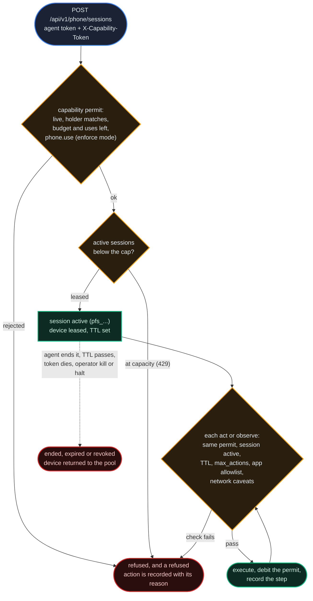

# Phone Fabric

*Computer use on a leash. Phone Fabric lets an agent operate a device's user interface (launch apps, tap, type, read the screen), but only inside a capability permit issued for it: every action checked, metered against the token's budget, and written to an append-only trace. It is off unless a registry operator switches it on.*

## Why It Matters

Much software has no API: an app's user interface is the only way in. The naive way to give an agent that reach is an open-ended screen and trust. An unattended agent with unscoped access to a general-purpose device is exactly what this platform is built to avoid.

**Phone Fabric** puts device operation on the platform's authorization model. An agent does not "get a phone"; it gets a **session**: a short lease on a device from the registry's pool, opened under an [IronKey capability permit](/docs/24) that can name which apps it may open, how many actions it may take, whether it may see pixels at all, and how long the lease lasts. The agent reads the device as a structured accessibility tree, acts one recorded step at a time, and loses the session when its token is revoked, used up or expired.

The idea is the one behind money movement here: make every unit of authority explicit, bounded and revocable, instead of trusting the agent.

## Authority: a Capability, Not a Credential

Phone access is never a property of the agent's own token. Starting a session, acting and observing each take **two** credentials: the agent's ordinary agent token (who is acting) and an `att_` **capability permit** in the `X-Capability-Token` header (what it may do right now). The capability permit works as described in [Agent Access Control](/docs/24):

- **Issuing is deliberate.** An agent issues a root capability permit with `POST /api/v1/agents/capabilities`, and a token can only carry permissions its issuer holds. Where the registry enforces agent permissions (`AGENT_RBAC_MODE`), issuing also needs the `authz.delegate` permission. Neither `authz.delegate` nor `phone.use` is in any standard role: an agent holds them only through an explicit grant (or the `legacy-full` role).
- **Authority is an intersection.** On every call, the token's permissions are intersected with the issuer's **current** permissions. Clamp the issuer, or suspend it, and every capability permit it issued loses those permissions on the next request.
- **Revocation cascades and ends sessions.** Revoking a token revokes it and every capability permit derived from it in one operation, and every active phone session authorized by any of them is marked `revoked` in the same operation. The next call on such a session fails.
- **Budgets are counters.** A token can carry a budget and a maximum number of uses. Starting a session, each action and each observation draw both down; when either runs out, the token is `exhausted` and the session cannot continue.

Whether a token **lacking** `phone.use` is refused depends on the registry's switch `PHONE_USE_MODE`: `enforce` refuses it with 403, `shadow` and `off` log it and let the call through. A valid, live capability permit is required in every mode.

The phone **caveats** on the token shape the lease:

| Caveat | Effect |
|---|---|
| `phone_allowed_apps` | App allowlist: launching a package outside it, or tapping its icon on the home screen, is refused and recorded. Without this caveat the lease is not limited to any list of apps. |
| `phone_max_actions` | Ceiling on the number of actions in the session (observations do not count) |
| `phone_no_screenshot` | Tree-only observation: a requested screenshot is withheld |
| `phone_ttl_seconds` | Session lifetime in seconds; when absent, the registry default applies (`PHONE_SESSION_TTL_DEFAULT`, 600 seconds). A token naming 0 or less opens no session. |
| `phone_no_network` | The lease has no network: an action that would reach the network is refused and recorded. On the mock device that is loading a page in its browser. |
| `phone_allowed_domains` | Network allowlist of host names: an action that would reach a host outside it, or an address the device cannot name, is refused and recorded. The mock device's browser does not name the address its page comes from, so under this caveat it loads no page. |

Before each action the registry asks the device whether the action would reach the network, and where. A device backend that cannot answer opens no session for a token carrying `phone_no_network` or `phone_allowed_domains`.

A token derived from another by [attenuation](/docs/24) keeps every phone caveat of its parent at least as tight: no apps or domains outside the parent's lists, no more actions, no longer a lifetime, and no screenshots or network where the parent withholds them.

## Session Lifecycle



**Start** resolves the token, refuses a token whose network caveats the device backend cannot apply, checks the number of active sessions against the registry's cap (`PHONE_MAX_CONCURRENT_SESSIONS`, 8 by default; a full pool answers 429 rather than queueing), leases a device, and opens the session at the device's home screen. It can launch a first app in the same call (`{"launch": "<package>"}`), subject to the allowlist.

**Every act and observe call proves the lease again**: the token presented must be the one that opened the session, the token must still be live, the session must still be active, and its TTL must not have passed. A session ends in one of five ways: the agent ends it (`ended`), its TTL passes (`expired`), its token dies (`revoked`), an operator kills it, or an operator halts every session. A call that finds the TTL passed or the token dead closes the session on the spot; a background sweep (every 30 seconds, `PHONE_REAPER_INTERVAL_SECONDS`) closes the ones nobody touches and returns their devices to the pool.

## Acting

An agent drives the device one action per call (`POST .../act`), naming a `type`, an optional `target` from the observed tree, and `text` where relevant:

| Action `type` | Meaning |
|---|---|
| `launch` | Open an app by package name (allowlist-checked) |
| `tap` | Tap a node by its id; tapping an app icon on the home screen (`icon:<package>`) is allowlist-checked too |
| `type` | Enter text into an editable node |
| `swipe`, `key` | A gesture, or a hardware key |
| `back`, `home` | Navigate back, or return to the home screen |

Three checks run in a fixed order before anything touches the device: the `phone_max_actions` ceiling, the app allowlist for an action that would open a package, then the network caveats for an action that would reach the network. A refused action costs nothing and is still recorded with its reason (`max_actions`, `app_not_allowed:<package>`, `network_blocked`, `domain_not_allowed:<host>`): the trace records what the agent *tried*, not only what it did. An allowed action runs on the device, debits the token, advances the session's action counter, and returns `ok`, the resulting `package` and `screen`, a `detail`, and the `seq` of its trace row. An action the device itself could not perform (an unknown node, for instance) is still debited and recorded with the outcome `error`.

## Seeing: the Accessibility Tree

Observation is **tree-first**. `GET .../observe` returns the current screen as a tree of nodes, each with an `id`, a `role` (`screen`, `button`, `text`, `input`, `image`, `list`), its visible `text`, its owning `package`, whether it is `tappable` or `editable`, and its `children`, plus the current `package` and `screen`. Action targets refer to these ids.

Screenshots are the exception: they are returned only when requested (`?screenshot=true`) and allowed. On a lease with `phone_no_screenshot`, the screenshot is withheld and every observation says `screenshot_blocked: true`. A tree-only lease lets an agent *operate* an app without ever receiving its pixels, and keeps the trace meaningful, because targets are named nodes rather than coordinates. An observation is debited like an action (looking spends authority too), but it does not count toward `phone_max_actions`.

## Metering & Limits

Starting a session and every action or observation debit the capability permit: one unit each by default (`PHONE_START_COST`, `PHONE_ACTION_COST`). This is the ordinary capability-permit debit: a counter on the token, flipping it to `exhausted` once its budget or its use count runs out.

This metering is **not** money movement. Phone Fabric sits entirely on the deny side of the platform: budgets are bookkeeping *about* authority, and no units move as a result of a phone action. The [supply audit](/docs/07) has nothing to see here.

The limits stack, from narrowest to widest:

| Scope | Limit |
|---|---|
| Per session | TTL, `phone_max_actions`, app allowlist, screenshot policy, network caveats |
| Per permit | Budget, maximum uses, expiry, the issuer's current permissions |
| Per registry | `PHONE_FABRIC_ENABLED`, `PHONE_USE_MODE`, `PHONE_MAX_CONCURRENT_SESSIONS`, the cost per start and per action |

## Endpoint Reference

| Endpoint | Credentials | What it does |
|---|---|---|
| `POST /api/v1/phone/sessions` | agent token and capability permit | Start a session: lease a device, set the TTL, optionally launch a first app |
| `POST /api/v1/phone/sessions/{id}/act` | agent token and the session's capability permit | Perform one metered, checked action |
| `GET /api/v1/phone/sessions/{id}/observe` | agent token and the session's capability permit | Read the accessibility tree (`?screenshot=true` honoured only where the lease allows) |
| `POST /api/v1/phone/sessions/{id}/end` | agent token | End your session and release the device |
| `GET /api/v1/phone/sessions/mine` | agent token | Your 50 most recent sessions, with status and end reason |

A token cannot act on another token's lease: `act` and `observe` refuse a capability permit other than the one that opened the session.

```http
POST /api/v1/phone/sessions
Authorization: Bearer <agent-token>
X-Capability-Token: att_…
Content-Type: application/json

{ "launch": "com.example.notes" }
```

```http
POST /api/v1/phone/sessions/{id}/act
Authorization: Bearer <agent-token>
X-Capability-Token: att_…
Content-Type: application/json

{ "type": "tap", "target": "node-42" }
```

A successful start returns `session_id`, `backend`, `expires_at`, `allowed_apps`, `max_actions`, `budget_remaining` and, when an app was launched, the result of that launch.

## The Trace

Every session writes an append-only trace: one row per step, with its sequence number (0 for the start, then one more for each step in the order it happened), action type, target, cost, outcome (`ok`, `error` or `denied`) and detail. Refusals are rows like any other, so an agent probing the edges of its allowlist leaves the same record as one doing its job. Starting a session also emits `PhoneSessionStarted` to the event store, and every end emits `PhoneSessionEnded` with its `status` (`ended`, `expired` or `revoked`) and `end_reason` (`agent`, `ttl`, `token_revoked` or `token_dead`, `admin_kill`, `global_halt`).

## Operator Controls

The admin routes take an administrator's credential, checked as on every other admin route ([chapter 08](/docs/08)): an administrator's session, or an administrator's API key whose scopes reach admin routes, and two-factor authentication where the registry requires it for administrators:

| Endpoint | What it does |
|---|---|
| `GET /api/v1/admin/phone/pool` | Devices and their leases, active sessions, the concurrency cap |
| `GET /api/v1/admin/phone/sessions` | The 200 most recent sessions on the registry, plus whether the fabric is enabled, its backend and its mode |
| `GET /api/v1/admin/phone/sessions/{id}/actions` | One session's trace (up to 500 steps) |
| `POST /api/v1/admin/phone/sessions/{id}/kill` | End one active session and release its device |
| `POST /api/v1/admin/phone/global-halt` | End every active session and release every device in one call |

Kill and halt only change status: they end authority and free devices, and touch no balance and no token budget. With the owner's cascade revocation ([chapter 24](/docs/24)), the operator's per-session kill and the global halt, three independent hands can stop a session.

## Control Plane and Data Plane

The **control plane** is what this chapter documents: sessions, capability checks, caveats, metering, the trace and the operator controls. It ships in the registry and behaves the same everywhere.

The **data plane** is the device itself, chosen with `PHONE_FABRIC_BACKEND`. The released backend is `mock`: a deterministic, scripted phone that behaves identically on every run, for developing and evaluating agents. A driver for emulated Android devices (`redroid`, reached through a sidecar on the device host) is in the code; the session routes do not yet lease real instances to it, so treat emulated devices as planned.

Where the fabric is switched off, the session routes answer 503 once the agent token has been checked.

## Status

Phone Fabric's control plane ships in the registry and is **off by default**. Two switches stage it: a master switch (`PHONE_FABRIC_ENABLED`, default `false`; the session routes refuse service until an operator turns it on) and the enforcement mode of the `phone.use` check (`PHONE_USE_MODE`: `off`, `shadow` or `enforce`, default `off`), the same staged rollout as the rest of [IronKey](/docs/24). The frame kit's templates switch neither on. The capability path (issue, meter, exhaust, revoke with the session ended) runs end to end against the mock backend.

See also [Agent Access Control](/docs/24) for the capability and delegation model the fabric uses, [Agents & Identity](/docs/01) for the credentials underneath it, [Security & Identity Fabric](/docs/08) for the security model it extends to devices, and [The Event Store & Supply Audit](/docs/07) for why systems that only refuse never touch the supply invariant.
