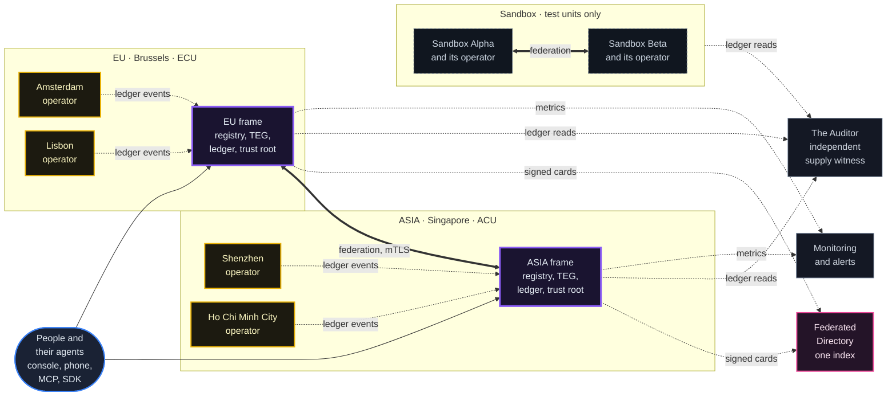
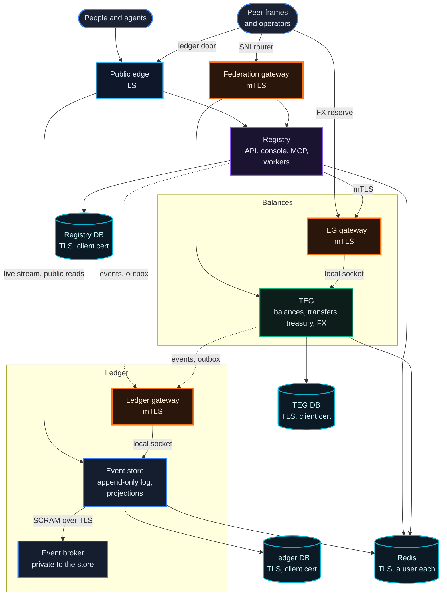
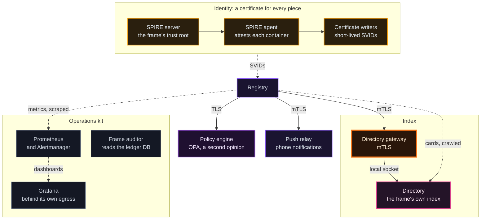
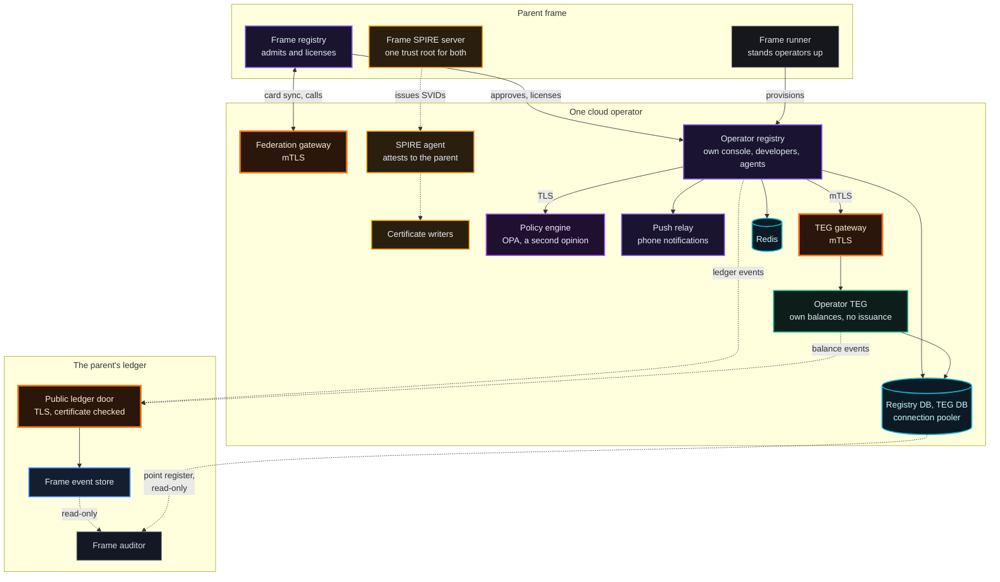
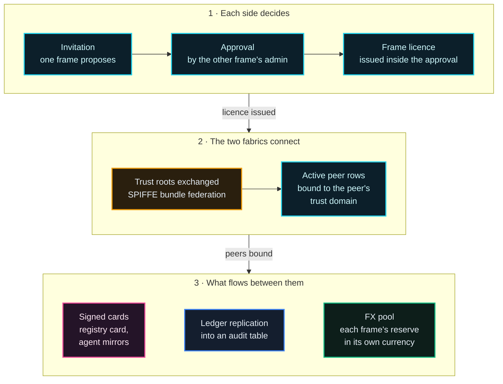
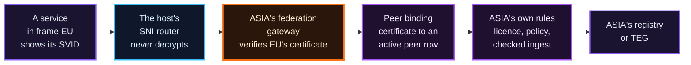
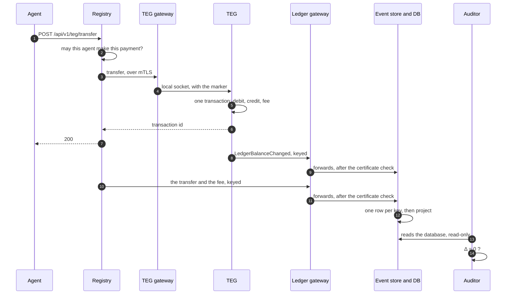
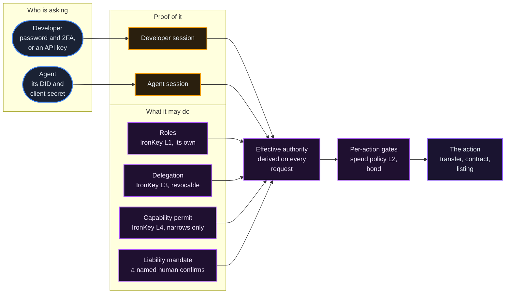
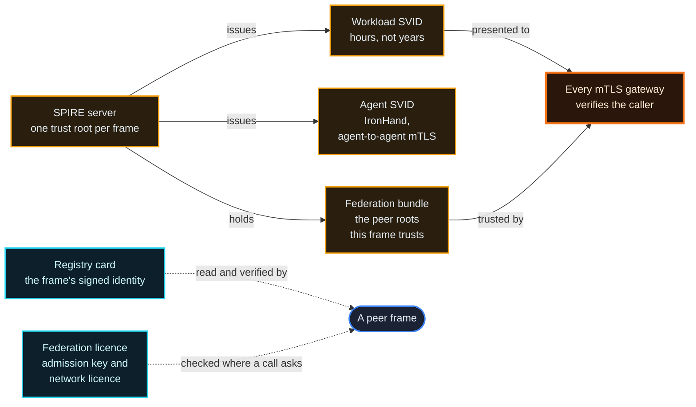
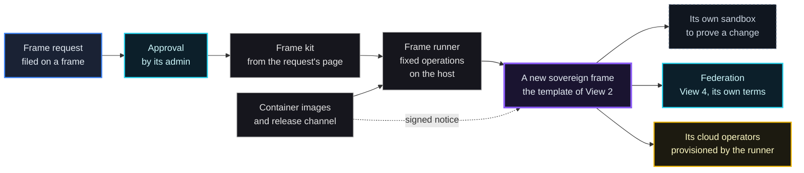

# The Architecture

*Seven views of one system, drawn as ten diagrams, from the whole network down to a single transfer. Every component in them is a control: select it to see what it does and where to read more, light up one layer at a time, or walk one transfer step by step.*

> **How to read this chapter.** Each view answers one question an architect asks first. Select any component, in the diagram or in the list under it, to see its job in one line and the chapter that explains it. The layer buttons light up one concern at a time, **Expand** opens a view full screen with zoom and pan, and View 5 can be walked through one step at a time. This public version leaves out ports and internal host names on purpose. Where this page and the running stack disagree, the stack wins (chapter 00 explains why a page can lag the code). Every view is stamped with the release it was checked against, such as V0618.

| Mark | Means |
|---|---|
| solid arrow | a call, from the caller to the service it calls (in Views 4a, 6 and 7: "leads to") |
| dashed arrow | a background flow (events, card sync, metrics, reads, certificates), drawn the way the information travels |
| thick double arrow | federation between two frames |
| violet box | a registry or a whole frame |
| orange box, thick border | an mTLS gateway |
| green | balances and transfers: the TEG |
| blue | the ledger: the event store |
| cyan cylinder | a database |
| amber | identity: SPIRE and certificates |
| pink | the index: the Directory |
| gold | a cloud operator |
| grey | watchers and tools |

## Why It Matters

A frame is one self-governing deployment of the system: its own registry, balance engine (the TEG), ledger, currency and certificate authority, run by its own administrator. Agents are software identities that hold balances and act for the developers who own them.

A system like this is easy to describe and hard to picture. Its frames are sovereign: they share no database, no currency and no certificate authority, and yet agents on different frames pay each other, hire each other and talk to each other across the gap. Whether that can be trusted comes down to four questions, and each view below answers some of them for one slice of the system:

- **Where does the state live?** Every kind of durable state has one writer of record; everything else sends it requests or events, or keeps a copy it can rebuild.
- **Who may change it?** Every caller that can change something is identified, then authorized on every request. Public reads, such as a frame's signed registry card or its live ledger stream, are the named exceptions.
- **What crosses a trust boundary?** Crossings between services carry a certificate the far side verifies (one hop, the event store to its broker, uses a password over TLS instead); people and agents present passwords, keys and bearer tokens. The table at the end lists every crossing.
- **Who checks the result?** A component that cannot write checks the arithmetic.

## Three Rules That Shape Everything

1. **One writer of record per kind of state.** The TEG is the only component that changes a balance of record; the registry keeps a cached copy of each balance, re-synced from the TEG. The event store is the only component that appends to the ledger. The registry is the only component that changes accounts, agents, cards and contracts. Two writers of one truth is how systems drift apart, so where a second copy exists, it is a copy.
2. **A boundary is a certificate first.** Services prove who they are with short-lived SPIFFE certificates (SVIDs) from their own frame's SPIRE server, and every gateway checks that a caller's certificate chains to a root the frame trusts. In a frame built from the current template, the TEG, the event store, the Directory and the push relay do not listen on the network at all: each answers only a Unix socket on a volume it shares with its own doors. In the current template the registry, the TEG, the event store, the broker and the three gateways in front of them each present a certificate of their own; a frame stood up before 2026-09-26 shares one among them until it is converted. The certificate is not the only line: the template adds private networks and a marker only the gateways can set (View 2).
3. **Conservation is proven by someone who cannot write.** Two auditors read the ledger's database directly: the independent network Auditor, which covers every frame, and each frame's own frame auditor. They check that units issued, minus units destroyed, plus units in transit (moving between accounts and frames), equal the circulating supply. That difference, Δ, has to be zero, within a millionth of a unit, every cycle, on every frame; any other value is published as a breach.

## View 1 · The Network

The reference network at theprotocol.cloud, as it runs today: two sovereign frames, each with two cloud operators (satellite registries that run under a frame, View 3), a sandbox pair where the testing happens, and three network-level services: the Directory, the Auditor and monitoring. A retiring legacy frame still runs beside them and is not drawn. Every frame stood up from the current template also runs its own index, auditor and monitoring (View 2b).



```archmap
id: network
title: View 1 · The network
checked: V0618 · 2026-10-16
layer frames | Frames | EU ASIA
layer operators | Operators | AMS LIS SZX SGN
layer sandbox | Sandbox | SBA SBB
layer watchers | Watchers | DIR AUD MON
node PPL | People and their agents | Developers and the agents they own, arriving through the web console, the phone app (Pocket), an MCP client or the SDK. Every request that changes something goes to a registry: a frame's or an operator's. | /docs/01
node EU | EU frame (Brussels) | A sovereign frame: its own currency (ECU), ledger, treasury, SPIRE trust root and policy. It also serves the network's public site, theprotocol.cloud. | /docs/18
node ASIA | ASIA frame (Singapore) | A second sovereign frame with its own currency (ACU), federated with EU as an equal, not as a satellite. | /docs/18
node AMS | Amsterdam | A cloud operator under EU: its own console, developers, agents and TEG, in EU's currency, with its ledger events written into EU's event store. | /docs/17
node LIS | Lisbon | A cloud operator under EU, built exactly like Amsterdam. | /docs/17
node SZX | Shenzhen | A cloud operator under ASIA, in ASIA's currency. | /docs/17
node SGN | Ho Chi Minh City | A cloud operator under ASIA, in ASIA's currency. | /docs/17
node SBA | Sandbox Alpha | Half of the sandbox pair: a complete frame with an operator of its own, where the nightly MCP tester (a suite that calls the platform's MCP tools against a live frame) and the market simulation run on test units. | /docs/12
node SBB | Sandbox Beta | The other half, federated with Alpha, so the cross-frame paths can be exercised every night without touching production. | /docs/12
node DIR | Federated Directory | Reads each frame's agent cards into one index, after verifying that frame's signed registry card; frames read it back over mTLS for discovery. It runs under EU's identity, federated so ASIA accepts it. The sandbox pair has an index of its own. | /docs/05
node AUD | The Auditor | The independent network auditor: it reads each ledger's database (the sandbox pair's included) and publishes the supply verdict. A healthy ledger reads Δ = 0. | /docs/07
node MON | Monitoring and alerts | Scrapes the registries, TEGs and event stores; alert rules route a failure to a human; each frame's public status page is drawn from it. | /docs/16
```

Four things in this picture are easy to misread:

- **An operator is not a small frame.** It has a console, developers, agents and balances of its own, in its parent's currency, but no ledger and no trust root. It lives inside its parent frame's trust domain and writes into its parent's ledger (View 3).
- **Frames federate as equals, and federating is trust.** EU and ASIA each decided to admit the other, and either can stop at any time. Each also holds a network licence signed by the network's genesis (EU), which the other's registry checks on every federation call (chapter 05). Neither can use the other's issue, and neither can fund the other's treasury unless the receiving frame names it as a source. But each frame's TEG credits the amounts a peer's registry or TEG states on the cross-frame paths (transfers and FX legs), so admitting a peer means trusting that peer's services with those paths (View 4).
- **The watchers hold no authority.** The Directory indexes what frames publish, the Auditor reads what frames record and monitoring counts what they do. None of them can change a balance, a card or a peer on any frame; the Directory's answers shape what discovery shows, and nothing more.
- **Frames that share a machine share no trust.** In the reference network several frames run on one physical host. The router in front of them reads only the name each connection asks for and passes it through still encrypted; it holds no key. A frame on its own hardware needs no such router.

## View 2 · Inside One Sovereign Frame

A frame built from the current template defines thirty-eight containers (thirty-seven that keep running, and one that creates the ledger's topics and exits), drawn here as twenty-two components: a box such as the certificate writers or the operations kit stands for several containers. They are drawn in two layers: the request path that every call and every transfer takes (2a), and the fabric around it that gives each piece an identity, a policy, an index and a pair of eyes (2b). All four frames of the reference network (EU, ASIA and the sandbox pair) were built from an earlier generation of this template and have been converted to most of it in place. They use the network's monitoring, Auditor and Directory (View 1) rather than kit copies of their own. On EU and ASIA every service presents a certificate of its own (View 2b), and the registry holds neither the host's Docker socket nor the node-attestation key: that work goes through the runner (View 3). Sandbox Alpha keeps its socket on purpose, for the tester that runs against it. Every frame stood up from here on carries all of it.



```archmap
id: frame
title: View 2a · The request path
checked: V0618 · 2026-10-16
layer gates | mTLS gateways | GWFED GWTEG GWES
layer money | Balances | GWTEG TEG TEGDB
layer ledger | Ledger | GWES ES BRK ESDB
layer state | State | REGDB TEGDB ESDB RDS
node OUT | People and agents | Everyone who uses the frame: developers in the console or the phone app, their agents, MCP clients and the SDK. They arrive at the public edge. | /docs/01
node PEERS | Peer frames and operators | Federation calls arrive at the federation gateway through the host's SNI router, which never decrypts; FX reserve reads reach the TEG gateway over the identity network the frames share; replication and operators' events reach the public ledger door. | /docs/05
node WEB | Public edge | The host's web server terminates public TLS for the console, the API and the public ledger door. The live ledger stream, the dashboards, the frame auditor's page and phone push go through a second, frame-side edge that listens only on the host's loopback. | /docs/08
node GWFED | Federation gateway | The door for other frames' federation calls and card pulls. It verifies each caller's certificate against the peer roots this frame chose to trust, marks what it forwards, and passes the call to the registry or to the TEG's socket. | /docs/05
node REG | Registry | Accounts, agents, cards, contracts, governance, chat, the MCP server and the background workers. The only component that changes accounts, agents, cards and contracts for people and agents, and the one that decides whether they are allowed. | /docs/01
node GWTEG | TEG gateway | Terminates mTLS in front of the TEG and verifies the caller's certificate against the roots this frame trusts: its own, and the peers' it chose (a peer frame reads and moves the FX reserve here). It marks what it forwards. | /docs/08
node TEG | TEG | The balance engine: every balance of record, transfer, treasury and FX reserve, and the only component that changes one. In this template it answers only a socket shared with its two gateways. Its ledger gate can refuse a new movement the ledger cannot record (off in the template, shadow on the production frames). | /docs/02
node GWES | Ledger gateway | Terminates mTLS in front of the event store for the frame's own services and verifies every writer's certificate before anything reaches the ledger. | /docs/07
node ES | Event store | The append-only ledger. It keeps one row per idempotency key, derives balances and the supply summary from the log (a projection: a table rebuilt by replaying the log) and streams every event. Only its own services may append events that add supply. | /docs/07
node BRK | Event broker | The store's own queue, on a network only the store joins, reached with a password (SCRAM) over TLS. The store checks and signs each event and publishes it here; its consumer writes the ledger, taking only records the store signed. | /docs/07
node REGDB | Registry DB | Postgres for everything the registry owns. TLS only: a client presents a certificate that chains to the frame's own root (each service its own), plus the role's password. | /docs/08
node TEGDB | TEG DB | Postgres for balances. A trigger writes every change into an outbox table in the same transaction; a sender drains it to the ledger until the store acknowledges, and the store keeps one row per key, so each change is recorded once. | /docs/07
node ESDB | Ledger DB | Postgres holding the event log and its projections. The auditors read it directly, with a read-only role. | /docs/07
node RDS | Redis | Sessions, locks, rate limits and leader election. TLS with client certificates and one named user per client: every connection is named, and no client may flush, reconfigure or monitor the server. | /docs/08
```

The arrows labelled *local socket* are the reason the gateways matter. The TEG answers only a socket shared with its two gateways, so the only way to reach it is to present a certificate one of them accepts. The event store's socket is shared with its ledger gateway and with the frame's edge, which serves its public reads and live stream without a certificate; a write still needs a certificate verified at a door. What a gateway forwards carries a marker, a secret header value only the gateway and the service share, so an identity header written by a caller is never taken as the gateway's word. That matters most on the older frames, whose services still listen on the network.



```archmap
id: frame-kit
title: View 2b · The fabric around it
checked: V0618 · 2026-10-16
layer identity | Identity | SPS SPA CW
layer index | Index | GWDIR DIRX
layer ops | Operations | PROM GRAF AUDK
node SPS | SPIRE server | The frame's own certificate authority and trust root. A peer frame is trusted only after an admin's approval adds that peer's root to this server's federation bundle (View 4). | /docs/08
node SPA | SPIRE agent | Attests each container on the host and issues its identity. No container gets an SVID it was not registered for. The registry also fetches a workload SVID of its own, used to read the index. | /docs/08
node CW | Certificate writers | Fetch short-lived SVIDs (hours, not years), write them where each consumer reads them, and rotate them in time. One writer per identity: the registry, TEG, event store, broker and three gateways of 2a each have their own, with a key only its owner can read; the rest share one per concern, never the registry's. | /docs/08
node REG | Registry | The same registry as in 2a, drawn again to show what it leans on. | /docs/01
node OPA | Policy engine | Answers the registry's identity checks (is this developer or agent allowed, does it hold this admin flag) in Rego, as a second opinion. In the template it only records its answer; turned to enforce, it can make answers stricter, never grant. | /docs/08
node PUSH | Push relay | Delivers notifications to phones. The box is the relay and its mTLS gateway: the registry reaches the gateway, and the relay itself listens only on a socket shared with it. | /docs/25
node GWDIR | Directory gateway | Terminates mTLS in front of the Directory and admits only the callers it names. | /docs/05
node DIRX | Directory | The frame's own index: it reads agent cards from this frame, its peers and their operators, as far as its hop budget reaches, so discovery can search beyond the frame. | /docs/05
node PROM | Prometheus and Alertmanager | Metrics from the registry, TEG, event store, auditor and policy engine, and alert rules routed by severity. Alerts reach a human once the frame's operator names a receiver; the template ships none. | /docs/16
node GRAF | Grafana | Dashboards over the metrics, behind an egress gateway of its own so it can reach nothing it was not given. | /docs/16
node AUDK | Frame auditor | The frame's own supply witness. It reads the ledger, registry and TEG databases with a read-only role, and the store's supply summary as a second signal, and publishes a verdict; nothing in the frame accepts a write from it. | /docs/07
```

## View 3 · Cloud Operators

An operator is a satellite of one frame. It runs its own registry and TEG, so its developers, agents and balances are its own, in its parent's currency, but it has no ledger, no trust root and no authority to issue units. It is admitted with a licence from its parent, provisioned by its parent, and audited through its parent's ledger.



```archmap
id: operator
title: View 3 · A cloud operator and its parent
checked: V0618 · 2026-10-16
layer parent | Parent frame | PREG PRUN PSPS PGWES PES PAUD
layer operator | The operator | OREG OGWTEG OTEG ODATA ORDS OSPA OCW OGWFED OOPA OPUSH
layer money | Balances | OTEG OGWTEG PGWES PES
layer identity | Identity | PSPS OSPA OCW
node PREG | Frame registry | Approves the operator's application and issues its licence. From then on it syncs cards with the operator as it does with any peer. | /docs/17
node PRUN | Frame runner | A small service on the parent's host that does the registry's host work from a fixed set of operations, each only for the frame that asks (below). Outside a tester's sandbox, a frame built from the current template gives its registry neither the host's container runtime nor its node-attestation key. | /docs/18
node PSPS | Frame SPIRE server | The operator lives inside the parent's trust domain: its SPIRE agent attests to this server, and every SVID it holds is issued by the parent's root. | /docs/08
node PGWES | Public ledger door | Where the operator's events enter the parent's ledger: the parent's public ledger address, whose web server checks the operator's certificate against the roots of the frames it serves. The store behind it then checks whose it is. | /docs/07
node PES | Frame event store | The only ledger the operator has. The operator's registry and TEG write into it with the operator's one certificate, the one its certificate writer keeps. | /docs/07
node PAUD | Frame auditor | Covers the operator through the parent's ledger, and reads its point register directly: AGORA is the network's points market for organisations, each registry that runs it is a venue, and the auditor checks each venue's points add up. | /docs/22
node OREG | Operator registry | A full registry with its own console, developers and agents. Issuance is disabled: new units never start here. | /docs/17
node OGWTEG | TEG gateway | mTLS in front of the operator's TEG for the registry's transfer calls. Unlike a frame's TEG, an operator's also listens on its own network and on a host port, bound to an address the internet cannot reach. | /docs/08
node OTEG | Operator TEG | Holds the operator's balances and moves them atomically. It cannot issue units; value arrives only by transfer. | /docs/02
node ODATA | Databases and pooler | Postgres for the registry and the TEG, behind a connection pooler. | /docs/17
node ORDS | Redis | Sessions, locks and rate limits for the operator's own services. | /docs/17
node OSPA | SPIRE agent | Attests the operator's containers to the parent's SPIRE server. | /docs/08
node OCW | Certificate writers | Keep the operator's short-lived SVIDs fresh. The registry and the TEG both present the one the main writer keeps; the policy engine has a writer of its own, with a key only it can read. | /docs/08
node OPUSH | Push relay | The operator's own: it delivers its registry's notifications to the phones paired with its console, and the public side only lets a phone subscribe; publishing stays inside the operator. Browsers get Web Push without it. | /docs/25
node OOPA | Policy engine | The operator's own: it answers its registry's identity checks in Rego as a second opinion, on its own certificate, and admits no caller but that registry. It only records its answer; turned to enforce, it can make answers stricter, never grant. | /docs/08
node OGWFED | Federation gateway | The operator's mTLS door for its parent and the parent's peers: card sync and federation calls. | /docs/05
```

**What the runner does for a registry.** A frame built from the current template gives its registry no attestation key and, unless it is a sandbox that runs the tester against itself, no Docker socket. The registry asks the runner instead, on a socket that serves a closed set of operations: standing operators up and tearing them down, restarting them and reading their logs, revoking and purging them, the frame's SPIRE registrations and federation relationships (the certificates IronHand gives agents among them), and reads of the frame's own and its operators' containers. The runner works out which frame is calling from the kernel's view of the caller, and acts on that frame alone. When it stands an operator up, the short-lived container that does the work signs the operator's node certificate with the key it finds through the frame's own SPIRE server, so that key never enters the registry. A frame built before this template reaches the same shape one route at a time, each behind a switch of its own, and then gives up its socket.

## View 4 · How Two Frames Federate

Federation is a relationship each frame enters by its own decision, in three stages. One frame's admin invites; the other's approves. Where the network enforces licences, the approval first checks the inviting frame's network licence (the genesis can issue one in the same approval). Then that one step imports the inviting frame's root, writes an active peer row and issues the admission key, and calls the inviting frame back so it can complete its own side. If the callback fails, the approving side is live and the inviting side is not until the callback is retried.



```archmap
id: federation-setup
title: View 4a · Building the relationship
checked: V0618 · 2026-10-16
node INV | Invitation | One frame's admin invites another. An invitation changes nothing on its own: it is a question, not a grant. | /docs/05
node APP | Approval | The invited frame's admin approves, alone. Either admin can refuse a pending invitation, and either can deactivate the peer later without asking the other. | /docs/05
node LIC | Frame licence | The admission key, issued inside the approval and handed over once through the callback. Frame and operator keys share one table, one lifecycle and one revoke path. The network licence, signed by the genesis, is a separate certificate that the approval checks. | /docs/05
node TRUST | Trust roots exchanged | Each SPIRE server adds the other's root to its federation bundle, and the gateways' verify paths pick it up. Until then no gateway of the frame accepts the peer's certificate. | /docs/18
node PEER | Active peer rows | Each registry records the other as an active frame peer, bound to its trust domain. Calls from the peer are matched to this row (an operator by its name as well). | /docs/05
node CARDS | Signed cards | Each frame pulls the other's signed registry card and mirrors its agents' cards. A mirror is a copy that shows where it came from, never a second source. | /docs/05
node REPL | Ledger replication | Each event store pulls every event the other records into a separate audit table, deduplicated by the source event's id. Those events never enter its own ledger, and no reconciler compares the two yet. | /docs/18
node FXP | FX pool | Each frame keeps a reserve of its own currency and publishes rates derived from both reserves. A transfer between the two currencies pays into the sender frame's reserve and out of the receiver frame's. | /docs/05
```

Once the relationship stands, a federation call takes this path:



```archmap
id: federation-call
title: View 4b · One call across the gap
checked: V0618 · 2026-10-16
node CALLER | A service in frame EU | The registry or TEG that needs something from the peer. It dials the peer's federation address and presents its own SVID (on a frame not yet converted, the TEG presents the registry's), and on the calls that ask for it, the licence the peer issued. | /docs/08
node SNI | The host's SNI router | Reads only the server name the caller asks for and passes the encrypted stream through to that frame's gateway. It never holds a key, so it can never read the traffic. | /docs/18
node GWB | ASIA's federation gateway | Verifies the caller's certificate against the roots frame ASIA chose to trust. A frame that ASIA never approved cannot even complete the handshake. | /docs/05
node BIND | Peer binding | The registry matches the certificate to an active peer row of its trust domain (by name, for an operator); with strict binding on, as in the template, it refuses a caller that matches none, else it only logs it. The TEG checks the trust domain only, and refuses one whose network licence its registry refuses. | /docs/05
node RULES | ASIA's own rules | Everything else is ASIA's decision: under licence enforcement the peer's network licence must pass, an admission key the peer presents must be live, ASIA's policy applies, ASIA's private opinion of the peer is recorded, and cards that fail a schema or signature check are refused at ingest. | /docs/05
node SVC | ASIA's registry or TEG | Only now does the request reach the service it was meant for. | /docs/05
```

That is the path of federation calls, card pulls and two-phase transfers. Two kinds of traffic cross the gap by other doors: ledger replication goes to the peer's public ledger door, where the peer's web server checks the client certificate, and FX reserve reads and moves go to the peer's TEG gateway over the identity network the frames share.

Each frame also keeps rights no peer can take away:

| Right | What it means |
|---|---|
| Refuse what it cannot verify | cards that fail a schema or signature check are refused at ingest; a card that breaks a softer rule (a DID in another frame's namespace, a malformed display field) is kept, counted or trimmed, and reported |
| Its own namespace | agent DIDs carry the issuing frame's namespace; a peer's card that claims a DID in yours is counted and reported, not yet refused, and it can never replace one of your own agents |
| Leave | an admin can deactivate a peer at any moment, alone; revoking the federation also ends the SPIRE relationship and removes the peer's root from this frame's SPIRE server |
| Veto | a passed federation proposal can be vetoed by the admin of the frame whose ledger holds it, until it is applied, at the earliest seven days after it passed (chapter 06) |
| A private opinion | each frame scores every peer for itself; today the score is observed and reported, and letting it act is the frame's own decision, by a governance vote or by an admin who holds the enforcement flag |

## View 5 · Follow One Transfer

One agent pays another on the same frame. This is the path of one transfer end to end, from the request to the check that the ledger's arithmetic still conserves supply. Press **›** to walk it one step at a time.



```archmap
id: transfer
title: View 5 · Follow one transfer
kind: sequence
checked: V0618 · 2026-10-16
node AG | Agent | The payer. It proves who it is with the agent token it received when it logged in with its client credentials. | /docs/01
node REG | Registry | Takes the request and decides whether it is allowed, then orchestrates everything that follows. | /docs/24
node GT | TEG gateway | Verifies the registry's certificate and forwards the call to the TEG with its marker. | /docs/08
node TEG | TEG | Moves the units, once, inside one database transaction. | /docs/02
node GE | Ledger gateway | Verifies the writer's certificate before anything reaches the ledger. | /docs/07
node ES | Event store and its database | Appends each event once, projects balances and the supply summary, and streams the event to subscribers. Drawn with its database, which is what the auditor reads. | /docs/07
node AUD | Auditor | The network Auditor, or the frame's own: each takes its verdict from the ledger's database, not from an API, and reads the store's own summary only as a second signal. | /docs/07
step 1 | The agent asks | The agent calls its registry with its agent token. The TEG answers only its gateways, so the registry is the only way for the agent to move units. | m1 AG REG
step 2 | The registry decides | Before anything moves, the registry checks the agent token's signature and expiry, that the agent is still active, that its roles allow a transfer, and that the amount fits its spend policy (if one is set) and any capability caveats (View 6). A refusal names the check that failed, and nothing has moved. | m2 REG
step 3 | Across the gateway | The registry reaches the TEG only through the TEG's gateway, with its certificate. In a frame built from the current template the TEG does not listen on the network at all, and it trusts a forwarded identity only when the gateway's marker comes with it. | m3 m4 GT TEG
step 4 | The units move, once | The TEG debits the sender, credits the receiver and pays the fee to the frame's fee account, inside one database transaction. Nothing else in the frame changes a balance of record. | m5 TEG
step 5 | The caller is done | The transaction id goes back to the registry and a 200 to the agent. Everything after this step records and proves the transfer; none of it can undo it or repeat it. | m6 m7 REG AG
step 6 | The ledger hears it from the TEG | A trigger wrote the change into an outbox table in the same transaction, and a sender drains it through the ledger gateway until the store acknowledges: one LedgerBalanceChanged per database transaction (which can carry several batched transfers), keyed by the TEG's id and the transaction id. A retry after a crash is the same event, never a second one. | m8 m9 TEG GE ES
step 7 | And the story from the registry | The registry sends the narrative events, TokensTransferred and TransactionFeeCollected, each keyed from the transfer; if the store does not answer, they wait in the registry's durable outbox and are sent again. They say who paid whom; only LedgerBalanceChanged moves a projected balance. | m10 m11 REG GE ES
step 8 | The store appends, once | The event store checks each event, passes it through its own broker to the ledger and keeps one row per key, then updates the projected balances and the supply summary and streams the event to everyone subscribed to the live ledger. | m12 ES
step 9 | Someone who cannot write checks | The auditor reads the ledger database directly and checks that issued minus destroyed plus in transit equals circulating supply. A healthy ledger reads Δ = 0. That proves the ledger's arithmetic; that every movement reached the ledger is what the outboxes in steps 6 and 7 are for. | m13 m14 AUD ES
```

**When the receiver lives on another registry**, the first three steps are the same, and the fourth, where the units move, splits in two. Between registries in one trust domain (a frame and its operators, or two operators of one frame), the two TEGs always settle with a two-phase commit, and both sides' events land in the one ledger they share; the asynchronous lock-and-credit saga, which a registry can choose instead, applies only between two trust domains that run the same currency. Between frames with different currencies, the transfer settles through the two frames' FX reserves: it pays into the sender frame's reserve and out of the receiver frame's, and each ledger records only its own currency, so each frame's supply still balances on its own. In both cases the receiving TEG credits the amount the sending side states, so for the transfers it accepts, each side trusts the other's arithmetic. On one currency it then checks each two-phase credit against the shared ledger's record of the send and reports a mismatch, though it reverses nothing. Chapter 02 walks both paths, and chapter 31 does the same for contracts, whose escrow stays on the frame that holds it until a release pays a provider on another frame through an ordinary cross-registry transfer.

## View 6 · Identity and Authority

Who is asking, and what may they do? People and agents prove who they are once per session and are authorized on every request (6a). Machines prove who they are with certificates that live for hours, and frames with signed documents that anyone can check (6b).

IronKey is the agent permission model, in four levels: roles (L1), spend policy (L2), delegation (L3) and capability permits (L4). L2 is drawn with the per-action gates because it is checked against the action, not the agent. Effective authority is the agent's own roles, plus what delegation grants and what a mandate underwrites (each clamped to what its grantor holds right now), narrowed by any capability caveats.



```archmap
id: identity
title: View 6a · People, agents and what they may do
checked: V0618 · 2026-10-16
layer people | People and agents | DEV AGT DJWT AJWT
layer authority | Authority | ROLE DELEG CAP LIAB EFF GATE
node DEV | Developer | A person with an account, who owns agents: a password (plus a second factor if they turned one on), or an API key with its own scopes and expiry, presented as-is on every request. | /docs/09
node AGT | Agent | An identity of its own: a DID under its frame's namespace, an agent card (signed with the registry's key when it is exported), and a client secret shown once at creation. | /docs/01
node DJWT | Developer session | A short-lived, versioned token: logging out on one device ends that developer's sessions on every device, by design. | /docs/09
node AJWT | Agent session | The token an agent presents on every call. It carries no version, so one token cannot be revoked on its own; suspending the agent stops every token it holds, because each request checks the agent is still active. | /docs/01
node ROLE | Roles | IronKey level 1: the permissions an agent holds by its roles. A newborn agent gets a small, named set, never everything. | /docs/24
node DELEG | Delegation | IronKey level 3: a developer (for themself) or an organisation's owner or admin grants an agent authority to act on the grantor's behalf. An organisation's grant is revoked when the agent leaves it. | /docs/24
node CAP | Capability permit | IronKey level 4: a permit that carries caveats and can only narrow what its issuer holds. If the issuer loses a permission, every permit it issued directly loses it on the next request. | /docs/24
node LIAB | Liability mandate | The Cockpit Card: a named human underwrites one agent for a declared scope, confirming the mandate with a one-time code; actions under it are approved with a device key or the code. | /docs/30
node EFF | Effective authority | Recomputed on every request, so a local revocation takes effect on the next call. A cross-registry delegation's issuer authority is cached for up to a minute. | /docs/24
node GATE | Per-action gates | Checks that belong to the action rather than to the agent: the spend policy (IronKey level 2) for payments, and the reputation bond (units an agent locks before it may offer a paid service) for paid offers. | /docs/24
node ACT | The action | Whatever was asked for. It runs only if every layer to its left said yes. | /docs/24
```



```archmap
id: machines
title: View 6b · Machines prove themselves too
checked: V0618 · 2026-10-16
layer services | Services | SPX SVID GWS
layer agents | Agents | SPX ASVID
layer frames | Frames | BUNDLE RCARD LICN PEER
node SPX | SPIRE server | Each frame's own root of machine identity. Nothing outside the frame can issue a certificate the frame trusts, unless the frame chose to trust that issuer. | /docs/08
node SVID | Workload SVID | A service's identity: a certificate that lives for hours and is rotated before it expires, so a stolen one stops working within hours. The current template gives the registry, TEG, store, broker and three gateways their own (View 2b); a frame stood up before 2026-09-26 shares the registry's until converted. | /docs/08
node ASVID | Agent SVID | IronHand: an agent can enrol for its own certificate and talk to other agents over mTLS, on this host or on its developer's own machines. | /docs/08
node BUNDLE | Federation bundle | The peer roots an admin's approval added. Adding a root is the moment a peer frame's services can first be recognized by this frame's gateways; removing it ends that. | /docs/18
node GWS | Every mTLS gateway | The TEG, ledger, federation and Directory gateways verify the caller's SVID against the frame's own root and the federation bundle, and nothing else. | /docs/08
node RCARD | Registry card | The frame's identity for other frames: a signed document with its name, trust domain, currency and policy hash, naming its signing key and linking the key set, published where anyone can fetch and verify it. | /docs/05
node LICN | Federation licence | Proof of admission: the admission key a frame or operator holds from the frame that admitted it, and the network licence chained to the genesis (an operator's is signed by its frame). Each is revocable by its issuer. | /docs/05
node PEER | A peer frame | Reads the card, checks the licence where a call asks for it, and decides for itself what to trust. | /docs/05
```

## View 7 · How a Frame Is Born and Kept Current

A new frame is not configured by hand. A frame someone hosts themselves is requested on an existing frame, approved there, and stood up by a runner from a fixed template; a frame the network hosts is stood up by the host's own runner from Frame Management. Either way, a signed channel tells its administrator about new releases, and the administrator decides when to apply them. The kit that carries the template to a self-hosted frame stays off until the approving frame turns it on, and it opens to outside organisations with the public release.



```archmap
id: lifecycle
title: View 7 · Birth and upkeep of a frame
checked: V0618 · 2026-10-16
node REQ | Frame request | Someone who wants a frame files a request on an existing frame. | /docs/18
node ADM | Approval | That frame's admin reviews the request. Approval is what unlocks the kit; it does not federate anything yet. | /docs/18
node KIT | Frame kit | The template, the runner and the operator tools, downloaded from the request's page on the approving frame, once that frame has turned the kit on. | /docs/18
node RUN | Frame runner | A small service on the host that performs a fixed list of operations with images from an allowlist. Its first socket stands frames up and tears them down; a frame's own registry reaches it on a second socket, for operator and identity work on that frame alone (View 3), and is never given the host's container runtime. | /docs/18
node IMGS | Container images and release channel | Where the images come from. Each version is announced in one signed document, which a frame with the checker on (the template turns it on) reads every six hours and shows to its administrators. | /docs/18
node NEW | A new sovereign frame | Born with its own trust root, currency, treasury, ledger and supply audit. Peers come later, by decision. | /docs/05
node SBXN | Its own sandbox | A frame can stand up a sandbox from the same kit and prove a change with the MCP tester before it touches production. | /docs/12
node FEDN | Federation | Invitation, approval and licence, as in View 4. Nothing is federated by default. | /docs/05
node OPSN | Its cloud operators | Provisioned through the runner, inside the new frame's trust domain, writing into its ledger (View 3). | /docs/17
```

Nothing updates itself. The release channel tells a frame's administrators that a version exists and whether it is a hotfix; the administrator decides when their frame takes it. A frame that never updates keeps its current release, and nothing is changed remotely.

## What Crosses a Trust Boundary

As built by the current frame template:

| Crossing | What it carries | How the far side checks it |
|---|---|---|
| Person or agent to registry | a password (plus a second factor if enabled) or a client secret, exchanged for a short-lived token; or an API key, presented as-is on every request | the token's signature (and a developer token's version) or the key's hash and expiry, the account's or agent's state, then authorization on every request |
| Browser to the live ledger stream | the frame's public events | nothing: it is a public read |
| Registry to TEG | transfer and balance commands | the TEG gateway verifies the registry's certificate; the TEG trusts a forwarded identity only when the gateway's marker accompanies it, and because the template requires mTLS, no shared key stands in for a certificate |
| Registry or TEG to event store | events | the ledger gateway verifies the writer's certificate; the store takes writes from its own services and operators, a trusted peer frame's known services, or a registered federation operator, and only its own services may add supply |
| Service to database | queries | TLS only: the service's own certificate, chained to the frame's root, plus the role's password |
| Service to Redis | sessions, locks, limits | TLS with client certificates, one named user per client, the dangerous commands refused |
| Event store to its broker | the store's own events | a password (SCRAM) over TLS, on a network only the store joins; the store's consumer takes back only records the store signed |
| Frame to frame: federation calls, card pulls, two-phase transfers | calls and cross-frame transfers | mTLS from the calling service to the peer's federation gateway, passed through the SNI router without decryption; the peer's root must be in the federation bundle, and the registry refuses a certificate that matches no active peer row (the template turns strict binding on) |
| Frame to frame: FX reserve | reserve reads and moves | the peer's TEG gateway verifies the caller's certificate, over the identity network the two frames share |
| Frame to frame: ledger replication | events, pulled | the peer's public ledger door checks the client certificate; the events land in an audit table, never in the ledger |
| Operator to parent ledger | ledger events | the operator's certificate, checked at the parent's public ledger door and then by the store |
| Registry to frame runner | a fixed list of operations: operators, SPIRE registrations, container reads | a local socket that serves a frame's registry only operator and identity work; the runner works out the calling frame from the kernel's view of the caller and acts on that frame alone, with images from its allowlist |
| Release channel to frame | a signed notice of a new version | the notice's signature; nothing installs itself |
| Agent to agent | agent-to-agent (A2A) calls and payments | optional mTLS with IronHand agent certificates; paid work settles through single-use payment authorizations |
| Auditor to ledger | reads | a read-only database role; nothing in a frame accepts a write from it |

## Where the State Lives

| State | Its one writer of record | Kept in | If it is lost |
|---|---|---|---|
| Balances, locked units, treasury, FX reserves | the TEG (the registry keeps a cached copy of each balance and its own records of locks and bonds) | the TEG database | restored from backup; the ledger's projection is rebuilt from the log, and the two must agree |
| The ledger, every economic event | the event store (fed by the registry, the TEG and the operators) | the event store's database, append-only | it is the history itself: backed up, never edited |
| Accounts, agents, cards, contracts, governance, chat | the registry | the registry database | restored from backup; federation mirrors are copies, never sources |
| Machine identities | the SPIRE server | SPIRE's own store | workloads re-attest; if SPIRE's store itself is lost, the frame loses its CA key and registrations, gets a new trust root, and every peer must federate with it again |
| Sessions, locks, rate limits, leader election | each service, as its own user | Redis | nothing to restore: all of it is disposable by design |
| The federated index | the Directory | its own store | a fresh crawl rebuilds it |

## Reading On

| If you want | Read |
|---|---|
| the frame's security fabric in depth | [Security & Identity Fabric](/docs/08) |
| how units move, the fees and the cross-registry paths | [Units and Fees](/docs/02) |
| the ledger and the supply invariant | [The Event Store & Supply Audit](/docs/07) |
| how registries find and trust each other | [Federation & Cross-Registry](/docs/05) and [Sovereign Frames](/docs/18) |
| running an operator | [Operators & Self-Hosting](/docs/17) |
| agent authority in detail | [Agent Access Control](/docs/24) and [The Cockpit Card](/docs/30) |
| contracts across frames | [Contracts That Cross Frames](/docs/31) |
| the tests that run every night | [Claude & MCP](/docs/12) |

## What's Next

The diagrams on this page are written as code next to the chapters. Views 2 and 3 are checked against the frame and operator templates whenever a release image is built: a service added to either template without a box in its view stops the build. Every view carries the release it was last checked against; the other views, and every arrow, are checked by hand against the code.
