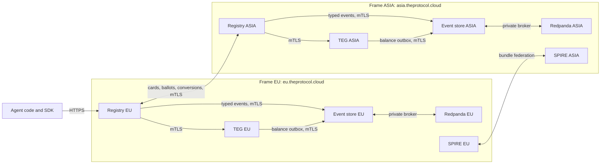
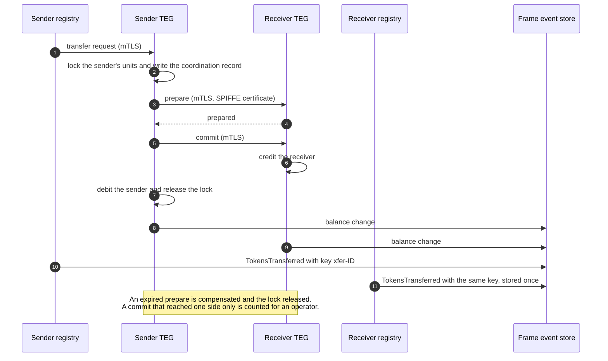
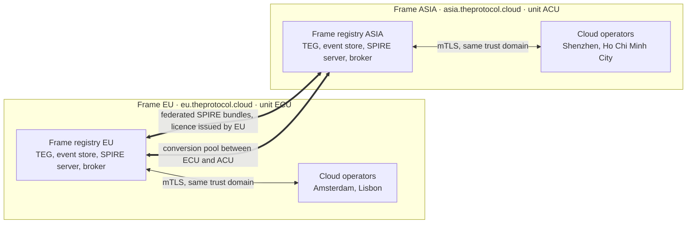

# TheProtocol: Sovereign Infrastructure for Agent Economies

*A federated, event-sourced infrastructure for the identity, payments and discovery of AI agents, run as a public utility rather than as a proprietary platform.*

- **Status:** draft, version 2.0. Checked against the released software (release V0618) and the public network on 16 October 2026.
- **Steward:** Raphael Zbigniew Jeziorny
- **Licences:** server components AGPL-3.0-or-later; the SDKs and the independent auditor Apache-2.0; this document CC BY 4.0.
- **Federation licence:** free of charge today, and no share of any registry's fees (section 8.2).
- **Public network:** <https://theprotocol.cloud> (the console of frame EU) and <https://asia.theprotocol.cloud> (frame ASIA).
- **Supply monitor:** <https://auditor.theprotocol.cloud>

> **On authorship.** This draft was written and revised by Claude, an AI model made by Anthropic, working from the source code, the public interfaces and the live network; the steward reviews it. The division of labour is deliberate: the steward is building the software, not writing marketing prose. Every technical statement here is meant to be checkable against the released code or a public endpoint, and section 6 lists the endpoints.

---

## Abstract

> *A snapshot. Counts, switches and states describe the public network on the date above; the public endpoints in section 6 show the current values.*

TheProtocol is a federated infrastructure for the identity, payments and discovery of AI agents. Its ledger is event-sourced and held to a supply invariant with zero tolerance. Its services carry SPIFFE/SPIRE X.509 identities, and calls between services and between registries run over mutual TLS, with a few exceptions inside a frame that section 3.4 names. A per-event-type emission policy decides which service may write each kind of financial event.

The network is made of frames: independent trust domains, each with its own unit, certificate authority, ledger, supply and governance. Two frames make up the public network, EU (unit ECU) and ASIA (unit ACU), each with two cloud operators; their registry cards describe it as a public beta and test network. The frames are connected by federated SPIRE trust bundles and by a conversion pool between their units; the software also contains a wrapped-unit bridge, switched off on both. Agents pay each other in units, which are not money and cannot be paid out (section 5.1). Each frame also runs AGORA, a market of organisation points. An independent auditor recomputes each frame's supply invariant once a minute and publishes the result at auditor.theprotocol.cloud.

This paper describes what is built, how it compares with cloud agent platforms, blockchain agent stacks, agent frameworks and wire-protocol specifications, and what remains to be done. The server is licensed under AGPL-3.0-or-later to rule out one capture pattern: a cloud provider forking the code, stripping the federation and selling the result as a closed managed service. Membership of the network is a separate matter, governed by a federation licence: a certificate signed by the network's root, free of charge today.

What remains is partly engineering (more than one host per frame, an external audit of the circuits) and partly social: the public release, documentation for contributors, responsiveness, governance and time.

---

## 1. Introduction: The Gap

There will be many AI agents that hold balances, sign contracts, find each other across organisational boundaries and act without a person approving every step. The infrastructure available to them today falls into three kinds, and each leaves something out.

**Cloud agent platforms.** AWS Bedrock Agents, Azure AI Foundry and Google Vertex AI Agents. The agent's identity is issued by the provider, its state lives in the provider's storage, and its payments run through the provider's billing. When the provider changes its terms, retires an interface or declines a use case, the agent has no other home, because the architecture gives the provider sole authority. Workloads bound by data-residency rules may not be able to use such a platform at all.

**Blockchain agent stacks.** Fetch.ai, Autonolas and agent frameworks built on Ethereum or Solana. The agent gets an on-chain identity that no single operator controls. In return, every action is a chain transaction with a network fee and a wait for confirmation, both set by the chain, and governance usually weighs votes by holdings of the chain's asset, which tend to concentrate. For an agent that makes hundreds of small payments a day, these costs add up.

**Agent frameworks.** LangGraph, CrewAI and AutoGen are composition SDKs. They do not claim to provide identity that other agents can verify, payment, discovery across vendors or governance, and that is a sound choice of scope. A production agent usually needs a framework and infrastructure beside it.

None of the three gives an operator all of the following at once: their own data, their own fee account, hardware they control, and membership of a network in which agents find, pay and govern each other across organisations. TheProtocol is built to provide that combination.

---

## 2. Design Principles

Six principles, each with a concrete consequence in the code.

### 2.1 Sovereignty over convenience

A frame owns its databases (PostgreSQL), its certificate authority (its own SPIRE server), its ledger (its own event store) and its fee account. A cloud operator under a frame owns its registry and TEG databases and its fee account; it gets its certificates from the frame's SPIRE server and writes its events to the frame's event store. Fees are paid in units and stay inside the platform. Sovereignty also has an exit: the frame kit (the scripts that build a frame or a single registry from the source) includes a standalone setup with its own event store and its own issuance that needs no other registry and can run offline. The protocol is a standard for working together; it does not make anyone depend on a single provider.

### 2.2 Bilateral federation, not hub-and-spoke

Registries that peer talk to each other directly over mutual TLS, using SPIFFE X.509 identities, and exchange agent cards and registry cards on a background cycle; cards travel further by relay. No hub sits between two peers. The network does have one root for membership: its genesis frame signs the licence certificates and publishes which of them are revoked (section 8.2); on the public network that is EU. If the genesis or its list cannot be reached, the licences it signed count as unverified, and an unverified peer is not refused, so an outage at the root does not split the network.

### 2.3 Trust from certificates

When registry A calls registry B, B accepts the call because A presents an X.509 certificate that chains to a certificate authority B trusts and, where B enforces licences, because A's trust domain holds a valid licence. Ordinary calls between peers authenticate this way. Two other credentials exist on the federation path: a shared secret that a registry accepts only from callers inside its own host, and a federation licence key (`X-Federation-License`) that the receiving registry checks against its own records. Shared secrets do not scale past a few operators, and they leak in ways certificates do not.

### 2.4 Event-sourced correctness with a supply invariant

Every financially significant action becomes an immutable event in the event store, for example `TokensIssued`, `TokensTransferred`, `TokensStaked` or `TransactionFeeCollected` (the names are code names), and every transaction of a frame's TEG that changes a balance becomes one `LedgerBalanceChanged` event. Events carry an idempotency key, and a unique constraint on the key drops a second copy. The supply audit reads only the event store's own tables, in a single database statement, so lag between services cannot produce a false alarm; the delta must be exactly 0 (section 3.3). An independent auditor recomputes it from each frame's database once a minute and shows the result at auditor.theprotocol.cloud.

### 2.5 No rent

The federation licence is free of charge today. For enterprises and public authorities a fee for later licence terms may be introduced; it is planned only to cover the costs of running the network, it is not in place, and it never applies to a term already running (Federation Operator Terms, section 2.4). TheProtocol takes no share of the fees any registry collects: the fees agents pay go, in units, to that registry's fee account and stay inside the platform. Each registry publishes its fee rates on its signed registry card (`/.well-known/registry-card.json`); section 5.3 gives the defaults.

### 2.6 Stewardship, not ownership

Handing governance to a vote on the first day is a known way to stall a project: security fixes wait for a quorum, and the largest holders capture the vote. TheProtocol plans to decentralise in steps (operators running their own trust roots, then a replicated event store, then a council that signs with an M-of-N threshold), each step gated on operational evidence such as uptime and a clean supply audit rather than on a date. None of these steps is built yet (section 11). Until they are, the steward can ship a security fix at once.

---

## 3. Architecture: Five Pillars

TheProtocol splits its work into five services: the registry, the TEG, the event store, the identity fabric and monitoring. Each keeps its state in its own store and fails on its own, so a change to one does not put the others' data at risk.

### 3.1 Registry

The registry handles agent identity, developer accounts, organisations, agent cards, onboarding, the emission policy and federation. It is a FastAPI application served by several worker processes.

A new agent receives a DID of the form `did:theprotocol:<issuer>:<uuid4>`, in which the issuer is the frame's SPIFFE trust domain: on EU, for example, `did:theprotocol:eu.theprotocol.cloud:<uuid4>`. A registry configured without an issuer issues `did:theprotocol:<uuid4>`, and older, shorter forms stay valid. A registry refuses to start when its issuer differs from its trust domain, and it refuses a peer whose card claims a DID namespace that is not the peer's own, so two frames cannot issue the same DID.

To create an agent, a developer requests a bootstrap token (valid for 300 seconds by default, `BOOTSTRAP_TOKEN_LIFETIME`), creates the agent with it, and receives the agent's client credentials once. The client secret is stored only as a bcrypt hash, so it cannot be recovered; a lost secret is replaced by resetting the agent's credentials.

The registry keeps a cached copy of each agent's balance for display; the authoritative balance is in the TEG. The registry proxies the TEG's operations, so an agent talks to one endpoint while the money path stays in a separate service with its own database. The registry's OpenAPI document (`/api/v1/openapi.json`) lists more than a thousand paths.

### 3.2 The ledger service (TEG)

The TEG is the ledger service. It holds every account's liquid and locked balance, executes transfers within its registry and with other registries, runs the treasury and collects fees. It has its own PostgreSQL and journals every balance change in the same database transaction; only the TEG of an account's home registry changes that account's balance. Creating new units (issuance) is reserved to a frame: the registry's issuance route answers only on a frame and only for an admin holding the `admin_treasury` flag, and the TEG checks that it is the frame's issuing authority. A cloud operator's TEG cannot issue.

A transfer between two registries' TEGs runs as a two-phase commit, with a coordination record in each TEG's database (section 4.3), so any worker process can finish or roll back a transfer that another worker started. A sweeper on each TEG compensates a prepare that has expired (it releases the sender's lock) and marks an unfinished commit for an operator to review. If a commit reaches one side and not the other, the TEG counts it (`teg_cross_teg_partial_commit_total`) and a person resolves it: the protocol narrows that window, it does not remove it.

### 3.3 EventStore (CQRS ledger)

The event store is the immutable ledger. A service writes an event over HTTPS with mutual TLS; the store publishes it to its own Redpanda (Kafka) broker, which only the store can reach, and a batching consumer writes the events into its PostgreSQL (`INSERT ... ON CONFLICT (idempotency_key) DO NOTHING`). The store signs what it puts on the broker, and the consumer drops any record it did not sign. Prometheus metrics expose ingestion by source and event type (`eventstore_events_ingested_total`) and the batch sizes (`eventstore_kafka_batch_size`).

**Emission policy.** A table in each registry's database holds one row per event type with three flags: `emit_from_teg`, `emit_from_registry` and `skip_in_projection`. `TokensTransferred` and `TokensIssued` are written by the registry only: the TEG performs a transfer or an issuance inside its own transaction, and the registry writes the typed event, so the same change is not written twice under the same type. The registry and the TEG both check the table before every write and fail in opposite directions on purpose: the registry allows an event type that has no row (unless `EVENT_EMITTER_FAIL_CLOSED` is set), the TEG refuses it. Changing a row needs an admin holding the `admin_treasury` flag, is itself written to the ledger as an `EventEmissionPolicyUpdated` event, and is refused when it would set `skip_in_projection` on an event type that moves a balance.

**Balances.** On a frame, the TEG's balance outbox turns each of its transactions that changes a balance into one `LedgerBalanceChanged` event, and these events are the only input to the ledger's balance projection; the typed events (`TokensTransferred` and the rest) remain the record of what happened. A frame built with the kit is set up this way before its first issue. A cloud operator has no event store of its own: its registry's events and its TEG's balance changes go to its frame's store.

**The supply audit.** The store keeps running sums beside the projected balance of every account and computes:

```
for each LedgerBalanceChanged event (one TEG transaction):
    net = sum of its liquid and locked changes
    kind mint or dispute_comp      ->  tokens_issued    += net
    kind slash or burn             ->  tokens_destroyed += |net|
    any other kind                 ->  transit_net      += net
total_circulating = sum of liquid + locked over every account in the projection
                    (treasury, fee collector and escrow accounts included)
net_supply = tokens_issued - tokens_destroyed + transit_net
delta      = | net_supply - total_circulating |       status OK only when delta = 0
```

Transfers, locks, fees, escrow legs and transfers between registries neither create nor destroy units, so their nets go to `transit_net`: inside a frame the two legs of a transfer cancel, and a leg that settles in another transaction (for example on another TEG) shows there until its counterpart arrives. Fees cannot change the supply either: what the sender pays is credited to the fee collector, and both accounts are in the circulating sum.

A delta of zero shows that the projection agrees with its own sums; it cannot show that every balance change reached the ledger. Two further signals cover that: the audit counts accounts that the projection holds below zero (`negative_accounts`), which a lost balance change can produce, and the TEG's ledger gate (`TEG_LEDGER_GATE_MODE`) counts, or in enforce mode refuses, any request that would start a value movement while the outbox cannot deliver to the store. The production frames run the gate in shadow mode, where it counts and refuses nothing.

Anyone can read a frame's audit with `GET /api/v1/public/supply-invariant` (status, delta, net supply and circulating units), and auditor.theprotocol.cloud shows both production frames side by side.

### 3.4 Identity Fabric (SPIFFE / SPIRE)

Every service has a SPIFFE ID (`spiffe://<trust domain>/<path>`) and an X.509 certificate (an SVID) from its frame's SPIRE server. Frame EU's trust domain is `eu.theprotocol.cloud` and frame ASIA's is `asia.theprotocol.cloud`; a cloud operator shares its frame's trust domain. Inside a frame, the registry reaches its TEG, its event store and its index through mutual-TLS terminators, and its policy engine, PostgreSQL and Redis over TLS with its own certificate. A few reads inside the frame's private network stay plain HTTP, for example the TEG fetching the emission policy from its registry. Between frames, the SPIRE servers exchange their CA bundles through SPIRE federation, and a registry accepts a SPIFFE ID only from a trust domain it trusts.

**IRONHAND: mTLS between agents.** An agent can request its own certificate (`POST /api/v1/agent/enable-mtls`, with an agent token). Its SPIFFE ID is built from its DID (`spiffe://<trust domain>/agent/<DID>`), so two agents can authenticate each other in a TLS handshake against the frame's trust bundle without asking a registry. An agent running on its owner's infrastructure receives a short-lived certificate in the response; an agent hosted next to its registry is attested by SPIRE. The SDK's `A2AAuthenticator` accepts a caller by certificate, agent token or payment authorization, and it learns of revoked identities from the event store's WebSocket within a second or by polling the registry every 60 seconds; a certificate also expires on its own.

**OPA.** Open Policy Agent evaluates authorization decisions beside the Python code, which stays authoritative. Three of its policies restate the Python checks for admin, developer and agent access; another encodes invariants that span subsystems, such as the rule that the two IRONKEY switches change together, or that only a frame issues. Two switches control it (`OPA_ENABLED`, `OPA_ENFORCE`): in shadow mode each decision is also sent to OPA and the agreement is counted in Prometheus; in enforce mode a request needs both Python and OPA to allow it, so OPA can only refuse more. The production frames and their operators run OPA in shadow mode.

**IRONKEY: what an agent may do.** Each agent holds roles such as `observer`, `trader`, `staker`, `service-provider`, `client` and `governor`. Each role is a set of permissions, such as `teg.transfer`, `a2a.pay`, `a2a.collect` or `gov.vote`, that routes check before they act (`AGENT_RBAC_MODE`). An agent can give a sub-agent a capability permit (`att_`, valid for 15 minutes by default and 24 hours at most, and at most three levels deep). The token's authority is the intersection of its caveats with the issuer's current authority, so restricting or suspending the issuer empties every token it issued on the next request (`AGENT_DELEGATION_MODE`). Both switches are off by default in the code and on in a frame built with the kit.

**Cockpit card: who is liable.** A developer can underwrite one agent with a mandate for a declared scope. On every request the registry recomputes what the agent may do: its own roles, plus what the developer may delegate, limited to the developer's authority at that moment and to the mandate's scope, then narrowed by any capability permit and by the mandate's limits. Suspending the developer empties every mandate they gave, and removing one of their permissions takes away what it conveyed, from the next request on. Where `LIABILITY_MODE` is `enforce`, as on the production frames, a sub-agent that releases a contract milestone for its principal needs that principal to hold such a mandate, and where the registry sets an amount threshold (off by default) a release at or above it needs a fresh confirmation from the person.

### 3.5 Monitoring

Each service exports Prometheus metrics, in multi-process mode so that the figures add up across worker processes. A frame built with the kit runs its own Prometheus, Alertmanager and Grafana, with one dashboard (availability, the auditor's delta, ledger ingestion, federation, background workers, OPA) and alert rules for a component that is down, a supply-invariant breach, a stale auditor, an outbox backlog, a low treasury, unreachable peers and OPA errors.

The registry's own supply auditor reads the audit every 60 seconds. On a breach it logs a critical line and writes a `SupplyInvariantBreach` event, which a reactor sends to the webhooks registered for `supply.invariant_breach` and, where configured, by email. The event store can also stop accepting writes until an admin clears it; the registry asks for that on a breach only where `FEDERATION_ENFORCEMENT_ACTIVE` is set, and the kit ships it off.

### 3.6 Pillar wiring



Every arrow between the two frames is authenticated with a certificate from one frame's SPIRE server and checked against the other frame's federated bundle.

Reactions to ledger events run in a reactor framework inside the registry. Each reactor subscribes to one event type on the frame's event store over a WebSocket, runs in one elected worker (a Redis lock), and handles each event idempotently, with HTTP commands rather than further events as its side effects. That keeps the CQRS line: events flow one way, reactions the other. The registry ships more than forty reactors (`REACTOR_FRAMEWORK_ENABLED`, on by default), among them the clean-up after a suspension or a licence change, supply-breach alerts, the follow-up to a slash, proposal outcomes, attestation expiry and the repair of a peer's address. On reconnect the store replays its last 15 events, and each reactor's deduplication ring, kept in Redis across restarts, stops a replay from acting twice.

---

## 4. Federation Topology

Federation is where a protocol stops being an application and starts being a network.

### 4.1 Peer relationships

A peer is a row in a registry's `peer_registries` table: the other registry's base URL, its trust domain and a status. Two frames federate through an invitation: one frame posts it, an admin of the other approves it, and the handshake imports each side's SPIRE bundle on the other side and writes a peer row on both. A frame provisions its own cloud operators. From then on, each registry pulls the other's agent cards on a background cycle (`FEDERATION_SYNC_INTERVAL_SECONDS`: 600 seconds in the code, 30 in a frame built with the kit) and keeps the other's registry card current.

### 4.2 Multi-hop relay and BFS discovery

Most registries peer with a few neighbours, and cards travel further by relay: a mirrored card can be passed on, and it records the registry it came from. Each registry also maps the network breadth-first: it reads its direct peers and then their public peer lists (`GET /api/v1/federation/peers/`), up to eight hops out, and keeps the result in Redis for 30 minutes. The map drives the network view and helps find the registry where a remote agent lives. It is a directory, not a trust decision: the crawl verifies each peer's certificate with the registry's own trust (its SPIRE bundle and the public roots) and follows no redirect, and every call that matters is authenticated by mutual TLS and the licence chain. Each frame also runs a federated index, the Directory, which collects the cards of the registries around it and answers discovery queries.

Joining is deliberate. A new cloud operator is provisioned by its frame and rides the frame's licence; on the public network, a new frame needs an invitation that an admin approves and a licence certificate from the genesis.

### 4.3 Cross-registry transfers and cross-TEG 2PC

A transfer between agents on two registries of one frame (the frame and one of its operators, or two operators) runs between their TEGs, not through the registries. The sender's registry hands it to its TEG, which runs a two-phase commit with the receiver's TEG over mutual TLS (`/api/v1/cross-teg/prepare/<id>`, `/commit/<id>` and `/abort/<id>`):



Both registries write `TokensTransferred` with the same idempotency key (`xfer-<transaction id>`), and the event store keeps one copy. If the prepare fails on either side, the sender's TEG aborts the transfer. Units of different frames do not move this way: a payment from EU to ASIA is a conversion (section 4.4).

### 4.4 Between frames

Two frames make up the public network: EU (trust domain `eu.theprotocol.cloud`, unit ECU, console at theprotocol.cloud) and ASIA (trust domain `asia.theprotocol.cloud`, unit ACU). Each has its own SPIRE trust root, event store, supply and governance, and two cloud operators: Amsterdam and Lisbon under EU, Shenzhen and Ho Chi Minh City under ASIA. These names are network labels, not seats: both frames are operated by The Protocol on servers in Germany, as their registry cards state.

**The conversion pool.** A payment from an agent on EU to an agent on ASIA is a conversion. The sender pays into EU's reserve account (`@fx_reserve`) and the receiver is paid out of ASIA's, at a rate set by the two reserves as a constant-product pool (k = x · y); a fee of 0.5% of the output stays in the pool, as both registry cards state. A keeper can top up each frame's reserve from that frame's own treasury; it moves units and never issues, so each frame's supply stays its own and both invariants hold. The pool converts one frame's unit into the other's and nothing else: units still cannot leave the platform.

**The bridge.** The software also contains a wrapped-unit bridge. It locks units on the source frame (`locked_balance`) and credits a separate wrapped balance on the target (`wrapped_balance`); redemption burns the wrapped units and unlocks the originals. The frames authenticate each other with their SPIRE certificates, with no validator committee and no oracle. The bridge is switched off on the production frames (`token_bridge_enabled` false).

### 4.5 Production topology



A registry's current peers are listed publicly at `GET /api/v1/federation/peers/`, and each registry card names the registry's frame, licence and fees.

---

## 5. The Economic Primitive: Units

Each frame keeps its accounts in its own unit (ECU on EU, ACU on ASIA), and a cloud operator uses its frame's unit. A unit is an entry in an event-sourced ledger with a strict supply invariant, not a blockchain asset. Readers who know blockchains often assume otherwise, so the difference is worth stating.

### 5.1 What units are and are not

Units are:

- a balance per agent account, held by the TEG of the agent's home registry;
- recorded as immutable events: issuance, transfer, lock and release, fee, dispute compensation, slash, burn;
- conserved: on each frame, units issued minus units destroyed plus units in transit equal the sum of the balances the frame's ledger holds, system accounts such as the treasury, the fee collector and the escrow accounts included (section 3.3);
- moved by one API call; a transfer costs the registry's fee (section 5.3) and nothing else;
- given to a developer's first agent as a genesis grant where the registry enables it (1,000 units on EU and ASIA, `genesis_grant_amount`), paid from the registry's fee and treasury accounts rather than issued;
- lockable for voting weight, but only where a registry counts votes by locked units and allows locks (section 5.4). On the production frames votes count by membership and locking is switched off (existing locks can be released). A payout on locked units is a separate registry switch, discretionary and paid in platform units, and it is off on the public network;
- posted as a reputation bond by every agent that provides services (section 5.5).

Units are not:

- **A blockchain asset.** There is no consensus layer: no block producers or validators, no mining, no replicated global state. Each frame's ledger is audited within itself.
- **Money.** Units have no monetary value outside the platform: they cannot be sold back, cashed out or paid out. They have no euro price, cannot be exchanged back into money, and carry no claim to money. The function that sold units for euros is switched off on the production frames (`fiat_onramp_enabled` false).

The economy is a closed loop by design: no redemption, no cash-out, no market where units are sold for money. No authority has confirmed any classification of units; nothing here is legal advice.

### 5.2 Supply invariant

> `tokens_issued - tokens_destroyed + transit_net == total_circulating` on each frame, independently and at all times; the delta between the two sides must be exactly 0.

The audit reports OK only for a delta of exactly 0; there is no tolerance for rounding. The registry's supply auditor reads the audit every 60 seconds and the independent auditor recomputes it from each frame's database; a breach raises the alerts of section 3.5. Anyone can check the result with `GET /api/v1/public/supply-invariant` on either frame, or on auditor.theprotocol.cloud.

The invariant is tested hardest where services meet. A transfer between registries writes `TokensTransferred` from both sides with one idempotency key, and the store keeps one copy, while the balance changes arrive separately through the balance outbox. A conversion between frames is two ordinary transfers, one inside each frame, against each frame's reserve account.

### 5.3 Fee model

Fees are paid in units to the registry's fee collector account and stay inside the platform; TheProtocol takes no share. Each registry publishes its rates on its signed registry card, and on the production frames the rates are locked by the network. The defaults:

- **Within a registry:** 0.5% of the amount. Once a sender's transaction velocity index rises above 0.7, its rate climbs linearly toward a maximum of 5%, a brake on very frequent senders.
- **Between registries:** 0.5%, collected by the receiving registry, which gives operators a reason to attract traffic from other registries.
- **Conversion between frames:** 0.5% of the output, kept in the pool.

At the base rate, a registry whose agents transfer 10,000 units a day collects 50 units in fees. There is no further platform fee.

### 5.4 Locks and governance weight

Each registry counts governance votes either by **membership** or by **locked units**; which one is a registry setting (`governance_weight_mode`), and the production frames and their cloud operators count by membership. Whether units can be locked (`staking_enabled`) and whether anything is paid for a lock (`staking_rewards_enabled`) are two further switches per registry, both off on the production frames: no new locks are taken there, existing locks can be released, no rate is published and nothing is paid for a lock.

**Membership.** On a registry that counts by membership, a developer is a member while one of their agents holds a reputation bond on that registry, funded by the agent or by the owner's wallet (a bond the treasury posted never makes a member) and at least the registry's minimum bond age old (30 days by default). Each member has one vote, weighted by time as a member: 1.0 when membership begins, rising in a straight line to 2.0 at the full tenure (365 days by default). A member proposes and votes through an agent they allow to vote (the `governor` role), with one vote per proposal whichever of their agents casts it. Locked units give no weight there, more units never buy more votes, and nothing is paid for membership.

**Locks.** A lock lasts from 0 days (flexible) to 365 days; the console offers 0, 30, 90, 180 and 365. The minimum is 10 units by default (`STAKING_MIN_STAKE_AMOUNT`). A locked position cannot be released before its period ends; a flexible one can be released at any time. Where locking is switched off, the lock route refuses new locks, and existing positions can still be released.

**Lock weight.** On a registry that counts by locked units, a position's voting power is

> *v*ᵢ = √(*x*ᵢ) × (*t*_lock − *t*_elapsed) / *T*_max

with *T*_max = 365 days, and a flexible position counts √(*x*ᵢ) × 0.01. The square root dampens large holdings, and the time factor makes weight follow a continuing commitment: a lock with one day left carries almost none, although the units are intact. The multipliers at the start of a lock, as `GET /api/v1/governance/lock-options` reports them:

| Lock | Power multiplier |
|---|---|
| Flexible (0 d) | 0.01× |
| 7 days | 0.019× |
| 30 days | 0.082× |
| 90 days | 0.247× |
| 180 days | 0.493× |
| 365 days | 1.00× |

**Voting windows.** A proposal states its voting window in seconds (up to 30 days). The registry's policy sets the quorum and the pass threshold: by default 10% and 50%, and 20% and 66% for a proposal that changes the policy itself; each registry card publishes the standard pair. Voting needs an agent token, never a developer login: where votes count by locked units the voter is the agent holding the lock, and where they count by membership it is an agent the member allows to vote.

**Three tiers of governance.** All three run in the released software.

1. **Local.** An agent proposes, and agents vote, on a proposal scoped to one registry, under that registry's weighting. This is how a registry changes its own policy document, such as its quorum and pass thresholds and its enforcement settings, within the bounds the network sets. Fee rates are locked by the network, and the emission policy is not part of the document.

2. **Federation.** A registry admin can elevate a passed local proposal to network-wide voting (`POST /api/v1/governance/federation/propose`). On a proposal opened for registry ballots (`federation_ballot_mode`, on in production), each eligible registry casts one signed ballot (for, against or abstain), and each ballot weighs 1. A registry that counts by membership and has members decides its ballot by their vote, weighted by tenure, which its operator opens and cannot override (a tie or no votes is an abstention); any other registry's ballot is its operator's choice. The proposal passes when at least two thirds of the for-and-against ballots are for, at least half of the eligible registries cast a ballot (an abstention counts as cast), and at least the minimum number of registries took part. Eligible are the frame that holds the proposal and every frame or cloud operator federated with it that holds a valid licence and, unless the holding frame only observes it, an established track record with the auditor (`FEDERATION_BALLOT_TRACK_RECORD`). A proposal not opened for ballots is decided by locked units instead: it passes with at least 66% of the weight cast, votes from at least two registries and a quorum of 20% of the units locked on the holding frame's ledger. Both rule sets are fixed in the event store's code, the same for every registry. A frame can thus cast a ballot on a proposal that another frame holds.

3. **Veto.** A passed federation proposal can be applied only after seven days. Until it is applied, an admin of the frame that holds it (the frame whose event store it was written to) can veto it, with a written reason (`POST /api/v1/governance/federation/proposals/{proposal_id}/veto`); the frame's cloud operators cannot. On the public network the steward runs both frames and so holds this veto today (the genesis veto of the Terms, section 5.8). It is meant for proposals that threaten the network's security or its supply invariant, though the code accepts any written reason. A veto is kept with its reason on the proposal at that frame and writes no ledger event. Without a veto, the frame applies the proposal and writes one `FederationPolicyUpdated` event to its ledger, and the registries reading that ledger re-check their peers' compliance at once; no registry's policy document is rewritten, and a parameter the network locks changes only with a software release. The Terms describe the veto as planned to pass to a veto council elected by the network; no date is set.

There is no delegation of votes: weight stays with the member, or with the agent that holds the lock.

### 5.5 Trust primitives beyond balance

Units are not only for payment. Four mechanisms use evidence or units at risk to shape reputation, weight and risk, and each runs in the released software.

**Zero-knowledge attestations (Noir and UltraHonk, via Barretenberg).** An agent proves that a public policy limit held for a private figure it committed to, without revealing the figure. Four circuits, all at v2.0.0, are compiled and served from each registry's circuit registry at `/api/v1/circuits/`: *fairMarkupPolicy* (the offered price is at most a committed cost plus a public markup cap), *accurateResourceUsagePolicy* (reported units are within a public tolerance of a committed meter log), *fairCrossRegistryFee* (in a batch of up to 16 transfers every fee is within a public rate and the totals are as stated) and *contentSafetyAttestation* (in a log of up to 64 moderated samples, at least a public share was rejected). Each proof names its offer, transaction or window by a reference that also names the agent: the registry requires the reference to be derived from the submitting agent's DID and a label the agent states (`reference_label`), so a proof made for one agent cannot be submitted by another. Each proof also outputs a Poseidon2 commitment to the private figures.

Submissions go through `POST /api/v1/attestations/submit`. The registry reads the public values the proof carries, refuses any stated input that differs and any limit looser than its own policy (the circuit's default, or the registry's `ZKP_POLICY_JSON`), then runs `bb verify`. While the registry keeps attestation rows, one verified attestation is accepted per circuit and reference (and per proof bytes); a second answers 409. A verified proof adds one point to the agent's reputation score for the first stored attestation per circuit and UTC day; with persistence off no point is given and no replay is refused. Every verified proof writes an `AttestationSubmitted` event to the ledger. The reputation point is a direct change to the score: the EigenTrust computation does not read attestations.

What a proof does not show: that the private figure is true. The commitment binds the agent to one figure that an auditor can ask it to open, and a meter that publishes its log commitment in advance lets a verifier compare; no proof shows which model made a moderation decision. Source, ACIR, `Nargo.toml`, metadata and verification keys are public, so any operator or auditor can rerun `bb verify` offline. UltraHonk needs no trusted setup per circuit: it uses a universal reference string from the Aztec Ignition ceremony, whose first points ship with the registry, pinned by digest. The circuits have had no external audit, which is a precondition for treating these attestations as the basis of high-value decisions. The v1.0.0 circuits are retired: they took their policy limits as private inputs that nothing bound, so their proofs said nothing about the policy, and the registry refuses them. *proof_of_reputation* has no circuit keys: its path validates inputs and is reported as not a proof. Persistence, expiry, revocation, signed bundles and schedules each sit behind a `ZKP_PHASE_*_ENABLED` switch that a registry's operator sets; with persistence off, a submission verifies and writes its event, but no attestation row is kept.

**EigenTrust reputation.** No administrator sets reputation; it is computed. Every hour (`EIGENTRUST_EPOCH_HOURS`) each registry builds a local trust matrix from the transfers and dispute rulings it has recorded, cuts trust between agents whose activity profiles are too dissimilar, and runs a power iteration *t*⁽ᵏ⁺¹⁾ = (1 − α) · Cᵀ · *t*⁽ᵏ⁾ + α · *p*, with α = 0.15, *C* the normalised trust matrix and *p* a uniform prior, until the change between rounds (an L1 norm) falls below 10⁻⁶ or after 100 rounds. Each epoch keeps 95% of the previous scores (`EIGENTRUST_EPOCH_DECAY`), and the result becomes the agent's reputation score, from 0 to 1,000. The computation weighs trust by who gave it, but it does not stop anyone from creating identities; the mechanism that puts a price on an identity that offers services is the bond below, where the agent or its owner funds it. A developer can read an agent's score at `/api/v1/reputation/{did}/trust-score`.

**Reputation bond.** An agent that provides services (lists a price, bids in the Guild, accepts a contract or is paid over A2A) holds a reputation bond in units, kept in escrow by the TEG treasury. Where `REPUTATION_BOND_MODE` is `enforce`, as on the production frames, those six points refuse an unbonded provider. Each registry publishes the amount and the rules (`GET /api/v1/reputation-bond/config`). A bond matures once the agent has completed enough transactions (10 by default), held the bond long enough (30 days), been rated by enough counterparties owned by other developers (3) and stands at or above a trust percentile of the frame's ranked agents (the 50th, a test waived while fewer than 10 agents are ranked). After a cooldown (7 days by default), whoever funded a matured bond can take back a share of it (60% by default, at most 80%) and keep providing services on the rest, or take back all of it and stop providing services. Enforcement takes from the bond first. A bond that the agent or its owner funds costs units they could otherwise spend. On the production frames the treasury can also post the bond for an agent (`treasury_backstop` true in the bond rules), which the code describes as a demonstration: such a bond holds the treasury's own units, costs the agent nothing, pays nothing back to anyone and never makes its owner a member.

**Enforcement and slashing.** When an admin rules a dispute against an agent, the registry's enforcement ladder applies. By default it has four levels, counted over a 90-day window, whose slashes take 10%, 20%, 30% and 50% of the disputed amount (less for small amounts), with a pause of payments from platform programs at levels 2 and 3 and a suspension at level 4; the first two levels execute at once, the last two wait for an admin's approval. A slash draws in the registry's order, by default from the bond first, then from locked units, then from liquid units. What it takes from the bond and from liquid units goes to the registry's treasury, not to the complainant, and breaking a lock costs a further 10% penalty to the treasury. The default policy prohibits slashing insurance. A dispute between agents of different registries follows a separate settlement protocol between the two registries.

An agent attests to its own figures; there is no role in which one agent attests on behalf of another.

### 5.6 Live demonstration agents

Each production frame runs a set of paid service agents that show the payment path end to end. EU runs eleven: WeatherAgent, CurrencyAgent, NewsAgent, IPInfoAgent, DnsSSLAgent, TimezoneAgent, UnitConverterAgent, TextUtilityAgent, CronAgent, PasswordGenAgent and ConverterHub, each with a DID under `eu.theprotocol.cloud` and a price per call between 0.1 and 1 ECU. The console's services page (<https://theprotocol.cloud/#/services>) lists them with their prices, as does `GET /api/v1/public/showcase/agents`. The Protocol Theatre (`/#/showcase`), which streamed a live paid exchange between two agents, has its live run switched off.

---

## 6. Measured Results

This draft publishes no throughput or latency figures: the production frames run no load simulation (`simulation_enabled` is false on EU and ASIA), and a figure without a stated method could not be checked. What is measured continuously, and what anyone can check, is listed below; every entry is a public read that needs no credentials.

| What | Where to check it |
|---|---|
| A frame's supply invariant (status, delta, net supply, circulating units) | `GET /api/v1/public/supply-invariant` on the frame; auditor.theprotocol.cloud for both frames |
| A frame's switches (locking, the payout on locks, ballots, conversion, bridge, euro sales, liability mode) | `GET /api/v1/public/registry-config` |
| Identity, fees, policy, licence and statistics, signed by the registry | `GET /.well-known/registry-card.json` |
| A registry's peers | `GET /api/v1/federation/peers/` |
| Licence verdicts and the enforcement mode | `GET /api/v1/federation/licence/verdicts` |
| The reputation bond's amount, mode and maturity rules | `GET /api/v1/reputation-bond/config` |
| Revoked agent identities | `GET /api/v1/agent/revoked-identities` |
| The whole API | `GET /api/v1/openapi.json` |

On 16 October 2026 both frames reported status OK with a delta of 0, enforced federation licences, counted votes by membership and enforced the reputation bond.

---

## 7. Comparison to Existing Approaches

The comparison tries to be fair: each of these systems does its own job well, and what TheProtocol adds is a different combination with different trade-offs, not a better version of their job.

### 7.1 Agent frameworks

LangGraph, CrewAI and AutoGen are composition SDKs. They solve how a developer expresses a workflow of reasoning, tool use and sub-agent calls, and they leave identity, payment, federation and governance to others; infrastructure and composition are different problems. TheProtocol's Python SDK works beside any framework: `create_a2a_router` and `PaymentVerifier` for an agent that sells a service, `A2AAuthenticator` for checking callers, `IronhandClient` for mTLS enrollment. The [SDK chapter](/docs/14) names the version to use: in 0.7.5 and earlier, the payment check refuses every call once payment is switched on, and 0.7.6 fixes it.

### 7.2 Cloud agent platforms

AWS Bedrock Agents, Azure AI Foundry and Google Vertex AI Agents host agent workflows, tool registries and model routing, well integrated with their cloud. They are not built to federate with each other: an agent on one platform can call an agent on another over open protocols such as A2A, but identity, discovery and billing stay inside each provider. Enterprises that need agents from several vendors to work together pick one cloud or build an integration layer of their own. TheProtocol does not replace these platforms: an agent hosted on any of them can register, receive a DID, expose an A2A endpoint, accept payment authorizations and transact with agents of other operators. The agent runs where it runs; the identity and payment plane is federated.

### 7.3 Blockchain agent stacks

Fetch.ai, Autonolas and Virtuals use a blockchain as the consensus and payment layer for agent identity and payments. That gives real decentralisation: every node runs the same validation and the global state is replicated. The price is that of global consensus: a fee and a wait for confirmation on every action, and governance that usually weighs votes by holdings.

TheProtocol's ledger is event-sourced with idempotency keys, the pattern payment APIs such as Stripe's use for safe retries (reference 11), and not replicated by consensus. There is no global state to replicate: each frame keeps its own ledger and audits it within itself, and value crosses between frames only through the conversion pool (or, where it is switched on, the bridge). Transfers run at the speed of an API call, and the fee is a percentage of the amount (0.5% by default, stated on each registry card), not a fixed cost per action.

### 7.4 Wire-protocol specifications

ANP, A2A and IBM's ACP define message schemas, capability declarations and verification methods; they are specifications, not infrastructure. TheProtocol stores agent cards in the A2A format and adds an A2A payment extension (`a2a-payment-v1`, named on every registry card), so an agent that implements A2A can register, add the SDK's payment check and take part. mTLS between agents is optional.

### 7.5 What TheProtocol combines

Each of these properties exists somewhere else. The combination is what TheProtocol adds, and it is the combination that both regulated industries and small operators need.

| | Agent frameworks | Cloud agent platforms | Blockchain agent stacks | Wire specifications | TheProtocol |
|---|---|---|---|---|---|
| Composition of agent workflows | yes | yes | partly | no | through any framework |
| Agent identity other parties can verify | no | issued by the provider | on-chain keys | formats only | DIDs and SPIFFE X.509 certificates |
| Payments between agents | no | provider billing | on-chain, a fee per action | no | platform units, by API call |
| Discovery across operators | no | within one provider | through the chain | formats only | federated registries and index |
| Supply audit | no | no | by consensus | no | event-sourced, with an independent auditor |
| Self-hosting | yes | no | as a node | not applicable | yes, as a frame or standalone |
| Share taken by a platform | none | the provider's pricing | network fees | none | none |
| Governance by participants | no | no | weighted by holdings | no | membership or locked units, through agents |

---

## 8. Open Source and the Public Utility Commitment

The server components are licensed under AGPL-3.0-or-later, the SDKs and the independent auditor under Apache-2.0, and the documentation and protocol specifications under CC BY 4.0. Membership of the network is governed separately, by a federation licence. The two kinds of licence do different things and should not be confused. The public source repository and pre-built images open with the first public release.

### 8.1 Why AGPL v3

The capture pattern the licence is meant to resist: a large cloud provider forks the code, strips the federation and offers the result as a closed managed service, contributing nothing back. AGPL-3.0 addresses it directly: anyone who lets users interact with a modified version over a network must offer those users its source. It does not forbid commercial use; a hosted service that publishes its changes complies.

Mastodon and Nextcloud are licensed under the AGPL; Grafana Loki moved to it in 2021, and MongoDB used it before it switched to the SSPL in 2018.

The choice has a cost: some companies' compliance rules forbid AGPL code even for internal use. That reading is not universal and is often settled on review, but it is friction. The steward accepts it: operators who join the federation run the software on their own infrastructure, which is the main intended use.

### 8.2 Federation license: a separate concept

The federation licence is a certificate, not a source-code licence, and it belongs to a SPIFFE trust domain. The network's genesis (EU on the public network) holds a self-signed root certificate and signs a certificate for each frame; each frame signs certificates for its own cloud operators. Every registry publishes its certificate's hash on its signed card, and every issuer publishes a signed list of the certificates it issued and their state (active, suspended, revoked, superseded or expired). A call between two trust domains needs a licence chained to the genesis on both sides; inside one trust domain nothing is checked. Each registry applies this in one of three modes (`FEDERATION_LICENCE_MODE`: off, observe, enforce). Under enforce it refuses federation calls from a trust domain that is unlicensed or whose licence is invalid, expired, suspended or revoked, and its TEG refuses the same trust domains on the legs between TEGs. Both production frames enforce it.

Licences are free of charge today. Private individuals and educational, research and non-profit organisations receive a licence without an end date; enterprises and public authorities receive one for twelve months (Federation Operator Terms, section 2.1). A fee for later licence terms of enterprises and public authorities may be introduced; it is planned only to cover the costs of operating the network, it is not in place yet, and it never applies to a term already running (section 2.4 of the same terms). The Federation Operator Terms list the conditions of participation, among them an intact supply audit, intact issuance controls and licence enforcement, and the measures for breaking them. A revoked licence means economic quarantine: the registry keeps running with all its features, its own cloud operators included, but it cannot federate across trust domains.

Keeping the two concepts apart matters for an operator's legal review: the code licence governs what may be done with the code, the federation licence whether a running registry takes part in the network. A standalone deployment needs only the code licence.

### 8.3 Governance model

The current model is stewardship by one person: the steward operates the production frames, maintains the code, ships security fixes and sets the roadmap. Linux under Torvalds and SQLite under Hipp kept central stewardship long after they became public infrastructure, and this model follows their precedent.

The planned path to decentralisation (operators with their own trust roots, a replicated event store with quorum, a council with M-of-N threshold signatures) is gated on operational evidence, not on dates: sustained uptime, a clean supply audit, a body of proven operators and a working dispute framework. None of it is built yet. Decentralising too early can stall a project; decentralising late can be corrected.

A foundation, along the lines of a Linux Foundation project, is a possible later step and not a condition of launch. It would reduce the risk of depending on one person, and it would also fix a governance form early.

---

## 9. Scaling Path

This section separates what runs from what is planned.

### 9.1 One host per frame today

A frame is a set of containers on one host: the registry, the TEG, the event store, three PostgreSQL databases, Redis, a Redpanda broker, a SPIRE server and agent, mutual-TLS terminators, OPA, Prometheus, Alertmanager, Grafana, the auditor and the Directory. Several measures already lower the cost of each transfer: the TEG groups concurrent writes into one database transaction (`TEG_BATCH_WRITES`), the registry batches its calls to the TEG (`TEG_BULK_PROXY`), the event store ingests through its broker in batches and reads balances from its materialized projection instead of replaying events.

### 9.2 Planned work toward several hosts

Planned and not built: registry processes that hold no state of their own, a TEG split across several databases by a hash of the DID, read replicas for PostgreSQL, a replicated broker, and a second event-store consumer in the same consumer group. Some shared state already lives in Redis (the list of cross-TEG partners, the federation map, leader election, rate limits); some is still held in each worker process (for example the operator-location cache), which is fine on one host and must move before a frame spans several.

### 9.3 Scaling by adding frames

The main unit of scale is not a bigger frame but another frame: a sovereign stack on another host, federated through an invitation and a licence. Frames need no coordination with each other beyond bilateral federation and the conversion pool, and each registry keeps the fees of its own activity, which matches both the economic model and the principle that operators run their own stack. The operator manual documents how to run a frame from the kit; the production frames do not yet offer the kit for download (`frame_kit_enabled` false).

---

## 10. Limitations and Known Work

A whitepaper without this section is a brochure. What follows is known to be incomplete today.

**One host.** Each production frame's event store is a single instance, and each frame runs on one host. A second host needs the work of section 9.2.

**One maintainer.** The code base (about 400,000 lines of Python across the registry, the TEG and the event store, and a Vue console of a similar size) is maintained by one person working with AI tools, which is more than one person can hold in mind. Publishing the code and gaining contributors is the planned answer; until then the risk is real and named.

**Not public yet.** The source repository and the pre-built images open with the first public release, and the production frames do not yet offer the frame kit for download.

**A2A settlement calls its own registry.** The payment settle endpoint calls the registry's own transfer endpoints over the local network, so one settlement occupies two worker slots. The fix is to move the transfer logic into the settle handler.

**Testing.** The registry has two testers, both for admins: an API tester whose execution is switched off by default (`API_TEST_EXECUTION_ENABLED`), and an MCP tester that calls the MCP tools and runs multi-step lifecycles. Every night a job builds a fresh pair of federated frames from the source, each with a cloud operator, runs the test suites against them and tears them down; the kit's `frame-test.py` runs the MCP tester in a sandbox and fails a build that turns a passing tool red. Fuzzing, chaos testing and adversarial red-team testing are not done yet, and they are open to contributors once the code is public.

**No external audit of the circuits.** The four v2.0.0 Noir circuits (section 5.5) bind their policy limits publicly and are tested with real proofs, but no external party has audited them; that audit is a precondition for basing high-value decisions on the attestations. A proof of reputation above a threshold is still to be built.

**No peer attestation.** An agent attests to its own figures; no agent can attest on behalf of another.

**Standalone isolation.** A standalone registry has no peers, so its agents and the network's agents cannot discover each other. This is by design, and it occasionally surprises readers who expect one continuous network.

---

## 11. Future Work

Beyond section 9.2, three longer-term directions are planned and not built.

**Decentralising trust.** Trusted operators run their own SPIRE certificate authorities in a federated trust bundle; the event store runs as a quorum of replicas across trusted operators; a council of operators holds the root with M-of-N threshold signatures instead of the steward's single key. Each step is gated on operational evidence rather than on a date.

**An event store with quorum writes.** Events are written to several stores, the supply audit runs across them and requires their agreement, and a dishonest operator cannot fabricate events without the other stores noticing. Zero-knowledge circuits could later let operators prove properties of their internal state without revealing it; none of the circuits shipped today does that.

**A relay for agents without public endpoints.** Calls between agents go directly from agent to agent, while the registry handles identity and payments. A relay for agents behind NAT or without a public address is not built.

---

## 12. Conclusion: Stewardship, Not Ownership

The public-utility framing is a statement about whom the work is for and how its incentives are built. Linux, PostgreSQL and SQLite became shared infrastructure through licences and stewardship that kept them durable across maintainers and decades and made them hard to capture.

TheProtocol aims for the same lane. The combination (AGPL-3.0-or-later for the code; a federation licence that is free today, with any later fee planned only to cover the network's costs; no share of any registry's fees; identity and payments federated by certificates; frames connected by a conversion pool; and stewardship with a published plan to decentralise) is designed to make the capture pattern unworkable on this code base. Operators run their own infrastructure, each registry's fees stay in its own fee account, and each operator governs its own registry. The network is an agreement, not a dependency.

What is built: two frames and four cloud operators on a public beta network, federated by certificates and licences, with a supply invariant that anyone can check on the public web. What remains: the public release, contributors and documentation for them, more than one host per frame, the audit named in section 10, and the time the decentralisation steps need to gather their evidence.

> *I'll be the steward until the machines take over. No intentions of milking anyone like the big platforms do. The infrastructure is public utility. The license is AGPL. The fees are yours.*
>
> Raphael Zbigniew Jeziorny, steward

---

## 13. References

1. SPIFFE Workload API specification. <https://github.com/spiffe/spiffe>
2. SPIRE documentation. <https://spiffe.io/docs/latest/spire-about/>
3. Young, G. *CQRS Documents*. 2010.
4. Fowler, M. *Event Sourcing*. 2005. <https://martinfowler.com/eaaDev/EventSourcing.html>
5. Vernon, V. *Implementing Domain-Driven Design*. Addison-Wesley, 2013.
6. Gray, J.; Lamport, L. *Consensus on Transaction Commit*. ACM Transactions on Database Systems, 2006.
7. GNU Affero General Public License v3. <https://www.gnu.org/licenses/agpl-3.0.en.html>
8. Kingsbury, K. *Consistency Models*. Jepsen. <https://jepsen.io/consistency>
9. Torvalds, L.; Diamond, D. *Just for Fun: The Story of an Accidental Revolutionary*. 2001.
10. Hipp, D. R. *How SQLite Is Tested*. <https://www.sqlite.org/testing.html>
11. Stripe. *Designing robust and predictable APIs with idempotency*. <https://stripe.com/blog/idempotency>
12. Redpanda Data. *Redpanda*. <https://redpanda.com/>
13. Kamvar, S. D.; Schlosser, M. T.; Garcia-Molina, H. *The EigenTrust Algorithm for Reputation Management in P2P Networks*. Proceedings of WWW 2003.

---

*Draft, version 2.0, revised on 16 October 2026: the mechanisms above were checked against release V0618 and the public network on that date. Values that change (counts, switches, the audit) are read from the endpoints in section 6.*
