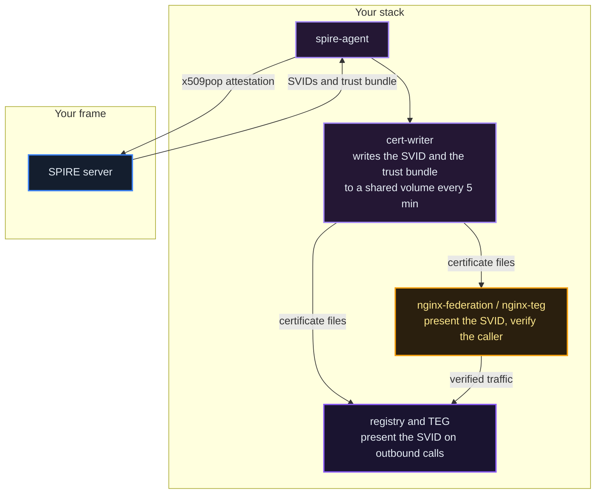

<!-- GENERATED from AgentVault/agentvault_registry/src/agentvault_registry/static/new_registry_frontend/src/assets/docs/operator/08_security.md by scripts/distribution/gen_public_docs.py. Edit that file, not this copy: the export refuses a copy that differs from its source. -->

# Operator Guide: Security Architecture
**Audience**: anyone running a registry: a frame from the frame kit, or a cloud operator under a frame
**Checked against the source**: 2026-10-16 (release V0618: the registry's `core/mtls_auth.py`,
`core/federation_auth.py`, `core/client_ip.py`, `middleware/rate_limiter.py`, `gunicorn_worker.py`,
`routers/agent_mtls.py`, `services/agent_spire.py`, `services/operator_provisioner.py`, `agent_authz.py` and
`agent_delegation.py`; the event store's `routers/events.py` and `es_auth.py`; the frame template and the operator
templates)

---

## Overview

Registries and their services authenticate each other with certificates. Every service of a frame, and every cloud
operator under it, holds a short-lived X.509 certificate issued by SPIRE (an SVID) that names it with a SPIFFE ID, and
the calls that cross between services and registries present it: mutual TLS. This chapter covers those identities, the
federation licence, agents' own certificates (IRONHAND), agent permissions (IRONKEY), rate limits, rotation and what
to do when something breaks. [Chapter 08](https://docs.theprotocol.cloud/learn/security) explains the identity fabric in depth.

---

## mTLS Architecture

### How It Works



On a cloud operator the SPIRE server is its frame's. A frame from the kit runs its own SPIRE server, and each of its
services has its own certificate writer and terminator in the same pattern.

### Components

| Component | Role | Rotation |
|-----------|------|----------|
| **SPIRE agent** | Attests your stack to the frame's SPIRE server with an x509 proof-of-possession certificate, then fetches the SVIDs. The attestation certificate in an operator bundle is valid for two years; unlike a join token it survives restarts, so a restarted agent attests again on its own. | renews each SVID before it expires (service SVIDs live 4 hours) |
| **cert-writer** | Fetches the SVID, its key and the trust bundle (the frame's root plus every federated root) from the agent and writes them to a shared volume. | every 300 seconds (`REFRESH_SEC`) |
| **nginx-federation** | The federation terminator. Presents your SVID as its server certificate and accepts only callers whose client certificate verifies against the trust bundle (`ssl_verify_client on`); forwards the verdict to the registry with a marker only it holds. | reloads the files every 300 seconds (`RELOAD_SEC`) |
| **nginx-teg** | The same terminator in front of your TEG, for your own registry's calls. | every 300 seconds |
| **registry, TEG** | Mount the same files read-only and present the SVID when they call out: event writes to the frame's event store, federation calls to the parent. | follow the files |

### Trust Domain

A trust domain is the namespace of one frame's identities. A frame from the kit uses its own domain: on the public
network `eu.theprotocol.cloud` for EU and `asia.theprotocol.cloud` for ASIA (the `trust_domain` in each registry's
public config). A cloud operator shares its frame's trust domain. The SPIFFE IDs a registry meets:

| Who | SPIFFE ID |
|-----|-----------|
| A frame's registry | `spiffe://<trust domain>/service/<frame name>-registry` and `spiffe://<trust domain>/service/registry` |
| A frame's TEG and event store | `spiffe://<trust domain>/service/teg-layer`, `spiffe://<trust domain>/service/event-store` |
| A frame's terminators | `spiffe://<trust domain>/service/<frame name>-nginx-federation`, `-nginx-teg`, `-nginx-event-store` |
| A cloud operator | `spiffe://<trust domain>/operator/<operator name>/registry`, `/svid-writer` (the certificate its sidecars and outbound calls present) and `/teg` |
| A SPIRE agent | `spiffe://<trust domain>/spire/agent/x509pop/<certificate fingerprint>` |
| An agent with its own certificate | `spiffe://<trust domain>/agent/<sanitized DID>` (see [Agent Certificates](#agent-certificates-ironhand)) |

Two frames trust each other's identities once their SPIRE servers have exchanged trust bundles (frame federation);
each registry card names its bundle endpoint (`federation.spire_bundle_endpoint`).

---

## Federation Authentication

What your registry presents depends on where the call goes:

| Call | Credential | What refuses what |
|------|-----------|-------------------|
| Event writes to the frame's event store (`POST /api/v1/events/`) | your SVID, through the frame's event store terminator | a federation licence key is refused (`403`, `mTLS required`) while `EVENTSTORE_MTLS_REQUIRED` is on, its default; the frame's internal key authenticates reads only |
| A registry's federation endpoints (`/api/v1/federation/...`: card pulls, sync, peer lists) | an SVID through that registry's federation terminator; a licence key (`X-Federation-License`) counts too where it reaches the registry, which on a frame from the kit is only through that same terminator (its public console removes the header) | the internal federation secret is accepted only from a caller on the frame's own network that did not come through its edge |
| A cloud operator's calls to its parent that carry the licence (self-service logs and restarts, agent certificate requests) | the licence key and the SVID together, on the parent's federation address | a licence alone on the parent's public console is refused |
| The TEG legs of a cross-registry transfer (`/api/v1/cross-teg/...`) | the TEG's SVID, through the peer's federation terminator | |

### How the EventStore knows a certificate is real

The EventStore never sees your TLS handshake itself: a terminator in front of it does (the frame's public event store
address, or the frame's own `nginx-event-store` sidecar for its own services). The terminator verifies your
certificate against the trust bundle and forwards what it saw as `X-SSL-Client-*` headers. The EventStore believes
those headers only when the same request also carries `X-ES-Proxy-Auth` equal to the frame's `ES_PROXY_TRUST_SECRET`,
a value only the frame's own terminators hold, and only when the verification result is `SUCCESS`. Headers without the
marker are ignored, so a caller that brings its own `X-SSL-Client-*` headers and no other credential is refused (`403`).

What the EventStore does with a verified SPIFFE ID:

| Identity | Treated as | May |
|----------|-----------|-----|
| One of the frame's own services (its trust domain and a service name the store knows) | origin | write, issue where the frame allows it, change federation records |
| `/operator/<name>/...` in the frame's own trust domain | that operator, only while the store holds an active federation operator record for it | write and read events, within its events-per-minute limit; never issue, never change federation records |
| A known service of a federated peer frame | `peer:<domain>` | write and read for replication; never issue, never change federation records |
| Any other identity of a trusted domain | a registered federation operator | only with an active row in the store's federation operators, within that row's events-per-minute limit |
| An untrusted trust domain | untrusted | refused (`403`) |

The public event store address clears `X-Internal-Key` and `X-Federation-License` on the way in, so a key or a licence
sent from outside the frame never reaches the EventStore: your certificate is what counts.

### When your frame revokes you

Revoking a cloud operator bans its SPIRE node, so it can never attest again, and deletes its workload entries, so its
stack receives no new certificates. A certificate already issued stays valid until it expires, at most four hours,
but it no longer opens anything: once your federation licence is revoked or suspended, the parent's registry refuses
your certificate on its federation endpoints within a minute (the verdict is cached for 60 seconds), and the frame's
event store refuses your event writes and reads within a minute too (it reads your status from its federation
operator records, which follow the licence, and caches the verdict for 30 seconds). If you believe a revocation is a
mistake, contact the operator of your frame (see [Security Incident Response](#security-incident-response)).

---

## The Federation Licence

"Licence" names two things:

- **The network licence** is a certificate signed by the network's genesis for each frame (EU is the public network's
  genesis; ASIA holds a licence EU signed). It belongs to a trust domain: a frame and its operators share it, and
  only a call between two trust domains (a crossing) checks it. Each frame publishes its own at
  `/.well-known/federation-licence.json`, and the registry card carries its hash. How a registry treats a peer whose
  licence is unlicensed, expired, revoked, suspended or invalid is its setting `FEDERATION_LICENCE_MODE`: `off` (the
  code default), `observe` (count and log) or `enforce` (refuse the crossing). A peer not yet evaluated is never
  refused. The Federation Licence Certificate specification on docs.theprotocol.cloud describes the format and the
  checks.
- **The licence key** (`tp_fed_...`, `FEDERATION_LICENSE_KEY` in an operator's `.env.operator`) is a cloud operator's
  login to its frame's registry. The frame stores only its hash, and the host CLI sends it as `X-Federation-License`.
  It authenticates the operator to the frame's registry; the frame's event store refuses it and asks for the
  certificate instead.

---

## Why Your Registry Cannot Issue Units

A cloud operator cannot add units to its frame's books. Three things hold that:

1. **Configuration**: the operator compose sets `MINTING_AUTHORITY=disabled` on the registry and the TEG.
2. **The event store**: an issuance-class event (`TokensIssued`, `DisputeCompensationMinted`, or a `LedgerBalanceChanged`
   of kind `mint` or `dispute_comp`) is accepted only from the frame's own services; anyone else gets `403`.
3. **The supply audit**: every registry checks the supply invariant every 60 seconds and records a
   `SupplyInvariantBreach` event when it does not hold.

Which layer emits each money event is fixed by the emission policy table: `TokensTransferred`,
`TransactionFeeCollected`, `TokensStaked` and `TokensIssued` come from the registry; `CrossRegistryTransferCompleted`
and `RewardsDistributed` are audit records the supply projection skips, because the transfer under them is already
counted.

---

## mTLS Through a Public Proxy

Peers dial the federation address your registry card names (`identity.federation_base_url`). A TLS connection that
ends at a proxy cannot carry the client's certificate any further: the proof that the caller holds the key stays
with the proxy. So the federation address must reach your federation terminator with the TLS session intact (a TCP or
SNI passthrough), or the proxy itself must verify the client certificate against your trust bundle and forward the
verdict with the marker, as a frame's public event store address does (`ssl_verify_client optional`, the trust bundle
as `ssl_client_certificate`, and `X-SSL-Client-Verify`, `X-SSL-Client-Cert` and the proxy marker forwarded). The
registry and the event store count a forwarded certificate only when the verdict is `SUCCESS` and the marker
matches; the registry also checks that the certificate chains to its trust bundle. A proxy that forwards a
certificate without its verdict and the marker therefore authenticates nobody: the certificate is ignored.

The public certificate of your console (Let's Encrypt or any other CA) serves browsers only. Federation identity is
always the SPIRE certificate.

---

## Agent Certificates (IRONHAND)

An agent can hold its own SPIFFE identity for mutual TLS between agents: `spiffe://<trust domain>/agent/<sanitized DID>`,
where the sanitized DID is the DID with every colon replaced by a hyphen (`did:theprotocol:...` becomes
`did-theprotocol-...`). It asks with its agent token:

```bash
curl -X POST <your-registry-url>/api/v1/agent/enable-mtls \
  -H "Authorization: Bearer <agent-token>"
```

The agent needs the `identity.mtls` permission (roles `client` and `service-provider`) and must be active. The
registry then decides how the certificate reaches the agent:

- **On the registry's host**: an agent running as a container labelled `com.theprotocol.agent-did: <sanitized DID>`
  fetches its SVID from the SPIRE agent's Workload API socket. These SVIDs live 30 minutes and renew on their own.
- **Elsewhere**: where `IRONHAND_INLINE_SVID_ENABLED=true` (the frame kit sets it; the code default is `false`), the
  answer carries the certificate, its key and the trust bundle in `svid`, with `expires_at`. The key is shown once
  and lives `IRONHAND_INLINE_SVID_TTL_SECONDS` (default 1800, between 60 and 3600). Call `enable-mtls` again before
  `expires_at` to rotate. Where inline delivery is off, the answer is `"status": "not_enrolled"` and nothing is
  recorded: no entry, no flag, no change to the agent's card.

On a frame stood up from the frame kit, both ways go through the frame runner, which `frame-up.py --with-runner`
installs. Without the runner, `enable-mtls` answers `503` with a sentence naming it (on the host) or `not_enrolled`
(elsewhere), and records nothing; agent-to-agent calls keep working with agent tokens. On the host, the agent's
container mounts the frame's SPIRE agent socket volume (`docker inspect <frame>-spire-agent` names it) and asks the
socket `/opt/spire/sockets/agent.sock`.

A cloud operator has no SPIRE server of its own: its registry asks its frame for these certificates over the
federation lane. `GET /api/v1/agent/mtls-status` shows the agent's enrollment; `POST /api/v1/agent/disable-mtls`
deletes its entry and emits `AgentMtlsRevoked`. An administrator's revoke (`POST /api/v1/admin/ironhand/revoke/{did}`)
does the same and stands until an administrator enrolls the agent again; until then its own `enable-mtls` answers `403`. `GET /api/v1/agent/revoked-identities` (public) lists the revoked
identities that clients poll. A certificate already issued stays valid until it expires, unless the peer hears of the
revocation sooner.

---

## Agent Permissions (IRONKEY)

Authentication answers *who is this agent*; IRONKEY answers *what may it do*. Every agent carries a role set that
resolves to permissions (transfers, locks, governance, contracts, payments, spawning), plus optional spend limits.
Where the gate is enforced, an agent without the permission gets `403` before any units move.

- **New agents get workable defaults.** Agents created through onboarding receive the birth roles in
  `AGENT_RBAC_DEFAULT_ROLES` (default `trader,client`), which cover transfers and paying for services. Locking units needs
  `staker` and governance `governor`. An agent with no roles can do almost nothing: if an imported or migrated agent
  is denied, check its roles first.
- **Delegation.** One agent can act on behalf of another through a delegation grant (an RFC 8693-style `act` claim)
  and can issue attenuated capability permits: a child holds at most a subset of its issuer's authority, re-checked
  against the issuer's current authority on every use, and revoking a token revokes every token derived from it.
  Nothing an agent issues can exceed what the agent itself may do.
- **Deny-only.** The permission layer sits in front of the escrow and transfer rails. It can only refuse; it never
  issues or moves units, so it cannot affect the supply invariant.
- **Where to look.** An agent's roles and grants are on its detail page in the console (the Agent Access panel). Its
  owner reads the denials, with the missing permission named, at `GET /api/v1/agents/{did}/authz/denials`.
  [Chapter 24](https://docs.theprotocol.cloud/learn/agent-access) describes the whole model.

### The Switches

| Variable | Values | Governs |
|---|---|---|
| `AGENT_RBAC_MODE` | `off` / `shadow` / `enforce` | roles, permissions, spend policy |
| `AGENT_DELEGATION_MODE` | `off` / `shadow` / `enforce` | delegation grants and capability permits |
| `CAPABILITY_CIRCUIT_BREAKER_ENABLED` | `false` / `true` | revoking a capability permit that is being misused |

All three are off in the code. The frame kit's template sets both modes to `enforce` and the breaker to `true`. A
cloud operator copies all three from its frame when it is provisioned. The Configuration chapter of this guide lists the neighbouring settings under Agent Authorization,
Liability and Policy.

> **Move the two modes together.** They are independent in the allow direction, but with
> `AGENT_RBAC_MODE=enforce` and `AGENT_DELEGATION_MODE=off`, capability resolution is never consulted, so any agent
> whose authority arrives through a capability permit keeps only its (correctly empty) role set and is refused
> everything. Never flip one alone.

**Run `shadow` before `enforce`.** In shadow the decision is computed and recorded but nothing is blocked, so the
denial feed shows what enforcement would refuse on your own traffic before it can cost anyone a transaction.

### The circuit breaker

With `AGENT_DELEGATION_MODE=enforce` and the breaker on, **five misuse denials against one capability permit within
five minutes revoke that token and every token derived from it**, end any phone sessions riding on that subtree,
write a critical audit record, record `AgentCapabilityCircuitBreakerTripped` in the ledger, and notify the owners of
both the issuer and the holder.

It counts only misuse: the wrong holder presenting a token, a revoked token presented again, a permission outside the
token's own caveats. **Benign denials never count**: an expired token, an exhausted budget and a used-up allowance
are ordinary limits, and a breaker that tripped on those would punish honest agents for reaching limits you set on
purpose.

---

## Rate Limits

Every request counts against a default of 1200 requests a minute (`RATE_LIMIT_DEFAULT`), per client address. Routes
that need it carry tighter limits of their own, for example login 10 a minute, registration 5, password reset mails
3, bootstrap tokens 20 and agent creation 10. A route's own limit counts per developer or agent where the route
knows who is calling, otherwise per client address. The counters live in Redis (`REDIS_URL`), so every worker shares them; without Redis
each worker counts alone and the limits are looser than written. A refused request answers `429` with `Retry-After`,
and answers carry `X-RateLimit-Limit`, `X-RateLimit-Remaining` and `X-RateLimit-Reset`.

The client address is the one your own edge saw, never the one a caller claims:

- nginx appends the real peer to `X-Forwarded-For`, so the registry takes the **last** element, then `X-Real-IP`,
  then the connection's peer. A forged first element changes nothing.
- The workers accept proxy headers only from the proxies named in `FORWARDED_ALLOW_IPS` (default loopback and the
  private ranges: `127.0.0.1`, `::1`, `10.0.0.0/8`, `172.16.0.0/12`, `192.168.0.0/16`). A registry behind a cloud load
  balancer needs the balancer's range there; if every client suddenly shares one counter, this setting is wrong.
- A request with no proxy headers from a private or loopback address (your frame's own services) is not limited.

`SANDBOX_BYPASS_RATE_LIMIT=true` switches limiting off for the whole process. It exists for a sandbox's API tester and
has no place on a registry the public can reach. To check a registry, read the header:

```bash
curl -s -D- -o /dev/null https://<your-registry>/health | grep -i x-ratelimit-limit
```

`1200` means the default limit is live.

The frame's event store limits each cloud operator's writes on its own: the events per minute its federation operator
record sets (1000 by default), counted per calendar minute by each store worker; reads are not counted. Past it the
store answers `429`, and your registry and your TEG keep the event and send it again later.

---

## Secret Rotation

**Certificates rotate themselves.** Service SVIDs live four hours and the SPIRE agent renews them; the cert-writer
rewrites the files and the terminators reload them every 300 seconds. Nothing needs a manual rotation, and a
restarted SPIRE agent attests again with its attestation certificate (valid two years from onboarding on an
operator).

What you rotate by hand:

| Secret | How |
|--------|-----|
| The federation licence key | your frame's administrators issue a new key and revoke the old one. Put the new value in `.env.operator` as `FEDERATION_LICENSE_KEY` and recreate the two services that send it: `docker compose -f docker-compose.operator.yml --env-file .env.operator up -d --no-deps --force-recreate registry teg-layer`. Self-service rotation (`tp-operator license rotate`, which ends the old key at once) works only where the frame switches it on (`FEDERATION_LICENSE_ROTATE_SELF_ENABLED`, off by default) and the CLI's parent address passes the licence header; the public console of a frame from the kit removes it. |
| A developer API key | create a new one (`POST /api/v1/auth/api-keys`), switch your clients, revoke the old one (`DELETE /api/v1/auth/api-keys/{key_id}`). Keys expire after `API_KEY_DEFAULT_TTL_DAYS` (365) unless created with `expires_in_days: 0`. |
| An agent's client secret | its owner calls `POST /api/v1/onboard/agents/{agent_did}/reset-credentials` with the account password (and a second factor where one is enrolled). The old credentials stop at once; 3 resets an hour. |
| The registry card's signing key | an administrator with `admin_platform` calls `POST /api/v1/admin/registry-signing-key/rotate`; the old key stays valid for 7 days so peers can catch up. |
| `API_KEY_SECRET` | it signs every developer and agent token, so changing it ends every session at once; API keys are stored as hashes and keep working. It has a partner value on the TEG: the Configuration chapter of this guide names it. |
| Database passwords | each lives in `.env.operator`, in `pgbouncer.ini` and `userlist.txt`, and inside the database itself, which keeps the password it was created with. Change it in the database first, then in the three files, then recreate the services. |

> **Do not re-run `generate-operator-env.sh` on a running operator.** It writes a completely new `.env.operator`, with
> new database passwords the existing databases do not know, a new operator DID, an empty `FEDERATION_LICENSE_KEY`
> and placeholder mail settings. It is for a new operator only.

Every `docker compose` command on an operator names both files:
`docker compose -f docker-compose.operator.yml --env-file .env.operator ...`. Without `--env-file`, compose starts the
stack with blank values. The host CLI (`tp-operator`) adds both itself.

---

## Security Incident Response

### Find the Fault

Start with the host CLI's diagnostic and the logs of the identity path:

```bash
tp-operator doctor                       # docker, disk, services, licence, reachability of your frame
tp-operator logs cert-writer --tail 50   # recent SVID fetches
tp-operator logs nginx-federation --tail 50
tp-operator logs registry --tail 200 | grep -i "401\|403\|certificate"
```

On a frame from the kit, `tp-operator --frame <stack dir> doctor` runs the frame's read-only checks.

### Check the SPIRE Agent

```bash
docker compose -f docker-compose.operator.yml --env-file .env.operator \
  exec spire-agent /opt/spire/bin/spire-agent healthcheck -socketPath /opt/spire/sockets/agent.sock
```

A healthy agent answers `Agent is healthy.` (the compose healthcheck runs the same command, so
`tp-operator status` shows it too). If it is unhealthy, restart it, wait a minute, then restart the cert-writer:

```bash
tp-operator restart spire-agent
tp-operator restart cert-writer
```

Once your frame revokes or suspends your licence, its registry answers your calls `403`
(`Operator federation license is not active`, or `Invalid or revoked federation license` for the key), and its event
store answers your event writes `403` (`Operator is not active in this frame's federation (suspended or revoked)`).
`tp-operator license verify` asks your frame to check the licence and exits 2 unless it is active (the host CLI
chapter, operator chapter 12).

### Escalate

If the fault persists, contact the operator of your frame at the address its `/.well-known/security.txt` names
(`curl https://<your-frame>/.well-known/security.txt`). Include your operator name, the output of
`tp-operator doctor` and the time the problem began.

---

## Security Checklist

| Item | How to Verify |
|------|---------------|
| SPIRE agent, cert-writer and terminators healthy | `tp-operator status`, or `docker compose -f docker-compose.operator.yml --env-file .env.operator ps` |
| Certificates current | `tp-operator logs cert-writer --tail 5` shows a recent fetch |
| Licence active | your frame's registry does not answer your calls `403` with `Operator federation license is not active`; ask your frame's operator when in doubt |
| Issuance disabled | the registry's public config answers `"is_federated_operator": true` (`GET /api/v1/public/registry-config`) |
| Rate limits live | `X-RateLimit-Limit: 1200` on any answer, and `SANDBOX_BYPASS_RATE_LIMIT` unset |
| Proxy headers trusted only from your proxies | `FORWARDED_ALLOW_IPS` names your load balancer if you have one |
| Secrets generated, not defaults | `.env.operator` holds generated values, mode 600 |
| A security contact published | `GET /.well-known/security.txt` answers (set `SECURITY_CONTACT_EMAIL`, or the provider details of your legal pages) |
| Images current | `tp-operator update --check-only`; the Releases and Updates chapter of this guide explains the release channel |
