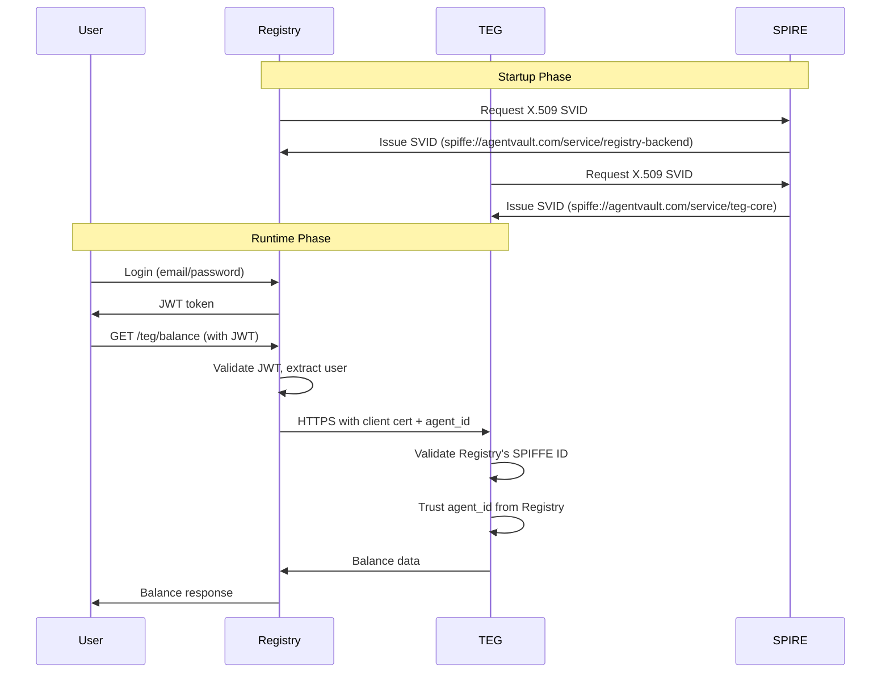

# mTLS Integration Summary: Registry Backend ↔ TEG Core Service

## Executive Summary

Boss, the mTLS integration between the AgentVault Registry Backend and TEG Core Service is now complete. This establishes cryptographically secure service-to-service communication using SPIFFE/SPIRE SVIDs, eliminating the need for shared secrets and providing a foundation for Zero Trust architecture.

## What Was Implemented

### 1. TEG Core Service - mTLS Server (Part 1)

**New Components:**
- `src/teg_core_service/identity/svid_manager.py`: Manages SVID acquisition and certificate rotation
- `src/teg_core_service/identity/spiffe_auth.py`: Middleware for extracting client SPIFFE IDs
- `src/teg_core_service/main_mtls.py`: Enhanced main module with mTLS server configuration
- `src/teg_core_service/api/v1/endpoints_token_mtls.py`: Token endpoints that validate client identities

**Key Features:**
- Automatic X.509 SVID fetching from SPIRE Agent
- Uvicorn configured to require client certificates
- Client SPIFFE ID extraction and validation
- Graceful certificate rotation without downtime

### 2. Registry Backend - mTLS Client (Part 2)

**New Components:**
- `src/agentvault_registry/identity/svid_client.py`: Manages client certificates for outbound connections
- `src/agentvault_registry/main_mtls.py`: Enhanced main with lifecycle management
- `src/agentvault_registry/routers/teg_integration_mtls.py`: Updated TEG proxy with mTLS support

**Key Features:**
- Automatic HTTPS upgrade when mTLS available
- HTTPX client configured with client certificates
- Backward compatible - works without SPIFFE
- Trust bundle validation for server certificates

### 3. Infrastructure & Documentation (Part 3)

**New Files:**
- `identity-fabric/docker-compose.full.yml`: Complete stack with all services
- `identity-fabric/init-spire-mtls.sh`: Automated SPIRE setup script
- `identity-fabric/docs/SPIRE_SETUP_GUIDE_MTLS.md`: Comprehensive setup guide
- `identity-fabric/docs/IDENTITY_FABRIC_MVP_MTLS.md`: Updated architecture docs
- `TEG_INTEGRATION_README.md`: Integration documentation

**Docker Support:**
- Dockerfiles for both services with SPIFFE labels
- Volume mounts for SPIRE Agent socket access
- Health checks showing mTLS status

## Authentication Model Evolution

### Before mTLS:
```
Registry → TEG: Bearer {placeholder-agent-id-token}
Trust Level: None (placeholder authentication)
Security: Transport encryption only
```

### With mTLS:
```
Registry → TEG: mTLS Certificate + Bearer {agent-id}
Trust Level: Cryptographic (X.509 SVID)
Security: Mutual authentication + encryption

TEG knows: Request from spiffe://agentvault.com/service/registry-backend
TEG trusts: agent_id is pre-validated by Registry's v1.0.0 auth
```

## Security Improvements

1. **No Shared Secrets**: Services authenticate via certificates, not API keys
2. **Cryptographic Identity**: Each service has a unique SPIFFE ID
3. **Automatic Rotation**: Certificates renewed before expiration
4. **Audit Trail**: Every request includes verified service identity
5. **Defense in Depth**: Multiple security layers (network, transport, auth)

## How mTLS Works



## Testing the Implementation

### Quick Test:
```bash
# Start everything
cd identity-fabric
docker-compose -f docker-compose.full.yml up -d

# Initialize SPIRE
./init-spire-mtls.sh

# Check mTLS status
curl http://localhost:8000/health | jq
curl http://localhost:8001/health | jq

# Both should show: "mtls_enabled": true
```

### Integration Test:
```bash
# Direct TEG access (should fail - no client cert)
curl https://localhost:8001/api/v1/token/fee-config
# Error: Client certificate required

# Access via Registry (should work - has client cert)
TOKEN=$(curl -X POST http://localhost:8000/api/v1/auth/login \
  -H "Content-Type: application/json" \
  -d '{"email": "test@example.com", "password": "test"}' | jq -r .access_token)

curl http://localhost:8000/api/v1/teg/fee-config \
  -H "Authorization: Bearer $TOKEN"
# Success: Returns fee configuration
```

## Configuration

### TEG Core Service:
```python
# When SPIFFE_ENDPOINT_SOCKET is set:
- Fetches server certificate from SPIRE
- Configures Uvicorn for mTLS
- Requires client certificates
- Validates client SPIFFE IDs
```

### Registry Backend:
```python
# When SPIFFE_ENDPOINT_SOCKET is set:
- Fetches client certificate from SPIRE  
- Upgrades TEG_API_BASE_URL to HTTPS
- Configures HTTPX with client certs
- Validates server certificate
```

## Next Steps

This mTLS implementation is a crucial step but not the final destination:

1. **Complete Auth Bridge (REQ-INT-V1AUTH-001)**
   - Replace agent ID in Bearer token with JWT SVID
   - Implement full cryptographic agent authentication

2. **Extend mTLS Coverage**
   - Chronicle Service integration
   - Circuit Registry connections
   - Admin interfaces

3. **Enhanced Authorization**
   - SPIFFE ID-based access policies
   - Fine-grained permissions per service

4. **Production Hardening**
   - Replace self-signed CA with production PKI
   - Implement high-availability SPIRE deployment
   - Add comprehensive monitoring and alerting

## Key Takeaways

1. **It Works**: mTLS is operational between Registry and TEG
2. **It's Secure**: Cryptographic service authentication replaces placeholders
3. **It's Maintainable**: Automatic certificate rotation, clear separation of concerns
4. **It's Ready**: Foundation laid for comprehensive Zero Trust implementation

The "Warrior Owl" philosophy is evident throughout - robust security, well-documented implementation, and a clear path forward. This mTLS integration significantly enhances AgentVault's security posture while maintaining operational simplicity.

---
*"Stone Cold Clear" implementation, Boss. The services now speak with cryptographic authority.*
