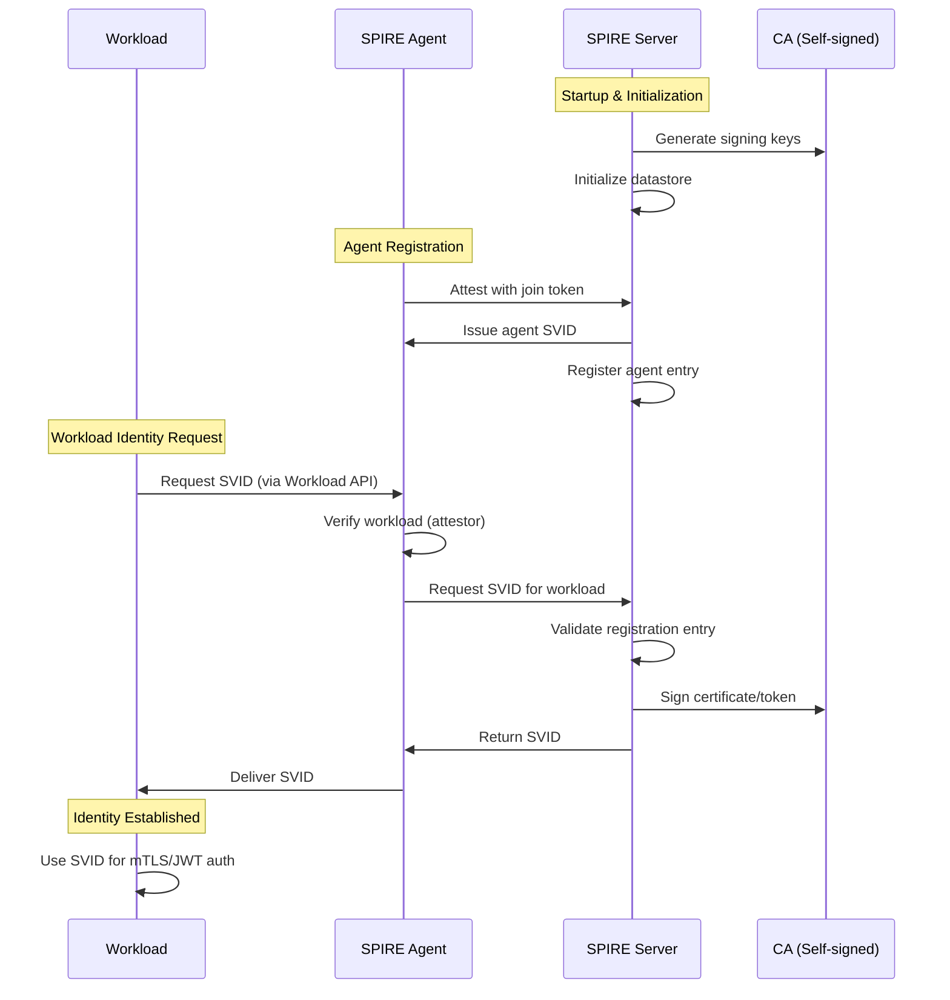

# AgentVault Identity Fabric MVP

## Overview

This document describes the foundational SPIFFE/SPIRE implementation for the AgentVault Identity Fabric, establishing the cornerstone for Zero Trust agent identity management.

## Architecture

### Trust Domain Structure

```
Trust Domain: agentvault.com
│
├── SPIRE Server (Control Plane)
│   ├── Registration API (port 8081)
│   ├── Self-signed CA (MVP)
│   └── SQLite Datastore
│
├── SPIRE Agent (Data Plane)
│   ├── Node Attestation (join_token)
│   ├── Workload API (Unix Socket)
│   └── Workload Attestors
│       ├── unix (UID/GID)
│       └── docker (container metadata)
│
└── Workloads (AgentVault Components)
    ├── Sample Workload
    │   └── spiffe://agentvault.com/sample-workload
    ├── TEG Core Service (future)
    │   └── spiffe://agentvault.com/teg/core
    └── Agent Executors (future)
        └── spiffe://agentvault.com/agent/{agent-id}
```

### Component Interaction Flow



## Implementation Details

### SPIRE Server Configuration

**Key Design Decisions:**

1. **Trust Domain**: `agentvault.com` - Establishes our identity namespace
2. **CA Type**: Self-signed for MVP, upstream CA ready for production
3. **Storage**: SQLite for simplicity, easily migrated to PostgreSQL
4. **TTLs**: Conservative defaults (1h X.509, 5m JWT) for security

```hocon
server {
  trust_domain = "agentvault.com"
  data_dir = "/opt/spire/data"
  
  # MVP: Self-signed CA
  ca_key_type = "rsa-2048"
  default_x509_svid_ttl = "1h"
  default_jwt_svid_ttl = "5m"
}
```

### SPIRE Agent Configuration

**Attestation Strategy:**

- **Node Attestor**: `join_token` for Docker simplicity
- **Workload Attestors**: Both `unix` and `docker` for flexibility
- **Socket Path**: Standard location for container access

```hocon
agent {
  trust_domain = "agentvault.com"
  server_address = "spire-server"
  socket_path = "/opt/spire/sockets/agent.sock"
}
```

### Sample Workload Integration

The sample workload demonstrates the fundamental pattern for SPIFFE integration:

```python
# Core integration pattern
with default_workload_api_client() as client:
    # X.509 for mTLS
    x509_context = client.fetch_x509_context()
    x509_svid = x509_context.default_svid()
    
    # JWT for API auth
    jwt_svids = client.fetch_jwt_svid(audiences=["agentvault-service"])
```

## Security Model

### Identity Hierarchy

```
Root of Trust: SPIRE Server CA
│
├── Node Identity (SPIRE Agent)
│   └── spiffe://agentvault.com/spire-agent
│
└── Workload Identities
    ├── Service Identities
    │   ├── spiffe://agentvault.com/teg/core
    │   ├── spiffe://agentvault.com/chronicle
    │   └── spiffe://agentvault.com/registry
    │
    └── Agent Identities
        ├── spiffe://agentvault.com/agent/{uuid}
        └── spiffe://agentvault.com/agent/executor/{type}
```

### Attestation Mechanisms

1. **Node Level**: Join tokens (MVP), K8s PSATs (production)
2. **Workload Level**: Unix UID/GID, Docker metadata, K8s labels
3. **Registration**: Explicit entries with parent-child relationships

## Integration Points

### TEG Core Service

```python
# Future TEG integration
class TEGCoreService:
    def __init__(self):
        self.svid_manager = SVIDManager()
        self.x509_svid = self.svid_manager.fetch_x509_svid()
        
    def create_mtls_server(self):
        # Use X.509 SVID for server cert
        return create_server(
            cert=self.x509_svid.cert_chain,
            key=self.x509_svid.private_key
        )
```

### Agent Authentication

```python
# Agent JWT authentication pattern
class AgentAuthenticator:
    def authenticate_request(self, request):
        jwt_svid = self.fetch_jwt_svid(audience="teg-core")
        request.headers["Authorization"] = f"Bearer {jwt_svid.token}"
```

### Chronicle Event Signing

```python
# Event authenticity using SPIFFE
class ChronicleService:
    def sign_event(self, event):
        # Use X.509 private key for signing
        signature = self.x509_svid.sign(event.serialize())
        event.signature = signature
        event.signer_spiffe_id = str(self.x509_svid.spiffe_id)
```

## Operational Considerations

### Health Monitoring

- SPIRE Server health: `http://localhost:8080/ready`
- SPIRE Agent health: `http://localhost:8082/ready`
- Workload API availability via socket existence check

### SVID Rotation

- X.509 SVIDs: 1-hour lifetime, auto-rotated at 50% lifetime
- JWT SVIDs: 5-minute lifetime, fetched on-demand
- Workloads must handle rotation gracefully

### Debugging Tools

```bash
# View all registrations
spire-server entry show

# Test workload attestation
spire-agent api fetch x509 -socketPath /path/to/socket

# Monitor SVID issuance
spire-server bundle show
```

## Future Enhancements

### Phase 1: Production Readiness
- [ ] Replace self-signed CA with proper PKI
- [ ] Implement K8s node/workload attestors
- [ ] Add PostgreSQL backend for HA
- [ ] Implement SPIRE Server federation

### Phase 2: Advanced Integration
- [ ] mTLS for all inter-service communication
- [ ] JWT-based API gateway integration
- [ ] SVID-based authorization policies
- [ ] Workload identity for all agent types

### Phase 3: Federation & Scaling
- [ ] Multi-region SPIRE deployment
- [ ] Cross-domain federation
- [ ] External IdP integration
- [ ] Compliance audit logging

## Key Achievements

1. **Foundation Established**: Working SPIFFE/SPIRE infrastructure
2. **Pattern Demonstrated**: Clear integration pattern via sample workload
3. **Docker-Ready**: Fully containerized for development
4. **Production Path**: Clear upgrade path to production-grade setup
5. **Zero Trust Ready**: Cryptographic identity for all workloads

## Conclusion

This MVP implementation provides a solid foundation for the AgentVault Identity Fabric. The SPIFFE/SPIRE integration enables:

- **Cryptographic workload identity** without shared secrets
- **Automatic certificate rotation** for operational simplicity
- **Standards-based approach** ensuring interoperability
- **Zero Trust architecture** from the ground up

The sample workload demonstrates that any AgentVault component can now establish a strong cryptographic identity with minimal code changes, setting the stage for comprehensive security improvements across the platform.
