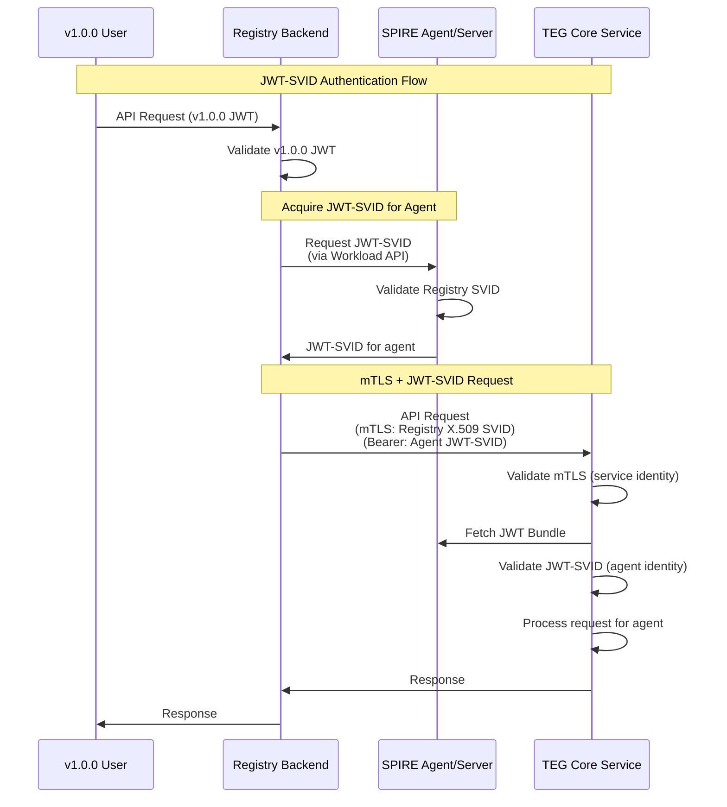

# AgentVault Identity Fabric MVP with JWT-SVID Authentication

## Overview

This document describes the enhanced SPIFFE/SPIRE implementation for the AgentVault Identity Fabric, including the JWT-SVID authentication bridge between v1.0.0 agents and the TEG Layer MVP.

## Architecture

### Trust Domain Structure

```
Trust Domain: agentvault.com
│
├── SPIRE Server (Control Plane)
│   ├── Registration API (port 8081)
│   ├── Self-signed CA (MVP)
│   ├── SQLite Datastore
│   └── JWT-SVID Signing Keys
│
├── SPIRE Agent (Data Plane)
│   ├── Node Attestation (join_token)
│   ├── Workload API (Unix Socket)
│   └── Workload Attestors
│       ├── unix (UID/GID)
│       └── docker (container metadata)
│
└── Workloads (AgentVault Components)
    ├── Registry Backend (mTLS + JWT-SVID Provider)
    │   └── spiffe://agentvault.com/service/registry-backend
    ├── TEG Core Service (mTLS + JWT-SVID Validator)
    │   └── spiffe://agentvault.com/service/teg-core
    └── Agent Identities (JWT-SVIDs)
        └── spiffe://agentvault.com/agent/{agent_local_id}
```

### Enhanced Authentication Flow



## Implementation Details

### JWT-SVID Configuration

**SPIRE Server Enhancement:**

```bash
# Register Registry Backend with JWT-SVID capabilities
spire-server entry create \
    -parentID spiffe://agentvault.com/spire-agent \
    -spiffeID spiffe://agentvault.com/service/registry-backend \
    -selector docker:label:com.agentvault.service:registry-backend \
    -ttl 3600 \
    -jwtSVIDTTL 300  # 5 minute JWT-SVIDs

# Agent registration pattern
spire-server entry create \
    -parentID spiffe://agentvault.com/service/registry-backend \
    -spiffeID spiffe://agentvault.com/agent/{agent_local_id} \
    -selector k8s:ns:agentvault \
    -ttl 3600 \
    -jwtSVIDTTL 300
```

### Registry Backend - JWT-SVID Provider

```python
# JWT-SVID acquisition for authenticated agents
class JWTSVIDProvider:
    async def acquire_jwt_svid_for_agent(
        self, 
        agent_email: str,
        audience: str = "spiffe://agentvault.com/service/teg-core"
    ) -> str:
        # Convert email to SPIFFE ID format
        safe_agent_id = agent_email.replace('@', '_at_').replace('.', '_dot_')
        agent_spiffe_id = f"spiffe://agentvault.com/agent/{safe_agent_id}"
        
        # Request JWT-SVID via Workload API
        jwt_svid = self._workload_api_client.fetch_jwt_svid(
            audiences=[audience],
            subject=agent_spiffe_id
        )
        
        return jwt_svid.token
```

### TEG Core Service - JWT-SVID Validator

```python
# JWT-SVID validation dependency
def verify_jwt_svid(credentials: HTTPAuthorizationCredentials) -> str:
    token = credentials.credentials
    
    # Validate JWT-SVID against SPIRE trust bundle
    jwt_bundle = fetch_jwt_bundle_for_trust_domain("agentvault.com")
    jwt_svid = JwtSvid.parse(token, expected_audience)
    jwt_svid.validate(jwt_bundle)
    
    # Extract agent SPIFFE ID
    agent_spiffe_id = jwt_svid.spiffe_id.to_string()
    
    # Convert to TEG agent ID format
    agent_id = extract_agent_id_from_spiffe_id(agent_spiffe_id)
    
    return agent_id
```

## Security Model

### Dual-Layer Authentication

1. **Service-to-Service (mTLS)**:
   - Registry Backend ↔ TEG Core Service
   - X.509 SVIDs for channel security
   - Validates service identity

2. **End-User Authentication (JWT-SVID)**:
   - Agent identity in JWT-SVID
   - Short-lived tokens (5 minutes)
   - Audience-restricted to TEG Core

### JWT-SVID Claims Structure

```json
{
  "aud": ["spiffe://agentvault.com/service/teg-core"],
  "exp": 1234567890,
  "iat": 1234567590,
  "iss": "spiffe://agentvault.com",
  "sub": "spiffe://agentvault.com/agent/user_at_example_dot_com"
}
```

### Trust Boundaries

```
┌─────────────────────────────────────────────────────────┐
│                    Trust Domain                         │
│                  agentvault.com                         │
│                                                         │
│  ┌──────────────────┐        ┌───────────────────┐    │
│  │ Registry Backend │        │  TEG Core Service │    │
│  │                  │ mTLS + │                   │    │
│  │ X.509 SVID:     │------->│ X.509 SVID:       │    │
│  │ .../service/    │JWT-SVID│ .../service/      │    │
│  │ registry-backend│        │ teg-core          │    │
│  └──────────────────┘        └───────────────────┘    │
│           ↑                           ↑                 │
│           │                           │                 │
│      JWT-SVID                    JWT-SVID              │
│      Provider                   Validator              │
│           │                           │                 │
│  ┌────────┴──────────────────────────┴────────────┐   │
│  │              SPIRE Infrastructure               │   │
│  │         (Server + Agent + Workload API)         │   │
│  └─────────────────────────────────────────────────┘   │
└─────────────────────────────────────────────────────────┘
```

## Integration Points

### TEG Integration Router Enhancement

```python
# Enhanced TEG integration with JWT-SVIDs
async def make_teg_request_with_jwt_svid(
    method: str,
    endpoint: str,
    current_developer: models.Developer,
    json_data: Optional[dict] = None
) -> httpx.Response:
    # Acquire JWT-SVID for agent
    jwt_svid = await acquire_agent_jwt_svid(
        agent_email=current_developer.email,
        audience=TEG_CORE_AUDIENCE
    )
    
    # Get mTLS client (uses Registry Backend X.509 SVID)
    client = await get_mtls_client()
    
    # Make request with dual authentication
    response = await client.request(
        method=method,
        url=url,
        headers={
            "Authorization": f"Bearer {jwt_svid}",  # Agent identity
            "X-Request-Source": "agentvault-registry-v1"
        },
        json=json_data
    )
    
    return response
```

### TEG Token Endpoints Enhancement

```python
# Replace simple token verification with JWT-SVID
@router.get("/balance")
async def get_balance(
    agent_id: Annotated[str, Depends(verify_jwt_svid)],  # JWT-SVID auth
    db: Session = Depends(get_db)
):
    """Get balance for JWT-SVID authenticated agent"""
    balance = AgentCRUD.get_balance(db, agent_id)
    return TokenBalanceResponse(agent_id=agent_id, balance=balance)
```

## Operational Considerations

### JWT-SVID Lifecycle

1. **Issuance**: On-demand when v1.0.0 request received
2. **TTL**: 5 minutes (configurable)
3. **Caching**: Not recommended due to short TTL
4. **Renewal**: Automatic on next request

### Monitoring & Debugging

```bash
# View JWT-SVID capable registrations
spire-server entry show -selector jwtSVIDTTL

# Test JWT-SVID acquisition
spire-agent api fetch jwt \
    -audience spiffe://agentvault.com/service/teg-core \
    -socketPath /opt/spire/sockets/agent.sock

# Debug JWT-SVID validation
export JWT_SVID_DEBUG=true
tail -f /var/log/teg-core/jwt-svid-validation.log
```

### Performance Considerations

- JWT-SVID acquisition: ~10-50ms overhead
- Validation: ~1-5ms with cached bundle
- mTLS handshake: One-time per connection
- Connection pooling recommended

## Implementation Status

### Completed (REQ-INT-V1AUTH-001)

- [x] SPIRE configuration for JWT-SVID support
- [x] Registry Backend JWT-SVID provider
- [x] TEG Core Service JWT-SVID validator
- [x] Updated TEG integration endpoints
- [x] mTLS + JWT-SVID dual authentication
- [x] Agent SPIFFE ID mapping

### MVP Limitations

1. **Agent Registration**: Manual or delegated via registry
2. **JWT Signing**: Uses SPIRE's default signing keys
3. **Audience Management**: Single audience (TEG Core)
4. **Token Refresh**: No refresh tokens (short TTL only)

## Future Enhancements

### Phase 1: Production Hardening
- [ ] Dynamic agent registration API
- [ ] JWT-SVID caching with TTL awareness
- [ ] Multiple audience support
- [ ] Comprehensive audit logging

### Phase 2: Advanced Features
- [ ] Custom claims in JWT-SVIDs
- [ ] Agent-specific permissions
- [ ] JWT-SVID for other services
- [ ] Federation support

### Phase 3: Full Integration
- [ ] Replace v1.0.0 auth with SPIFFE
- [ ] Agent-to-agent JWT-SVIDs
- [ ] Policy-based authorization
- [ ] Zero-downtime rotation

## Key Achievements

1. **End-to-End Authentication**: Complete chain from v1.0.0 user to TEG service
2. **Cryptographic Identity**: Every request has verifiable agent identity
3. **Service Isolation**: mTLS ensures only authorized services communicate
4. **Standards Compliance**: Full SPIFFE/SPIRE JWT-SVID specification
5. **Zero Trust Progress**: No implicit trust between components

## Conclusion

The JWT-SVID implementation completes the authentication bridge between AgentVault v1.0.0 and the TEG Layer MVP. This provides:

- **Strong Authentication**: Cryptographic proof of agent identity
- **Service Security**: mTLS prevents unauthorized service access
- **Audit Trail**: Every action traceable to specific agent
- **Future-Proof**: Standard SPIFFE approach enables federation
- **Operational Excellence**: Automatic rotation and management

The system now supports true end-to-end authentication with defense in depth through dual-layer security (mTLS + JWT-SVID).
