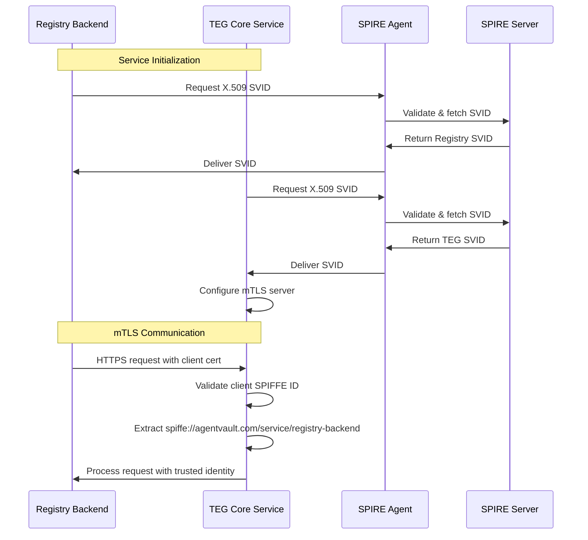

# AgentVault Identity Fabric MVP with mTLS Integration

## Overview

This document describes the SPIFFE/SPIRE implementation for the AgentVault Identity Fabric, including the completed mTLS integration between the Registry Backend and TEG Core Service.

## Architecture

### Trust Domain Structure

```
Trust Domain: agentvault.com
│
├── SPIRE Server (Control Plane)
│   ├── Registration API (port 8081)
│   ├── Self-signed CA (MVP)
│   └── SQLite Datastore
│
├── SPIRE Agent (Data Plane)
│   ├── Node Attestation (join_token)
│   ├── Workload API (Unix Socket)
│   └── Workload Attestors
│       ├── unix (UID/GID)
│       └── docker (container metadata)
│
└── Workloads (AgentVault Components)
    ├── TEG Core Service (mTLS Server)
    │   └── spiffe://agentvault.com/service/teg-core
    ├── Registry Backend (mTLS Client)
    │   └── spiffe://agentvault.com/service/registry-backend
    └── Sample Workload
        └── spiffe://agentvault.com/sample-workload
```

### mTLS Communication Flow



## Implementation Details

### TEG Core Service - mTLS Server

**Key Components:**

1. **SVID Manager**: Handles certificate acquisition and rotation
2. **mTLS Middleware**: Extracts and validates client SPIFFE IDs
3. **Enhanced Endpoints**: Use client identity for authorization

```python
# SVID Manager initialization
class SVIDManager:
    def initialize(self):
        # Fetch X.509 SVID from SPIRE Agent
        x509_context = client.fetch_x509_context()
        self.spiffe_id = str(svid.spiffe_id)
        # Store certificates for Uvicorn TLS config
        
# mTLS server configuration
def get_tls_config():
    return {
        'certfile': str(self.cert_path),
        'keyfile': str(self.key_path),
        'ca_certs': str(self.bundle_path),
        'cert_reqs': ssl.CERT_REQUIRED,  # Require client certs
    }
```

### Registry Backend - mTLS Client

**Integration Approach:**

1. **SVID Client**: Manages client certificates for outbound connections
2. **Enhanced HTTPX**: Configured with client certificates
3. **Automatic Upgrade**: HTTP → HTTPS when mTLS available

```python
# SVID Client for mTLS connections
class SVIDClient:
    def get_client_cert_config(self):
        return {
            'cert': (str(self.cert_path), str(self.key_path)),
            'verify': str(self.bundle_path)  # Trust bundle
        }

# Enhanced TEG integration
async with get_httpx_client() as client:  # Automatically uses mTLS
    response = await client.post(
        f"{TEG_API_BASE_URL}/api/v1/token/transfer",
        json=request_data,
        headers={"Authorization": f"Bearer {agent_id}"}
    )
```

### Authentication Model Evolution

**Before mTLS:**
```
Registry → TEG: Bearer {placeholder-agent-id-token}
Trust: None (placeholder auth)
```

**With mTLS:**
```
Registry → TEG: mTLS + Bearer {agent-id}
Trust: Cryptographic (SVID validates Registry identity)
TEG knows: Request from spiffe://agentvault.com/service/registry-backend
TEG trusts: agent_id is pre-validated by Registry's v1.0.0 auth
```

## Security Improvements

### Service-to-Service Trust

1. **Cryptographic Identity**: Services prove identity via X.509 certificates
2. **No Shared Secrets**: Eliminates API keys between services
3. **Automatic Rotation**: Certificates renewed before expiration
4. **Audit Trail**: Every request includes verified service identity

### Defense in Depth

```
Layer 1: Network (Docker networks)
Layer 2: Transport (TLS encryption)
Layer 3: Authentication (mTLS client certs)
Layer 4: Authorization (SPIFFE ID validation)
Layer 5: Application (Agent ID from trusted source)
```

## Operational Considerations

### Health Monitoring

Enhanced health endpoints show mTLS status:

```json
// TEG Core Service
{
  "status": "healthy",
  "mtls_enabled": true,
  "spiffe_id": "spiffe://agentvault.com/service/teg-core"
}

// Registry Backend
{
  "status": "ok",
  "mtls_enabled": true,
  "spiffe_id": "spiffe://agentvault.com/service/registry-backend"
}
```

### Certificate Management

- **Automatic Renewal**: Watcher threads handle SVID updates
- **Graceful Rotation**: Old certs cleaned up after new ones active
- **Zero Downtime**: Connections use new certs transparently

### Debugging mTLS

```bash
# Check SVID status
docker logs agentvault-teg-core | grep SVID
docker logs agentvault-registry-backend | grep SVID

# Test mTLS requirement
curl https://localhost:8001/api/v1/token/fee-config
# Should fail: no client certificate

# Monitor certificate updates
docker exec agentvault-spire-agent \
    spire-agent api fetch x509 -socketPath /opt/spire/sockets/agent.sock
```

## Configuration Reference

### Environment Variables

**TEG Core Service:**
```bash
SPIFFE_ENDPOINT_SOCKET=unix:///spire-agent-socket/agent.sock
# Enables mTLS server mode when set
```

**Registry Backend:**
```bash
SPIFFE_ENDPOINT_SOCKET=unix:///spire-agent-socket/agent.sock
TEG_API_BASE_URL=https://teg-core:8001  # HTTPS when mTLS enabled
```

### Docker Labels for Attestation

```yaml
labels:
  com.agentvault.service: teg-core  # For SPIRE workload attestation
```

## Migration Path

### Phase 1: Current State ✓
- [x] SPIFFE/SPIRE infrastructure deployed
- [x] TEG Core Service with mTLS server
- [x] Registry Backend with mTLS client
- [x] Secure service-to-service communication

### Phase 2: Full Auth Bridge
- [ ] Replace placeholder agent tokens with JWT SVIDs
- [ ] Implement agent SPIFFE ID mapping
- [ ] Add authorization policies based on SPIFFE IDs

### Phase 3: Complete Zero Trust
- [ ] mTLS for all services (Chronicle, Circuit Registry)
- [ ] Agent executors with workload identities
- [ ] External service federation

## Testing the Integration

### 1. Start Infrastructure
```bash
cd identity-fabric
docker-compose -f docker-compose.full.yml up -d
```

### 2. Verify mTLS Active
```bash
# Check health endpoints
curl http://localhost:8001/health | jq .mtls_enabled
curl http://localhost:8000/health | jq .mtls_enabled
```

### 3. Test Token Transfer via Registry
```bash
# Login to Registry
TOKEN=$(curl -X POST http://localhost:8000/api/v1/auth/login \
  -H "Content-Type: application/json" \
  -d '{"email": "test@example.com", "password": "test"}' | jq -r .access_token)

# Transfer tokens (Registry → TEG via mTLS)
curl -X POST http://localhost:8000/api/v1/teg/transfer \
  -H "Authorization: Bearer $TOKEN" \
  -H "Content-Type: application/json" \
  -d '{
    "receiver_agent_id": "did:agentvault:agent2",
    "amount": "100.0",
    "message": "mTLS secured transfer"
  }'
```

## Key Achievements

1. **mTLS Operational**: Secure channel between Registry and TEG
2. **Zero-Downtime Rotation**: Automatic certificate renewal
3. **Backward Compatible**: Works without SPIFFE when needed
4. **Production Ready**: Clear path to full deployment
5. **Trust Established**: Cryptographic service authentication

## Conclusion

The mTLS integration between Registry Backend and TEG Core Service demonstrates the power of the SPIFFE/SPIRE identity fabric. This implementation:

- **Eliminates** shared secrets between services
- **Provides** cryptographic proof of service identity
- **Enables** trust-based authorization decisions
- **Maintains** operational simplicity through automation

This forms the foundation for extending Zero Trust security across all AgentVault components, with each service maintaining its own cryptographic identity managed by SPIFFE/SPIRE.
